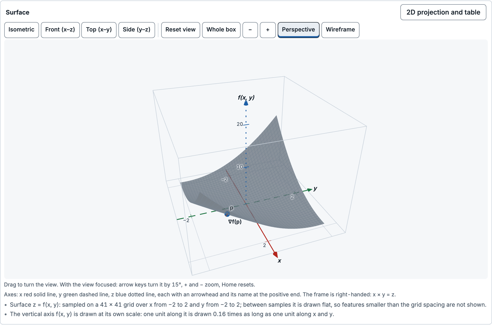
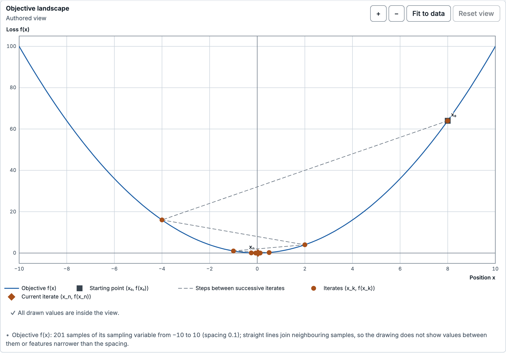
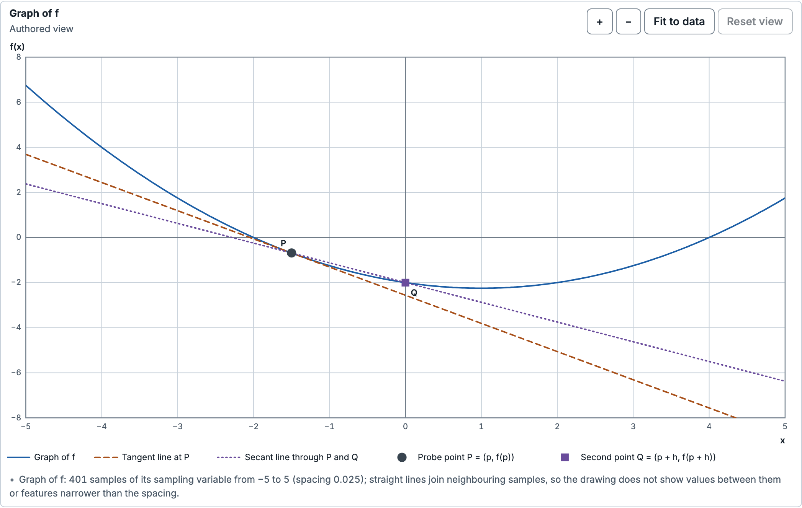
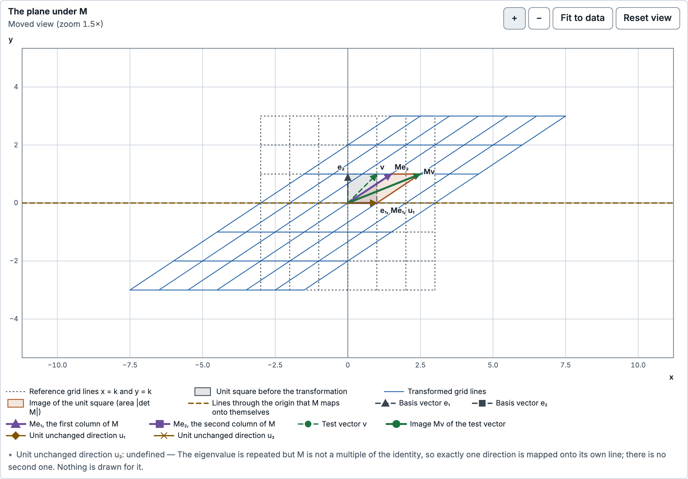
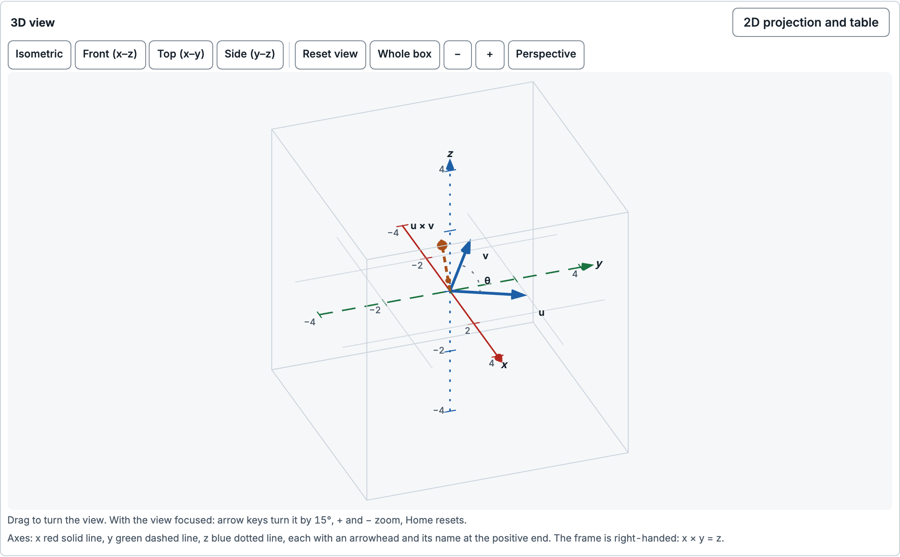
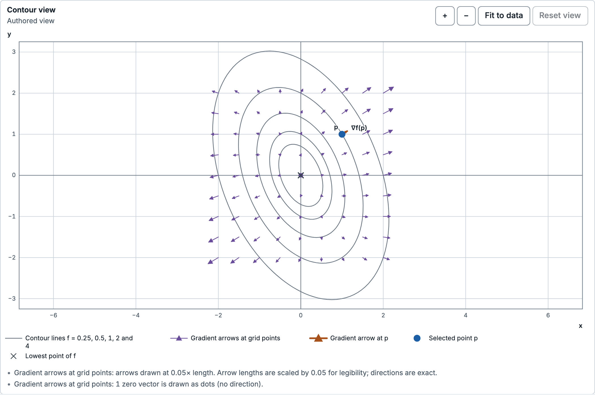

# Explorable Models

**Interactive mathematics, built to be embedded.**

Move a point, change a matrix, or step through an optimization run. The geometry, equations, tables, and numerical
readouts follow the same computed model state.

Explorable Models is the visualization subsystem for **Study Harness**. It combines five ready-to-embed activities,
a browser player for React and plain DOM hosts, and a toolkit for authoring more. Study Harness owns the surrounding
tutoring experience, responses, grading, and learning record; this repository supplies the interactive models and
the boundary between those models and the host application.

[Quick start](#quick-start) · [Visualizations](#visualizations) · [Embedding](#embed-an-activity) ·
[Authoring](#author-new-content) · [Engineering handoff](docs/study-harness/README.md)

[](docs/images/activities/quadratic-surface.png)

*A quadratic surface in the optional 3D renderer. Turn the view, move the point, and compare the gradient with the
model's contours and cross-sections.*

> **Developer preview · 0.3.0-preview.1.** Packages are built locally from this repository. The activities are
> `reference-checked`; independent subject review and actual Study Harness integration remain external gates.
> See [verification and scope](#verification-and-scope) before integrating.

## Visualizations

These are high-resolution captures of the actual learner components, rendered from the production build in
free exploration. Each gallery image is 2,094 pixels wide; click it to inspect the full resolution.
[Capture details and parameters](docs/images/activities/README.md).

### Gradient descent: follow the whole run

Change the step size and curvature, then step, play, or jump to an exact iteration. The objective landscape,
iteration plot, recurrence, and values stay together. This example alternates across the minimum while the distance
to it halves with every update.

[](docs/images/activities/quadratic-descent.png)

### Derivatives: connect a curve, its tangent, and a secant

Drag the probe along the function and change the secant offset. Compare the two slopes, inspect the derivative
plot, and see why a zero secant offset is undefined.

[](docs/images/activities/function-derivative.png)

### Linear transformations: see what a matrix does

Stretch, rotate, shear, reflect, or collapse a plane. The reference grid, transformed grid, basis vectors, unit
square, determinant, and test vector all follow the current matrix. The screenshot shows a shear, framed with
the normal zoom control.

[](docs/images/activities/linear-transformation.png)

### Vectors in 3D: explore orientation and the cross product

Rotate the scene and change either vector. Inspect their angle, dot product, cross product, and coordinate
projections. Exact inputs, keyboard controls, tables, and 2D alternatives accompany the spatial view.

[](docs/images/activities/vector-orientation.png)

### Surfaces: connect the 3D shape to a contour map

The surface activity also supplies a contour view, cross-sections, and a gradient field. Here, a standard quadratic
bowl shows the selected point and the direction of increasing height. Arrow scaling is disclosed in the view.

[](docs/images/activities/surface-contours.png)

The [content guide](docs/study-harness/content-packages.md) documents each activity's model, assumptions, domain,
conventions, and boundary states.

## Quick start

Requires **Node.js 22.12 or newer**.

```sh
git clone https://github.com/jamesliuai/Explorable-Models.git
cd Explorable-Models
npm ci
npm run dev
```

### Run the integration fixture

Open a local activity below. These pages mount the real learner component inside a development host that supplies
policy, persistence, and response handling. Add `&mode=free` for authorized free exploration.

| Activity | Local URL |
| --- | --- |
| Quadratic gradient descent | [Open](http://127.0.0.1:5173/study-harness.html?flow=generic&template=quadratic-gradient-descent&mode=free) |
| Function and derivative | [Open](http://127.0.0.1:5173/study-harness.html?template=function-derivative&mode=free) |
| Linear transformation | [Open](http://127.0.0.1:5173/study-harness.html?template=linear-transformation&mode=free) |
| 3D vector orientation | [Open](http://127.0.0.1:5173/study-harness.html?template=vector-orientation-3d&spatial=1&mode=free) |
| Quadratic surface and gradient | [Open](http://127.0.0.1:5173/study-harness.html?template=quadratic-surface-gradient&spatial=1&mode=free) |

The default [`/study-harness.html`](http://127.0.0.1:5173/study-harness.html) demonstrates a guided quadratic
learning-and-return flow. The [host example](examples/study-harness-host/README.md) covers stage transitions,
responses, saves, restores, and failure injection.

### Try the toolkit locally

The underlying toolkit also includes an [interactive card gallery](http://127.0.0.1:5173/showcase.html), a
[composition studio](http://127.0.0.1:5173/), a [TypeScript experiment gallery](http://127.0.0.1:5173/gallery.html),
and an [embedded hinged-rod example](http://127.0.0.1:5173/hinged-rod.html).

For a production build, run `npm run build`, then `npm run preview`. Serve the output over HTTP; direct `file://`
loading is unsupported.

## What the runtime handles

- **One model state.** Scenes, plots, equations, tables, and readouts bind to identified quantities and frames.
  Undefined quantities carry a reason; numerical limits are explicit.
- **Deliberate interaction.** Drag previews stay tentative until committed. Parameter commits start a new run;
  camera moves and display changes stay in presentation state.
- **Host-controlled disclosure.** The adapter applies the host's policy and persists exposure before revealing
  solution-bearing content. Stage changes use receipts and expected revisions.
- **Recovery and continuity.** Journals, saved artifacts, migrations, guarded restores, and explicit persistence
  states support interrupted sessions.
- **Multiple ways to work.** Exact entry, keyboard operation, tables, text descriptions, and readouts accompany
  direct manipulation. Layout responds to the embedding container; 3D has 2D alternatives.
- **Bounded browser execution.** Pure models run in workers. The optional 3D renderer and math assets load on demand.
  Activities can be captured as SVG or PNG.

The [architecture](docs/study-harness/architecture.md), [runtime](docs/study-harness/activity-runtime.md), and
[security model](SECURITY.md) describe the guarantees and their limits.

## Embed an activity

Build the six local packages with `npm run pack:study-harness`, then install the tarballs from
`release/study-harness/packages/` into your host. The [integration guide](docs/study-harness/README.md#3-integrate-into-study-harness)
covers package hashes, peer dependencies, and the `HostPort` implementation.

```ts
import { createInstalledCatalog } from '@explorable-models/catalog';
import { createStudyHarnessVisualizer } from '@explorable-models/player/activity';

const catalog = createInstalledCatalog({
  reviews: hostReviewRecords,
  revocations: hostRevocations,
});

const visualizer = createStudyHarnessVisualizer({
  catalog,
  host: hostPort,
  surfaceDefaults: { theme: 'system', fonts: 'bundled' },
});

const opened = await visualizer.prepare(activityRequest, {
  operationId: crypto.randomUUID(),
});

if (opened.ok) {
  const surface = visualizer.mount(
    document.querySelector('#activity')!,
    opened.prepared,
    { spatialLoader: () => import('@explorable-models/player-3d') },
  );
  await surface.ready;
}

// When the host tears down: visualizer.dispose();
```

The host supplies policy, response references, receipts, journals, and storage. React hosts can provide a host-owned
response component through `responseSlot`. Follow the [embedding guide](docs/embedding.md#study-harness-learner-surface)
for lifecycle, workers, capture, and content security policy.

## Author new content

Start from an installed activity:

```sh
npm run models -- activity scaffold my-activity --from quadratic-gradient-descent
```

Then validate the package, run its worker-backed checks and independent references, capture its stages, and prepare
a review packet. The [activity authoring guide](docs/study-harness/authoring.md) documents those commands and the
package contract.

For general visualizations, use the [declarative document workflow](docs/declarative-authoring.md) or the
[trusted-local TypeScript workflow](docs/authoring.md). Authored model and check code executes in browser workers.
Source artifacts, declarative documents, and activity records retain their separate versioned formats.

Agents can use the [document tools](docs/tooling.md) or [policy-scoped activity tools](docs/study-harness/agent-tools.md)
to inspect, propose, commit, operate, and save through the same guarded interfaces.

## Verify and build

For development checks, install Chromium and use the repository scripts. The unit/contract tests also require Rust
(the contract crate declares Rust 1.85 or newer).

```sh
npx playwright install chromium
npm run typecheck
npm test
npm run test:browser
npm run build
npm run verify:gallery
```

For release work, `npm run release:study-harness` builds one package set and records all required gates against its
hashes. It covers contracts, independent references, disclosure, migrations, lifecycle, browsers, packed consumers,
budgets, benchmarks, review packets, source packaging, and the packaged native host. Environment gaps stay explicit.
See [release verification](docs/release.md#verify-a-study-harness-release) for prerequisites and narrower commands.

### Verification and scope

The recorded SDK candidate before the namespace rename passed **19/19 effective gates** in run `2026-10-29T05-29-41.307Z`: six affected gates were
rerun and thirteen unchanged passing results were reused with audited provenance. That record includes 2,319 unit
tests, 208 Chromium browser tests, and 356 Firefox/WebKit passes with two documented touch-input skips.

Packaged reference-host run `full-2026-10-29T05:53:42.866Z` passed 168 of 168 checks with the console unlocked.
These are measurements on one macOS machine. The supported packaged drag scope is 30 fps; 60 fps remains an
improvement objective. Dependency ceilings remain 250,000 B gzip for the activity entry and 180,000 B for the retained
2D consumer. [Measurements and methods](docs/study-harness/performance.md).

The namespace has since changed to `@explorable-models/*`, and the command is `explorable-models`
(`npm run models` in this checkout). Previous namespace and command aliases are intentionally unsupported.
The [current rename verification](docs/study-harness/evidence/namespace-rename.json) records the package, CLI, unit,
browser, clean-consumer, and frontend checks separately from those historical package and binary measurements.

The README and gallery captures were refreshed after that candidate verification. The
[handoff](docs/study-harness/README.md), [requirement ledger](docs/study-harness/requirement-ledger.md), and
[historical verification record](docs/study-harness/evidence/history/verification-2026-10-29T05-56-31.791Z.json)
retain the exact scope and provenance. Commit-specific CI results belong to their own run.

Actual Study Harness integration, independent subject review, manual assistive-technology and intended-user checks,
a real configured agent trial, other native/mobile platforms, the network-disabled procedure, and learning-benefit
evaluation remain [external gates](docs/study-harness/external-gates.md). Automated checks establish engineering
evidence; they do not establish those approvals.

## Documentation

| Start here | What you will find |
| --- | --- |
| [Engineering handoff](docs/study-harness/README.md) | Integration checklist, decisions, current evidence, and remaining external work |
| [Embedding](docs/embedding.md) | Activity and document surfaces, workers, persistence, capture, and CSP |
| [Content packages](docs/study-harness/content-packages.md) | The five installed models and their boundary states |
| [Compatibility and rollback](docs/study-harness/compatibility.md) | Format versions, migrations, support scope, and rollback |
| [Packages](packages) | Core, activity, catalogue, player, optional 3D renderer, agent tools, and CLI |
| [Contributing](CONTRIBUTING.md) | Development and verification workflow |
| [Changelog](CHANGELOG.md) | Changes in the current preview |
| [Security](SECURITY.md) | Threat model and reporting |

Packages use the `@explorable-models/*` namespace and the `explorable-models` CLI. MIT licensed; see [LICENSE](LICENSE)
and [third-party notices](THIRD_PARTY_NOTICES.md).
