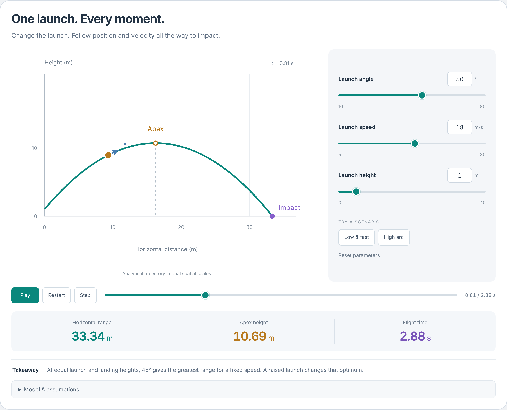
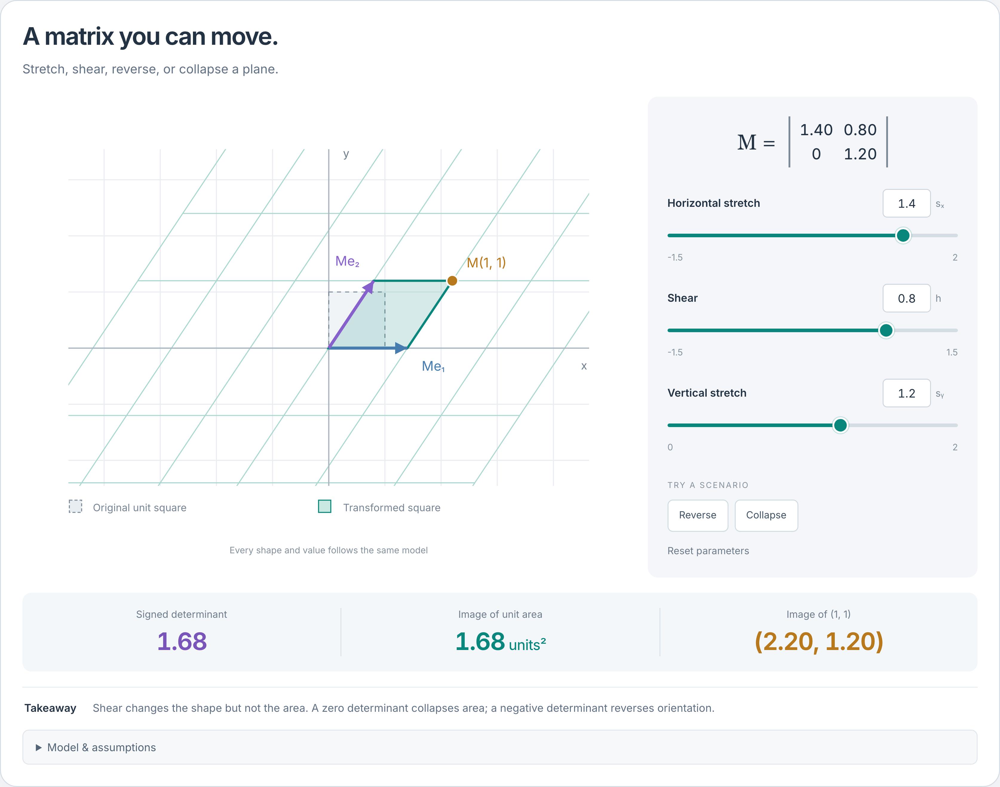
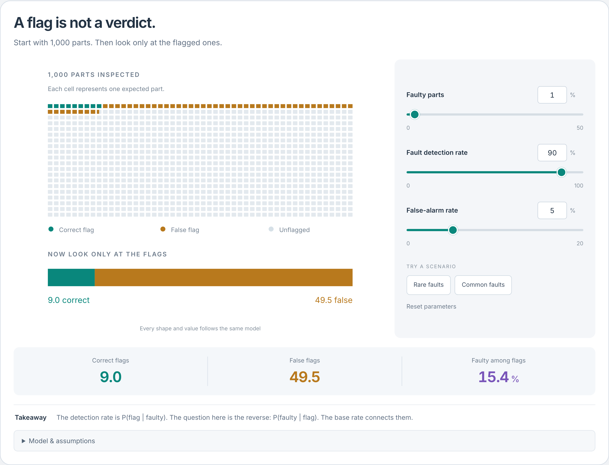

# Explorable Models

**A TypeScript toolkit for interactive explanations and agent-driven authoring.**

Turn a mathematical model into a diagram people can explore. Move a slider, scrub through time, or change a matrix: the geometry, plots, and numerical readouts follow the same computed state.

Developers can embed the browser player in React or plain-DOM applications. Agents can discover the document grammar, compose a visualization, inspect its values, and revise it through provider-neutral tools. Playback requires no AI connection or account.

[Try locally](#try-it-locally) · [Explore the examples](examples/showcase/README.md) · [Embed a visualization](docs/embedding.md) · [Author with tools](docs/declarative-authoring.md)

[](docs/images/showcase/projectile.png)

**One launch, every moment.** Change speed, angle, or launch height; follow position and velocity through the exact impact time. The trajectory, playback, and readouts share one computed model. [Example source](examples/showcase/README.md).

The screenshots show custom React/SVG cards backed by the public document runtime. You can build your own presentation layer or use the generic player for declared scenes, plots, equations, values, and tables.

> **Developer preview:** `0.2.0-preview.1` is available from this source repository. Build local package tarballs for use in another application. npm publication and a hosted demo are deferred; see the [preview contract](docs/agent-first-contract.md).

## Try it locally

Requires **Node.js 22.12 or newer**.

```sh
git clone https://github.com/jamesliuai/Explorable-Models.git
cd Explorable-Models
npm ci
npm run dev
```

Then open one of these local entry points:

| Start here | What you can try |
| --- | --- |
| [Interactive cards](http://127.0.0.1:5173/showcase.html) | Six examples with live sliders, exact inputs, and scenario presets |
| [Composition studio](http://127.0.0.1:5173/) | Create and edit documents; inspect model quantities and views |
| [Hinged rod](http://127.0.0.1:5173/hinged-rod.html) | An embedded conversation card with model-bound acceleration arrows |
| [TypeScript gallery](http://127.0.0.1:5173/gallery.html) | Five source-based experiments, including a rolling body with 2D and 3D views |

## More than physics

**Linear transformations.** Stretch, shear, reverse, or collapse a plane. The grid, basis vectors, determinant, and area change together.

[](docs/images/showcase/matrix.png)

**Probability and base rates.** A detector catches 90% of faulty parts, yet only 15.4% of its flags identify real faults in this scenario. Change the base rate and see why, using expected frequencies and conditional probability.

[](docs/images/showcase/probability.png)

These are screenshots of running examples; click an image for full resolution. The [six-card collection](examples/showcase/README.md) also includes free-body diagrams, wave interference, and refraction through total internal reflection. See the [capture recipe](examples/showcase/README.md#verification-and-captures) to reproduce them.

The composition studio has eight editable presets: waves, coordinate geometry, projectiles, linear maps, Riemann sums, oscillators, supplied data, and probability.

## What the toolkit handles

- **Connected views.** Model quantities are evaluated in a browser worker. Diagrams, plots, numerical readouts, and agent inspection use the same committed frame.
- **Live interaction.** Bounded controls, draggable points with exact alternatives, analytical playback, and comparisons between retained runs. Parameter commits start a new run; presentation edits preserve model state.
- **Guarded edits.** Version checks reject stale mutations. Failed candidates preserve the last accepted visualization, and preview gestures stay tentative until committed or cancelled.
- **Explicit mathematical limits.** Undefined quantities carry a reason. Missing plot samples leave gaps rather than silently becoming zero.
- **Reproducible state.** Saved artifacts carry model revisions and runtime identities. Incompatible restores fail explicitly; the host owns durable storage.

The declarative API supports analytical and parametric models with bounded expressions and numeric datasets. General 3D, numerical differential-equation solvers, stochastic simulation, and arbitrary generated JavaScript are outside that API. Source-based TypeScript experiments have a separate authoring contract.

Your application owns the chat or agent connection, authentication, navigation, and persistence. The toolkit supplies model computation, rendering, interaction, and structured tools.

## Embed in an application

Build and verify matching local packages:

```sh
npm run build:packages
npm run verify:packages
```

Install the tarballs from `release/preview/` as described in the [embedding guide](docs/embedding.md). In a browser client, create a session, accept a document, and mount a player:

```ts
import { createPreset, createVisualizationSession } from '@experiment-kit/core/declarative';
import { mountVisualization } from '@experiment-kit/player';

const session = await createVisualizationSession();
const guard = () => {
  const state = session.getState();
  return {
    sessionId: session.id,
    expectedVersion: state.version,
    ...(state.run ? { expectedRunId: state.run.id } : {}),
    operationId: crypto.randomUUID(),
    origin: 'host' as const,
  };
};

const candidate = await session.createCandidate(createPreset('wave'), guard());
await session.commitCandidate(candidate.id, guard());
const surface = mountVisualization(document.querySelector('#visualization')!, { session });

// On teardown:
// surface.unmount();
// session.dispose();
```

React hosts can import `VisualizationSurface` from `@experiment-kit/player` and render `<VisualizationSurface session={session} />`. The plain-DOM mount uses React internally and isolates its styles in a ShadowRoot. See the [embedding guide](docs/embedding.md) for lifecycle, worker setup, persistence, and SVG export, or the [card example](examples/showcase/README.md) for a custom presentation layer.

## Author with an agent

Agents work through an explicit sequence: **discover → inspect → create or revise → commit → operate and save**. Tools expose schemas, expression capabilities, resource limits, computed state, and repair diagnostics. Edits target stable quantity, series, view, and mark IDs.

Use [`@experiment-kit/agent`](packages/agent/README.md) to connect an agent to an authorized browser session. The local CLI also provides an MCP adapter via `experiment-kit mcp-document`; it supports computational inspection without a mounted visual surface. Configuration and tool schemas are in the [CLI/MCP reference](docs/tooling.md).

For trusted local authors who need pure TypeScript models, start with:

```sh
npm run kit -- init my-experiment --template linear-map
npm run kit -- dev my-experiment
```

The [source authoring guide](docs/authoring.md) covers model bindings, checks, capture, and export. Authored model/check code executes in browser workers, never privileged CLI Node. Source artifacts (schema 1.0) and declarative documents (schema 2.0) have separate formats; they do not silently migrate between runtimes.

## Verify and build

Install Chromium before running browser tests or browser-backed CLI commands:

```sh
npx playwright install chromium
npm run typecheck
npm test
npm run test:browser
npm run build
npm run verify:gallery
```

The production build in `dist/` includes the studio, interactive cards, and galleries. Run `npm run preview` or serve it from a static HTTP host; direct `file://` loading is unsupported. See [release packaging](docs/release.md) for local package and site distributions.

Tests cover reference values, boundaries, undefined states, worker failures, guarded edits, snapshots, exports, and browser interactions. Automated checks and visual polish do not establish independent scientific review, accessibility certification, or learning efficacy. See the [acceptance record](docs/acceptance.md) and [preview evidence](docs/agent-first-release-status.md).

## Documentation and packages

| Resource | Purpose |
| --- | --- |
| [Document authoring](docs/declarative-authoring.md) | Compose and revise models through structured tools |
| [Embedding](docs/embedding.md) | React and DOM integration, workers, persistence, and export |
| [Architecture](docs/architecture.md) | Runtime and state design |
| [Examples](examples) | Interactive cards, source experiments, and host integrations |
| [Reference tests](tests/reference) | Acceptance fixtures kept outside candidate examples |
| [`packages/core`](packages/core) | Contracts, validation, expressions, worker evaluation, and sessions |
| [`packages/player`](packages/player) | Embeddable surfaces, studio, and galleries |
| [`packages/agent`](packages/agent) | Provider-neutral schemas, executor, and session relay |
| [`packages/cli`](packages/cli) | Local authoring, browser coordination, MCP adapters, and export |
| [Contributing](CONTRIBUTING.md) | Development and verification workflow |

The project was originally called Experiment Kit; the `@experiment-kit/*` package names and `experiment-kit` CLI retain that name for compatibility.

MIT licensed. See [LICENSE](LICENSE) and [third-party notices](THIRD_PARTY_NOTICES.md).
