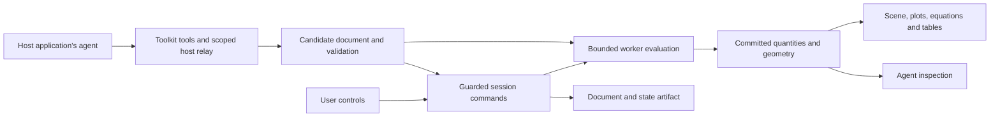

# Agent-first STEM visualization toolkit: implementation and release plan

> **Historical: the 0.2-era plan.** This plan predates the Study Harness implementation report. It is kept as a
> record of the agent-first preview's planning and is not the current specification. The current specification is
> [docs/study-harness-visualizer-implementation-report.md](study-harness-visualizer-implementation-report.md), and
> progress is tracked in the [requirement ledger](study-harness/requirement-ledger.md). Status statements below refer
> to the 0.2 preview.

Planning date: October 22, 2026.

Implementation update (October 22, 2026): the owner selected a verified local preview, with external pilots and publication to be arranged separately. See [the candidate evidence and remaining gates](agent-first-release-status.md). The full supported-release checklist below remains the target; it is not marked complete by the preview.

Status: proposed implementation plan. This document describes future work; it does not change the current public API or claim that the planned features exist. API names and package boundaries below are design targets to validate in the first milestones. The existing working name is Explorable Models.

**1. Product outcome and release definition**

Build an embeddable toolkit that lets an application's agent create, inspect, operate, revise, and save interactive STEM explanations. Breadth comes from composable primitives, editable presets, and controlled extensions. A preset is a document built from public capabilities; it must not be a privileged renderer selected by a topic ID.

The primary customer is a developer building a learning tool, educational website, technical assistant, or explanation interface. Their end users manipulate the resulting visualizations. The customer supplies its own agent, authentication, application shell, and persistence. Playback and manual interaction must work without an agent connection.

The first release of this direction should be a supported pre-1.0 developer release, provisionally 0.2.0, with explicit compatibility rules. Choose the final package names and version before packaging. Do not describe it as a universal scientific simulator or promise unrestricted support for every STEM scenario.

The release-defining test is:

> A developer unfamiliar with the repository installs the distributed packages in another application. Their tool-using agent creates an unfamiliar visualization, makes targeted revisions, shares control with a user, and saves and restores the result using public interfaces alone.

All of these must be true:

- The consumer does not edit toolkit source or depend on repository aliases.
- Basic creation needs JSON-compatible tool input, not shell access, local source files, a compiler, or Playwright.
- Scenes, plots, equations, tables, and agent inspection agree on committed model data.
- Invalid candidates and stale mutations preserve the last accepted visualization.
- Small tasks have a short authoring path; larger tasks can use the same primitives with a custom model or installed adapter.
- The result remains useful and understandable when the agent is disconnected.

**2. Baseline: what exists and what needs to change**

The current project has a dependency-free core SDK, analytical/parametric model contracts, browser-worker execution, strict validation, guarded commands, exact boundary events, snapshots, candidate activation, a React gallery/player, local CLI/MCP tooling, and static exports. These are valuable foundations.

Earlier assessment in this conversation passed type checking, 123 automated tests, and 12 browser tests after allowing local server access. Those results describe that assessed state. They do not validate future changes, constitute an independent scientific review, or replace release-candidate testing.

| Current implementation | Implication for this direction | Planned treatment |
| --- | --- | --- |
| `packages/core/src/runtime.ts`, `worker.ts`, validation and identity code | Strong state and execution foundation | Preserve and extend behind explicit versioned contracts |
| `App.tsx` imports the example registry and owns navigation, URL state, saved runs, and a global bridge | Reusable rendering is coupled to the gallery | Extract an instance-based session and surface; move gallery behavior into an application layer |
| `App.tsx` branches on rolling, linear-map, and base-rates IDs | Rich visuals do not generalize automatically | Implement public primitives and migrate representative examples |
| `GenericScene.tsx` mainly renders 2D arrays as polylines | Geometry types and semantic presentation are too limited | Replace with typed mark renderers and explicit bindings |
| Models are `evaluate({params,time})` with optional time domains | Good analytical scope; no general solver lifecycle | Keep for first release; provide a compatible extension boundary |
| CLI/MCP chiefly operates existing source projects | A hosted tool-only agent cannot easily construct a new visualization | Add document authoring tools over a host-neutral service |
| Core has a standalone package; unified release retains source/tooling layout | Website consumers inherit an awkward distribution path | Package browser integration and agent interfaces independently of CLI compiler tooling |
| Definition identity includes source, views, dependencies, and toolkit identity | Useful reproducibility, but display changes and model changes are tightly coupled | Introduce explicit document/model/presentation identities in the new schema while preserving old artifact rules |
| `CONTRIBUTING.md` says to avoid a general-purpose scene language | Guidance conflicts with the agreed direction | Update it when the new design is adopted; require a bounded composition grammar justified by actual scenarios |

The earlier visual assessment also found an error rounded to `-0` in the Riemann example, dimensionless range labels displayed awkwardly, and mobile parameter controls placed far below the scene. These are concrete usability regressions to address, not reasons to discard the runtime.

**3. First-release scope**

The first supported release should be broad within 2D explanatory visualization. Completeness of the end-to-end workflow has priority over a large component catalog.

| Area | Required for release | Deferred expansion |
| --- | --- | --- |
| Embedding | React surface, imperative DOM mounting, independent instances, host-controlled persistence and theming | Native mobile SDKs, additional framework-specific wrappers |
| Authoring | Compact declarative document, bounded expressions, semantic edits, diagnostics | Arbitrary generated frontend code |
| Geometry | Points, segments, paths, polygons, circles/ellipses, arrows, angle arcs, anchored labels, groups | Full CAD constraints, mesh editing |
| Plots | Line/scatter/bar series, shaded regions, axes, legends, explicit scales and domains | Large-data analytics, specialized statistical chart catalogs |
| Explanatory views | Equations, bound substitutions, values, tables, legends, annotations | Full lesson authoring, assessment and grading systems |
| Interaction | Parameter controls, exact entry, selection, drag bindings, pan/zoom, play/pause/seek/step where applicable | General scripting of gestures or arbitrary event handlers |
| Models | Parametric and analytical expressions, bounded supplied datasets, existing trusted custom-worker path | Numerical ODE/PDE solvers, event-driven simulation, seeded stochastic adapters |
| Linked views | Shared frame, linked selection and highlighting, explicit run comparison | Automatic cross-document synchronization, collaborative multi-user editing |
| Presets | A small editable set covering different compositions | A comprehensive STEM curriculum |
| Agent integration | Provider-neutral schemas and executor, hosted relay example, updated local MCP adapter | A built-in agent service or hosted model subscription |
| Artifacts | Save/restore, exact revision references, portable declarative documents, static export, frozen capture | Video production and arbitrary file export formats |
| Extensions | Host-installed model/renderer capability registration, with a tested example | Public plugin marketplace and automatic package installation |
| 3D | Existing rolling 3D retained under its documented legacy scope where feasible | General 3D creation, surfaces, spatial picking and molecular/physics packages |

Simple node-and-edge diagrams can be composed from existing shapes and connectors. Automatic graph layout and domain-specific circuit behavior are not implied by that support. Vector diagrams use arrows; a general vector-field component is a subsequent extension unless pilot tasks show it is necessary before release.

The three authoring levels are:

1. **Declarative:** a compact document with parameters, expressions/data, and bound visuals. This is the default website-agent path.
2. **Custom model:** a pure worker model with the same quantity and visual contracts. Existing trusted-local compilation remains supported.
3. **Installed extension:** a host-approved renderer or computation adapter, discoverable by capability ID and version. The agent can use installed extensions; it cannot install or grant privileges to them.

**4. Architecture and responsibility boundaries**

Use a small number of public packages. The following is a proposed organization, not a requirement to publish every internal module separately:

| Surface | Responsibility |
| --- | --- |
| `@experiment-kit/core` | JSON contracts, validation, identities, sessions/runs, commands, snapshots, worker protocol; no React or DOM dependencies |
| `@experiment-kit/player` | Browser surface, primitive rendering, controls, responsive layout, imperative mount API and React entry point |
| `@experiment-kit/agent` | Capability/tool descriptions, tool dispatch, candidate authoring and diagnostics; no model-provider dependency |
| CLI distribution | Trusted local compilation, development coordinator, MCP transport, static export and browser capture |
| Gallery application | Navigation, examples, documentation links, saved-run UI and demonstration agent integration, consuming public APIs |

Expression execution, preset definitions and adapter registries can begin as internal modules or subpath exports. Split them into packages only when dependency or distribution requirements justify it.

Keep Playwright, esbuild, Vite, MCP transport dependencies, and local filesystem code out of the website-consumer dependency graph. Keep optional 3D assets out of the default 2D load. Determine the React peer-dependency and imperative-bundle strategy during the packaging spike: a plain-DOM consumer must not need to write React code, and a React consumer must not get duplicate React runtimes. Document the actual installed dependencies honestly.

The data flow is:



The host owns authentication, user/session authorization, agent credentials, document storage, data access and deployment. The toolkit owns document validation, rendering, computation boundaries, mutation semantics, artifact validation and structured errors. A server-side agent dispatching to a browser session requires an explicit relay; in-memory JavaScript references cannot cross that boundary.

**5. Embedding contract**

Design and test the public API against both a React consumer and a plain-DOM consumer. Keep names provisional until these consumers pass.

An integration should approximately support:

```ts
// Design sketch only. These exports do not exist yet.
const session = await createVisualizationSession({
  capabilities: hostCapabilities,
  limits: hostLimits,
});

const surface = mountVisualization(container, {
  session,
  theme: hostTheme,
  controls: 'default',
});

const tools = createVisualizationTools({ session });
// The host registers or relays these tools to its agent.

const unsubscribe = session.subscribe(handleCommittedChange);
const artifact = await session.exportDocument();

unsubscribe();
surface.unmount();
session.dispose();
```

Specify these behaviors before freezing the interface:

- Each session has an opaque identity, its own worker, run state, candidate state and event subscriptions. Session identity is not authorization.
- Surface mounting does not take over the page title, URL, storage keys, global CSS or navigation. Host styles do not silently corrupt toolkit controls. Test repeated SVG IDs and accessibility label IDs across instances.
- Default controls and inspector are optional. A host can render its own controls against the same command API.
- A session can exist before a surface mounts. Separate computational readiness from visual readiness and fail visual-only operations clearly when no surface is available.
- DOM access occurs at mount time. Importing server-compatible entries must not access `window`, `document`, or storage. Document the client-only surface boundary for SSR applications.
- Host events include ready, committed change, selection change, candidate status, error and disposal. Include operation origin and request ID for attribution without creating agent feedback loops.
- Provide explicit storage import/export functions; persistence failures cannot discard the visible working state.
- Resizing, hidden tabs, unmounting during computation, worker failure and repeated mount/dispose cycles have defined behavior.
- Allow host-configured locale and numeric formatting through a documented interface. English-only documentation is acceptable initially; do not hardcode assumptions that make later localization impossible.
- Worker assets resolve from a documented base URL under consumer build tools and CSP. Include an explicit worker-factory override where bundler conventions differ.

**6. Document, calculation and visual contracts**

Create a new versioned document format rather than silently expanding schema `1.0` until its meaning changes. A single machine-readable schema source should drive generated TypeScript/API documentation where practical; add conformance tests for any separately maintained runtime validator.

The document should contain:

- Schema version, stable document ID, title and concise explanatory intent.
- Required capabilities and versions, including installed adapters.
- Parameters with types, defaults, bounds, steps, labels and units.
- A model: expressions, supplied data, or a reference to an installed/custom worker adapter.
- Declared quantities and datasets with shape, meaning, units and undefined/missing-value semantics.
- Views containing typed marks, bindings, controls and presentation metadata.
- Responsive layout and default presentation state.
- Assumptions, limitations, sources and explicit review/check provenance.

Keep the short authoring representation ergonomic. Default cosmetic details, infer schema information where unambiguous, and return the fully normalized document for inspection. Do not invent scientific sources, assumptions, units or review credentials. A static diagram can be represented as a parametric model with constant quantities and geometry; it should not need a visible clock or a separate source project.

**Expressions and datasets.** Define an allowlisted expression grammar with named references, arithmetic, bounded vector operations, selected math functions and bounded sampling. Parse to an AST; validate identifiers, operation count, depth, types and references; reject dependency cycles; evaluate in the worker. Never use `eval`, `new Function`, arbitrary property access, global lookup, dynamic imports, recursion or unrestricted loops for the declarative path. Expressions must preserve undefined/out-of-domain status and reasons.

Constants used as scientific coordinates, values or geometry become declared model data. Cosmetic constants remain presentation data. Calculations for geometry, plotted series and equation substitutions belong in the model/worker path. Renderers may perform documented coordinate projection and display scaling; they must not reimplement physical equations.

Define bounded numeric datasets/series with explicit columns, units and null/missing semantics. The current scalar/vector quantity contract and vector-length cap are not a suitable way to hide arbitrary large tables. Extend the schema and worker protocol deliberately. Host-provided data are validated and revisioned; the model worker does not fetch arbitrary URLs. Default to immutable data snapshots for this release. A changed dataset is a model-input commit with new provenance.

Define what unit checking actually does. For the initial expression operations, validate compatible dimensions for supported arithmetic and require explicit display conversions. Unsupported dimensional reasoning must be reported as unchecked or rejected according to the published operation contract; metadata alone is not dimensional analysis. Use known tests for radians/degrees, affine display conversions if supported, vector shapes and dimensionless quantities. A full symbolic algebra engine is deferred.

**Visual primitives.** Give every view and semantic object a stable ID, typed properties, bounded styling, accessible description and explicit model binding. Support groups, z-order, clipping, explicit coordinate systems and label anchors. Distinguish polylines, polygons, point sets, disconnected segments and missing samples. Do not select fill or shape semantics by searching for words in an object ID.

For scientific scenes, default to equal-axis scaling where geometric meaning depends on it. Plot axes may scale independently when clearly labeled. Provide finite bounds, pan/zoom/reset, and explicit autoscale rules that do not unexpectedly change the physical scale every animation frame. Empty, constant, degenerate and singular data must have defined presentation.

For plots, render declared data or worker-produced series. Specify gaps at undefined samples, sampling density, clipping, log-domain rejection and line interpolation behavior. Do not draw a continuous line through a known discontinuity. Time-series projections into the future must be labeled as predicted/model curves rather than presented as observations already made.

For equations, retain trusted-off math rendering and explicit bindings for substitutions. For readouts, support precision rules and scientific notation; never round a meaningful nonzero error into an unexplained zero. Formatting must not change inspected values.

**Interactions.** Bind dragging to explicit parameter components with axis constraints and domain bounds. Screen-to-model inversion uses the declared coordinate transform. Preview remains tentative until commit; Escape/cancel restores accepted state. Sliders, keyboard control and exact input use the same validation and run semantics. Selection and highlighting propagate through semantic IDs across views.

Support bounded editable presets for sine waves, coordinate geometry, projectile motion, linear transforms, integration, probability and supplied-data exploration. Presets expand into normal documents. A user or agent can inspect and edit the expanded result. Avoid hidden per-topic behavior.

**7. State, revisions and compatibility**

Preserve the current guarantees: pure models, worker-only authored execution, exact boundaries, guarded mutations, tentative previews, explicit incompatibility, retained working revisions, and parameter commits that restart a run.

Use a written state-transition table to distinguish:

| Change | Required behavior |
| --- | --- |
| Scientific parameter or source-data commit | New run at the initial time; old run available subject to retention policy |
| Model/expression/adapter revision | Validate candidate; activate atomically; new run; no silent model-state migration |
| Color, label placement, layout, visibility, camera or display precision | Presentation change; preserve scientific run and time |
| Drag/slider preview | Tentative identity; explicit commit/cancel; protect capture/checkpoint and conflicting mutations |
| Restore | Validate artifact and dependencies; create a run with original provenance |
| Candidate failure or cancellation | Keep the accepted document, run and visible state |

Introduce a full document/artifact revision that includes model and presentation, plus model and presentation identities needed to classify changes. Every rendered view and capture must identify both its model frame and presentation revision. Numeric validation must bind to the model revision it checked; a presentation change requires presentation validation and a new full artifact identity. Never relabel an old full-definition check report as validating new bytes.

Do not infer a presentation-only change merely from an agent's assertion. Classify it from typed fields and dependencies. A unit conversion, binding or coordinate change can affect meaning even if it looks cosmetic.

Keep expected active-run ID, run version and presentation/document version checks as appropriate. A commit from a candidate preview must also detect user changes since the preview's base revision. Define commit behavior if playback advances during preparation: parameter edits restart as usual; presentation edits attach to the accepted scientific state under the documented guards.

Document retention, eviction, session disposal, snapshot ownership and persistence failures. Export must package the exact referenced definitions and required run snapshots, or explicitly state unresolved references. Saving comparison IDs alone is not enough for durable cross-session restoration.

Retain the existing format's strict behavior. Provide one explicit legacy import/conversion path if feasible, with warnings and a new identity; otherwise keep existing immutable exported bundles playable and reject unsupported imports clearly. No silent reinterpretation of old snapshots.

**8. Agent authoring and hosted integration**

Build one authoring service and adapt it to direct calls, host tool descriptors and MCP. Keep model-provider SDKs out of the service. Local MCP compilation can continue for trusted coding agents, while the declarative tools work without local filesystem access.

Proposed tool families:

| Tool family | Required behavior |
| --- | --- |
| Discover | List supported capabilities, limits, versions, schemas and small examples; fetch detailed docs on demand |
| Create candidate | Accept a bounded document or preset plus overrides; return candidate ID and normalization diagnostics |
| Revise candidate | Apply a guarded atomic batch of edits against stable IDs; report changed objects and affected bindings |
| Validate | Return schema, reference, computation and presentation diagnostics with explicit provenance |
| Inspect | Read active/candidate document structure, selected objects, requested quantities and current versions |
| Preview/capture | Render an isolated candidate or pinned accepted state; report readiness and visual availability |
| Commit/discard | Activate a valid exact revision or dispose a candidate without changing accepted state |
| Operate | Existing guarded parameter/playback/view/sample/compare operations |
| Save/restore | Serialize or restore an artifact through host-controlled data transport |

Tool names can consolidate related operations to keep discovery concise. Define machine-readable JSON input/output schemas and bounded resources. Do not return the entire renderer catalog or every sample on every call.

Separate browser preview from screenshot acquisition. Browsers do not expose unrestricted screenshots of their own DOM to ordinary application code. For the declarative 2D path, provide frozen scene/plot export from the supported renderer representation, with explicit SVG/PNG and font/asset limits. Full-surface screenshots, including HTML controls and equation layout, use a host-supplied capture adapter or the existing separate CLI/browser capture path. Capability discovery must report which capture forms are available. Returning an image/resource to a hosted agent must not require a local output filename. Basic create/edit/inspect remains usable without screenshot support; the release's visual authoring trials must include at least one tested image-capable integration.

Candidate lifecycle: draft -> validated for a specific revision -> previewable -> committed, rejected or discarded. For simple documents, allow a convenience create/validate/commit operation using the same lifecycle internally. Make preview policy host-configurable; explicit user approval is not inherently required for every edit.

Semantic edit operations should initially be small: add/remove/replace an object, change a binding, update parameters/expressions, change presentation, and adjust layout. An atomic batch can add a quantity and its binding together. Reject dangling references and show exactly which field needs repair. Avoid index-based array edits as the main agent interface.

Every mutation needs target/session identity, expected revision guards and an operation ID. Specify bounded retry deduplication, cancellation and progress for longer tasks. An interrupted or duplicated request must not create extra runs or partially applied edits. Candidate and result-resource retention limits must be visible.

Errors should include code, document path or object ID, explanation, relevant expected/actual values, and a recovery suggestion. Distinguish unsupported capability, invalid model, undefined mathematical result, conflict, resource limit and execution failure. A successful schema check must not be reported as mathematical verification.

Ship a minimal host relay example: authenticated application request -> allowed toolkit operation -> authorized browser session -> bounded response. Verify request correlation, disconnect/reconnect, expired sessions, multiple tabs, cancellation and user changes during agent generation. Opaque session IDs are insufficient to authorize access. The host decides which session/document the authenticated caller may use; the agent cannot elevate permissions by changing arguments.

Provide one working server-agent/browser-surface example with credentials remaining on the server, and one direct in-process tool example. Select maintained provider integrations during implementation after checking their then-current official APIs. State exactly which real integrations were exercised; protocol compatibility alone is not proof that every agent host works.

Agent-facing examples should teach capability discovery, plan-to-document construction, inspection, focused revision, error recovery and honest handling of unsupported requests. The toolkit need not contain an LLM to be agent-first.

**9. Security and resource boundaries**

Design the website-facing declarative path for untrusted input from the beginning. Review the interpreter, renderer, tool relay and artifact importer together. This is a technical release requirement for the intended use, not a claim that a worker provides adversarial isolation.

- No arbitrary HTML, CSS, JavaScript, event-handler strings, remote worker URLs or dynamic module names in declarative documents.
- Use bounded style tokens, sanitized labels, math rendering with trust disabled, and host-approved asset handles. Define SVG, font, link and image policies explicitly. Unsupported assets fail clearly.
- No agent credentials, application secrets, unrelated DOM, cookies or storage APIs enter model execution.
- Host-authorized data loading happens outside the model worker. Imported data and errors are size-limited; they do not automatically become agent instructions.
- Validate every boundary: tool input, document normalization, expression AST, worker output, renderer input and saved artifact.
- Enforce source/document byte limits, AST depth and operation limits, object counts, data/geometry sizes, evaluation deadlines, sample counts, retained candidates/runs and aggregate session budgets. Limits must agree across adapters and schemas.
- Terminate stalled workers, discard late replies by revision/request identity, and recover without losing the accepted state. A timeout is not a memory quota; also constrain allocations and input sizes.
- Make trusted custom-code execution an explicit mode that the host enables. Keep it out of the default hosted declarative tool set.
- Defer public arbitrary-code compilation to a separate architecture with isolation, resource enforcement and operational ownership. The first release need not offer that service.

Security completion requires targeted misuse tests and a documented review by someone who did not implement the relevant boundary. If that review cannot be obtained, keep the affected hosted mode experimental and narrow the public release claim. Do not use dependency scanning as a substitute for boundary review.

**10. Implementation sequence and milestone gates**

Implement in reviewable changes and keep the gallery working. Early milestones prove the entire path with a small vocabulary; later milestones broaden it. Security, accessibility, packaging and performance checks begin early rather than accumulating at the end.

| Milestone | Work and primary locations | Exit evidence |
| --- | --- | --- |
| M0: contract and baseline | Update architecture/authoring/contribution guidance; define first-release scope, schema decisions, benchmark and support matrix; preserve current artifacts | Agreed API sketch, state-transition table, baseline checks and reference screenshots |
| M1: external embedding | Extract session/surface from `App.tsx`, `useExperiment.ts`, `main.tsx`; add public player exports and packaging; retain gallery as consumer | Packed packages work in external React and DOM applications; two independent instances; cleanup, custom controls, CSP/worker and SSR-import tests |
| M2: smallest complete agent path | Add minimal document/expressions/plot/slider; authoring service; create/inspect/revise tools; host relay | Tool-only agent creates sine wave, adds a second curve and annotation, changes a parameter, saves and reopens; no filesystem/compiler access |
| M3: composition and state | Expand primitives, bindings, datasets, linked views, semantic edits, revisions and candidate lifecycle | Several unfamiliar compositions; exact frame agreement; presentation changes preserve runs; stale/cancelled edits and failures preserve accepted state |
| M4: presentation and presets | Migrate representative examples, add editable presets, responsive controls, precision, labels and accessible alternatives | Default/boundary/mobile visual review, keyboard tasks, screen-reader checks, cross-browser tests and extension proof |
| M5: external trials and hardening | Blind agent trials, developer integration pilots, user tasks, performance profiling, misuse tests, compatibility/artifact work | Recorded passes/failures, repaired high-impact friction, published support limits, independent boundary review |
| M6: release candidate | Final package/export pipeline, documentation, license inventory, CI, fresh-install tests, release evidence | All mandatory gates pass for exact packed candidate; docs commands and examples reproduce |
| M7: public release and maintenance | Publish packages/docs/gallery, record hashes/tag/changelog, open support channels, monitor reported regressions | Public install and demo smoke test; rollback and patch process verified |

M1 and M2 are the first product-risk checkpoints. If basic embedding or tool-only generation remains awkward, repair that interface before expanding the mark catalog. M3 should be driven by examples requiring combinations of existing primitives. M5 feedback may reopen M2-M4; it is a genuine decision gate.

Do not promise dates before M2. Estimate subsequent milestones from measured implementation and repair effort. For planning, treat this as a substantial multi-milestone SDK change rather than a UI polish pass. Calendar estimates depend on contributor availability, security review and access to pilot users.

**11. Initial implementation backlog**

These are proposed review-sized work packages, with splitting allowed when changes grow too large:

1. Record baseline results/artifacts and add the new contract, compatibility and benchmark decisions. Reconcile `CONTRIBUTING.md` with this direction.
2. Extract reusable session ownership and lifecycle; move URL/title/storage/gallery registry behavior out of the surface.
3. Build player package exports and external consumer fixtures using tarballs, including two instances, strict cleanup and worker resolution.
4. Define the new document schema and normalizer for a sine-wave slice, with stable IDs and explicit scientific/presentation separation.
5. Implement bounded expression parsing/evaluation and a basic plot/slider/readout over the worker protocol.
6. Add candidate service, create/inspect/revise operations and structured diagnostics, preserving accepted state.
7. Build the minimal authenticated host relay example and demonstrate a real server-agent-to-browser round trip.
8. Extend primitives and model data for geometry, multiple series, tables, equation bindings, linked selection and explicit layout.
9. Complete atomic semantic editing, revision identities, retry behavior, concurrency guards, cancellation and artifact round trips.
10. Add drag/exact-input alternatives, responsive ordering, numeric precision, scene descriptions and manual accessibility evidence.
11. Convert linear-map, Riemann sums and analytical oscillator to public composition; add projectile, triangle and supplied-data examples; retain legacy adapters where conversion would expand scope without proving generality.
12. Prove a host-installed extension with no core edits; publish its lifecycle and trust contract.
13. Run external trials, profile workloads and perform boundary review; fix the observed blockers.
14. Complete docs, CI, compatibility checks, distribution, licensing, clean-install verification and the release evidence record.

Core type/runtime changes must have tests for the invariant they can break. Avoid broad formatting or refactors unrelated to these boundaries. Do not add a dependency for one example without checking its impact on runtime size, licensing and worker compatibility.

**12. Test strategy and evidence**

Use a layered test matrix. Most cases should assert observable contracts rather than mirror implementation details.

| Layer | Required evidence |
| --- | --- |
| Schema and expression contract | Cross-references, type/dimension rules, cycles, malformed inputs, bounds, undefined propagation, discontinuities and resource limits |
| Numerical references | Independent fixtures, known transformations, degenerate cases, invariant checks, and deliberate errors that the suite must detect |
| Runtime | Guards, exact boundaries, previews, restart semantics, presentation isolation, candidate activation, cancellation, retry deduplication and late worker messages |
| Visual representation | Screen geometry agrees with model coordinates; equal-axis behavior; projections, labels, precision and unit conversions; no formula duplication |
| Agent workflow | Create, targeted edit, repair, inspect, capture, save/restore; conflicts with human edits; unsupported requests and capability discovery |
| Consumer integration | Packed distribution, external builds, multiple instances, custom controls, CSS isolation, worker URLs, SSR-safe imports and disposal |
| Artifacts | Export/import validation, exact revisions, missing adapters/data, retained comparison runs, integrity inventory and offline playback over HTTP |
| Security | Interpreter and serialization misuse, HTML/math/asset injection, excessive allocations, invalid worker replies and unauthorized relay targets |
| Accessibility | Keyboard, nondrag alternatives, focus, meaningful labels/descriptions, non-color distinctions, reduced motion and manual assistive-technology tasks |
| Performance | Defined workloads and device/browser records; interaction latency, rendering cost, memory retention and initial-load dependency budget |

Keep numerical acceptance fixtures in `tests/reference/fixtures`. During blind agent trials, place evaluation fixtures outside the candidate's writable space. Report who authored fixtures, what the agent could see, and which assertions were independently reviewed. Author checks cannot promote themselves to independent provenance.

Maintain current checks and add release-specific consumer/agent suites. Existing commands remain required after relevant code changes:

```sh
npm run typecheck
npm test
npm run build
npm run test:browser
npm run verify:gallery
npm run build:sdk
```

Update commands as package boundaries evolve, and document replacements. Regenerate revisions and production artifacts after source/runtime/lock changes. Run the candidate against packaged output as well as the development tree. Current browser tests are primarily Chromium; add Firefox/WebKit coverage for critical supported flows and test actual Safari before advertising Safari support. Record an exact support matrix instead of claiming every browser works.

Visual inspection is required at default, interior, terminal, degenerate/undefined and mobile states. Include 390, 1024 and 1440 px widths, container resizing inside another page, zoom and long labels. Screenshots supplement numerical representation checks; neither substitutes for the other.

**13. Usefulness and authoring evaluation**

Build openly with these development tasks: sine-wave controls; linked projectile scene/plot; draggable triangle; linear transformation; Riemann sums; analytical oscillator; and supplied measurements with an explicitly defined overlay. The built-in base-rate example can remain a regression and can be migrated when the common primitives cover it cleanly.

Use concrete acceptance cases such as these, with separately authored fixture derivations:

| Development case | Minimum behavior and reference |
| --- | --- |
| Wave | For `y = A sin(2π f x)`, `A = 2`, `f = 1`, the value at `x = 0.25` is 2 within numerical tolerance; adding a comparison curve preserves the first curve's definition |
| Triangle | Vertices `(0,0)`, `(3,0)`, `(0,4)` produce area 6 and sides 3, 4, 5; dragging and exact entry yield the same committed vertices and quantities; a degenerate triangle has explicitly defined angle behavior |
| Projectile | With `g = 10`, initial velocity `(3,4)` and initial position `(0,0)`, return to ground is at 0.8 seconds and range is 2.4; the terminal event does not invent zero velocity |
| Integration | The existing `x²` midpoint fixture at 100 subdivisions gives approximately 0.333325; its nonzero error is distinguishable in the primary display |
| Supplied data | Points `(0,1)`, `(1,3)`, `(2,5)` align with the explicitly supplied overlay `y = 2x + 1`; missing rows create documented gaps, and a changed dataset creates a new input revision |
| Presentation revision | Recolor a path, move its label and change panel layout; preserve scientific parameters, active run and time while advancing presentation/artifact identity |
| Failed revision | Introduce a missing quantity reference or invalid expression; report the relevant object/path and preserve the accepted model and screen |

These are known development cases, not the held-out success benchmark. Keep a separate test for each representation failure that numerical fixtures alone cannot catch, such as a mirrored arrow or a curve joined across an undefined interval.

Reserve at least ten held-out task briefs spanning mathematics, mechanics, basic statistics and schematic diagrams within the declared capability envelope. Include new combinations rather than simple copies of presets. Each brief must include a creation request, a focused revision, an interaction or boundary case, and save/reopen. Reserve a few out-of-scope requests separately to test truthful capability handling; do not count them as successful supported authoring tasks.

Run each held-out task in two fresh agent configurations or hosts that receive only published tool documentation and allowed data. This creates at least twenty recorded attempts. Keep configuration, budget, task order and evaluation rules fixed before the run; preserve failures. A small trial is an engineering release gate, not statistical proof of market demand or universal agent reliability.

Proposed first-release gate:

- Each tested configuration completes at least 8 of 10 supported tasks end to end without human source repair.
- Every counted success passes its numerical, interaction, revision-preservation and artifact checks. Attractive but incorrect results do not pass.
- There are no unresolved reproducible silent-corruption, stale-overwrite, cross-session access or state-loss failures in the mandatory suite.
- Tool calls, elapsed time, token usage where available, retries and human interventions are recorded. Missing measurements are marked missing.
- At least three developers unfamiliar with the repository independently perform the documented basic integration. Target completion within 30 minutes from stated prerequisites; record machine setup separately and revise onboarding if they need undocumented help.
- At least three intended end users complete parameter changes, comparison/inspection and save/reopen tasks. Record confusion and repeated work, not just completion. Include keyboard-only and a manual screen-reader task; automated accessibility checks alone are insufficient.
- At least two pilot integrations use the toolkit inside an actual application workflow and report on usefulness after trying a follow-up task. Do not treat a favorable demo reaction as repeat-use evidence.

Also run a small matched comparison on three representative tasks against ordinary generated application code, using the same agent and budget. Record first creation and subsequent revision effort. This is a diagnostic for avoidable authoring overhead. Do not make a comparative advantage claim unless the results support the specific claim and limitations are published.

If the gate fails, classify failures as unsupported capability, documentation/schema discoverability, model reasoning, rendering, integration or operational behavior. Repair recurring toolkit-caused failures, then rerun with fresh variants so prompt tuning to known tasks does not masquerade as generality.

**14. Performance, usability and quality budgets**

At M1-M2, record a reference desktop and a real mobile device/browser. Freeze benchmark workloads before final optimization. Initial proposed targets are p95 commit-to-visible-response below 100 ms for the declared small interactive workload and no main-thread work that repeatedly blocks controls. These are targets, not measured project properties. Where worker startup or heavy computation has a different budget, show progress and allow cancellation rather than pretending every operation is immediate.

Suggested workloads: two simultaneous simple documents; a plot with roughly 1,000 samples and a few linked readouts; a scene with approximately 100 semantic objects; a bounded larger dataset at the published limit; and a mount/edit/dispose stress cycle. Adjust limits from measured evidence before documenting support. Test hidden-tab recovery and rapid gesture cancellation.

Set an initial-load bundle budget after the packaging spike and block unexplained regressions. Report compressed JavaScript, worker payload, fonts and optional assets separately. Default 2D consumers must not fetch Three.js, CLI tooling or model-provider SDKs. Establish memory stabilization over repeated session lifecycles; raw one-time memory size is not enough to diagnose leaks.

Presentation release checks include:

- Controls stay close to the affected scene on narrow screens; no horizontal page overflow.
- Label anchors remain meaningful under resizing and dragging. Provide a documented collision strategy and allow explicit placement overrides; do not claim universal automatic layout quality.
- Finite small values and errors remain visible with appropriate precision; suppress negative-zero formatting only when it does not hide meaningful nonzero values.
- Undefined values carry a reason in visible/accessible inspection and do not silently disappear or become zero.
- Missing units, scaled vectors, probabilities versus expected counts, and predicted versus observed curves are clearly distinguished.
- Selection is conveyed by more than color, focus is visible, and animation does not overwhelm assistive technology announcements.
- Empty, failed, loading and unsupported states tell the user what happened and preserve a recovery route.

**15. Documentation and distribution deliverables**

Required documentation:

1. A short product explanation and exact supported capability table.
2. React and plain-DOM quickstarts that work from published/packed packages.
3. A complete server-agent/browser-session example with the host's responsibilities spelled out.
4. A compact document tutorial, from one curve to linked views and targeted edits.
5. Generated schema/API references and capability examples that agents can retrieve selectively.
6. An expression/data reference with limits, units, undefined behavior and unsupported operations.
7. An agent cookbook covering creation, inspection, repair, revision, conflicts and unsupported requests.
8. Custom model and installed-extension guides, including trust boundaries and lifecycle tests.
9. Hosting/CSP/worker configuration, asset paths, SSR boundaries and browser support.
10. Persistence, export, compatibility, legacy artifact handling and version-upgrade guidance.
11. Accessibility and responsive-layout guidance for hosts using custom controls.
12. A troubleshooting guide based on observed pilot failures.
13. Contribution, security reporting, licensing, release and support policies.

Create a public gallery that exposes the source document, model assumptions and check status for each example. Let visitors inspect or copy an example and demonstrate one targeted revision. Provide deterministic replay or recorded output when a hosted agent service is unavailable; label it accurately. A public live agent service introduces credential, abuse and cost obligations and is optional for the toolkit release.

Build distribution from public package entry points. Test tarball installation in clean external directories. Confirm declaration files, exports maps, CSS, worker assets, peer dependencies and licenses. Avoid monorepo-relative imports and source-layout assumptions. Keep the local authoring CLI available as a separate installation path.

Declare how dependency versions are captured for exported artifacts versus reusable libraries. Preserve reproducible export identities without forcing every host application's dependency lock to become the model's semantic identity. Pin the actual execution adapters/runtime used by an exported artifact. Validate cache keys and asset-base behavior under subpaths and static hosts.

Keep the MIT license for original code unless intentionally changed, preserve third-party notices, audit preset/example sources and assets, and choose package names after checking availability. Establish a working private security-reporting destination and public issue template before publication. No telemetry should be added by default; if diagnostics are host-configurable, document exactly what is collected.

**16. Release checklist and stop conditions**

The release candidate is ready only when every mandatory item below has recorded evidence for the exact candidate version. A hosted demo alone is insufficient.

- [ ] First-release scope, package names, schema/runtime versions and browser/host support matrix are frozen.
- [ ] React and DOM integrations work from packed output with multiple independent instances.
- [ ] A real host agent creates and revises declarative visualizations without local filesystem/compiler access.
- [ ] Capability discovery matches shipped behavior; no silent fallback implies support for missing features.
- [ ] Numerical/frame/representation invariants and exact boundaries pass independent reference cases.
- [ ] Candidate failure, cancellation, retries and concurrent human edits preserve accepted state.
- [ ] Presentation changes preserve scientific state; model-input changes restart runs as documented.
- [ ] Small-document authoring is concise; presets remain fully editable public documents.
- [ ] Save/import/export/capture pin revisions and reopen with required dependencies and comparison data.
- [ ] Legacy artifacts have a documented, tested preservation or explicit conversion/rejection path.
- [ ] Required automated suites, cross-browser checks and manual default/boundary/mobile inspection pass.
- [ ] Keyboard and manual assistive-technology workflows have evidence; accessibility claims match the scope tested.
- [ ] Declarative execution, rendering, relay and import boundaries pass misuse tests and independent review.
- [ ] Performance and dependency budgets are measured on declared workloads and devices.
- [ ] External integration, blind authoring and pilot usability gates pass, with failures retained in the record.
- [ ] Docs quickstarts and example commands have been exercised in clean consumer environments.
- [ ] Tarball inventories, licenses, dependency review, asset hashes and package metadata are checked.
- [ ] CI reproduces the candidate checks; credentials and local connection artifacts are absent from distributions.
- [ ] Release notes state supported scope, known limitations, compatibility and actual review status.
- [ ] Maintainer contact, issue reporting, security reporting and patch/rollback procedures exist.

Release-blocking examples include a stale edit overwriting a user's work, values disagreeing across views, a saved document that cannot restore under its declared support, a renderer or interpreter escape, an unauthorized relay target, and a consumer installation requiring undocumented internal source access. Cosmetic issues can be documented only when they do not obscure scientific meaning or block a supported interaction.

If mandatory evidence is missing, release an explicitly limited preview to gather that evidence, or narrow the support claim and retest the smaller scope. Do not mark missing gates complete because automated tests pass.

When the candidate is ready, publishing is a separate operational action: create the release tag and changelog, publish the reviewed artifacts, deploy documentation/gallery, then run public-install and hosted-demo smoke tests. Record package integrity values and artifact URLs. Keep the previous immutable artifacts accessible, use a documented rollback/dist-tag process, and communicate affected versions if a serious issue is found.

**17. Work after the first supported release**

Choose expansion from actual unsupported requests and repeated integration friction. Track the request category, current workaround, user impact and implementation/maintenance cost.

Likely next capabilities are vector fields/heatmaps, richer schematic connectors, general 3D surfaces/cameras/picking, deterministic numerical adapters and seeded stochastic models. Before adding a stateful adapter, define initialization, stepping, event handling, checkpoint/restore, replay, tolerance, cancellation and resource limits. Keep reproducibility claims tied to a declared runtime and numerical tolerance; cross-platform floating-point identity is not automatic.

General 3D should reuse semantic IDs, bindings, selection, quantities and agent edits rather than introduce a disconnected authoring system. Specialized circuit, molecule or physics packages should register approved capabilities against the same extension interface.

Public code compilation, collaborative authoring, plugin marketplaces and very large datasets are separate projects requiring demand and operational ownership. They should not delay proving the first useful embedding and agent workflow.

**18. Immediate next action**

Start with M0-M2: extract the reusable session/surface, install packed packages in a separate consumer, and let a tool-only agent create a sine wave, add a second curve and annotation, revise it, and save/reopen it. Preserve the current gallery and runtime tests throughout.

That complete workflow is the first proof that this project has become the toolkit described here. Every subsequent primitive, preset and extension should enter through that same public path.
