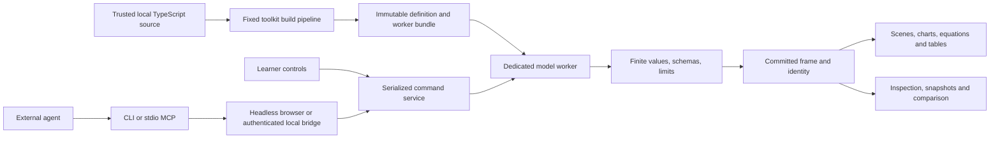

# Architecture and supported contract

> **Current architecture:** the Study Harness visualization subsystem (`@experiment-kit/activity`,
> `@experiment-kit/catalog`, `@experiment-kit/player/activity`, `@experiment-kit/player-3d`, the activity tools and
> authoring commands) is described in [docs/study-harness/architecture.md](study-harness/architecture.md), with
> decisions D1–D16, and indexed in the [handoff](study-harness/README.md). This page still describes the original
> schema 1.0 runtime, which is unchanged and retained for existing exports.

This document describes the original schema 1.0 runtime. The additional schema 2.0 agent-first preview is specified in [the versioned contract](agent-first-contract.md); its reusable player entry does not import the legacy gallery or topic-specific adapters.

Explorable Models 0.1 is a local authoring toolkit and portable browser player. The product unit is an immutable experiment definition plus a reproducible run. The player does not need an AI connection; an external agent uses the CLI or MCP adapter to inspect and operate the same runtime that learner controls use.

## Packages and data flow



| Location | Responsibility |
| --- | --- |
| `packages/core/src/types.ts` | Public JSON-compatible contracts for manifests, quantities, views, runs, commands, and reports |
| `packages/core/src/validation.ts` | Runtime validation, cross-reference checks, finite-number checks, and resource limits |
| `packages/core/src/schemas.ts` | Discoverable JSON schemas for manifests, commands, time points, and snapshots |
| `packages/core/src/runtime.ts` | Shared command service, run lifecycle, snapshots, isolated samples, comparison, and revision activation |
| `packages/core/src/worker.ts` | Worker protocol, model-kind validation, watchdog, and explicit trusted-test executor |
| `packages/player/src` | React player, semantic SVG views, lazy Three.js view, controls, inspection, saved states, and export UI |
| `packages/cli/src/compiler.ts` | Toolkit-owned esbuild/Vite build and source import allowlist |
| `packages/cli/src/browser-harness.ts` | Browser-side adapter over the core runtime |
| `packages/cli/src/coordinator.ts` | Authenticated loopback preview-session coordination |
| `packages/cli/src/mcp.ts` | Standard stdio MCP tools and bounded result resources |
| `packages/cli/src/artifacts.ts` | Static/source exports, checks, hashes, and archives |
| `examples` | Three launch reference examples and two extension examples, with model cards and source |
| `tests/reference/fixtures` | Acceptance values outside the example source directories |

The SDK has no runtime dependencies and ships as ESM JavaScript, TypeScript declarations, and editable source. The renderer uses React, SVG with D3 utilities, Three.js for the optional spatial view, and KaTeX with trust disabled. Dependencies are pinned in the root lockfile. Exact release dependency and MCP SDK versions are recorded in `package.json` and `package-lock.json`; the MCP SDK negotiates its mutually supported protocol with the client.

## Authoring files

An experiment contains `experiment.json`, `model.ts`, `views.json`, `checks.ts`, `model.md`, and transparent `fixtures.json` data. Authors can import local TypeScript/JSON helpers. The supported model is an analytical or parametric function:

```ts
interface AnalyticModel<P extends Record<string, number | string | boolean>> {
  kind: 'analytic' | 'parametric';
  timeDomain?(parameters: Readonly<P>): {
    start: number;
    end: number | null;
    endEventId?: string;
  };
  evaluate(input: Readonly<{ params: P; time: number }>): Evaluation;
}
```

Analytical models declare a time interval. Parametric models have time zero and no advancing clock. A finite terminal time is a model boundary, not an invented stop that erases velocity. A horizontal ramp has a `null` end, never `Infinity`.

A 2D view can declare fixed `bounds: { x: [minimum, maximum], y: [minimum, maximum] }` in the geometry's units. Both intervals must have finite ascending endpoints. Keeping coordinate extents in view data lets a generic renderer show motion against a stable scale without adding topic-specific mathematics to the runtime.

Quantity definitions name the label, scalar/vector shape, unit, dimension, meaning, and optional entity/reference-frame/sign convention. Each value is either finite numerical data or `null` with an explicit `undefined`/`out_of_domain` status and reason. Geometry has a declared shape, coordinate frame, unit, and element bound. Unknown or missing quantities, malformed vectors, missing declared geometry, and nonfinite data are rejected before rendering.

Model functions are intended to be pure. The runtime freezes input objects and the independent tests check repeat evaluation, but neither TypeScript nor a checksum proves mathematical correctness or arbitrary-source purity. The runtime does not implement a computer algebra system or a general physics engine.

## Definition, run, frame, and view identity

A `definitionRevision` is a SHA-256 digest of the normalized definition, source, dependency lock, and toolkit build identity. It identifies bytes and semantics; it is not a review credential. The gallery revision generator and CLI compiler retain the inputs needed to reproduce that identity.

A run has one immutable definition revision, a parameter set, a clock, and a command version. Accepted scientific parameter edits create a new run at the beginning of the domain. Earlier runs remain available for explicit comparison; checkpointed runs are retained within session bounds. Reset and seek operate on the current run. Restoring a snapshot creates a new run and preserves the source run ID as provenance.

Every accepted run mutation requires both `expectedRunVersion` and `expectedActiveRunId`. This protects against a newer learner edit even when two different runs both start at version zero. Mutations enter a serialized queue. A stale operation returns `CONFLICT` with the current identities and does not change the accepted state. Camera, selection, layers, and playback speed use a separate `expectedViewVersion`.

Playback uses a 120 Hz numerical clock grid, independently of how often the browser renders. Playback ticks do not increment the command version. A terminal event stores its unrounded computed floating-point time and event ID. An isolated sample can request an exact time without becoming a playback tick. `frameId` hashes revision, run, version, canonical time point, and any transient-preview identity. It is opaque; clients should not parse it.

A transient preview has tentative parameters and a separate identity. Inspection marks it as tentative. Agent mutations and checkpoints return `BUSY` while that preview is active. Commit creates a new run; cancellation restores the committed state. The browser's exact numeric entries may also remain an uncommitted local draft until Enter or blur. A draft is not a saved scientific state.

`getTimeDomain()` resolves through the currently active executor, including after revision activation. It does not instantiate an older model factory or change the learner's run.

## One inspection and mutation surface

The SDK exposes `describe`, `inspect`, `getState`, `guard`, `command`, `getTimeDomain`, `sample`, `compare`, `checkpoint`, `verify`, and `activateRevision`. The CLI and MCP wrap this service rather than maintaining a second mathematical implementation. Model output supplies numerical substitutions and data attributes that browser tests can compare with inspection.

`sample` evaluates a bounded separate run. `compare` requires explicit retained run IDs and time samples, reports parameter differences, and stops each trace at its own terminal event. It does not silently extrapolate a model beyond its domain. Large MCP results are made available as bounded JSON resources rather than flooding tool context.

The local preview coordinator registers browser sessions. Multiple tabs require an explicit session ID. Connecting to a live session does not recompile editable source: a temporarily invalid edit cannot block inspection or control of the last good revision. Headless operations launch the same compiled worker in Chromium. Frozen capture resolves the retained bundle for the requested snapshot revision, uses a separate player instance, waits for restoration, render readiness, and fonts, and records the resulting frame, view, viewport, and definition identity beside the PNG.

## Source revisions and atomic activation

The compiler builds candidate source without replacing the running experiment. The candidate's schemas, worker initialization, and authored quantitative checks run in a separate browser. Activation requires a passing report for the exact candidate revision, the expected current definition revision, and the active run guards. A failed build, failed evaluation, failed check, or stale guard preserves the previous accepted definition and frame.

Activation restarts scientific state under the new definition. Initial and activated bundles retain their own entry points for revision-specific capture while the preview's main entry point advances. The previous runtime bundle remains retained for the session; source control and exported immutable artifacts provide durable history. Automatic migration of arbitrary internal model state is not part of 0.1.

Technical checks and model review remain separate. An author check suite cannot promote itself to independent reference provenance in the CLI worker path. All supplied examples currently retain `review.status: 'unreviewed'` until an independent subject reviewer signs a specific scope. No learner-efficacy claim is encoded in a successful check report.

## Persistence and distribution

Source, executable bundle, and snapshot are distinct artifacts. A snapshot records schema/runtime versions, exact definition revision, parameters, time point, view state, comparison references, and optional annotations. A mismatched definition or schema returns `INCOMPATIBLE_SNAPSHOT`. Browser storage is a convenience; downloaded JSON and exported source/bundles are the durable transfer path.

An export contains a browser entry point, local assets, source, model card, metadata, check report, dependency lock, and an asset-hash manifest. The tested playback path is a local or hosted HTTP server. Direct `file://` worker loading is not supported. `?embed=1` removes the outer gallery chrome for embedding. No API key or model-provider session is required for playback.

## Execution boundary and limits

Version 0.1 supports trusted local authoring and playback of trusted exported bundles. It does not safely execute adversarial uploads.

- Candidate model and check modules execute only in a dedicated browser worker. The privileged Node process bundles their text and orchestrates a trusted harness.
- Compiler configuration is toolkit-owned. Candidate package scripts, Vite configuration, build hooks, arbitrary packages, remote imports, and dynamic imports are not loaded.
- Source imports must remain within the experiment directory. Source transfer uses an explicit allowlist plus resolved helpers; connection files, `.env`, chat history, and unrelated local files do not enter exports.
- The preview binds to loopback, checks Host/Origin, requires a random session token, uses same-origin resource policy, and prevents static symlink escapes. Worker responses use a restrictive network policy.
- Worker watchdogs terminate nonresponsive evaluations. The SDK default is 2 seconds; the authoring browser runner uses 3 seconds. The last good frame remains accepted.
- Runtime limits include 64 parameters, 256 quantities, vectors of at most 64 elements, 50,000 geometry coordinates, and at most 1,000 samples per bounded request. Source is limited to 128 files and 2 MiB; CLI ZIP export is limited to 64 MiB.

A browser worker is not a security sandbox or a universal memory quota. Public upload execution, isolated runner origins, remote compilation, arbitrary plugin code, and hostile-source testing need a separate architecture. Standard static hosting must also apply its own response security policy; an exported folder cannot configure every hosting server.

## Extension decisions

The launch models are rolling bodies, linear maps, and conditional probability. Riemann sums and a closed-form oscillator demonstrate additional domains through the same runtime. The oscillator is analytical; it is not a numerical integration adapter. Seeded stochastic state, discrete stepping, numerical solvers, MCP Apps embedding, hosted tutors, accounts, curricula, public uploads, and collaborative editing remain outside the implemented 0.1 scope.

A small independent runtime was implemented to deliver the requested reusable project. The comparative M0 experiment against ordinary generated web code and a Mojulo extension was not performed. The implementation therefore makes no claim of lower maintenance, lower repair cost, or superior learning outcomes. The separate acceptance record describes the reproducible software checks and the empirical work still needed before making those claims.
