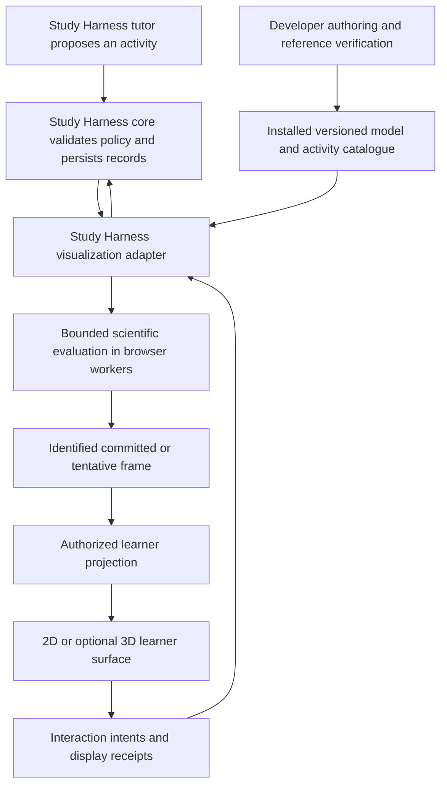

# Study Harness Visualizer Implementation Report

Turn Explorable Models into the complete visualization subsystem for Study Harness

Prepared 25 October 2026. Repository baseline: `910c03a3ef278532024df6ffedc878572e8dc093`, version `0.2.0-preview.1`. This is an implementation specification; the proposed capabilities are not claims about the current release.

Reading guide: [current gaps](#3-current-implementation-and-concrete-gaps), [target architecture](#4-target-architecture-and-ownership), [required activities](#12-required-activity-and-content-packages), [implementation work packages](#20-implementation-sequence-and-work-packages), [acceptance matrix](#21-acceptance-matrix), and [ready-to-use agent goal](#222-ready-to-use-implementation-goal).

## 1 Decision and intended outcome

Revise this repository around Study Harness as its primary integration target. Retain the mathematical runtime, browser-worker execution, guarded commands, revision identities, and useful reference tests. Build a dedicated activity adapter and learner surface. Replace existing UI and internal abstractions where they obstruct the requirements below. Keep the complete Study Harness tutor in a separate application repository.

The finished subsystem must let Study Harness select an approved mathematical activity, collect a prediction before revealing results, support responsive local experimentation, present equivalent accessible information, record what the application exposed, and restore the activity after a restart. It must also support explicitly exploratory scenes without misrepresenting their scientific review status. A later independent task must receive only the tools and information its task policy permits.

The target is a dependable, professionally presented teaching instrument. A gallery of attractive simulations, a passing JSON validator, or a new wrapper around the current player is insufficient. Conversely, implementing voice recording, a tutor, a mastery model, or a review scheduler inside this repository would duplicate responsibilities that belong in Study Harness.

The implementation is complete against a bounded capability contract. It does not need to solve every mathematical problem, render every possible STEM object, or execute arbitrary generated programs. Unsupported requests must be clear, recoverable outcomes. Adding more unrelated capabilities cannot compensate for unreliable exposure records, misleading mathematics, or poor controls.

### 1.1 Required delivery scope

The full engineering scope includes all work packages in Section 20: the Study Harness adapter, a new learner surface, durable event integration, reviewed-content infrastructure, three complete 2D activity packages, a bounded optional 3D package with two spatial activities, accessible alternatives, migration and recovery, a packaged Tauri integration fixture, agent tools, authoring utilities, performance work, documentation, and release verification.

The 3D package is optional at runtime, but its implementation is included in this full-fit roadmap. Study Harness's original first release could ship with 2D alone. The broader scope here follows the owner's request for a completed subsystem rather than stopping at that first release.

General numerical differential-equation solving, arbitrary stochastic simulation, a computer algebra system, arbitrary HTML applications, remote plugin installation, and a universal curriculum are not required by the supplied specification. Provide an extension boundary that can accommodate future approved models; do not turn this project into all of those systems preemptively.

### 1.2 Three completion claims

Maintain separate statuses:

1. **Engineering complete:** every required implementation and automated acceptance gate passes against exact package hashes, including the packaged reference host and failure recovery.
2. **Approved for Study Harness use:** the actual host integration passes, the selected activity versions have the required subject review, and intended-user and assistive-technology checks have been performed. The reference host alone cannot establish this status.
3. **Learning benefit evaluated:** Study Harness's delayed independent-performance comparison has been conducted. This is an application-level research outcome, not a library test result.

An agent can implement the first and prepare evidence for the second. It must not invent a reviewer, learner session, platform run, provider trial, or efficacy result to close a checklist. Missing external evidence remains explicitly open while independent engineering work continues.

## 2 What the full Study Harness design requires

The supplied specification describes a voice-friendly desktop tutor with an authoritative learning record. Its central distinction is between exposure, supported performance, and later independent performance. Visualizations must support that distinction through precise interfaces and predictable behavior. Sections 9, 10, and 17 supply the direct visualization contract; the rest of the report adds important integration obligations.

| Study Harness area | Consequence for this repository | Responsibility retained by Study Harness |
| --- | --- | --- |
| Original application and simple workspace | Small embeddable activity cards; no required gallery, navigation, account, or server | Desktop shell, sessions, application identity |
| Bounded diagnosis and conditional teaching | Host can present, skip, pause, or replace a visual activity without enforcing a universal lesson sequence | Decide whether a visual is useful and what to teach next |
| Prediction and exploration | Separate unrevealed, exploratory, and explanatory presentations; deterministic controls | Authorize stage changes and store learner responses |
| Independent checks | Enforce the permitted visual/tool projection; hide instructional support when required | Determine independence from task policy and assistance history |
| Evidence integrity | Stable activity/model identities, persisted exposure intent, display receipts, correction links | Authoritative attempt, assessment, dispute, and assistance records |
| Delayed review | Reopen exact old activities or instantiate a new task variant explicitly | Due dates, task selection, time since teaching, transfer judgments |
| Voice and mathematical expression | Accept a host-confirmed response reference and optional semantic object selection | Recording, transcription, correction, notation interpretation |
| Source grounding | Preserve source references and model assumptions without granting file access | Import, retrieval, verified source IDs, source permissions |
| Local privacy and BYOK | No provider keys, remote assets, telemetry service, or native file API in scene definitions | Credentials, provider calls, consent, budgets |
| Accessibility | Equivalent task operation without dragging, color recognition, animation, or speech | Whole-session accessibility and packaged-app evaluation |
| Resource efficiency | Local frame computation, bounded workers, hidden-scene suspension, lazy 3D and math assets | Overall app memory and request scheduling |
| Validation and research | Independent mathematical cases and auditable exposure records | Human content review and delayed learning evaluation |

Do not infer understanding from slider movement, time spent, or a sequence of explored parameter values. These are observations about interaction. They can inform a tutor's next question, but they cannot directly create an independent-success event.

## 3 Current implementation and concrete gaps

The current implementation already has substantial reusable foundations. The audit covered the public contracts, expression interpreter, worker protocol, session lifecycle, generic rendering, custom cards, tools and relay, reference fixtures, packaging, and browser tests. Source anchors are listed in Section 23.

| Current behavior | Required change |
| --- | --- |
| `VisualizationDocument` describes mathematics and views but has no Study Harness activity envelope | Introduce separate activity contracts linked to exact model and content versions |
| `visualization_discover` exposes grammar and technical limits | Add a catalogue of installed activity/model capabilities, allowed actions, review scope, and accessible alternatives |
| Schema validation and candidate evaluation are labeled author checks | Add a trusted content registry, reference-suite results, and separately issued review records |
| Generic player renders all parameter controls | Support stage-specific visible, enabled, fixed, and exact-input controls |
| Generic player always exposes an inspector with all quantities and source JSON | Keep developer inspection out of the learner surface; apply visibility policy to every output channel |
| Hidden marks are a style property | Add a host-authorized learner projection rather than treating CSS or mark visibility as assessment policy |
| Removing views or bindings can change model identity and restart a run | Make instructional reveal state independent of the immutable scientific definition |
| Generic previews preserve a frozen committed frame | Offer consistent live tentative previews through the public interaction layer |
| Custom cards have a separate primary/scratch-session controller | Promote the useful coalescing and cancellation behavior into supported infrastructure; avoid duplicated controllers |
| Session events expose state, origin labels, and operation IDs | Add typed activity events, trusted attribution, sequence numbers, persistence acknowledgements, and bounded summaries |
| Retained runs are bounded in memory | Add host-owned durable journaling and a complete activity artifact; retain explicit loss/eviction semantics |
| Generic equations are plain text substitutions; legacy UI uses KaTeX | Provide bounded mathematical typesetting in the learner surface with accessible output and policy-aware substitutions |
| Unit labels are partly presentation metadata | Define authoritative model-unit contracts, conversions, and interpretation revisions for approved templates |
| Analytical playback uses continuous time | Add explicit discrete iteration semantics for recurrence activities; do not label iterations as seconds |
| Camera state lives inside the SVG component and resets on remount | Expose serializable presentation state with a separate revision and restoration policy |
| Generic rendering clips to fixed bounds and has limited label placement | Add visible clipping information, useful framing controls, and tested annotation/layout behavior |
| General 3D is outside schema 2.0; a rolling example has a custom 3D view | Add a bounded, lazy spatial capability using the same frame, policy, inspection, and disposal contracts |
| Embedding is exercised in browser consumers | Build and test the packaged Tauri reference host, then validate the real Study Harness integration |
| Provider examples are mocked/scripted | Add a reproducible real-host trial protocol; retain scripted tests without presenting them as LLM trials |
| Preview artifacts require exact runtime compatibility | Define deliberate migration, retained-runtime/read-only fallback, and support policy |

### 3.1 Baseline verification

The earlier audit in this conversation ran the same clean source baseline: `npm run typecheck` passed, `npm test` passed 213 tests, `npm run test:browser` passed 32 Chromium tests, and `npm run build` passed. The build reported large chunks in the complete site distribution. Desktop, mobile-width, and undefined-boundary screenshots were inspected. Initial test failures caused by denied localhost binding disappeared when the test process had the required environment access.

These are baseline results, not evidence for any proposed feature. Re-run the complete relevant gates after implementation and record the new source revision, platform, dependencies, package hashes, and results. Do not use a growing test count as the acceptance criterion.

### 3.2 Quadratic feasibility and its limit

A temporary document executed in the existing browser worker reproduced the report's gradient-descent sequences for curvature 2 and initial position 4: `4, 2, 1, 0.5`; `4, -2, 1, -0.5`; and `4, -6, 9, -13.5`. It rendered and restored correctly without changing core source. The missing finished activity is not evidence that a general numerical solver is needed.

The naive expression `x0 * pow(1 - eta * a, n)` also exposed a content issue at extreme iteration counts: the power can overflow before multiplication by a zero starting position. The mathematical sequence should remain zero. The finished template must handle this boundary deliberately. This was a temporary authoring probe, not a defect in an existing shipped gradient-descent lesson. It demonstrates why valid expressions and plausible default screenshots cannot replace activity-specific checks.

## 4 Target architecture and ownership

Use three distinct layers: scientific computation, activity coordination, and presentation. Study Harness's privileged core remains authoritative over learning policy and durable records. The browser adapter enforces the host-issued policy but cannot grant itself more permission.



### 4.1 Package boundaries

The following paths are proposed work areas, not existing exports. Package names can be adjusted through one recorded architecture decision, provided their ownership and dependency direction remain intact.

| Area | Responsibility | Forbidden dependency or authority |
| --- | --- | --- |
| `packages/core` | Mathematical contracts, validation, identities, workers, evaluation, guarded model state | React, DOM, tutor policy, credentials, filesystem access from authored models |
| `packages/activity` | JSON schemas, activity reducer, projection policy, event and summary contracts, host interfaces | Provider SDKs, native bridge, mastery decisions, implicit durable storage |
| `packages/player` | Public learner surface, controls, accessible views, presentation state, interaction controller | Formula duplication, private answer keys, direct grade writes |
| `packages/catalog` | Installed template manifests, model loaders, constraints, sources, activity assets, review references | Agent-selected module URLs or self-issued review approval |
| `packages/player-3d` | Optional bounded spatial rendering and camera controls | Eager imports into the default 2D player |
| `packages/agent` | Capability discovery, policy-scoped tools, bounded diagnostics, authorized relay | Caller-selected principals, review elevation, unrestricted learner-state access |
| `packages/cli` | Authoring, packaging, worker-backed verification, reproducible capture | Running authored model/check modules in privileged Node |
| `examples/study-harness-host` | Browser integration fixture with injected persistence and policy failures | Pretending to be the full tutor |
| `examples/study-harness-tauri` | Packaged reference host with narrow Rust commands and local durable records | Production credentials, grading, curriculum or account infrastructure |

If a new package would introduce needless packaging overhead, a separately exported module with the same boundary is acceptable. The learner surface must not import the studio or authoring compiler. The production 2D consumer must not pull in Three.js, Playwright, a provider SDK, or CLI tooling.

### 4.2 State ownership

There are four revisions with different meanings:

- **Scientific revision:** model implementation, dataset, constraints, units, domain and declared coordinate interpretation. A change creates a new scientific run.
- **Presentation revision:** camera, layout, harmless label offsets, formatting and allowed selection. Changes preserve the scientific run and committed time/iteration.
- **Activity revision:** prompt, stage rules, permitted outputs, allowed controls, task/response references, and activity content. Changes are host-authorized and may invalidate derived activity records.
- **Host session revision:** authoritative attempt, assistance, response correction, dispute, deletion and other learning state. The renderer cannot advance it on its own.

Do not conflate these revision spaces. A different camera must not restart an experiment. Revealing a result must not silently change a formula. Editing a task must not preserve an obsolete independent-attempt interpretation. Use explicit expected revisions in commands that cross these boundaries.

### 4.3 Preserved invariants

The implementation must preserve the existing repository rules: pure models; browser-worker execution of authored code; one identified frame behind related views; explicit undefined values with reasons; guarded mutations; exact analytical boundaries; rejected stale results; preservation of the last accepted candidate; scientific parameter commits starting a new run; tentative gestures remaining tentative; and independent acceptance fixtures outside candidate examples.

For a discrete activity, the initial run index is zero. For a preview, every visible scientific representation must agree on the same identified tentative frame and be distinguishable from the committed frame. These are extensions of the frame invariant, not permission to render a mixture of draft controls and unrelated computed outputs.

## 5 Versioned contracts

Keep the activity envelope separate from the visualization document. Do not insert Study Harness fields into schema `2.0`, which currently rejects unknown keys. Introduce an independently versioned activity schema, initially `1.0`. If new spatial, iteration, constraint, or model semantics require a changed mathematical grammar, introduce a new document/runtime capability version with explicit readers and migration rules. Never silently redefine an old artifact.

### 5.1 Required records

| Record | Required information |
| --- | --- |
| Model manifest | Stable model ID, exact version and digest, capability dependencies, parameter and quantity definitions, units, domain, constraints, deterministic execution kind, operation/geometry limits, assumptions, sources, reference suite and review references |
| Activity template | Template ID/version/digest, model reference, observable purpose, stage graph, default permitted controls, reveal groups, accessible alternatives, content references and task-family references |
| Activity instance | Activity instance ID, objective IDs, host session ID/revision, template and model identities, initial parameters, mode, current stage/revision, response references, allowed actions and persistence status |
| Host policy | Policy version, approved template/model versions, allowed tool operations, visible output groups, permitted controls, export/inspection rules, independent-task tool conditions and expiry/revocation state |
| Scientific snapshot | Definition identity, runtime/capability identity, run ID, parameters, exact time or iteration, terminal state, data references and retained comparison definitions |
| Presentation snapshot | Per-view camera/bounds, selection, enabled display layers, layout, locale and formatting version; no authority to broaden host visibility |
| Interaction event | Event ID, activity ID, sequence, operation ID, trusted actor, event type, relevant revisions/frame reference, bounded payload, host timestamp and causal references |
| Exposure record | Authorized content group and exact content/model revision, exposure scope, intended stage, host persistence receipt, display status, display interval if observed, and uncertainty after interruptions |
| Interaction summary | Summarizer version, event cursor, committed experiments, bounded preview observations, revealed content, response references, comparisons, limitations and incomplete-record status |
| Activity artifact | All required schemas/versions/digests, scientific and presentation snapshots, activity state, journal checkpoint/cursor, content references, review references, and integrity manifest |

Use bounded schemas with unknown-field rejection, stable IDs, maximum strings/arrays, safe numeric ranges and semantic cross-reference validation. Generate TypeScript types and a Rust-consumable contract from an authoritative schema source, and run shared valid/invalid fixtures through both. Avoid independently handwritten policy rules that drift across languages.

### 5.2 Model catalogue and review authority

Expose discoverable installed capabilities, not an invitation for the agent to install software. A catalogue entry maps an approved ID/version to data and, where needed, a host-installed worker module bundled with the application. Agent arguments cannot choose a filesystem path, JavaScript URL, native command, dependency, or executable loader.

Separate these states: authored, mechanically validated, reference checked, independently reviewed for a named scope, deprecated, and revoked. Review records identify the exact model/content version, reviewer, date, scope, remaining limitations and relevant reference-suite digest. Changing relevant mathematics, units or explanatory content invalidates the applicable approval until reviewed again. A hash establishes identity, not truth.

The existing `provenance.review = 'unreviewed'` field must not become a string the agent can set to `reviewed`. Keep review authority in host-trusted catalogue metadata or a separately verified attestation. An imported document may carry a review claim as untrusted provenance; the host must resolve it against its approved registry before presenting it as approved.

Provide two explicit modes. Approved activity mode restricts scientific edits to approved parameters and alternatives. Exploratory mode permits bounded unreviewed composition when host policy allows it, labels that state accurately, and cannot silently promote its results into reviewed assessment content.

### 5.3 Public adapter operations

The report's six operations become a supported API with concrete lifecycle behavior:

| Operation | Required behavior |
| --- | --- |
| `getCapabilities` | Return installed model/template versions, schema versions, dimensions, execution kinds, controls, limits, review scope, rendering requirements and alternatives |
| `validate` | Validate the complete activity request, references, current host policy, constraints and resource budget; evaluate candidate defaults in a worker; return scoped diagnostics without activating it |
| `render` or `mount` | Mount only a prepared, authorized activity projection; return a surface handle with readiness, error and disposal hooks |
| `getState` | Return audience-appropriate state, revision guards, committed/tentative distinction, persistence state, and only authorized observations |
| `summarizeInteraction` | Produce a deterministic bounded summary from an acknowledged event interval, including uncertainty and exposure; never infer competence |
| `dispose` | Stop owned workers/timers, abort requests, unsubscribe, release graphics resources and invalidate pending surface responses idempotently |

Also expose explicit commands for preparing/committing activities, parameter preview/commit/cancel, time/index navigation, comparison, reset, stage-transition requests, suspension/resumption, save/restore and authorized capture. Exact names may follow project conventions. The behaviors and acceptance criteria are normative.

All model or stage mutations require applicable expected revisions and operation IDs. Routing IDs and `origin: 'host'` strings are not authorization. Bind authority through a trusted adapter construction context and the privileged host's verified response. A stale policy or revoked activity must fail before revealing or mutating content.

Define stable diagnostics for unsupported capabilities, invalid references, constraint violations, undefined calculations, numerical limits, stale model/activity/host revisions, denied policy, pending persistence, worker failure, unsupported artifacts, cancelled work and disposed sessions. Each error should describe a valid recovery without exposing hidden content in its message.

## 6 Lesson stages and information visibility

### 6.1 Flexible activity progression

Support a template-defined stage graph whose common stages are prepare, predict, explore, explain and closed. Independent assessment is a host task context with an explicitly permitted tool set, not an automatic stage that declares the learner independent. Free exploration may enter explore directly when authorized. A host may skip a prediction, offer a worked example, or close an activity without forcing every learner through the same sequence.

A prediction is a host-persisted response reference with its task and revision, not a local boolean. The host may accept speech-derived, text, numeric, choice, or diagram responses. The visualizer should not grade those responses or rewrite their wording. Submission and correction follow the host's attempt semantics.

The required quadratic flow is: collect a prediction with the trace hidden; enable step-size exploration; reveal the trace under an acknowledged policy; add curvature control later; request an explanation through the host; close the instructional view before a new independent task. The same runtime must also support an authorized free-exploration version.

### 6.2 One learner projection for all output channels

Define visibility by stable semantic groups covering views, marks, quantities, equations, datasets, controls and annotations. A group can be absent, visible but fixed, or interactive where appropriate. The projection must cover:

- SVG/Canvas/3D content, tables, readouts, tooltips, legends, labels and error explanations.
- Accessible descriptions, live regions, keyboard focus targets and equivalent numerical views.
- Copy actions, downloaded artifacts, image/SVG metadata and any learner-facing inspection endpoint.
- Tutor/agent inspection when the caller is only authorized for learner-visible state.
- Remounted surfaces, comparisons, restored snapshots and any cached representation.

Hidden content must not merely be made transparent, visually clipped, or moved offscreen while remaining in the accessibility tree. Clear invalid selection and focus on stage changes. Do not send private assessment solutions or rubrics to the learner component at all. Developer inspection is a separate capability and entry point, disabled in ordinary Study Harness use.

The approved mathematical definition may still be available to the trusted computation layer. This design prevents accidental application disclosure; it is not a promise of adversarial exam security on a learner-controlled computer. Do not add surveillance or claim to prove that no outside help was used.

A presentation-only edit can still change instructional assistance. Adding an explanatory label, highlighting the correct vector or substituting a solved equation may preserve the scientific run while requiring a new activity authorization and exposure record. Do not use the scientific/presentation identity distinction to bypass teaching policy. Bind permitted explanatory content to its exact content digest, including accessible text.

### 6.3 Persist before reveal without pretending rendering is transactional

There is no atomic database-and-screen transaction. Implement an explicit protocol:

1. Prepare the new projection and evaluate its required frame without displaying restricted output.
2. Ask the host to validate current policy and durably record an exposure intent, including exact content and revisions.
3. Receive a receipt that binds the authorized content, activity revision and idempotency key. Recheck its validity before display.
4. Apply the authorized projection and record a display acknowledgement after the identified content is rendered in an active surface.
5. Persist the acknowledgement through the host. If a crash or disconnect leaves the result uncertain, preserve that uncertainty and conservatively treat the content as potentially exposed for subsequent assessment decisions.

Do not label an authorization as proof the learner saw or understood the content. Do not label an unacknowledged render as definitely unseen. If recording the exposure intent fails, keep the revealing transition pending and offer a retry. Once content was displayed, a later write failure cannot make it unexposed.

Continuous exploration requires an acknowledged exposure scope covering the permitted model, content groups and parameter domain. Individual pointer moves do not require a database round trip or a model request. New solution-bearing groups require a new authorization. Flush bounded observations at gesture completion, pause, stage change and close. Track lost or unacknowledged ranges explicitly.

Cancelling a gesture reverts tentative parameters and scientific state. It does not erase the fact that its rendered preview exposed information. Restoring an earlier checkpoint likewise cannot erase assistance history. This distinction is mandatory for the report's evidence integrity.

### 6.4 Independent work and assistance changes

Before entering an independent task, the host selects the permitted tools and whether any neutral visual scaffold remains. Hide or unmount instructional outputs, cancel previews, suspend playback and invalidate stale reveal authorizations. Freeze the assistance/exposure snapshot when the answer is submitted.

A later request to reopen the teaching visual must go through the host and change the relevant assistance record before display. Feedback after a submitted answer affects subsequent attempts, not the already submitted answer. Transcript correction, task revision and disputes invalidate dependent summaries through references rather than silently rewriting events. These rules belong to Study Harness; the adapter must expose enough identity and events to enforce them reliably.

## 7 Interaction records and summaries

### 7.1 Event vocabulary

Provide typed events for activity prepared/opened/closed; prediction reference submitted or superseded; reveal requested/authorized/displayed/uncertain; preview started/observed/cancelled; parameters committed; time or index changed; playback started/paused/ended; comparison retained/removed; view state changed; help requested; activity suspended/resumed; artifact saved/restored; operation failed; and content revoked.

Record semantically meaningful events, not every animation frame. Each committed parameter event includes prior/new run references and the complete authoritative parameter set or a reconstructible patch. Distinguish learner, tutor and host actions using trusted attribution. Preserve operation IDs and ordering across retry/reconnect boundaries. Keep host wall-clock time separate from simulation time and monotonic durations; neither response speed nor idle time is a competence score.

Use compact preview records with an explicit sampling policy, final/cancelled state, values actually rendered when available, and omitted-observation counts. A summary of sampled values must not claim to enumerate every value tried. Exposure scope remains recorded even if detailed gesture data is reduced.

### 7.2 Durable integration and recovery

The adapter receives a typed host persistence port. The host owns transactional writes, append sequencing, durable duplicate detection and acknowledgement. The current 64-operation in-memory retry window is not sufficient for durable learning records. Maintain a host outbox/inbox strategy for operations with uncertain results, and reconcile on reconnect before issuing conflicting transitions.

Provide explicit states for saved, saving, pending recovery and failed. Queue growth must be bounded. When the queue cannot safely accept more evidence-bearing work, pause that work with a clear recovery path rather than silently dropping it. Read-only viewing already covered by an acknowledged exposure may continue under host policy.

The persisted activity checkpoint and event cursor must form a coherent restore point. Rehydration must not duplicate a reveal, start playback unexpectedly, reopen a revoked model, or manufacture a new prediction. The host can mark derived summaries stale without deleting the original causal record. User deletion must remove or invalidate all linked local artifacts and derived summaries under the host's deletion policy; the toolkit must release its own cached copies.

### 7.3 Summary content

The deterministic summary should answer: which exact activity/model version was used; which committed scenarios were explored; which tentative observations were recorded; which content was revealed; which comparisons were made; which host response references exist; and whether the record is complete through a stated event cursor.

Include known limitations such as an interrupted preview, lost acknowledgement or capped history. Return raw structured observations alongside concise text produced from them. If the host asks an LLM to interpret that record, keep the interpretation separate and evidence-linked. The library summary must not say the learner understood convergence because they selected three step sizes.

Default summary limits should be practical and configurable downward: at most 20 representative committed configurations, 20 preview observations, and a 32 KiB structured summary. These are initial engineering limits, not scientific thresholds. Preserve the full permitted journal in host storage, provide pagination or references for additional records, and mark truncation explicitly. Summaries must respect the caller's visibility policy and omit unrelated conversation or source text.

## 8 Scientific computation and model authoring

### 8.1 Approved models and constrained expressions

Support both ordinary bounded expression documents and host-installed pure model kernels. Approved templates should choose the simplest mechanism that expresses their mathematics accurately. A complicated expression assembled to work around missing control flow is not preferable to a small, tested, installed worker model.

A model kernel declares its version, input/output schema, execution kind, constraints, maximum work, checkpoint requirements and deterministic evaluation behavior. It executes in the browser worker. Runtime requests select an installed ID/version; they never carry executable source or imports. The privileged host validates identifiers and policy without importing authored mathematics into Rust or Node. Trusted reference test implementations remain distinct from candidate code.

Keep the expression allowlist and existing size/depth/operation checks. Add operators only for a demonstrated content requirement. If conditional expressions are introduced, define lazy branch evaluation, type/dimension checking, bounded cost and undefined propagation explicitly. Never globally change `0 * undefined` into zero to hide overflow; that would conceal other invalid calculations.

### 8.2 Domain and parameter rules

Per-parameter min/max values are insufficient for every vetted model. Add model-owned cross-parameter constraints with stable IDs, readable messages and recoverable alternatives. Validate them for exact input, pointer/keyboard preview, commit, tool operations, candidate creation and restore. All entry points must enforce the same rules.

Classify controls by scientific role: a committed model input starts a new run; time/index navigation stays in the current run; a camera or layer change belongs to presentation. Declare whether `step` is merely the UI increment or a true discrete admissibility rule. A slider step must not falsely imply that exact intermediate values are scientifically invalid. Reject invalid exact entries without coercing them into a different experiment. Any clamping during pointer movement must be visible and deterministic.

Separate a forbidden model domain from a legitimate undefined quantity within an allowed domain. For example, a singular matrix may be a useful valid experiment even though its inverse is undefined. Keep reason codes and explanatory text for mathematical undefinedness, out-of-domain requests, numerical overflow/underflow limits, unsupported capability and worker failure. The renderer must not turn any of these into zero or silently retain an old value under a new parameter label.

### 8.3 Units and scientific interpretation

For approved templates, declare canonical units, dimensions, coordinate conventions, angle conventions, quantity meanings and display transforms. Convert allowed display units at the input/output boundary through tested mappings. Dimensional checks must distinguish explicitly dimensionless values from unspecified dimensions. Do not present free-form unit strings as validated conversions.

Initially support only the units required by the bundled activities: dimensionless values, iteration index, length, time, mass, acceleration, force and radians/degrees where applicable. Do not claim a universal unit engine. An approved degree input must convert to radians before trigonometric evaluation. Vector-arrow scale and any normalized axis must be disclosed without changing the underlying quantity.

Fix identity classification for meaningful metadata. A change from metres to centimetres with no numerical conversion, an altered sign convention, or a changed physical assumption can change scientific interpretation even if the arithmetic string is unchanged. Such changes must invalidate the applicable model/content approval and task bindings. Harmless label spelling and display precision remain presentation changes. Encode this distinction in tests rather than relying on a generic metadata exemption.

### 8.4 Discrete iteration and continuous time

Add explicit discrete navigation for bounded recurrence activities: integer index, next/previous step, reset to index zero, maximum permitted index, and terminal/numerical-limit events. Do not use fractional time scrubbing to evaluate a negative multiplier to a fractional power. Animation of a discrete activity advances whole iterations; a visual interpolation is presentation only and must not be represented as another computed iterate.

Keep analytical time playback and exact terminal events for mechanics. Parameter commits restart at initial time/index; seeking and camera edits do not. Terminal impact must retain the model's declared pre-impact velocity rather than inventing a collision response. Comparisons must label whether traces share a time, an iteration, or a normalized progress fraction, and must respect each run's own domain.

The initial discrete kernel can use the quadratic's closed form with explicit numerical cases. There is no requirement to add a general stateful solver. If an installed recurrence later requires stepping, its initialization, deterministic replay, checkpoint compatibility and resource bound must be formalized before it is advertised.

### 8.5 Curves, geometry and datasets

Preserve missing-value gaps and known discontinuity breaks. Add author-specified domain segmentation and open/closed endpoint semantics needed by the function activities. Expose sampling resolution and limitations through developer diagnostics. A smooth polyline cannot certify continuity between samples.

Require quantities, plotted samples and model-derived geometry to come from the same evaluation identity. Coordinate-to-pixel projection and tessellation of an already declared shape remain rendering operations; recomputing derivatives, forces, trajectories or convergence classification in components does not. Tests must inspect meaningful displayed geometry as well as attached numeric attributes.

Provide a useful path for bounded immutable observed datasets and distinguish them from model predictions. Preserve source/provenance, missing cells and units. Changing data invalidates scientific identity. Neither interpolation nor automatic fitting should happen without an explicit supported model. For large tables, cap or virtualize visible rows while preserving accessible navigation and export policy.

### 8.6 Isolated sampling and task consistency

Expose a bounded, separately authorized sampling operation for the exact installed model/version, parameter set and requested time/index list. Evaluate it in the worker through an isolated request. It must not mutate the learner's current run, preview, selection, event cursor or playback. Enforce the same constraints, numerical statuses and resource limits as interactive evaluation, and return full model/frame provenance.

The host can use this operation to construct consistent task variants or inspect an approved model. Fix the task statement, rubric and expected result before presenting an assessment; do not quietly recompute an expected answer from an edited model afterward. Sharing a model between tasks and visuals prevents one class of mismatch, but does not replace independent mathematical reference cases. Teacher/host-only samples must stay outside learner-scoped tool results and summaries.

## 9 Responsive interactions and state recovery

Promote the useful primary/scratch-frame behavior in `examples/shared/controller.ts` into a supported, reusable interaction controller. Keep examples as consumers of that implementation. The new learner surface should not freeze all visual feedback during an ordinary slider gesture.

Required gesture behavior:

1. Start an identified tentative preview from an exact committed state and an authorized exposure scope.
2. Compute locally with at most one active preview request and one newest queued value; coalesce obsolete requests.
3. Render a complete tentative frame across the scene, equations, readouts and accessible equivalents. Mark it as tentative in the state API without distracting per-frame announcements.
4. Commit once on the declared completion gesture, using fresh guards and model constraints. Preserve distinct keyboard, pointer and exact-input semantics.
5. Cancel on Escape, pointer cancellation, navigation or revoked policy. Restore the committed frame, discard stale replies and preserve any exposure already recorded.

Preview IDs and epochs must prevent an old reply from replacing a later commit, a restored activity or a different lesson. Handle loss of pointer capture, touch scroll, input blur, IME composition, rapid scenario switching and disposal during evaluation. Explain rejected input without clearing the learner's typed draft unnecessarily.

Provide separate actions for restart playback, reset view and reset experiment. Reset experiment starts a new run under the same approved template; it does not erase activity history. If undo is offered, restoring prior scientific parameters creates a new run with provenance. Undo never retracts an exposure record.

One session may have multiple views, but should have one coordinated interaction authority. Two activities must not share mutation state accidentally. Budget scratch workers across activities instead of allocating unbounded pairs of workers for every historical card. Paused historical cards should use frozen state and acquire computation resources only when reactivated.

On worker timeout or crash, retain the last accepted state with a visible stale/error status, terminate the failed worker, and offer bounded recovery. Never show old results as though they were recomputed successfully for new inputs. On disposal or policy revocation, no delayed response may become visible.

## 10 Learner experience and visual quality

### 10.1 A dedicated Study Harness surface

Build a public `StudyActivitySurface` or equivalent. It should accept an activity controller and a host-authorized projection, not an unrestricted document plus a flag that hides developer controls. Keep the existing generic player/studio for authoring and debugging if useful.

The default layout is a compact teaching card: a short activity title and current instruction, the scene, a small set of relevant controls, linked observations, and one clear next action owned by the host. Support a narrow side panel, an inline conversation card and an expanded workspace. Container width, not just browser width, determines layout. A full-page site header and authoring toolbar must not be required.

Use consistent typography, spacing, focus treatment, color roles, number formatting and motion. Supply light and dark themes and host tokens without allowing host CSS to obscure meaningful states. Preserve Shadow DOM mounting for hosts that need style isolation and a React entry that shares the host runtime. Bundle required fonts/assets locally or support a system-font mode.

The application owns the prediction composer and explanatory conversation. Provide a clear slot or callback for the host's response UI, preserving focus and submit status. Do not create a second transcript field, microphone control or independent response ledger inside the card.

### 10.2 Controls and representations

Support per-parameter visibility, fixed values, enabled/disabled state with reason, exact numeric entry, native keyboard controls and named approved scenarios. Scenario changes must be guarded and logged like other scientific changes. Group related parameters; do not display every internal model constant as a slider.

Provide 2D curves, points, vectors, segments, polygons, angles, bounded regions, annotations, coordinate axes, line/scatter/bar plots, equations, values and tables through the shared frame and policy system. Add linked selection/probing, coordinated current-point markers and meaningful comparison views where the activity needs them. A comparison must identify both runs, their parameter differences and their relevant domain boundaries.

Offer equal aspect for scientific geometry, independently scaled axes for appropriate charts, useful ticks, unit-bearing labels, readable legends, and consistent directional conventions. Distinguish sign from magnitude and orientation from area. Do not draw a nonzero arrowhead for a zero vector. Handle coincident points and collapsed geometry intentionally.

Bounded label placement should support anchor positions, offsets, wrapping, leaders and collision diagnostics. Freeze authored defaults for teaching comparisons; an explicit fit-to-data action can change presentation bounds. If data leave the viewport, show a clear clipped/out-of-range indicator and provide a way to inspect the values. Auto-rescaling must not hide divergence or distort comparisons without notice.

### 10.3 Mathematical notation

Support readable mathematical notation with quantity-bound substitutions, consistent precision, accessible MathML and a plain-text fallback. The current declarative equation renderer is not the legacy KaTeX component. Reuse rendering infrastructure only after bounding it for this public surface.

Use `trust: false`, finite expansion and size limits, bounded input length, safe error rendering and isolated macro state. For an initial implementation, cap equation source at 4,096 characters, macro expansions at 1,000 and user-requested size at 20 em; make the limits discoverable and test them. These are engineering defaults. Avoid shared mutable macro dictionaries across activities. KaTeX documents `maxExpand`, `maxSize`, trust restrictions and HTML/MathML output in its [options reference](https://katex.org/docs/options).

Interpolation must format numeric values from the identified frame, not evaluate arbitrary TeX or HTML. Hidden quantities cannot appear in substituted strings, error text or accessible alternatives. Layout must handle long equations through wrapping, a clear bounded horizontal region, or an alternate representation without shrinking all text into illegibility.

### 10.4 Required UI states

Design and implement empty, preparing, awaiting persistence, ready, tentative preview, playing, paused, exact boundary, mathematically undefined, clipped, unsupported capability, recoverable failure, stale policy, suspended, restored and disposed states. Retain useful content during recoverable errors. Provide a clear retry or return action, with no raw stack traces or unexplained IDs in ordinary learner UI.

Validate the actual Study Harness surfaces at container widths of 320, 390, 640 and 960 pixels, alongside a normal desktop workspace. Check default, interior, degenerate, extreme and undefined cases. Test long titles, long units, negative values, tiny nonzero values, large magnitudes, dark mode, increased text size and reduced motion. Visual acceptance means representative screens have been inspected and defects repaired, not merely that a screenshot file exists.

## 11 Accessibility and equivalent tasks

Target the accessibility behaviors specified by Study Harness, with manual verification of the packaged experience. Every scientific action must have an exact numeric, keyboard or other nondragging alternative. Selection and probing should use a manageable focus model; hundreds of decorative marks must not produce hundreds of unnecessary tab stops.

Provide descriptive labels, visible focus, meaningful grouping, non-color distinctions and text/numeric equivalents for the displayed scientific relationship. Restore focus sensibly when a stage hides its current control. Disabled and hidden states need different semantics. A model description is not a substitute for exposing its current authorized observations.

Support reduced motion, pause and single step. Do not announce every animation frame. Announce committed changes, relevant boundaries and actionable errors at a controlled rate, and let learners request current values. Keep the same visibility policy for screen-reader output as for visual output.

Test keyboard-only completion of each bundled activity; 200 percent text resizing; reflow at a narrow effective viewport including 400 percent zoom; contrast and non-color encodings; and representative screen-reader operation on the supported desktop platform. Allow contained scrolling for a genuinely two-dimensional table or scene while keeping instructions and controls usable. A fallback must support the same task, not merely display an apology that the visual is unavailable.

For 3D, provide orientation presets, named camera controls, numeric coordinates, bounded keyboard rotation and an equivalent 2D projection or table. A task that inherently depends on spatial understanding may need an explicitly designed alternative activity; do not claim equal access from a list of coordinates alone. Record which task equivalence was actually tested.

Automated axe checks and semantic assertions are required engineering evidence. Independent manual accessibility evaluation and learner use remain separate release gates. Relevant normative guidance is [WCAG 2.2](https://www.w3.org/TR/WCAG22/); do not describe this implementation as certified solely because tests pass.

## 12 Required activity and content packages

Ship five complete activity packages through the public catalogue: three 2D foundations and two spatial activities. Every package includes a versioned model, stage definitions, allowed controls, learner copy, assumptions, sources/derivation, accessible alternatives, boundary cases, reference fixtures, representation tests, restore tests, capture examples and review status. The first actual course unit can select among these or add a similarly verified package; the compatibility unit is not an assumption about the owner's course.

### 12.1 Function and derivative

Use an explicit bounded polynomial family, such as `f(x) = A*x^2 + B*x + C`, with analytically defined derivative. Show function, movable probe, tangent, optional secant and linked slope values. Permit hiding derivative/tangent information until prediction is recorded. Add the derivative plot only when authorized.

Cover positive/negative curvature, linear and constant degeneracies, zero slope, secant points approaching each other, sign changes and domain boundaries. Do not compute an undefined secant at coincident points and silently call it the derivative. If a limiting derivative is shown, label its analytical origin. No general symbolic differentiation engine is required.

### 12.2 Vectors and linear transformations

Use a 2 by 2 matrix with explicit column-vector convention. Show basis vectors, a test vector, transformed grid or bounded geometry, determinant and nonnegative area when authorized. Allow prediction of orientation, collapse and selected unchanged directions. Support exact vector/matrix entry and keyboard alternatives to dragging.

Reference cases must include identity, nonaxis rotation, nonsymmetric shear, reflection, singular collapse, zero matrix and zero vector. A negative determinant reverses orientation; it does not create negative geometric area. If eigenvector behavior is taught, implement only a documented supported family or a properly validated computation with complex/repeated/defective cases handled explicitly. Do not imply every real matrix has two visible real eigenvectors.

### 12.3 Quadratic gradient descent

Implement `f(x) = a*x^2/2`, `a > 0`, update `x[n+1] = (1 - eta*a)*x[n]`, and integer iterations. Positive-step convergence from nonzero starts is `0 < eta*a < 2`. Distinguish convergence without sign changes, alternating convergence, one-step arrival, fixed-magnitude oscillation and divergence. Zero step is a permitted boundary demonstration if the activity policy includes it; it is not positive-step convergence.

The first activity reveals only step size, then curvature, and can show the function, current iterate, discrete trace and selected numeric observations. Use bounded comparison scenarios for the report's three step sizes. Support a new-curvature task through the host, followed later by a recurrence representation. The visualization package supplies compatible assets and reference metadata; the host owns held-out assessment prompts and scoring.

The mandatory mathematical cases include:

| Case | Expected result |
| --- | --- |
| `a=2, eta=0.25, x0=4` | First four positions `4, 2, 1, 0.5` |
| `a=2, eta=0.75, x0=4` | First four positions `4, -2, 1, -0.5` |
| `a=2, eta=1.25, x0=4` | First four positions `4, -6, 9, -13.5` |
| `x0=0` in any allowed regime | Position remains exactly zero, including large allowed iteration indices |
| `eta=0` | Position stays at its initial value |
| `eta*a=1` | Index zero is `x0`; every later position is zero |
| `eta*a=2` | Nonzero positions alternate with constant magnitude |
| `a=5` and positive step sizes | Convergence interval is `0 < eta < 0.4` |
| Multiplier `-0.8` | Alternating convergence for any finite initial position |
| Growing sequence beyond representable or allowed bounds | Explicit numerical limit, accurate last finite index when available, no wrapped/zero/invented value |

Test neighboring floating-point values around each boundary. Classify exact parameter regimes from declared mathematical conditions, with displayed precision separate from computation. A tiny nonzero state rounded on screen must not become proof of exact convergence. Handle underflow as a numerical approximation with appropriate limitations. Set explicit curvature, step-size and iteration bounds, and verify the zero-start exception before an overflowing computation.

### 12.4 Spatial vector orientation

Provide a bounded 3D activity showing two vectors, their angle and, when revealed, dot/cross products with a declared handedness. Include coordinate projections, orientation presets and exact numeric alternatives. Check parallel, antiparallel, orthogonal and zero vectors. An angle involving a zero vector is undefined; a zero cross product has no arbitrary direction.

### 12.5 Quadratic surface and gradient

Provide a bounded two-variable quadratic surface with a linked contour/projection view, a selected point and a gradient vector or a bounded field of gradient arrows. Use a declared symmetric positive-definite family for the core activity and approved degenerate variants only if separately specified. Evaluate surface samples, gradients and contours from the same worker model. Disclose sampling and vector scaling.

Check gradients against independent analytic values, axes/coordinate orientation, minimum location, zero gradient and approved cross-sections. Camera movement must never alter model parameters. This provides the report's purposeful surface/vector-field capability without committing to arbitrary meshes, volumetric rendering or a general 3D physics engine.

### 12.6 Content assurance and retained examples

Keep test oracles outside candidate examples. Use explicit independently derived reference numbers or an independently implemented analytical method, with stated absolute/relative tolerances and provenance. Do not use the same helper for both the model and its purported independent oracle. Add mutation tests that detect wrong signs, units, factors, transposed matrices, incorrect boundaries and hidden-output leakage.

Provide a subject-review packet per package with derivation, assumptions, reference cases, representation screenshots and task intent. An engineering agent may prepare it but cannot sign it as independent human review. Retain existing showcase and legacy examples as regression assets; migrate them into the catalogue only when they satisfy the applicable contract. Their presence must not inflate the count of approved teaching activities.

The browser reference host should include a complete quadratic learning-and-return fixture with host-owned response references and a later changed-representation task. It may use deterministic scripted tutor messages. Label it as an integration fixture, not a real tutor or evidence of learning benefit. Keep held-out production assessment solutions outside agent-visible learner assets and ordinary retrieval data.

## 13 Optional spatial rendering architecture

Load `player-3d` only after a compatible activity requests its installed capability. Loading or failing 3D must not affect the default 2D dependency graph. Use bounded scientific primitives: points, segments, arrows, axes, approved sampled surfaces and bounded vector fields. Exclude arbitrary shaders, untrusted textures, remote models and user-supplied renderer code.

Introduce explicit 3D quantity/geometry shapes and coordinate-frame metadata under a versioned capability. Set and enforce maximum vertices, indices, field samples, labels, texture sizes if any, and per-frame operation costs. The initial templates should use no remote textures. Establish concrete limits in the schema during the contract milestone and test limit-plus-one rejection; do not leave them as undocumented renderer assumptions.

Use the same committed/tentative frame IDs, activity projection, selection, summary and snapshot contracts as 2D. Support orthographic/perspective camera settings where needed, reset/orientation buttons, keyboard navigation and camera serialization. Test context loss, resize, suspension, resume and fallback when WebGL is unavailable.

Dispose owned geometries, materials, textures, controls, observers, render loops and listeners on teardown. Three.js requires explicit disposal for resources such as geometry, material and texture; removing a scene object alone is insufficient. Follow its [cleanup guidance](https://threejs.org/manual/pages/cleanup.html), and verify resource counts over repeated mount/dispose cycles. Internal renderer caches mean a nonzero counter alone is not proof of a leak; unbounded growth across equivalent cycles must be investigated.

## 14 Persistence and compatibility

An activity artifact must restore the same scientific state and the permitted presentation while preserving the host's evidence history. Store exact template/model/runtime identities, parameter values, time/index, required immutable data, camera state, comparison definitions, content revisions, policy reference, event checkpoint and pending-operation status. Do not persist credentials or unrestricted host context.

Restore initially paused. Revalidate catalogue approval, policy and compatibility before showing content. Do not trust a saved artifact's declaration that it was an independent activity or that all information was visible. The current host policy may be more restrictive, or the activity may have been revoked. A missing approved model should produce a readable unsupported artifact state and a recovery choice; silently substituting a similar model is unacceptable.

Define migrations as explicit, versioned transformations with fixtures, original-byte retention, a changed-artifact identity and a report of altered semantics. Separate format migration from scientific equivalence. If equivalence cannot be established, reopen with a retained compatible runtime in an appropriate restricted mode or show an archival read-only representation. Never replay arbitrary executable source from an imported bundle in the new trusted activity path.

Preserve legacy schema 1.0 exports and schema 2.0 documents under their documented boundaries. A new Study Harness release may narrow the active authoring interface, but existing artifacts need a documented read/restore path or explicit rejection with recovery information. Do not silently relabel them as a new format. Keep a compatibility matrix by artifact, document, activity, model and runtime version.

Integrate atomic save, interrupted save, disk-full, corrupted payload, missing blob, partial migration, backup restore, deletion and stale callback tests. The application database owns the durable transaction and content-addressed blobs. This repository supplies schemas, migration functions, validation and a conformance fixture; it should not create a second authoritative learning database in browser storage.

A portable host backup must include the required journal records through its checkpoint and all referenced immutable content, or a manifest with an explicit verified offline recovery strategy. IDs and paths into the original machine alone are not a backup. Test restoration into an empty host store with the original files unavailable and networking disabled. Preserve event identity so reimport does not duplicate assistance records.

Autosave during a gesture must retain a coherent committed checkpoint and identify any pending draft separately. Saving must not silently commit or cancel the learner's preview. On close, let the host resolve or retain the pending operation under its policy; conservative exposure history survives either choice. Do not export a tentative frame as though it were the saved committed experiment.

## 15 Agent integration and developer authoring

### 15.1 Policy-scoped agent operations

Offer task-oriented operations for discovering approved templates, preparing an activity, inspecting permitted state, proposing a bounded revision, requesting a host-authorized reveal, operating permitted parameters, obtaining an interaction summary, saving/restoring and closing. Keep lower-level document composition tools for approved exploratory/authoring contexts. Do not give every tutor request unrestricted access to all existing tool methods.

Return compact schemas and fetch detailed model/template documentation on demand. Include unsupported capabilities and alternatives. Tool output must identify technical validation scope, review scope and activity status separately. Errors should support repair without encouraging a model to bypass guards or invent a capability.

Bind each tool executor to an authorized host context, activity and policy revision. Recheck after asynchronous authorization and before commit. Agent-provided origin labels, session IDs, expected revisions or review fields are not permissions. Test forged origin, cross-activity requests, guessed candidate IDs, stale authorizations, repeated operation IDs with changed arguments, disconnect/reconnect and cancellation after commit.

Teacher-only diagnostics and full scientific inspection must be explicit, separately authorized operations. A learner-scoped inspect call must return the same permitted content as the surface. Teacher-only information must not leak through suggested recovery text, serialized errors, exports or cached tool receipts. Host policy determines whether the tutor may receive restricted solution information for teaching; its learner-facing output still passes through the application's assistance transaction.

### 15.2 Authoring workflow

Provide commands to scaffold a model/activity package, validate schemas, run candidate checks in a worker, run external reference fixtures, inspect boundary cases, capture stage-specific representations, generate a subject-review packet, and package the exact result. The authoring tool should distinguish a reviewed template edit from a new exploratory composition.

Add an author preview with stage switching and a clearly separated learner preview. It should expose omitted visible groups, orphaned references, missing equivalents, unsupported units, clipping and label-collision diagnostics. Give authors a concise way to define a model once and reuse its quantity IDs across scenes, equations, tables and summaries. Preserve the last working candidate throughout edits.

Teach agents the actual constraints with small examples and repair cases. A catalogue document must not be privileged simply because it has a familiar topic ID. Model behavior comes from its exact installed definition and review record. Avoid adding a special-case renderer for each new lesson when a reusable primitive or template would suffice.

### 15.3 Real integration trial

Retain deterministic protocol tests and add a recorded trial through the actual Study Harness agent path once available. The trial must select an activity, personalize allowed parameters, inspect state, handle a rejected request, request a reveal through the host, summarize interaction, save, reopen and handle a stale operation. Include at least one unsupported request that is correctly declined.

Use a pinned provider/model configuration and bounded budget supplied by the host. Record sanitized request/response identifiers, outcomes and repairs, without keys or unrelated study content. A mock transport or scripted call sequence is useful test evidence but cannot satisfy this real-agent gate. If credentials or the real application are unavailable, finish the fixtures and protocol tests and leave this release evidence open.

## 16 Security and privacy boundaries

Treat scene text, imported documents, model proposals and source excerpts as data. Escape text, reject arbitrary HTML and event handlers, validate colors/URLs/resource references, and keep remote assets out of approved runtime activities. Do not use `eval`, dynamic function construction, an agent-selected import, a shell, or a compiler in the learner runtime. Source/check authoring remains a separate trusted-local workflow with browser-worker execution.

Workers provide isolation from the DOM and a termination mechanism; they are not a complete hostile-code security boundary or a universal memory quota. Bound payloads before deep traversal, verify output shapes and identities, cap queues, enforce operation costs, terminate nonresponding workers, and reject malformed/late replies. Set a restrictive content security policy and test actual production asset loading rather than relying on a dev-server policy.

The visualization packages must not import Tauri APIs, filesystem libraries, provider clients or credential stores. The host supplies narrow typed callbacks whose arguments are validated again in Rust. Those callbacks accept activity IDs, receipts and bounded artifacts rather than arbitrary paths or generic native commands. Never expose a command that returns a provider key.

A React component and ShadowRoot inside a shared WebView are not separate native permission boundaries. The initial supported threat model is trusted bundled rendering code handling untrusted declarative data. If arbitrary executable content is introduced later, it requires an independently designed unprivileged execution boundary. Do not treat moving generated code into another component as isolation.

Tauri permissions apply to windows/webviews, and overlapping capabilities can combine permissions. Registered application commands also require deliberate restriction; the Tauri documentation notes that commands registered through `invoke_handler` are available to app windows/webviews by default unless configured through the application manifest mechanism. Validate the resulting command scope and per-request authority instead of assuming a capability file protects every custom command. See [Tauri capabilities](https://v2.tauri.app/security/capabilities/).

Keep learner text, source extracts, private assessment data and keys out of ordinary logs and package archives. Use local opt-in diagnostic exports with explicit redaction. The interaction journal is part of the user's study record, not a telemetry feed. The host controls retention, export and deletion. Remote provider processing remains the application's concern; the visualizer must function with all external network access blocked.

Add misuse fixtures for script-like labels, hostile TeX, prototype keys/getters/cycles, oversized inputs and output frames, forged review records, arbitrary resource URLs, cross-session operations, stale policy, unauthorized capture and disclosure through errors. Test the same cases through direct APIs and agent tools. Security review must inspect the real data path and native commands, not only a schema file.

## 17 Packaged desktop integration

Build a small Tauri 2 reference host in this repository using the actual packed library artifacts. It should contain the learner card, minimal host-owned stage controls, durable activity/event storage and save/reopen recovery. It must run from packaged assets without a permanent local HTTP server, a provider account or internet access. Keep it a conformance fixture with original code; do not expand it into a second Study Harness application.

Test module worker URLs, Web Crypto, offline fonts, math styles, local data resources, SVG/PNG export, optional WebGL, CSP, native permission rejection and window lifecycle in the packaged binary. Tauri's [process model](https://v2.tauri.app/concept/process-model/) uses platform WebViews; a successful Chromium run does not prove packaged compatibility. Its [CSP guidance](https://v2.tauri.app/security/csp/) also requires application configuration and careful asset allowances. Pin tested versions and record the effective production policy rather than prescribing unverified protocol strings.

Use the available macOS environment for the first reference run unless the owner selects a different initial platform. This is a development default, not a claim that the owner's target OS has been confirmed. Record the actual macOS version, hardware, WebView behavior and binary identity. Add Windows/Linux packaged verification before claiming those platforms are supported; browser-engine tests alone cannot satisfy that claim.

Automate packaged tests with a currently supported Tauri testing path and keep test-only IPC or driver servers out of release builds. At the time of this review, Tauri's [WebDriver guidance](https://v2.tauri.app/develop/tests/webdriver/) describes the WebdriverIO Tauri service, including an embedded-server route for macOS, while direct `tauri-driver` has different platform support. Verify the chosen route against pinned dependencies. Supplement automation with actual packaged visual and assistive-technology inspection.

Required restart sequence: open a quadratic activity; submit a host response reference; authorize and reveal the trace; commit an exploration; change camera; save; terminate the application; reopen; verify scientific state, permitted presentation, event order and conservative exposure history; then start a fresh independent-task fixture with the teaching visual unavailable. Repeat with process termination before persistence acknowledgement, after acknowledgement but before display, and after display but before display-ack persistence.

The real Study Harness application must later pass the same conformance sequence using its actual core, persistence, policy and agent connection. Its microphone, provider credentials, grading and review scheduler remain host responsibilities. The reference host proves the toolkit boundary; it does not complete those application features.

## 18 Performance and lifecycle budgets

Make interaction local and predictable. No slider movement, animation frame, camera change or selection should cause a provider request. Suspend evaluation/render loops when a card is offscreen, its panel is collapsed, its window is hidden or the host suspends it. Resume from declared state without wall-clock catch-up. Reduced-motion settings must suppress automatic animation.

Use an explicit scheduler with bounded foreground and background work. Start with at most one active preview evaluation plus one newest pending preview per active controller, and an application-configurable global worker budget. A hidden historical card must not retain an active animation loop. Keep a bounded number of reusable workers or dispose idle workers; document which policy is used and test retained ownership.

Measure production consumers and the packaged reference host on a declared reference machine. Include realistic retained history and multiple cards. Use controlled repeated measurements after warmup, report p50/p95 and sample count, and separate worker evaluation, render, storage acknowledgement and provider latency.

| Measure | Initial acceptance target and scope |
| --- | --- |
| Input feedback | Acknowledge a local interaction within 100 ms at p95 on the reference machine |
| Ordinary 2D preview | Target 60 fps where feasible; maintain usable 30 fps for the documented ordinary workload; report dropped frames and actual sampling rate |
| Scientific commit through visible frame | At most 100 ms p95 for the declared small 2D workloads; measure durable host acknowledgement separately |
| Offscreen activity | No ongoing model ticks or drawing loops after suspension settles; pending work is cancelled or bounded to completion |
| Lifecycle stress | 100 mount/interact/suspend/restore/dispose cycles with no surviving activity-owned workers, timers, listeners or surfaces; bounded pool resources identified separately |
| Default 2D dependency graph | Preserve the existing 180,000-byte gzip consumer budget while changing the old entry; measure the new activity entry separately before freezing its budget |
| New activity entry | Proposed ceiling of 250,000 bytes gzip for bundled JS including React and worker code, excluding explicitly lazy math/3D assets; freeze exact measurement rules at the contract milestone |
| Optional assets | Record separate compressed/uncompressed budgets for math/fonts, 3D and content; no eager loading in a plain 2D activity |
| Host resource use | Evaluate the report's 3-second cached launch and approximate 250 MB idle/500 MB ordinary-study targets at whole-app scope; do not relabel them as measured library guarantees |

These are engineering targets to validate, not previously measured promises. Retain distribution limits unless a justified architecture decision records the change, its measurements and user impact. If an ordinary workload cannot meet a target, fix the cause or explicitly revise the supported workload/budget; never silently delete the test or reduce scientific clarity. Process memory measurements need repeated comparable lifecycles and explanation of caches/GC, not one favorable heap sample.

Benchmark at least: the quadratic with linked trace and math; a 1,001-sample curve; a 100-mark scene; a maximum supported table/dataset; two simultaneous active 2D activities; many suspended history cards; and each spatial activity. Test a slow evaluator, stalled persistence, rapidly changing inputs, resize and navigation while work is pending.

## 19 Export and operational quality

Provide three distinct output paths: a full host-owned activity backup, a policy-filtered learner snapshot, and a frozen visual capture. A learner snapshot or capture cannot include hidden quantities, source solutions, teacher-only metadata or an unrestricted scientific document merely because the backup format contains it.

Keep SVG scene export and add a tested PNG activity/scene capture path suitable for the host's local attachment workflow. Use a frozen authorized projection, explicit surface ID, exact frame/activity/presentation identities, settled fonts and dimensions. Include a text/numeric companion when appropriate. A capture must not accidentally select another mounted surface with a different camera, reveal state or dimensions. During an unresolved preview, reject capture or require the user/host to commit or cancel; do not silently export a tentative frame as a committed run.

Rasterization must use local trusted assets with bounded dimensions and pixel count. Handle missing fonts, tainted resources and unsupported capture cleanly. Full-app or native screenshots are a separate host operation. The visualizer must not capture unrelated chat, source panels or desktop content.

Rebuild matched packages, schemas, types, worker assets and API documentation together. Exercise clean installs from tarballs without monorepo aliases; verify license inventory, asset hashes, SSR-safe imports and browser/native worker loading. Provide an exact version compatibility matrix, changelog, migration examples, known limitations, support policy and rollback procedure.

Keep development diagnostics useful without exposing internals to learners. Use stable error codes and optional local metrics for evaluation latency, queue depth, persistence state and resource ownership. Do not add analytics upload. Preserve reproducible failure artifacts with content redacted and execution identity attached.

Public registry publishing, hosting, release tags, signing credentials and deployment are separate owner-controlled release actions. Completing local engineering does not require pretending that these actions happened or publishing without authorization.

## 20 Implementation sequence and work packages

The implementation agent should maintain a requirement ledger derived from Section 21. Each entry records status, implementation locations, tests, evidence paths and any external dependency. The prose requirements remain authoritative; the ledger is an execution aid. An unchecked external gate is not permission to skip independently executable work.

Do not treat milestones as scope cuts. Complete all engineering work packages for the full-fit target. Build the first vertical lesson early to expose integration mistakes before polishing every component. Names below are proposed; preserve a documented mapping if files are organized differently.

| Package | Deliverable and principal work areas | Depends on | Acceptance coverage |
| --- | --- | --- | --- |
| W01 Contracts and baseline | Record architecture decisions; freeze activity/model/policy schemas, budgets and support defaults; add shared TS/Rust fixtures; preserve baseline tests. `packages/activity`, core types/schema/identity, `docs` | None | A01–A04 |
| W02 Catalogue and model authority | Installed manifest registry, exact identity, constraints, review records, approved/exploratory modes, revocation. `packages/catalog`, core worker/validation | W01 | A05–A08 |
| W03 Scientific runtime | Discrete navigation, unit/interpretation identity, model kernels, domains, numerical statuses, isolated sampling and source-safe authoring path. `packages/core` | W01, W02 | A09–A14 |
| W04 Host protocol and journal | Activity reducer, host persistence port, durable receipts, event cursor/summary, correction and deletion integration. `packages/activity`, browser host fixture | W01 | A15–A20 |
| W05 Projection and exposure | One policy projection, staged reveal protocol, audience-scoped inspection, independence-tool transitions, preview exposure. Activity/player/agent boundary | W02, W04 | A21–A26 |
| W06 First complete lesson | Quadratic template and host fixture from prediction through saved exploration and a fresh independent task; initially plain but complete | W03–W05 | A27, A31, A51 |
| W07 Learner surface | Professional card layouts, exact controls, math, 2D primitives, comparisons, serializable presentation, accessibility. `packages/player` | W03, W05, W06 | A32–A38 |
| W08 Interaction controller | Public live-preview controller, coalescing, cancellation, global resource scheduling and suspension; migrate custom cards to shared behavior | W03, W04, W07 | A39–A43 |
| W09 Foundational content | Complete function/derivative and matrix activities; refine quadratic; independent fixtures, representation proofs and review packets | W02, W06–W08 | A27–A31 |
| W10 Spatial capability | Versioned bounded geometry, lazy 3D renderer, orientation and quadratic-surface activities, equivalents and disposal | W02, W03, W05, W07, W08 | A44–A47 |
| W11 Artifacts and capture | Activity snapshots, migrations, restore/revocation policy, surface-specific SVG/PNG and privacy-filtered exports | W04, W05, W07, W10 | A48–A50 |
| W12 Native conformance | Packaged Tauri fixture with durable host records, narrow commands, production CSP and interrupted-reveal/restart tests | W06, W08, W11; initial feasibility spike after W01 | A51–A54 |
| W13 Agent and author tooling | Activity tools, diagnostics, catalogue discovery, worker-backed author workflow, conformance trial kit and real-host trial when available | W02, W04, W05, W09 | A55–A57 |
| W14 Release and quality | Clean package installs, performance/lifecycle gates, cross-browser checks, docs, CI artifacts, license inventory and compatibility matrix | W07–W13 | A58–A60 |

Run the native feasibility spike near the beginning even though complete native conformance finishes later. A worker/CSP/platform blocker should influence the contracts before a large UI investment. Continue building independent core and content work while a platform or external-review issue is being resolved.

Before declaring the engineering goal complete, remove temporary bypasses, demo-only authority flags, unconditional review labels, stubbed persistence, placeholder alternatives, TODO-only error paths and undocumented limits from the production path. Keep test doubles clearly confined to tests and fixture hosts. Reconcile public docs with final behavior instead of leaving old preview claims beside incompatible new contracts.

### 20.1 Verification commands

Retain the applicable existing gates and add named gates for the new boundaries. After source/runtime/lockfile changes, regenerate revisions and production artifacts as required by `AGENTS.md`.

```sh
npm run typecheck
npm test
npm run test:browser
npm run test:cross-browser
npm run build
npm run verify:gallery
npm run build:packages
npm run verify:packages
npm run test:release
```

Add documented scripts for activity-contract conformance, content reference checks, disclosure tests, performance/lifecycle tests, packed native tests and activity artifact migration. Use one release pipeline to invoke the required gates and record exact results. A missing browser, denied loopback permission or absent native SDK is an environment failure to resolve or report, not a passing feature check. Run meaningful tests through the actual worker and public consumer paths; do not merely compare a function with its own helper.

## 21 Acceptance matrix

Every engineering row below needs reproducible evidence. Where a row names human or actual-host evidence, record that evidence separately from automated results. The detailed requirements in earlier sections define the scope of each row.

### 21.1 Contracts and mathematical behavior

| ID | Completion criterion |
| --- | --- |
| A01 | Package/import tests enforce pure core, provider-neutral adapter and separate learner/author/native boundaries |
| A02 | Shared valid/invalid fixtures agree across TypeScript and Rust contract validation, including unknown fields and bounds |
| A03 | Scientific, presentation, activity and host revisions have documented guards; changing one produces only the intended state effects |
| A04 | Old schema identities remain immutable; incompatible versions are rejected with a tested recovery path |
| A05 | Discovery returns actual installed model/template/capability versions, alternatives, limits and review scope |
| A06 | All entry points enforce individual and coupled parameter constraints consistently, including restore and previews |
| A07 | Forged, stale or self-issued review claims cannot enter approved mode; revoked content cannot be reactivated silently |
| A08 | Exploratory edits invalidate relevant approval and cannot alter an approved assessment template under the same identity |
| A09 | Authored model/check execution uses browser workers; hostile source cannot become a privileged Node build hook |
| A10 | Units, angle conversions, sign/coordinate conventions and meaningful interpretation edits are tested and identity-bound |
| A11 | Undefined, out-of-domain, numerical-limit and worker-error outcomes remain distinguishable and never become fabricated zeros |
| A12 | Discrete navigation uses integer indices with correct reset, boundaries and replay; continuous analytical endpoints remain exact |
| A13 | Every displayed scene, plot, equation and table agrees with its identified frame; missing samples do not become false connecting lines; separately authorized sampling returns exact provenance without mutating learner state |
| A14 | Wrong shapes, oversized frames, excess work, stale replies, cancellation and watchdog termination preserve accepted state |

### 21.2 Learning record and disclosure

| ID | Completion criterion |
| --- | --- |
| A15 | Events carry trusted attribution, exact model/activity references, ordering and durable duplicate handling across reconnects |
| A16 | Journal/checkpoint restore is coherent; queue overflow or disk failure never silently drops evidence-bearing work |
| A17 | Summaries are bounded, reproducible, cursor-based and explicit about omissions; no summary field asserts learner mastery |
| A18 | Response correction, task revision, dispute and deletion invalidate dependent records through stable references |
| A19 | Undo, reset, cancellation and restore cannot erase prior exposure or turn supported work into independent work |
| A20 | Paused, failed and uncertain persistence states have tested recovery without duplicate attempts or reveal records |
| A21 | Restricted content is absent from learner DOM/accessibility output, tables, labels, errors, tools, copy and export channels |
| A22 | Stage changes require a valid host receipt and expected policy/activity revisions; stale or forged authorizations fail |
| A23 | Crash injection before authorization, before render and after render produces honest unseen/displayed/uncertain records |
| A24 | Live tentative output requires an authorized exposure scope; cancelled previews retain exposure without committing scientific parameters |
| A25 | Entering an independent-task context removes unauthorized instructional output and invalidates pending reveal/preview work |
| A26 | Requesting help or reopening an instructional visual goes through host assistance persistence; feedback timing does not rewrite submitted-answer conditions |

### 21.3 Content and presentation

| ID | Completion criterion |
| --- | --- |
| A27 | Quadratic activity passes all Section 12.3 cases, including zero-start with extreme allowed indices and overflow/underflow handling |
| A28 | Function/derivative activity handles linear/constant/zero-slope/coincident-secant cases and staged output correctly |
| A29 | Matrix activity passes nonaxis, nonsymmetric, reflection, singular and zero-vector cases with truthful orientation and area |
| A30 | Each activity has independent-from-candidate reference fixtures, declared tolerances, mutation sensitivity and a version-bound subject-review packet |
| A31 | The quadratic reference lesson completes prediction, controlled reveal, exploration, explanation reference, restart and later independent-task setup |
| A32 | Container-responsive learner cards pass visual inspection across required widths, themes, long content, degenerate and extreme states |
| A33 | Per-parameter controls, exact entry, approved scenarios and fixed values behave consistently and explain invalid input |
| A34 | Labels, axes, units, legends, clipping indicators, zero vectors, coincident geometry and comparisons remain scientifically interpretable |
| A35 | Math rendering is bounded and accessible; hostile TeX and restricted substitutions cannot load resources or disclose hidden values |
| A36 | Keyboard-only completion, focus restoration, non-color meaning, resizing/reflow and reduced-motion behaviors are exercised |
| A37 | Manual assistive-technology and intended-user sessions cover actual tasks on the claimed platform; automated checks are recorded separately |
| A38 | Camera/selection/layout restore preserves scientific state and cannot re-enable a forbidden layer or control |

### 21.4 Interaction and spatial capabilities

| ID | Completion criterion |
| --- | --- |
| A39 | Continuous pointer/keyboard previews display coherent tentative frames; only gesture completion creates a committed run |
| A40 | Escape, pointercancel, navigation, policy revocation and late worker replies restore/preserve the correct state |
| A41 | Rapid changes coalesce with bounded queues and workers; multiple activities do not mutate each other's state |
| A42 | Offscreen/collapsed/hidden/suspended activities stop background work and resume without uncontrolled catch-up |
| A43 | Disposing during prepare/evaluate/save/reveal/capture releases owned resources and prevents subsequent visible callbacks |
| A44 | 2D imports and normal startup exclude the 3D branch; missing WebGL gives a tested equivalent/fallback path |
| A45 | Spatial vector orientation passes handedness, orthogonal/parallel/antiparallel/zero cases with usable alternatives |
| A46 | Surface/gradient activity agrees with analytical references, linked 2D views, sampling limits and camera-independent scientific state |
| A47 | 3D context loss, resource bounds, suspension and repeated disposal are tested with no unexplained growth |

### 21.5 Persistence integration and release

| ID | Completion criterion |
| --- | --- |
| A48 | Fresh-process artifact restoration includes exact scientific state, content identity, permitted presentation and journal checkpoint |
| A49 | Migration, corruption, missing data, revocation, interrupted writes and deletion preserve recoverability without silent model substitution |
| A50 | SVG/PNG capture selects the exact authorized surface/frame, excludes hidden/private data and rejects unresolved previews |
| A51 | Packaged Tauri reference host runs offline with actual module workers and passes the complete restart/interrupted-exposure sequence |
| A52 | Effective native command permissions, application manifest, CSP and resource origins are tested; release binary excludes test-only control endpoints |
| A53 | Each claimed OS has packaged evidence; a browser viewport or WebKit automation result is not substituted for native-platform testing |
| A54 | Actual Study Harness core/persistence/policy integration passes the same conformance sequence; fixture-host results remain separately labeled |
| A55 | Agent tool schemas, scope, guards, review restrictions, audience filtering, cancellation and relay authorization match runtime behavior |
| A56 | Author scaffolding, worker-backed verification, reference checks, stage captures and review-packet creation work from a clean package install |
| A57 | A real configured host-agent trial performs the documented sequence and handles unsupported/stale requests; scripted tests are retained separately |
| A58 | Production performance/dependency/lifecycle measurements meet documented budgets or carry an explicit approved scope/budget revision |
| A59 | Typecheck, relevant numerical/contract/misuse/browser/release suites, production build and packed consumer/native checks pass for exact package hashes |
| A60 | Documentation, compatibility matrix, license inventory, migrations, release evidence and rollback instructions match final behavior; no false scientific/accessibility/learning claims |

## 22 Agent handoff and decisions

### 22.1 Working decisions

Proceed with TypeScript, React, the existing pure worker runtime and Tauri 2 integration. Keep package names compatible where practical. Use a new activity schema and explicit new mathematical capabilities where required. Use the five specified activity packages as the compatibility target. Start native verification on available macOS hardware, while limiting support claims to platforms actually verified.

These decisions let engineering proceed without waiting for the owner's course choice, monthly provider budget or a second provider. The actual first course unit, release-platform commitment, subject reviewers, human participants and provider credentials remain host/release inputs. They should be requested only when the relevant dependent work is ready; none justifies leaving unrelated toolkit work unfinished.

Reconsider the architecture only when a concrete integration test demonstrates a conflict. Record the failing requirement, alternatives, chosen change and migration consequences. Permission to rebuild is permission to replace obstructing code, not a reason to discard tested invariants or duplicate the learning database. Avoid inventing arbitrary future requirements to justify a larger engine.

### 22.2 Ready to use implementation goal

The owner can give the implementing agent the following goal together with this repository and the report:

> Transform this repository into the complete Study Harness visualization subsystem specified in `docs/study-harness-visualizer-implementation-report.md`. Complete work packages W01 through W14 and maintain a requirement ledger for acceptance criteria A01 through A60. Treat the full report as the specification, not just the checklist. Preserve the existing scientific and guarded-state invariants. Rebuild or replace components wherever needed to meet the contract.
>
> Implement the activity adapter, trusted catalogue, policy-scoped learner projection, persisted reveal/exposure protocol, interaction summaries, professional learner surface, live previews, mathematical notation, accessible alternatives, the three 2D and two spatial activities, durable artifacts and migrations, export/capture, scoped agent tools, authoring utilities, packaged Tauri reference host, performance/lifecycle controls, documentation and release verification. Keep tutoring, grading, provider credentials, voice, scheduling and the authoritative learning store in the host application. Do not duplicate those product features in this toolkit.
>
> Begin with the contract and native feasibility spike, then complete the quadratic lesson end to end before generalizing. Use the actual public package and browser-worker paths. Keep reference fixtures outside candidate examples and report provenance accurately. Finish all independent engineering work even when an external review or host dependency is unavailable.
>
> Verify each completed requirement with implementation locations, meaningful tests and exact-version evidence. Run the repository's required typechecking, tests, browser checks, production builds and package gates, plus the new contract, disclosure, migration, performance and packaged-app gates. Inspect representative default, boundary, narrow-panel, mobile-width and accessibility states. Do not weaken tests, remove requirements, leave production stubs, or silently relabel unsupported behavior to make the goal appear complete.
>
> Distinguish engineering completion from actual Study Harness integration, independent subject review, manual accessibility/user validation and learning efficacy. Do not invent external evidence or claim a gate passed when it did not. Preserve a precise remaining-work record for dependencies that genuinely require a person, credentials, another repository or another platform. Do not publish, deploy, sign or use paid provider services without the owner's applicable authorization. Deliver the completed implementation and evidence with a concise account of all remaining external gates.

### 22.3 Handoff artifacts

The implementing agent must deliver the source changes, an updated architecture/contract guide, generated schemas/types, the five activity packages, the packaged reference host and instructions, the requirement ledger, machine-readable verification results, numerical reference reports, representative captures, performance/resource evidence, migration fixtures, clean-consumer evidence and review packets.

Each evidence record should identify the source commit, dependency lock digest, package/model/content hashes, tool/runtime versions, platform, workload or scenario, result and limitation. Keep private study data and credentials out of public artifacts. Failed attempts and environment gaps should remain available in the engineering record so that a later reviewer can reproduce the conclusion.

## 23 Sources and requirement traceability

### 23.1 Study Harness source

The governing product source is the user-supplied **Study Harness Original Project Specification**, dated 25 October 2026, supplied as `Study_Harness_Final_Project_Report.docx` at `/Users/james/Downloads/Study_Harness_Final_Project_Report.docx`. Its SHA-256 at this review is `e19349d1fc9c9857f97f715801a937159d3342aa3f01d07d497432f2ac6fc9da`. Requirements are cited by section because no rendered page numbers are asserted here.

| Source sections | Requirements carried into this plan |
| --- | --- |
| 1 and 2 | Original modular application, narrow visual adapter, participatory teaching and separation of coverage from competence |
| 3 and 4 | Conditional use of visuals, independent reference validation, honest evidence, no automatic learning claim |
| 5 and 6 | Prediction, flexible support, quiet work, controlled reveal and independent-task tool conditions |
| 7 | Stable IDs, persistence before exposure, immutable attempt conditions, correction/dispute/deletion consequences, delayed evidence |
| 8 | Host-owned speech and confirmed response text; no visualizer-owned transcription or grading |
| 9 | Capability vocabulary, bounded scene contract, local execution, independent scientific checks, lifecycle and selected 3D |
| 10 | Exact quadratic worked example, boundary cases, staged controls and changed-representation follow-up |
| 11 and 12 | Tauri/React/worker integration, authoritative core/database, source references and reviewed content packages |
| 13 and 14 | Native permissions, credential isolation, local ownership, accessibility and measured resource budgets |
| 15 and 16 | Product-integrity tests, ordinary-user sessions, delayed evaluation, staged build with complete return loop |
| 17 and 18 | Six adapter operations, unresolved host choices, source provenance and distinction between requirements and hypotheses |

### 23.2 Repository evidence

All current-state observations refer to the baseline commit in the opening metadata. These are relative repository links so the handoff remains usable in another checkout.

- [Repository contract and scope](../README.md), [agent workflow](../AGENTS.md), [source authoring](authoring.md), [declarative authoring](declarative-authoring.md), [embedding](embedding.md), and [preview contract](agent-first-contract.md).
- [Document and session types](../packages/core/src/declarative/types.ts), [JSON schema and limits](../packages/core/src/declarative/schema.ts), [semantic validation](../packages/core/src/declarative/validation.ts), [expression interpreter](../packages/core/src/declarative/expressions.ts), [evaluation](../packages/core/src/declarative/evaluation.ts), [worker boundary](../packages/core/src/declarative/worker.ts), [identity classification](../packages/core/src/declarative/identity.ts), and [guarded session](../packages/core/src/declarative-session.ts).
- [Generic surface and inspector](../packages/player/src/embedding/VisualizationSurface.tsx), [2D scene rendering](../packages/player/src/embedding/Scene.tsx), [surface mounting](../packages/player/src/embedding/mount.tsx), [SVG export](../packages/player/src/embedding/export.ts), [legacy math component](../packages/player/src/components/Equation.tsx), and [legacy rolling 3D](../packages/player/src/views/Rolling3D.tsx).
- [Custom card controller at the recorded baseline](https://github.com/jamesliuai/Explorable-Models/blob/910c03a3ef278532024df6ffedc878572e8dc093/examples/shared/controller.ts), [hinged-rod integration](../examples/hinged-rod/README.md), [showcase](../examples/showcase/README.md), and [public presets](../packages/core/src/presets.ts).
- [Agent tools](../packages/agent/src/tools.ts), [relay](../packages/agent/src/relay.ts), [agent integration documentation](../packages/agent/README.md), and [host relay example](../examples/host-relay/README.md).
- [Reference fixture provenance](../tests/reference/README.md), [acceptance record](acceptance.md), [preview evidence and limitations](agent-first-release-status.md), [package verification](../scripts/verify-packages.mjs), and [CI workflow](../.github/workflows/ci.yml).

### 23.3 External implementation references

The external references support implementation constraints, not a claim that the proposed subsystem has been built or improves learning. Use pinned versions and recheck documentation when implementation choices change.

- [Tauri process model](https://v2.tauri.app/concept/process-model/), [capabilities](https://v2.tauri.app/security/capabilities/), [content security policy](https://v2.tauri.app/security/csp/), and [packaged WebDriver testing](https://v2.tauri.app/develop/tests/webdriver/).
- [KaTeX rendering and security options](https://katex.org/docs/options).
- [Three.js resource cleanup](https://threejs.org/manual/pages/cleanup.html).
- [WCAG 2.2](https://www.w3.org/TR/WCAG22/).
