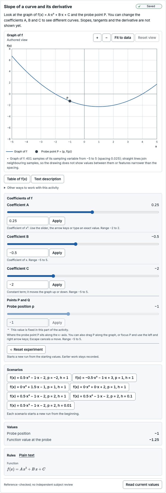
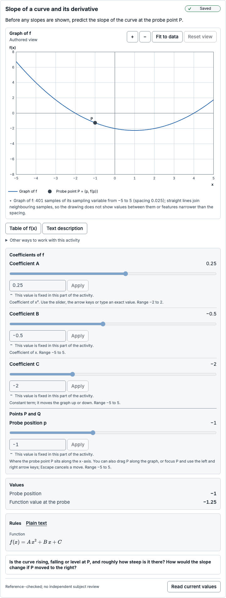
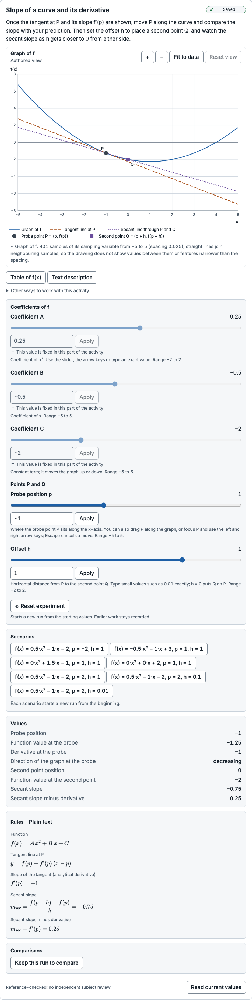
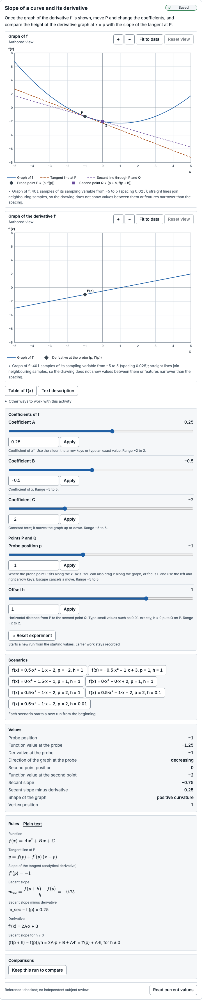
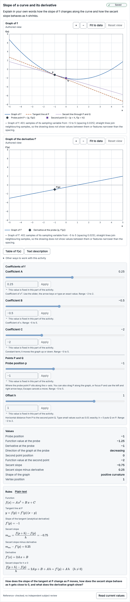
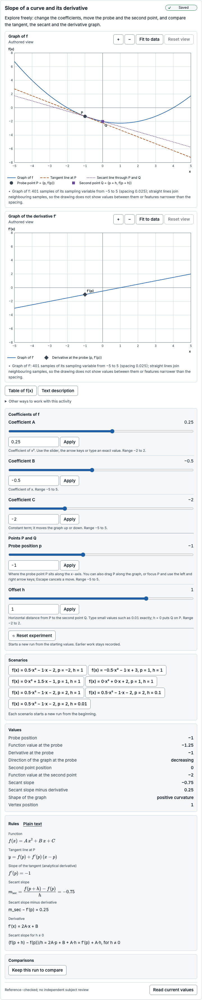

# Subject-review packet: Slope of a curve and its derivative

> Prepared automatically by `experiment-kit activity review-packet` (toolkit 0.3.0-preview.1) for a human subject reviewer.
> It is engineering evidence, **not** a subject review, an accessibility certification or evidence of learning benefit.
> Catalogue status of this exact version: **reference-checked** — no independent human review is recorded.
> The reviewer sign-off at the end is empty; an engineering agent cannot sign it.

## Exact identity

| Item | Value |
| --- | --- |
| Template | function-derivative@1.0.0 |
| Template digest | `sha256:8906edd91542d30c17ff41aa7b551fbb79a7a6d7d32c607ec39db4e0389a2f94` |
| Model | function-derivative@1.0.0 |
| Model digest | `sha256:bfeaa64ae40e41254f46d193a1aefc1ff9d900664571aba51e26492f1ff778ba` |
| Scientific revision | `sha256:e6436111cefe2448afeae498d425491f6b284f66f8141804c55255de793baa93` |
| Presentation revision | `sha256:6b7f39443087f6a470fbd39b3cd6ada3d6f62504b1e3bbb1c7044da9bc8a9053` |
| Reference suite bound by the model | function-derivative:1.0.0 `sha256:07404667c68ff04613998c5a4d8e7ce5acf21c53e84cb28d37384fe8a21394f4` |
| Reference fixture file | `tests/reference/fixtures/activities/function-derivative.json` `sha256:07404667c68ff04613998c5a4d8e7ce5acf21c53e84cb28d37384fe8a21394f4` |
| Fixture binding | matches |
| Execution | installed kernel function-derivative@1.0.0 (static) |
| Lifecycle | reference-checked |
| Generated with | toolkit 0.3.0-preview.1, Chromium 156.0.8078.4 |

## Purpose and task intent

Predict, then observe, how the slope of the tangent to f(x) = A·x² + B·x + C changes along the curve, how secant slopes compare with it as the second point moves closer, and how the derivative f′ records the slope at every x.

| Stage | Kind | Instruction | Host-owned response request | Visible groups (* = solution-bearing) | Controls |
| --- | --- | --- | --- | --- | --- |
| prepare | prepare | Look at the graph of f(x) = A·x² + B·x + C and the probe point P. You can change the coefficients A, B and C to see different curves. Slopes, tangents and the derivative are not shown yet. | — | function-plot (interactive), probe (fixed), function-rule (fixed), alternatives (fixed), coefficient-controls (interactive), probe-control (fixed), scenarios (interactive) | A (interactive), B (interactive), C (interactive), p (fixed) |
| predict | predict | Before any slopes are shown, predict the slope of the curve at the probe point P. | prediction: Is the curve rising, falling or level at P, and roughly how steep is it there? How would the slope change if P moved to the right? (task family function-derivative-slope-prediction) | function-plot (fixed), probe (fixed), function-rule (fixed), alternatives (fixed), coefficient-controls (fixed), probe-control (fixed) | A (fixed), B (fixed), C (fixed), p (fixed) |
| explore-slope | explore | Once the tangent at P and its slope f′(p) are shown, move P along the curve and compare the slope with your prediction. Then set the offset h to place a second point Q, and watch the secant slope as h gets closer to 0 from either side. | — | function-plot (interactive), probe (interactive), function-rule (fixed), alternatives (fixed), tangent* (interactive), slope* (fixed), slope-equations* (fixed), secant* (interactive), secant-values* (fixed), secant-equations* (fixed), coefficient-controls (fixed), probe-control (interactive), offset-control (interactive), scenarios (interactive) | A (fixed), B (fixed), C (fixed), p (interactive), h (interactive) |
| explore-derivative | explore | Once the graph of the derivative f′ is shown, move P and change the coefficients, and compare the height of the derivative graph at x = p with the slope of the tangent at P. | — | function-plot (interactive), probe (interactive), function-rule (fixed), alternatives (fixed), tangent* (interactive), slope* (fixed), slope-equations* (fixed), secant* (interactive), secant-values* (fixed), secant-equations* (fixed), derivative-plot* (interactive), shape* (fixed), derivative-rule* (fixed), coefficient-controls (interactive), probe-control (interactive), offset-control (interactive), scenarios (interactive) | A (interactive), B (interactive), C (interactive), p (interactive), h (interactive) |
| explain | explain | Explain in your own words how the slope of f changes along the curve and how the secant slope behaves as h shrinks. | explanation: How does the slope of the tangent at P change as P moves, how does the secant slope behave as h gets close to 0, and what does the derivative graph show? (task family function-derivative-explanation) | function-plot (fixed), probe (fixed), function-rule (fixed), alternatives (fixed), tangent* (fixed), slope* (fixed), slope-equations* (fixed), secant* (fixed), secant-values* (fixed), secant-equations* (fixed), derivative-plot* (fixed), shape* (fixed), derivative-rule* (fixed), coefficient-controls (fixed), probe-control (fixed), offset-control (fixed) | A (fixed), B (fixed), C (fixed), p (fixed), h (fixed) |
| closed | closed | This activity is closed. | — | none | none |
| free-explore | explore | Explore freely: change the coefficients, move the probe and the second point, and compare the tangent, the secant and the derivative graph. | — | function-plot (interactive), probe (interactive), function-rule (fixed), alternatives (fixed), tangent* (interactive), slope* (fixed), slope-equations* (fixed), secant* (interactive), secant-values* (fixed), secant-equations* (fixed), derivative-plot* (interactive), shape* (fixed), derivative-rule* (fixed), coefficient-controls (interactive), probe-control (interactive), offset-control (interactive), scenarios (interactive) | A (interactive), B (interactive), C (interactive), p (interactive), h (interactive) |

Transitions: prepare → predict (“Ask for a prediction”); predict → explore-slope (“Show the tangent, the slope and the secant”); explore-slope → explore-derivative (“Show the derivative graph”); explore-derivative → explain (“Ask for an explanation”); explain → closed (“Close the activity”); prepare → closed (“Close the activity”); predict → closed (“Close the activity”); explore-slope → closed (“Close the activity”); explore-derivative → closed (“Close the activity”); free-explore → closed (“Close the activity”). Initial stage: prepare.

Host-owned task families (the visualizer never collects, stores or grades responses):

| Task family | Description |
| --- | --- |
| function-derivative-slope-prediction | Host-owned prediction request about the slope of the graph at the probe point and how it changes along the curve. The host owns the response, its capture and any evaluation. |
| function-derivative-explanation | Host-owned explanation request about how the tangent slope changes along the curve and how secant slopes behave as the offset shrinks. The host owns the response, its capture and any evaluation. |
| function-derivative-later-task | Host-owned later task with another function or representation. Its prompts, held-out items and scoring stay with the host and are not part of this catalogue. |

## Derivation

- **derivation-difference-quotient** (derivation): Derivation written for this catalogue: expanding A·(x + h)² + B·(x + h) + C gives (f(x + h) − f(x))/h = 2A·x + B + A·h for every h ≠ 0, so the secant slope differs from f′(x) = 2A·x + B by exactly A·h and tends to it as h → 0; at h = 0 the quotient is 0/0. When A ≠ 0, f′(x) = 0 only at x = −B/(2A). Not independently reviewed.
- **study-harness-specification** (specification): Study Harness visualizer implementation report §12.1 and acceptance item A28: a bounded polynomial family with an analytically defined derivative, a movable probe, tangent, optional secant and linked slope values, a derivative plot shown only when authorized, and the linear, constant, zero-slope, coincident-secant, sign-change and domain-boundary cases.
- Template derivation note **derivation-difference-quotient**: Derivation written for this catalogue: expanding A·(x + h)² + B·(x + h) + C gives (f(x + h) − f(x))/h = 2A·x + B + A·h for every h ≠ 0, so the secant slope differs from f′(x) = 2A·x + B by exactly A·h and tends to it as h → 0; at h = 0 the quotient is 0/0. When A ≠ 0, f′(x) = 0 only at x = −B/(2A). Not independently reviewed.

## Assumptions

- The function is exactly the quadratic f(x) = A·x² + B·x + C with real coefficients; A = 0 gives a straight line and A = B = 0 a constant.
- The derivative is the analytical derivative f′(x) = 2A·x + B of this polynomial. It is not estimated from secant slopes, samples or a numerical limit.
- Inputs are IEEE-754 double-precision values taken at their exact values; the second point is evaluated at the exact sum p + h.
- Evaluation is deterministic on every conforming JavaScript engine: only exactly specified arithmetic is used, so the same parameters always give the same values.

## Limitations

- Each quantity is its exact value rounded to the nearest double once. Categories come from exact signs, so a slope that displays as 0 can still be classified as increasing or decreasing.
- A probe entered as a decimal is in general not exactly at a vertex whose position is not a binary fraction (for example −1/3), so the slope there is a small nonzero number.
- The secant slope is undefined at h = 0 and no limiting value is substituted. For h ≠ 0 it differs from the derivative by exactly A·h.
- The domain constraint −5 ≤ p + h ≤ 5 is evaluated on the double sum p + h, as by every runtime entry point; the exact sum can then lie outside by at most 2^−51, and Q is evaluated at that exact sum.
- Values outside the double range are statuses: a nonzero value that rounds to zero is a numerical limit (UNDERFLOW), subnormal values carry a reduced-precision note, and the vertex of a curve with a tiny nonzero A can exceed the largest double (OVERFLOW).
- The graphs of f and f′ are sampled at 401 positions from −5 to 5 in double precision; the polyline between samples does not certify values between them. Tangent and secant lines are drawn from correctly rounded endpoints, and an endpoint whose exact value is nonzero but below the double range is drawn at 0.

## Units and conventions

- Coordinates: x is horizontal and increases to the right; f(x) and f′(x) are vertical and increase upward. A slope is rise over run in these coordinates, so a positive slope rises to the right.

Parameters (canonical units; the authoring step is a UI increment unless admissibility says otherwise):

| Parameter | Label | Unit | Domain | Default | Admissible values |
| --- | --- | --- | --- | --- | --- |
| A | Coefficient A | dimensionless | [-2, 2] | 0.25 | continuous |
| B | Coefficient B | dimensionless | [-5, 5] | -0.5 | continuous |
| C | Coefficient C | dimensionless | [-5, 5] | -2 | continuous |
| p | Probe position | dimensionless | [-5, 5] | -1 | continuous |
| h | Secant offset | dimensionless | [-2, 2] | 1 | continuous |

Quantities:

| Quantity | Label | Shape | Unit | Meaning | Sign convention | Frame |
| --- | --- | --- | --- | --- | --- | --- |
| probe.x | Probe position | scalar | dimensionless | x-coordinate of the probe point P; it repeats the parameter p exactly. | Positive to the right of x = 0. | x–f(x) plane |
| probe.value | Function value at the probe | scalar | dimensionless | f(p) = A·p² + B·p + C, the height of the graph at the probe, rounded once from its exact value. | Positive above the x-axis. | x–f(x) plane |
| derivative | Derivative at the probe | scalar | dimensionless | Analytical derivative f′(p) = 2A·p + B of the quadratic at the probe: the slope of the tangent at P, from the exact differentiation rule for this polynomial. It is not estimated from secant slopes, samples or a numerical limit. | Positive when f increases as x increases (rise over run in the x–f(x) plane). | x–f(x) plane |
| second.x | Second point position | scalar | dimensionless | x-coordinate p + h of the second point Q, rounded once from the exact sum (the same double the domain constraint checks). Equal to p when h = 0. | Positive to the right of x = 0. | x–f(x) plane |
| second.value | Function value at the second point | scalar | dimensionless | f(p + h) = A·(p + h)² + B·(p + h) + C for the exact sum p + h, rounded once. | Positive above the x-axis. | x–f(x) plane |
| secant.slope | Secant slope | scalar | dimensionless | Slope (f(p + h) − f(p))/h of the line through P and Q, which equals 2A·p + B + A·h exactly for h ≠ 0. Undefined (COINCIDENT_POINTS) when h = 0 because a secant needs two distinct points; it is never replaced by the derivative. | Positive when f increases as x increases (rise over run in the x–f(x) plane). | x–f(x) plane |
| secant.difference | Secant slope minus derivative | scalar | dimensionless | Difference between the secant slope and the analytical derivative at the probe, equal to A·h exactly for h ≠ 0; undefined (COINCIDENT_POINTS) when h = 0 because the secant slope is undefined. | Positive when the secant is steeper upward (larger slope) than the tangent. | x–f(x) plane |
| slope.sign | Direction of the graph at the probe | category: increasing, decreasing, stationary | dimensionless | increasing when f′(p) > 0, decreasing when f′(p) < 0, stationary when f′(p) = 0; classified from the exact sign of 2A·p + B for the input values, never from rounded or displayed digits. | Positive when f increases as x increases (rise over run in the x–f(x) plane). | x–f(x) plane |
| curvature | Shape of the graph | category: positive-curvature, negative-curvature, linear, constant | dimensionless | positive-curvature when A > 0 (opens upward, slope increasing), negative-curvature when A < 0 (opens downward, slope decreasing), linear when A = 0 and B ≠ 0 (constant nonzero slope), constant when A = 0 and B = 0 (slope 0 everywhere). | — | x–f(x) plane |
| vertex.x | Vertex position | scalar | dimensionless | x-coordinate −B/(2A) of the vertex, the only x where the analytical derivative is zero; one correctly rounded division. Undefined (NO_VERTEX) when A = 0 because a line has no vertex. It may lie outside the plotted domain. | Positive to the right of x = 0. | x–f(x) plane |

Coupled constraints (enforced at every entry point):

| Constraint | Expression | Bounds | Message |
| --- | --- | --- | --- |
| secant-in-domain | `p + h` | -5 ≤ value ≤ 5 | The second point Q is at x = p + h, which must stay inside the plotted domain from −5 to 5. |

## Reference cases

Suite `function-derivative:1.0.0` for function-derivative@1.0.0: **40 of 40 cases agree** with frames evaluated in a browser module worker (34 evaluation points; rejection cases must be refused before evaluation).

- Author of the cases: Reference cases for report §12.1 derived by hand where the values are exact binary fractions, plus cases computed by exact rational arithmetic in tests/reference/oracles/function-derivative.ts, which shares no code with the catalogue kernel.
- Review statement of the fixture: No independent human subject reviewer has approved these cases. Automated agreement is engineering evidence only.
- Semantics: f(x) = A·x² + B·x + C with the analytical derivative f′(x) = 2A·x + B. Inputs are doubles taken at their exact values. P = (p, f(p)); Q = (p + h, f(p + h)) for the exact sum p + h. The secant slope is (f(p + h) − f(p))/h for h ≠ 0 and undefined (COINCIDENT_POINTS) for h = 0; the difference is secant slope − f′(p). slope.sign is the exact sign of f′(p); curvature is positive-curvature (A > 0), negative-curvature (A < 0), linear (A = 0, B ≠ 0) or constant (A = B = 0); vertex.x = −B/(2A), undefined (NO_VERTEX) when A = 0. Parameters are admissible when each lies in its domain interval and the double sum p + h lies in [−5, 5].
- Converted from `tests/reference/fixtures/activities/function-derivative.json` `sha256:07404667c68ff04613998c5a4d8e7ce5acf21c53e84cb28d37384fe8a21394f4` (suite function-derivative:1.0.0): Converted by experiment-kit activity tooling: case IDs, labels, provenance, parameters and tolerances copied unchanged; quantity expectations restated as experiment-kit.reference-fixtures 1.0 expectations.
- Not compared by this runner: Tangent and secant endpoints and the sampled curves (lines, sampling tolerance) are checked by tests/reference/activities/function-derivative.test.ts.

| Case | Label | Provenance | Tolerance | Result |
| --- | --- | --- | --- | --- |
| defaults | Manifest defaults: f(x) = 0.25x² − 0.5x − 2, p = −1, h = 1 | manifest default parameters; values derived by hand from f(x) = A·x² + B·x + C, f′(x) = 2A·x + B and (f(p + h) − f(p))/h, and cross-checked by exact rational arithmetic (tests/reference/oracles/function-derivative.ts) | exact | pass (1 point) |
| positive-curvature | f(x) = x² − 2x − 3 at p = 3 with h = 1 | report §12.1 (positive curvature); values derived by hand from f(x) = A·x² + B·x + C, f′(x) = 2A·x + B and (f(p + h) − f(p))/h, and cross-checked by exact rational arithmetic (tests/reference/oracles/function-derivative.ts) | exact | pass (1 point) |
| negative-curvature | f(x) = −x² + 2x + 1 at p = 2 with h = −1 | report §12.1 (negative curvature); values derived by hand from f(x) = A·x² + B·x + C, f′(x) = 2A·x + B and (f(p + h) − f(p))/h, and cross-checked by exact rational arithmetic (tests/reference/oracles/function-derivative.ts) | exact | pass (1 point) |
| linear | Linear f(x) = 1.5x − 1: secant slope equals the derivative | report §12.1 (linear degeneracy); values derived by hand from f(x) = A·x² + B·x + C, f′(x) = 2A·x + B and (f(p + h) − f(p))/h, and cross-checked by exact rational arithmetic (tests/reference/oracles/function-derivative.ts) | exact | pass (1 point) |
| linear-decreasing | Linear f(x) = −2x + 1 at p = −4 with h = 2 | report §12.1 (linear degeneracy); values derived by hand from f(x) = A·x² + B·x + C, f′(x) = 2A·x + B and (f(p + h) − f(p))/h, and cross-checked by exact rational arithmetic (tests/reference/oracles/function-derivative.ts) | exact | pass (1 point) |
| constant | Constant f(x) = 2: slope 0, curvature class constant, no vertex | report §12.1 (constant degeneracy); values derived by hand from f(x) = A·x² + B·x + C, f′(x) = 2A·x + B and (f(p + h) − f(p))/h, and cross-checked by exact rational arithmetic (tests/reference/oracles/function-derivative.ts) | exact | pass (1 point) |
| constant-coincident | Constant f(x) = −5 with h = 0: the secant is still undefined, not 0 | report §12.1 (constant degeneracy, coincident secant points); values derived by hand from f(x) = A·x² + B·x + C, f′(x) = 2A·x + B and (f(p + h) − f(p))/h, and cross-checked by exact rational arithmetic (tests/reference/oracles/function-derivative.ts) | exact | pass (1 point) |
| zero-slope-at-vertex | Probe at the vertex x = 1 of f(x) = 0.5x² − x − 2 | report §12.1 (zero slope); values derived by hand from f(x) = A·x² + B·x + C, f′(x) = 2A·x + B and (f(p + h) − f(p))/h, and cross-checked by exact rational arithmetic (tests/reference/oracles/function-derivative.ts) | exact | pass (1 point) |
| zero-slope-at-vertex-downward | Probe at the vertex x = 1 of f(x) = −2x² + 4x | report §12.1 (zero slope); values derived by hand from f(x) = A·x² + B·x + C, f′(x) = 2A·x + B and (f(p + h) − f(p))/h, and cross-checked by exact rational arithmetic (tests/reference/oracles/function-derivative.ts) | exact | pass (1 point) |
| probe-near-non-dyadic-vertex | p = double nearest −1/3 for f(x) = 1.5x² + x: f′(p) = 2^−54, increasing | report §12.1 (zero slope) and the rule that classification never uses displayed digits; f′(p) = 3·fl(−1/3) + 1 = 2^−54 derived by hand because fl(−1/3) = −6004799503160661·2^−54 and 3·6004799503160661 = 2^54 − 1; values computed by exact rational arithmetic in tests/reference/oracles/function-derivative.ts, which shares no code with the catalogue kernel, and rounded once to the nearest double | abs 0, rel 1e-12 | pass (1 point) |
| secant-h-1 | Secant approach at p = 2 of f(x) = 0.5x² − x − 2: h = 1 | report §12.1 (secant points approaching each other); values derived by hand from f(x) = A·x² + B·x + C, f′(x) = 2A·x + B and (f(p + h) − f(p))/h, and cross-checked by exact rational arithmetic (tests/reference/oracles/function-derivative.ts) | exact | pass (1 point) |
| secant-h-0.1 | Secant approach: h = 0.1 (secant = 2Ap + B + Ah exactly in rationals) | report §12.1 (secant points approaching each other); values computed by exact rational arithmetic in tests/reference/oracles/function-derivative.ts, which shares no code with the catalogue kernel, and rounded once to the nearest double | abs 0, rel 1e-12 | pass (1 point) |
| secant-h-0.001 | Secant approach: h = 0.001 | report §12.1 (secant points approaching each other); values computed by exact rational arithmetic in tests/reference/oracles/function-derivative.ts, which shares no code with the catalogue kernel, and rounded once to the nearest double | abs 0, rel 1e-12 | pass (1 point) |
| secant-h-minus-0.001 | Secant approach from the left: h = −0.001 | report §12.1 (secant points approaching each other); values computed by exact rational arithmetic in tests/reference/oracles/function-derivative.ts, which shares no code with the catalogue kernel, and rounded once to the nearest double | abs 0, rel 1e-12 | pass (1 point) |
| secant-tiny-offset | h = 1e-300: Q rounds onto P but the points are distinct, so the secant is defined | report §12.1 (secant points approaching each other); distinct exact points; values computed by exact rational arithmetic in tests/reference/oracles/function-derivative.ts, which shares no code with the catalogue kernel, and rounded once to the nearest double | abs 0, rel 1e-12 | pass (1 point) |
| coincident-h-0 | h = 0: secant slope and difference undefined (COINCIDENT_POINTS), no secant line | report §12.1 (coincident secant points are never relabelled as the derivative); values derived by hand from f(x) = A·x² + B·x + C, f′(x) = 2A·x + B and (f(p + h) − f(p))/h, and cross-checked by exact rational arithmetic (tests/reference/oracles/function-derivative.ts) | exact | pass (1 point) |
| coincident-at-vertex | h = 0 at the vertex: the secant is undefined, not 0 | report §12.1 (coincident secant points); values derived by hand from f(x) = A·x² + B·x + C, f′(x) = 2A·x + B and (f(p + h) − f(p))/h, and cross-checked by exact rational arithmetic (tests/reference/oracles/function-derivative.ts) | exact | pass (1 point) |
| sign-before-vertex | f(x) = x² − 2x − 3 left of the vertex: decreasing | report §12.1 (sign changes); values derived by hand from f(x) = A·x² + B·x + C, f′(x) = 2A·x + B and (f(p + h) − f(p))/h, and cross-checked by exact rational arithmetic (tests/reference/oracles/function-derivative.ts) | exact | pass (1 point) |
| sign-at-vertex | f(x) = x² − 2x − 3 at the vertex: stationary | report §12.1 (sign changes); values derived by hand from f(x) = A·x² + B·x + C, f′(x) = 2A·x + B and (f(p + h) − f(p))/h, and cross-checked by exact rational arithmetic (tests/reference/oracles/function-derivative.ts) | exact | pass (1 point) |
| sign-after-vertex | f(x) = x² − 2x − 3 right of the vertex: increasing | report §12.1 (sign changes); values derived by hand from f(x) = A·x² + B·x + C, f′(x) = 2A·x + B and (f(p + h) − f(p))/h, and cross-checked by exact rational arithmetic (tests/reference/oracles/function-derivative.ts) | exact | pass (1 point) |
| sign-before-vertex-downward | f(x) = −0.5x² − x + 3 left of its vertex x = −1: increasing | report §12.1 (sign changes); values derived by hand from f(x) = A·x² + B·x + C, f′(x) = 2A·x + B and (f(p + h) − f(p))/h, and cross-checked by exact rational arithmetic (tests/reference/oracles/function-derivative.ts) | exact | pass (1 point) |
| sign-after-vertex-downward | f(x) = −0.5x² − x + 3 right of its vertex: decreasing | report §12.1 (sign changes); values derived by hand from f(x) = A·x² + B·x + C, f′(x) = 2A·x + B and (f(p + h) − f(p))/h, and cross-checked by exact rational arithmetic (tests/reference/oracles/function-derivative.ts) | exact | pass (1 point) |
| probe-right-boundary | Probe at p = 5 (domain boundary) | report §12.1 (domain boundaries); values derived by hand from f(x) = A·x² + B·x + C, f′(x) = 2A·x + B and (f(p + h) − f(p))/h, and cross-checked by exact rational arithmetic (tests/reference/oracles/function-derivative.ts) | exact | pass (1 point) |
| probe-left-boundary | Probe at p = −5 (domain boundary) | report §12.1 (domain boundaries); values derived by hand from f(x) = A·x² + B·x + C, f′(x) = 2A·x + B and (f(p + h) − f(p))/h, and cross-checked by exact rational arithmetic (tests/reference/oracles/function-derivative.ts) | exact | pass (1 point) |
| second-right-boundary | Second point at p + h = 5 (inclusive) | report §12.1 (domain boundaries); values derived by hand from f(x) = A·x² + B·x + C, f′(x) = 2A·x + B and (f(p + h) − f(p))/h, and cross-checked by exact rational arithmetic (tests/reference/oracles/function-derivative.ts) | exact | pass (1 point) |
| second-left-boundary | Second point at p + h = −5 (inclusive) | report §12.1 (domain boundaries); values derived by hand from f(x) = A·x² + B·x + C, f′(x) = 2A·x + B and (f(p + h) − f(p))/h, and cross-checked by exact rational arithmetic (tests/reference/oracles/function-derivative.ts) | exact | pass (1 point) |
| coincident-at-boundary | p = 5 and h = 0 | report §12.1 (domain boundaries, coincident points); values derived by hand from f(x) = A·x² + B·x + C, f′(x) = 2A·x + B and (f(p + h) − f(p))/h, and cross-checked by exact rational arithmetic (tests/reference/oracles/function-derivative.ts) | exact | pass (1 point) |
| second-within-half-ulp-of-boundary | p = 5, h = 2^−52: the double sum is 5, so the constraint holds; Q is evaluated at the exact sum | declared constraint semantics (manifest limitations); values computed by exact rational arithmetic in tests/reference/oracles/function-derivative.ts, which shares no code with the catalogue kernel, and rounded once to the nearest double | abs 0, rel 1e-12 | pass (1 point) |
| corner-values-high | A = 2, B = 5, C = 5 at p = −5 with h = 2 | parameter-domain corners; values derived by hand from f(x) = A·x² + B·x + C, f′(x) = 2A·x + B and (f(p + h) − f(p))/h, and cross-checked by exact rational arithmetic (tests/reference/oracles/function-derivative.ts) | exact | pass (1 point) |
| corner-values-low | A = −2, B = −5, C = −5 at p = 5 with h = −2: \|f(p)\| = 80 | parameter-domain corners; values derived by hand from f(x) = A·x² + B·x + C, f′(x) = 2A·x + B and (f(p + h) − f(p))/h, and cross-checked by exact rational arithmetic (tests/reference/oracles/function-derivative.ts) | exact | pass (1 point) |
| decimal-coefficients | Decimal inputs A = 0.3, B = −1.7, C = 0.9, p = 2.2, h = −0.7 (rounded values) | non-binary decimal inputs; values computed by exact rational arithmetic in tests/reference/oracles/function-derivative.ts, which shares no code with the catalogue kernel, and rounded once to the nearest double | abs 0, rel 1e-12 | pass (1 point) |
| vertex-overflow | A = 2^−1074: the vertex −B/(2A) exceeds the double range (OVERFLOW); A·h is subnormal | report §8.2 numerical-limit statuses; values computed by exact rational arithmetic in tests/reference/oracles/function-derivative.ts, which shares no code with the catalogue kernel, and rounded once to the nearest double | abs 0, rel 1e-12 | pass (1 point) |
| vertex-underflow | B = 2^−1074, A = 2: the vertex is nonzero but rounds to zero (UNDERFLOW); f′(p) is subnormal | report §8.2 numerical-limit statuses; values computed by exact rational arithmetic in tests/reference/oracles/function-derivative.ts, which shares no code with the catalogue kernel, and rounded once to the nearest double | abs 0, rel 1e-12 | pass (1 point) |
| function-value-underflow | f(p) = p² with p = 1e-200 is nonzero but rounds to zero (UNDERFLOW) | report §8.2 numerical-limit statuses; values computed by exact rational arithmetic in tests/reference/oracles/function-derivative.ts, which shares no code with the catalogue kernel, and rounded once to the nearest double | abs 0, rel 1e-12 | pass (1 point) |
| second-beyond-right-boundary | p = 4, h = 1.5: p + h = 5.5 is outside the domain | report §12.1 (domain boundaries) and §8.2 coupled constraints; rejection derived by hand from the declared domain and the coupled constraint −5 ≤ p + h ≤ 5 (evaluated on the double sum); cross-checked by the oracle | exact | pass (rejected as expected) |
| second-beyond-left-boundary | p = −4.5, h = −1: p + h = −5.5 is outside the domain | report §12.1 (domain boundaries) and §8.2 coupled constraints; rejection derived by hand from the declared domain and the coupled constraint −5 ≤ p + h ≤ 5 (evaluated on the double sum); cross-checked by the oracle | exact | pass (rejected as expected) |
| second-one-ulp-beyond-boundary | p = 5, h = 2^−50: the double sum is the next double above 5 | declared constraint semantics (double sum); rejection derived by hand from the declared domain and the coupled constraint −5 ≤ p + h ≤ 5 (evaluated on the double sum); cross-checked by the oracle | exact | pass (rejected as expected) |
| probe-beyond-domain | p = 5.25 is outside [−5, 5] | declared parameter domain; rejection derived by hand from the declared domain and the coupled constraint −5 ≤ p + h ≤ 5 (evaluated on the double sum); cross-checked by the oracle | exact | pass (rejected as expected) |
| offset-beyond-domain | h = 2.5 is outside [−2, 2] | declared parameter domain; rejection derived by hand from the declared domain and the coupled constraint −5 ≤ p + h ≤ 5 (evaluated on the double sum); cross-checked by the oracle | exact | pass (rejected as expected) |
| coefficient-beyond-domain | A = 2.5 is outside [−2, 2] | declared parameter domain; rejection derived by hand from the declared domain and the coupled constraint −5 ≤ p + h ≤ 5 (evaluated on the double sum); cross-checked by the oracle | exact | pass (rejected as expected) |

## Mutation sensitivity

Generic faults injected into the evaluated model inside the checks worker (outputs or inputs altered after the kernel, one fault at a time); a mutant is detected when at least one reference case disagrees. **30 of 30 detected.**

| Fault | Mutants | Detected | Undetected targets |
| --- | --- | --- | --- |
| sign | 8 | 8 | — |
| factor | 8 | 8 | — |
| undefined-as-zero | 3 | 3 | — |
| limit-as-zero | 2 | 2 | — |
| swap-inputs | 4 | 4 | — |
| boundary-nudge | 5 | 5 | — |

Activity-specific mutants (for example wrong conventions, transposed inputs and incorrect boundaries) are exercised in the mutation-sensitivity tests of `tests/reference/activities/function-derivative.test.ts`; hidden-output leakage across output channels is tested in `tests/activity/disclosure.test.ts`. Those results are not restated here.

## Boundary cases

Declared cases come from the package (or the installed suite's non-valid expectations); generated probes test the declared domain edges. Outcomes: valid / undefined / numerical-limit / out-of-domain (rejected before evaluation) / worker-error.

| Case | Source | Parameters | Position | Outcome | Non-valid statuses | Expectation |
| --- | --- | --- | --- | --- | --- | --- |
| linear: Linear f(x) = 1.5x − 1: secant slope equals the derivative | declared | A = 0, B = 1.5, C = -1, p = 1, h = 0.5 | static | undefined | vertex.x: undefined:NO_VERTEX | met |
| linear-decreasing: Linear f(x) = −2x + 1 at p = −4 with h = 2 | declared | A = 0, B = -2, C = 1, p = -4, h = 2 | static | undefined | vertex.x: undefined:NO_VERTEX | met |
| constant: Constant f(x) = 2: slope 0, curvature class constant, no vertex | declared | A = 0, B = 0, C = 2, p = -3, h = 1 | static | undefined | vertex.x: undefined:NO_VERTEX | met |
| constant-coincident: Constant f(x) = −5 with h = 0: the secant is still undefined, not 0 | declared | A = 0, B = 0, C = -5, p = 0, h = 0 | static | undefined | secant.slope: undefined:COINCIDENT_POINTS, secant.difference: undefined:COINCIDENT_POINTS, vertex.x: undefined:NO_VERTEX | met |
| coincident-h-0: h = 0: secant slope and difference undefined (COINCIDENT_POINTS), no secant line | declared | A = 0.5, B = -1, C = -2, p = 2, h = 0 | static | undefined | secant.slope: undefined:COINCIDENT_POINTS, secant.difference: undefined:COINCIDENT_POINTS | met |
| coincident-at-vertex: h = 0 at the vertex: the secant is undefined, not 0 | declared | A = 0.5, B = -1, C = -2, p = 1, h = 0 | static | undefined | secant.slope: undefined:COINCIDENT_POINTS, secant.difference: undefined:COINCIDENT_POINTS | met |
| coincident-at-boundary: p = 5 and h = 0 | declared | A = 1, B = -2, C = -3, p = 5, h = 0 | static | undefined | secant.slope: undefined:COINCIDENT_POINTS, secant.difference: undefined:COINCIDENT_POINTS | met |
| vertex-overflow: A = 2^−1074: the vertex −B/(2A) exceeds the double range (OVERFLOW); A·h is subnormal | declared | A = 5e-324, B = 5, C = 0, p = 1, h = 1 | static | numerical-limit | secant.difference: valid:UNDERFLOW, vertex.x: numerical-limit:OVERFLOW | met |
| vertex-underflow: B = 2^−1074, A = 2: the vertex is nonzero but rounds to zero (UNDERFLOW); f′(p) is subnormal | declared | A = 2, B = 5e-324, C = 0, p = 0, h = 1 | static | numerical-limit | derivative: valid:UNDERFLOW, vertex.x: numerical-limit:UNDERFLOW | met |
| function-value-underflow: f(p) = p² with p = 1e-200 is nonzero but rounds to zero (UNDERFLOW) | declared | A = 1, B = 0, C = 0, p = 1e-200, h = 1 | static | numerical-limit | probe.value: numerical-limit:UNDERFLOW | met |
| second-beyond-right-boundary: p = 4, h = 1.5: p + h = 5.5 is outside the domain | declared | A = 1, B = -2, C = -3, p = 4, h = 1.5 | static | out-of-domain | CONSTRAINT_VIOLATION at $.constraints.secant-in-domain | met |
| second-beyond-left-boundary: p = −4.5, h = −1: p + h = −5.5 is outside the domain | declared | A = 1, B = -2, C = -3, p = -4.5, h = -1 | static | out-of-domain | CONSTRAINT_VIOLATION at $.constraints.secant-in-domain | met |
| second-one-ulp-beyond-boundary: p = 5, h = 2^−50: the double sum is the next double above 5 | declared | A = 1, B = -2, C = -3, p = 5, h = 8.881784197001252e-16 | static | out-of-domain | CONSTRAINT_VIOLATION at $.constraints.secant-in-domain | met |
| probe-beyond-domain: p = 5.25 is outside [−5, 5] | declared | A = 1, B = -2, C = -3, p = 5.25, h = -1 | static | out-of-domain | OUT_OF_DOMAIN at $.parameters.p | met |
| offset-beyond-domain: h = 2.5 is outside [−2, 2] | declared | A = 1, B = -2, C = -3, p = 0, h = 2.5 | static | out-of-domain | OUT_OF_DOMAIN at $.parameters.h | met |
| coefficient-beyond-domain: A = 2.5 is outside [−2, 2] | declared | A = 2.5, B = -2, C = -3, p = 0, h = 1 | static | out-of-domain | OUT_OF_DOMAIN at $.parameters.A | met |
| generated.A.min: A at its minimum -2 | generated | A = -2, B = -0.5, C = -2, p = -1, h = 1 | static | valid | — | — |
| generated.A.max: A at its maximum 2 | generated | A = 2, B = -0.5, C = -2, p = -1, h = 1 | static | valid | — | — |
| generated.A.below: A just below its minimum | generated | A = -2.000004, B = -0.5, C = -2, p = -1, h = 1 | static | out-of-domain | OUT_OF_DOMAIN at $.parameters.A | met |
| generated.A.above: A just above its maximum | generated | A = 2.000004, B = -0.5, C = -2, p = -1, h = 1 | static | out-of-domain | OUT_OF_DOMAIN at $.parameters.A | met |
| generated.B.min: B at its minimum -5 | generated | A = 0.25, B = -5, C = -2, p = -1, h = 1 | static | valid | — | — |
| generated.B.max: B at its maximum 5 | generated | A = 0.25, B = 5, C = -2, p = -1, h = 1 | static | valid | — | — |
| generated.B.below: B just below its minimum | generated | A = 0.25, B = -5.00001, C = -2, p = -1, h = 1 | static | out-of-domain | OUT_OF_DOMAIN at $.parameters.B | met |
| generated.B.above: B just above its maximum | generated | A = 0.25, B = 5.00001, C = -2, p = -1, h = 1 | static | out-of-domain | OUT_OF_DOMAIN at $.parameters.B | met |
| generated.C.min: C at its minimum -5 | generated | A = 0.25, B = -0.5, C = -5, p = -1, h = 1 | static | valid | — | — |
| generated.C.max: C at its maximum 5 | generated | A = 0.25, B = -0.5, C = 5, p = -1, h = 1 | static | valid | — | — |
| generated.C.below: C just below its minimum | generated | A = 0.25, B = -0.5, C = -5.00001, p = -1, h = 1 | static | out-of-domain | OUT_OF_DOMAIN at $.parameters.C | met |
| generated.C.above: C just above its maximum | generated | A = 0.25, B = -0.5, C = 5.00001, p = -1, h = 1 | static | out-of-domain | OUT_OF_DOMAIN at $.parameters.C | met |
| generated.p.min: p at its minimum -5 | generated | A = 0.25, B = -0.5, C = -2, p = -5, h = 1 | static | valid | — | — |
| generated.p.max: p at its maximum 5 | generated | A = 0.25, B = -0.5, C = -2, p = 5, h = 1 | static | out-of-domain | CONSTRAINT_VIOLATION at $.constraints.secant-in-domain | — |
| generated.p.below: p just below its minimum | generated | A = 0.25, B = -0.5, C = -2, p = -5.00001, h = 1 | static | out-of-domain | OUT_OF_DOMAIN at $.parameters.p | met |
| generated.p.above: p just above its maximum | generated | A = 0.25, B = -0.5, C = -2, p = 5.00001, h = 1 | static | out-of-domain | OUT_OF_DOMAIN at $.parameters.p | met |
| generated.h.min: h at its minimum -2 | generated | A = 0.25, B = -0.5, C = -2, p = -1, h = -2 | static | valid | — | — |
| generated.h.max: h at its maximum 2 | generated | A = 0.25, B = -0.5, C = -2, p = -1, h = 2 | static | valid | — | — |
| generated.h.below: h just below its minimum | generated | A = 0.25, B = -0.5, C = -2, p = -1, h = -2.000004 | static | out-of-domain | OUT_OF_DOMAIN at $.parameters.h | met |
| generated.h.above: h just above its maximum | generated | A = 0.25, B = -0.5, C = -2, p = -1, h = 2.000004 | static | out-of-domain | OUT_OF_DOMAIN at $.parameters.h | met |

## Default evaluation and author checks

Defaults A = 0.25, B = -0.5, C = -2, p = -1, h = 1 (position: static): probe.x valid, probe.value valid, derivative valid, second.x valid, second.value valid, secant.slope valid, secant.difference valid, slope.sign valid, curvature valid, vertex.x valid.

Sampling of the default frame (drawings between samples do not certify values between them): curve: 401 samples over [-5, 5]; derivative-curve: 401 samples over [-5, 5].

| Scenario | Outcome | Non-valid statuses |
| --- | --- | --- |
| curve-up | valid | — |
| curve-down | valid | — |
| sloped-line | undefined | vertex.x: undefined:NO_VERTEX |
| level-line | undefined | vertex.x: undefined:NO_VERTEX |
| offset-1 | valid | — |
| offset-0.1 | valid | — |
| offset-0.01 | valid | — |

No author checks are part of this packet.

## Stage-by-stage captures

Each stage was prepared through the activity adapter with the browser integration fixture host under an author-preview policy whose ceiling is every group, the stage's solution-bearing groups were authorized by the host through the persist-before-reveal path, and the learner surface was mounted with the learner binding (width 720 CSS px, theme light, fonts bundled, navigated to n = 4 where the stage allows navigation). A real host policy may show less. PNG: screenshot of the mounted card; SVG: the surface's own pure-SVG capture of the primary view; text: projection-only companion.

### prepare (prepare)

Instruction: Look at the graph of f(x) = A·x² + B·x + C and the probe point P. You can change the coefficients A, B and C to see different curves. Slopes, tangents and the derivative are not shown yet.

Revealed by the host for this stage: nothing (no solution-bearing groups). Review notice shown: “Reference-checked; no independent subject review”. Projection `sha256:df19a4dd47f8a4ccc2e7f5a9670a83a848696c611d47995ed45e53fda60ca118`, frame `sha256:0e1c0e5a88447afaafe3a64632bca0058a18c8c4b264e483ea06f1e69057e245`.



Files: [PNG](captures/prepare.png) · [SVG of function-plot](captures/prepare.svg) · [companion text](captures/prepare.txt)

Equations: 1 of 1 rendered with KaTeX.

### predict (predict)

Instruction: Before any slopes are shown, predict the slope of the curve at the probe point P.

Host-owned prediction request: Is the curve rising, falling or level at P, and roughly how steep is it there? How would the slope change if P moved to the right? (task family function-derivative-slope-prediction)

Revealed by the host for this stage: nothing (no solution-bearing groups). Review notice shown: “Reference-checked; no independent subject review”. Projection `sha256:7a08fe32189da472af25d65da2ba8a18913a12d233547853e51c2202399460be`, frame `sha256:bdd559212f7f56527a4e9f99ea1d745fcc77dba8b3794b35c082d9c742b436af`.



Files: [PNG](captures/predict.png) · [SVG of function-plot](captures/predict.svg) · [companion text](captures/predict.txt)

Equations: 1 of 1 rendered with KaTeX.

### explore-slope (explore)

Instruction: Once the tangent at P and its slope f′(p) are shown, move P along the curve and compare the slope with your prediction. Then set the offset h to place a second point Q, and watch the secant slope as h gets closer to 0 from either side.

Revealed by the host for this stage: tangent, slope, slope-equations, secant, secant-values, secant-equations. Review notice shown: “Reference-checked; no independent subject review”. Projection `sha256:585475edb3060e47d983f1fa01448e6cb439f17c46757a6c246369ed1f01ba9e`, frame `sha256:b2ffee3658bb9879506cd878def442f86c5c1bf5c5fce18178f85f8d270f6cf0`.



Files: [PNG](captures/explore-slope.png) · [SVG of function-plot](captures/explore-slope.svg) · [companion text](captures/explore-slope.txt)

Equations: 5 of 5 rendered with KaTeX.

### explore-derivative (explore)

Instruction: Once the graph of the derivative f′ is shown, move P and change the coefficients, and compare the height of the derivative graph at x = p with the slope of the tangent at P.

Revealed by the host for this stage: tangent, slope, slope-equations, secant, secant-values, secant-equations, derivative-plot, shape, derivative-rule. Review notice shown: “Reference-checked; no independent subject review”. Projection `sha256:ee80fb41a3ebe9b2997c4e089bfcbe1450b28645643e12317a4857ceb2d477b5`, frame `sha256:13a726e476aaff23f1f921d70b4ddb6d880f409fb3fcd2ca40f95c3a219d9cd7`.



Files: [PNG](captures/explore-derivative.png) · [SVG of function-plot](captures/explore-derivative.svg) · [companion text](captures/explore-derivative.txt)

Equations: 4 of 7 rendered with KaTeX, 3 shown as plain text.

### explain (explain)

Instruction: Explain in your own words how the slope of f changes along the curve and how the secant slope behaves as h shrinks.

Host-owned explanation request: How does the slope of the tangent at P change as P moves, how does the secant slope behave as h gets close to 0, and what does the derivative graph show? (task family function-derivative-explanation)

Revealed by the host for this stage: tangent, slope, slope-equations, secant, secant-values, secant-equations, derivative-plot, shape, derivative-rule. Review notice shown: “Reference-checked; no independent subject review”. Projection `sha256:66c08f4cd0b419b82b6606195e1523bee58e755f431c89bb7ccc2f9220ce41bd`, frame `sha256:7746fbaae4a58303300a2c4341711e9c8f52ec6f46638cb8c39713b378680a0b`.



Files: [PNG](captures/explain.png) · [SVG of function-plot](captures/explain.svg) · [companion text](captures/explain.txt)

Equations: 7 of 7 rendered with KaTeX.

### closed (closed)

Instruction: This activity is closed.

Revealed by the host for this stage: nothing (no solution-bearing groups). Review notice shown: “Reference-checked; no independent subject review”. Projection `sha256:6684125850b74bca5b2bf91520e7f8637ed1b5c4fa48fcddbd461b46d1f1ba57`, frame `sha256:66130cde18c3953052cb1a6c66a26a0dbd72e91a04324d2802931edf468028aa`.


Files: [PNG](captures/closed.png) · [companion text](captures/closed.txt) · no SVG (NOT_FOUND: This stage shows no view; the card screenshot and companion text record the stage.)

### free-explore (explore)

Instruction: Explore freely: change the coefficients, move the probe and the second point, and compare the tangent, the secant and the derivative graph.

Revealed by the host for this stage: tangent, slope, slope-equations, secant, secant-values, secant-equations, derivative-plot, shape, derivative-rule. Review notice shown: “Reference-checked; no independent subject review”. Projection `sha256:6b955fe3be3579c7199bd775e72197f7f7adbd5e54da6b2db62fb821e729a700`, frame `sha256:848484dc116aed81136650b437ef763719c3312381add611d07630a43ff140bc`.



Files: [PNG](captures/free-explore.png) · [SVG of function-plot](captures/free-explore.svg) · [companion text](captures/free-explore.txt)

Equations: 4 of 7 rendered with KaTeX, 3 shown as plain text.

## Content groups

Content digests bind exposure records to this exact content; any change to a group's text or definitions changes its digest.

| Group | Kind | Solution-bearing | Members | Content digest |
| --- | --- | --- | --- | --- |
| function-plot | view | no | function-plot, curve-table | `sha256:2f3126f58e6ef8742a391f97662db40c63d55e93cc4dc1b02202a086409a3baf` |
| probe | quantity | no | probe.x, probe.value | `sha256:1f9f726bc64f0ffdc613ff081f9fd1aef54d282b3eb26622ea83c3c56eb64917` |
| function-rule | equation | no | function-equation | `sha256:ac93faa256224a82307696a7d601b102104be49860de4591bc2afbcb63561c08` |
| coefficient-controls | control | no | A, B, C | `sha256:4d658d7b47786dc3c4f3da5065a0ff639c5e4b817b03fac2fd3afbe9a95c122b` |
| probe-control | control | no | p | `sha256:7f2da3314eef4eb12338912b84d76d98458cc949530e2d6dab3c70fdef1e20f5` |
| offset-control | control | no | h | `sha256:01a86bb2d695abb4f9f7e39499c906ac660122c18c499b20307188350c2b9603` |
| tangent | dataset | yes | tangent | `sha256:9911f9fa1864433e6b317b533158e6f36529e20ae8265b71a614c78525efc160` |
| slope | quantity | yes | derivative, slope.sign | `sha256:45d1d7ca5a68b734c8044f8bd0b4e047294a38b9c422b8cfaee4d9450d74d46d` |
| slope-equations | equation | yes | tangent-equation, slope-at-probe | `sha256:d0f7e60b04f84b88359f521996d3690c35cfdab655b2a424677137c9462d4531` |
| secant | dataset | yes | secant, second | `sha256:2fc781f6f5264638402257e4f113364db822c0c6b4f320d7615db8e63ed5784e` |
| secant-values | quantity | yes | second.x, second.value, secant.slope, secant.difference | `sha256:52a1e9fd72e09d3381d139b07e3baf85ad47b9fbb8729de25a70f77cb741d85c` |
| secant-equations | equation | yes | secant-quotient, secant-gap | `sha256:702752a699ff2fbbf2325cee253b575d85c72b6aa76585a7ae9761fcad5548e0` |
| derivative-plot | view | yes | derivative-plot, derivative-table | `sha256:9c0f70864409a0aedadde1b92f29137385a44d65c31cdfe03a6add164cfc71b7` |
| shape | quantity | yes | curvature, vertex.x | `sha256:454d2d51af6ea466013531b0cabab444e102f5117a4d41f21536cd219741ce3a` |
| derivative-rule | equation | yes | derivative-formula, secant-identity | `sha256:c24cb651bcf52ec4790080ea41485d03bb02d37fa433bc7e021288281a9ed0d8` |
| scenarios | annotation | no | scenario-note | `sha256:f11f8aadb7b006af3d7cc78bd841fbc09dd3ba38f0e189be4712c2c9dcf34213` |
| alternatives | alternative | no | curve-table, point-values, derivative-table, text-description, exact-entry, keyboard-controls | `sha256:6fab31f57fe135a76f2764c37628d7df8e3bf04c01b81a725890e572bd3ff907` |

## Accessible alternatives

The verification ID names the test or manual check that exercised each claimed equivalence. This packet does not re-run those checks; it records whether the named file exists in this toolkit tree.

| Alternative | Kind | Covers | Equivalence | Verification ID | Named file present |
| --- | --- | --- | --- | --- | --- |
| curve-table: Table of f(x) | table | function-plot, function-curve | equivalent | tests/browser/study-function-derivative.spec.ts#curve-table-equivalent | yes |
| point-values: Point and slope values | description | function-plot, probe-marker, second-marker, tangent-line, secant-line | equivalent | tests/browser/study-function-derivative.spec.ts#point-values-equivalent | yes |
| derivative-table: Table of f′(x) | table | derivative-plot, derivative-curve-line, derivative-probe-marker | equivalent | tests/browser/study-function-derivative.spec.ts#derivative-table-equivalent | yes |
| text-description: Text description | description | function-plot, derivative-plot | partial | tests/browser/study-function-derivative.spec.ts#text-description | yes |
| exact-entry: Exact entry | numeric-entry | A, B, C, p, h | equivalent | tests/browser/study-function-derivative.spec.ts#exact-entry | yes |
| keyboard-controls: Keyboard controls | keyboard | A, B, C, p, h, probe-marker | equivalent | tests/browser/study-function-derivative.spec.ts#keyboard-only | yes |

## Reviewer sign-off

This section is intentionally empty. An engineering agent cannot sign it. A completed review is entered by the host as a
`study-harness.review-record` in its trusted review registry, bound to the exact scientific revision, template digest and
reference-suite digest listed under “Exact identity”; a review of any other digest does not apply to this version.

- Reviewer name and role:
- Affiliation:
- Date:
- Scope reviewed:
- Limitations:
- Outcome (approved / approved-with-limitations / rejected):

## Regenerate

```sh
experiment-kit activity review-packet --installed function-derivative --out docs/study-harness/review-packets/function-derivative --width 720 --theme light --index 4
```

