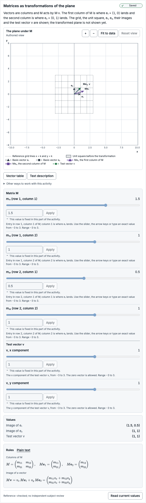
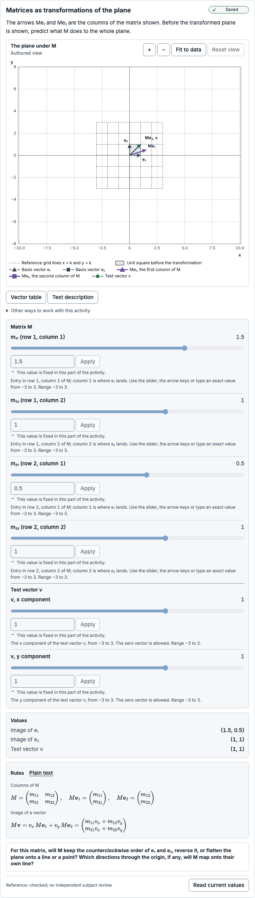
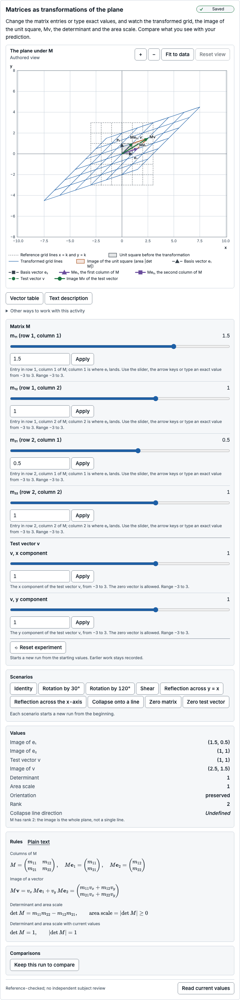
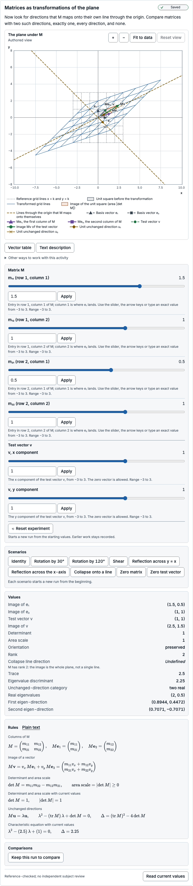
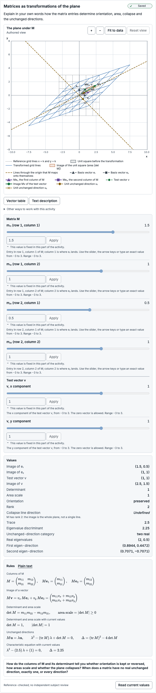
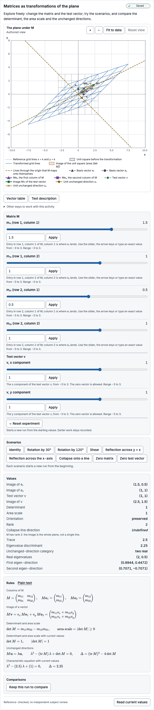

# Subject-review packet: Matrices as transformations of the plane

> Prepared automatically by `explorable-models activity review-packet` (toolkit 0.3.0-preview.1) for a human subject reviewer.
> It is engineering evidence, **not** a subject review, an accessibility certification or evidence of learning benefit.
> Catalogue status of this exact version: **reference-checked** — no independent human review is recorded.
> The reviewer sign-off at the end is empty; an engineering agent cannot sign it.

## Exact identity

| Item | Value |
| --- | --- |
| Template | linear-transformation@1.0.0 |
| Template digest | `sha256:4d967cfc97163d64edc51de87cc43f0cdffd7df2c170ef7bb06d282ed55a8796` |
| Model | linear-transformation@1.0.0 |
| Model digest | `sha256:556cf36026c7eaf95e03aa1974f3954a77b1209f5405e25b815f9d1f9dc298e2` |
| Scientific revision | `sha256:1784fe3fb59af950f7a6ec8e7344a4b53925b046deee2069d1bc727ef7993207` |
| Presentation revision | `sha256:b598bd8b32f1a4c9da32b569c873cfba0160712092556fbc770d7d6a7cb6be8e` |
| Reference suite bound by the model | linear-transformation:1.0.0 `sha256:1bcb216bab98b268056748e3e4b53fea6cd393e5487ea35449d602c57a8ed9a5` |
| Reference fixture file | `tests/reference/fixtures/activities/linear-transformation.json` `sha256:1bcb216bab98b268056748e3e4b53fea6cd393e5487ea35449d602c57a8ed9a5` |
| Fixture binding | matches |
| Execution | installed kernel linear-transformation@1.0.0 (static) |
| Lifecycle | reference-checked |
| Generated with | toolkit 0.3.0-preview.1, Chromium 156.0.8078.4 |

## Purpose and task intent

Predict, then observe, how a 2×2 matrix M moves the plane: where e₁ and e₂ land (the columns of M), whether orientation is kept or reversed, how areas scale, whether the plane collapses, and which directions stay on their own line.

| Stage | Kind | Instruction | Host-owned response request | Visible groups (* = solution-bearing) | Controls |
| --- | --- | --- | --- | --- | --- |
| prepare | prepare | Vectors are columns and M acts by M·v. The first column of M is where e₁ = (1, 0) lands and the second column is where e₂ = (0, 1) lands. The grid, the unit square, e₁, e₂, their images and the test vector v are shown; the transformed plane is not shown yet. | — | plane (fixed), reference (fixed), basis (fixed), columns (fixed), test-vector (fixed), matrix-control (fixed), vector-control (fixed), convention (fixed), readouts (fixed), alternatives (fixed) | m11 (fixed), m12 (fixed), m21 (fixed), m22 (fixed), vx (fixed), vy (fixed) |
| predict | predict | The arrows Me₁ and Me₂ are the columns of the matrix shown. Before the transformed plane is shown, predict what M does to the whole plane. | prediction: For this matrix, will M keep the counterclockwise order of e₁ and e₂, reverse it, or flatten the plane onto a line or a point? Which directions through the origin, if any, will M map onto their own line? (task family linear-transformation-prediction) | plane (fixed), reference (fixed), basis (fixed), columns (fixed), test-vector (fixed), matrix-control (fixed), vector-control (fixed), convention (fixed), readouts (fixed), alternatives (fixed) | m11 (fixed), m12 (fixed), m21 (fixed), m22 (fixed), vx (fixed), vy (fixed) |
| explore | explore | Change the matrix entries or type exact values, and watch the transformed grid, the image of the unit square, Mv, the determinant and the area scale. Compare what you see with your prediction. | — | plane (interactive), reference (fixed), basis (fixed), columns (fixed), test-vector (fixed), matrix-control (interactive), vector-control (interactive), convention (fixed), readouts (fixed), alternatives (fixed), scenarios (interactive), transformed* (fixed), image-vector* (fixed), determinant* (fixed), collapse* (fixed), determinant-rule (fixed), determinant-values* (fixed) | m11 (interactive), m12 (interactive), m21 (interactive), m22 (interactive), vx (interactive), vy (interactive) |
| explore-eigen | explore | Now look for directions that M maps onto their own line through the origin. Compare matrices with two such directions, exactly one, every direction, and none. | — | plane (interactive), reference (fixed), basis (fixed), columns (fixed), test-vector (fixed), matrix-control (interactive), vector-control (interactive), convention (fixed), readouts (fixed), alternatives (fixed), scenarios (interactive), transformed* (fixed), image-vector* (fixed), determinant* (fixed), collapse* (fixed), determinant-rule (fixed), determinant-values* (fixed), eigen* (fixed), eigen-lines* (fixed), eigen-rule (fixed), eigen-values* (fixed) | m11 (interactive), m12 (interactive), m21 (interactive), m22 (interactive), vx (interactive), vy (interactive) |
| explain | explain | Explain in your own words how the matrix entries determine orientation, area, collapse and the unchanged directions. | explanation: How do the columns of M and its determinant tell you whether orientation is kept or reversed, how areas scale and whether the plane collapses? When does a matrix have no real unchanged direction, exactly one, or every direction? (task family linear-transformation-explanation) | plane (fixed), reference (fixed), basis (fixed), columns (fixed), test-vector (fixed), matrix-control (fixed), vector-control (fixed), convention (fixed), readouts (fixed), alternatives (fixed), transformed* (fixed), image-vector* (fixed), determinant* (fixed), collapse* (fixed), determinant-rule (fixed), determinant-values* (fixed), eigen* (fixed), eigen-lines* (fixed), eigen-rule (fixed), eigen-values* (fixed) | m11 (fixed), m12 (fixed), m21 (fixed), m22 (fixed), vx (fixed), vy (fixed) |
| closed | closed | This activity is closed. | — | none | none |
| free-explore | explore | Explore freely: change the matrix and the test vector, try the scenarios, and compare the determinant, the area scale and the unchanged directions. | — | plane (interactive), reference (fixed), basis (fixed), columns (fixed), test-vector (fixed), matrix-control (interactive), vector-control (interactive), convention (fixed), readouts (fixed), alternatives (fixed), scenarios (interactive), transformed* (fixed), image-vector* (fixed), determinant* (fixed), collapse* (fixed), determinant-rule (fixed), determinant-values* (fixed), eigen* (fixed), eigen-lines* (fixed), eigen-rule (fixed), eigen-values* (fixed) | m11 (interactive), m12 (interactive), m21 (interactive), m22 (interactive), vx (interactive), vy (interactive) |

Transitions: prepare → predict (“Make a prediction”); predict → explore (“Show the transformed plane and explore the matrix”); explore → explore-eigen (“Show the unchanged directions”); explore-eigen → explain (“Ask for an explanation”); explore → explain (“Ask for an explanation (shows the unchanged directions too)”); explain → closed (“Close the activity”); prepare → closed (“Close the activity”); predict → closed (“Close the activity”); explore → closed (“Close the activity”); explore-eigen → closed (“Close the activity”); free-explore → closed (“Close the activity”). Initial stage: prepare.

Host-owned task families (the visualizer never collects, stores or grades responses):

| Task family | Description |
| --- | --- |
| linear-transformation-prediction | Host-owned prediction request about the orientation, collapse and unchanged directions of a given 2×2 matrix. The host owns the response, its capture and any evaluation. |
| linear-transformation-explanation | Host-owned explanation request about how the columns and determinant of a 2×2 matrix determine orientation, area, collapse and unchanged directions. The host owns the response, its capture and any evaluation. |
| linear-transformation-new-matrix-task | Host-owned later task with a new matrix or a changed representation. Its prompts, held-out items and scoring stay with the host and are not part of this catalogue. |

## Derivation

- **derivation-linear-map** (derivation): Derivation written for this catalogue: for v = vx·e₁ + vy·e₂, linearity gives M·v = vx·(M·e₁) + vy·(M·e₂), so the columns of M are the images of e₁ and e₂ and fix the whole map. The image of the unit square is the parallelogram spanned by the columns, with signed area det M = m11·m22 − m12·m21; |det M| scales every area and the sign of det M records whether the counterclockwise order of e₁, e₂ is kept. Eigenvalues are the roots of λ² − (tr M)·λ + det M = 0, real exactly when Δ = (tr M)² − 4·det M ≥ 0; when Δ = 0 and M ≠ λ·I the matrix M − λI has rank 1 and a single eigen-direction. Not independently reviewed.
- **study-harness-specification** (specification): Study Harness visualizer implementation report §12.2: 2×2 matrix with an explicit column-vector convention, basis vectors, test vector, transformed grid, determinant and nonnegative area when authorized, prediction of orientation, collapse and unchanged directions, and the identity, nonaxis rotation, nonsymmetric shear, reflection, singular collapse, zero matrix and zero vector reference cases.
- Template derivation note **derivation-linear-map**: Derivation written for this catalogue: for v = vx·e₁ + vy·e₂, linearity gives M·v = vx·(M·e₁) + vy·(M·e₂), so the columns of M are the images of e₁ and e₂ and fix the whole map. The image of the unit square is the parallelogram spanned by the columns, with signed area det M = m11·m22 − m12·m21; |det M| scales every area and the sign of det M records whether the counterclockwise order of e₁, e₂ is kept. Eigenvalues are the roots of λ² − (tr M)·λ + det M = 0, real exactly when Δ = (tr M)² − 4·det M ≥ 0; when Δ = 0 and M ≠ λ·I the matrix M − λI has rank 1 and a single eigen-direction. Not independently reviewed.

## Assumptions

- M is a real 2×2 matrix acting linearly on the plane; every statement is about the matrix with exactly the stored entries.
- Entries and test-vector components are IEEE-754 double-precision values in [−3, 3]; every value of that range, including 0 and the zero vector, is an allowed experiment.
- Orientation, rank and the unchanged-direction category are decided from exact signs and exact equalities for the stored entries, never from a tolerance or from rounded display digits.
- Evaluation is deterministic on every conforming JavaScript engine: exact integer arithmetic, IEEE-754 rounding and one correctly rounded square root per unit direction, so the same entries and test vector always give the same values.

## Limitations

- A decimal entry such as 0.7 is stored as the nearest double. A matrix that is singular in decimal arithmetic, such as columns (0.1, 0.3) and (0.7, 2.1), can be invertible as stored, with a determinant near 4e-17; the classification follows the stored values and the determinant shows it. Display rounding is separate from computation.
- Rotations by angles other than multiples of 90° have irrational entries; their stored entries are the nearest doubles, so for example det M differs from 1 by about 1e-16.
- Rational quantities (images, M·v, determinant, area scale, trace, discriminant, grid and square vertices) are exact and rounded once. Irrational quantities (eigenvalues from a non-square discriminant, unit directions) agree with the exact values to within a few units in the last place.
- A nonzero value too small to represent is a numerical-limit (UNDERFLOW) status, never zero; computed subnormal values carry an UNDERFLOW approximation note.
- The grid covers only the integer lines −3 ≤ k ≤ 3, and unchanged-direction lines are drawn with half-length 9; both are bounded drawings of unbounded lines.
- Only real eigen-directions are drawn. Complex eigenvalues are reported as a status; their rotation-like behaviour is not decomposed.

## Units and conventions

- Coordinates: Column-vector convention: vectors are columns and M acts by M·v. M·e₁ = (m11, m21) is the FIRST COLUMN of M and M·e₂ = (m12, m22) is the second column; entry m_ij is in row i, column j. The plane has x to the right and y up; counterclockwise from +x toward +y is the positive orientation.
- Handedness: right-handed

Parameters (canonical units; the authoring step is a UI increment unless admissibility says otherwise):

| Parameter | Label | Unit | Domain | Default | Admissible values |
| --- | --- | --- | --- | --- | --- |
| m11 | Matrix entry row 1, column 1 | dimensionless | [-3, 3] | 1.5 | continuous |
| m12 | Matrix entry row 1, column 2 | dimensionless | [-3, 3] | 1 | continuous |
| m21 | Matrix entry row 2, column 1 | dimensionless | [-3, 3] | 0.5 | continuous |
| m22 | Matrix entry row 2, column 2 | dimensionless | [-3, 3] | 1 | continuous |
| vx | Test vector x component | dimensionless | [-3, 3] | 1 | continuous |
| vy | Test vector y component | dimensionless | [-3, 3] | 1 | continuous |

Quantities:

| Quantity | Label | Shape | Unit | Meaning | Sign convention | Frame |
| --- | --- | --- | --- | --- | --- | --- |
| basis.e1 | Basis vector e₁ | vector(2) | dimensionless | The standard basis vector e₁ = (1, 0) before the transformation; a fixed reference. | Components (x, y) in the standard plane, x to the right and y up. | standard plane: x to the right, y up, origin at the centre |
| basis.e2 | Basis vector e₂ | vector(2) | dimensionless | The standard basis vector e₂ = (0, 1) before the transformation; a fixed reference. | Components (x, y) in the standard plane, x to the right and y up. | standard plane: x to the right, y up, origin at the centre |
| vector.v | Test vector v | vector(2) | dimensionless | The test vector v = (vx, vy) before the transformation, equal to the stored parameters. It may be the zero vector. | Components (x, y) in the standard plane, x to the right and y up. | standard plane: x to the right, y up, origin at the centre |
| image.e1 | Image of e₁ | vector(2) | dimensionless | M·e₁ = (m11, m21): the FIRST COLUMN of M (column-vector convention), the point where e₁ lands. | Components (x, y) in the standard plane, x to the right and y up. | standard plane: x to the right, y up, origin at the centre |
| image.e2 | Image of e₂ | vector(2) | dimensionless | M·e₂ = (m12, m22): the second column of M, the point where e₂ lands. | Components (x, y) in the standard plane, x to the right and y up. | standard plane: x to the right, y up, origin at the centre |
| image.v | Image of v | vector(2) | dimensionless | M·v = (m11·vx + m12·vy, m21·vx + m22·vy) = vx·(M·e₁) + vy·(M·e₂), exact and rounded once. It is the zero vector when v = 0 or when v lies along a collapsed direction; the zero vector is a valid result, not an undefined one. | Components (x, y) in the standard plane, x to the right and y up. | standard plane: x to the right, y up, origin at the centre |
| determinant | Determinant | scalar | dimensionless | det M = m11·m22 − m12·m21 for the stored entries, exact and rounded once: the signed factor by which M scales areas. | Positive when M keeps the counterclockwise order of e₁ then e₂, negative when it reverses that order, zero when the plane collapses onto a line or a point. | — |
| area.scale | Area scale | scalar | dimensionless | The nonnegative factor \|det M\| by which M multiplies every area: the area of the image of the unit square. A negative determinant reverses orientation; it never makes an area negative. | — | — |
| orientation | Orientation | category: preserved, reversed, collapsed | dimensionless | From the exact sign of det M for the stored entries: preserved (det M > 0, the counterclockwise order of e₁ then e₂ is kept), reversed (det M < 0, the order is flipped as by a reflection), collapsed (det M = 0, the plane is flattened onto a line or a point). Never from rounded digits. | Counterclockwise (from +x toward +y) is the positive orientation of the plane. | standard plane: x to the right, y up, origin at the centre |
| rank | Rank | scalar | dimensionless | Dimension of the image of M, decided exactly for the stored entries: 2 when det M ≠ 0, 1 when det M = 0 and M is not the zero matrix (the plane collapses onto a line), 0 for the zero matrix (every vector maps to the origin). | — | — |
| image.direction | Collapse line direction | vector(2) | dimensionless | For rank 1 only: the unit direction of the line through the origin onto which M collapses the plane (the line spanned by the columns of M). Undefined with FULL_RANK for rank 2 (the image is the whole plane) and with ZERO_IMAGE for the zero matrix (the image is a single point). | Components (x, y) in the standard plane, x to the right and y up. A line through the origin has two unit directions; the one whose first nonzero component is positive is reported. | standard plane: x to the right, y up, origin at the centre |
| trace | Trace | scalar | dimensionless | tr M = m11 + m22, exact and rounded once: the sum of the eigenvalues (counted with multiplicity, complex ones included). | — | — |
| eigen.discriminant | Eigenvalue discriminant | scalar | dimensionless | Δ = (tr M)² − 4·det M = (m11 − m22)² + 4·m12·m21 for the stored entries, exact and rounded once. Δ > 0: two distinct real eigenvalues; Δ = 0: one repeated eigenvalue; Δ < 0: a complex-conjugate pair. Its exact sign decides the eigen category. | — | — |
| eigen.category | Unchanged-direction category | category: two-real, repeated-scalar, repeated-defective, complex | dimensionless | How many directions through the origin M maps onto their own line (M·u = λ·u, with λ possibly negative or zero), decided exactly: two-real (Δ > 0: exactly two such directions), repeated-scalar (M = λ·I: every direction), repeated-defective (Δ = 0 and M ≠ λ·I: exactly one direction), complex (Δ < 0: no real direction). A real matrix does not always have two visible real eigenvectors. | — | — |
| eigen.values | Real eigenvalues | vector(2) | dimensionless | The real eigenvalues (λ₁, λ₂) with λ₁ ≥ λ₂, roots of λ² − (tr M)·λ + det M = 0 listed with multiplicity (a repeated eigenvalue appears twice). Undefined with COMPLEX_EIGENVALUES when Δ < 0. Irrational values agree with the exact roots to within a few units in the last place. | A negative eigenvalue reverses vectors along its direction; zero sends that direction to the origin. | — |
| eigen.direction1 | First eigen-direction | vector(2) | dimensionless | A unit vector u₁ with M·u₁ = λ₁·u₁: for two distinct real eigenvalues the direction of λ₁, and for a repeated eigenvalue with M ≠ λ·I the single unchanged direction. Undefined with COMPLEX_EIGENVALUES (no real direction is unchanged) or ALL_DIRECTIONS (M = λ·I: every direction is unchanged, so none is singled out). | Components (x, y) in the standard plane, x to the right and y up. A line through the origin has two unit directions; the one whose first nonzero component is positive is reported. | standard plane: x to the right, y up, origin at the centre |
| eigen.direction2 | Second eigen-direction | vector(2) | dimensionless | A unit vector u₂ with M·u₂ = λ₂·u₂ for two distinct real eigenvalues. Undefined with SINGLE_DIRECTION (a repeated eigenvalue with only one unchanged direction), COMPLEX_EIGENVALUES or ALL_DIRECTIONS. | Components (x, y) in the standard plane, x to the right and y up. A line through the origin has two unit directions; the one whose first nonzero component is positive is reported. | standard plane: x to the right, y up, origin at the centre |

## Reference cases

Suite `linear-transformation:1.0.0` for linear-transformation@1.0.0: **24 of 24 cases agree** with frames evaluated in a browser module worker (24 evaluation points; rejection cases must be refused before evaluation).

- Author of the cases: Reference cases from the implementation report §12.2 (identity, nonaxis rotation, nonsymmetric shear, reflection, singular collapse, zero matrix, zero vector) and boundary cases added for this catalogue. Values were derived by hand as closed forms and evaluated with plain double arithmetic, except where a case says otherwise; every case is cross-checked against tests/reference/oracles/linear-transformation.ts, an exact rational oracle that shares no code with the catalogue kernel.
- Review statement of the fixture: No independent human subject reviewer has approved these cases. Automated agreement is engineering evidence only.
- Semantics: Column-vector convention: M = [[m11, m12], [m21, m22]] acts by M·v, so M·e₁ = (m11, m21) is the first column and M·e₂ = (m12, m22) the second. Every value concerns the matrix with exactly the stored double entries: det M = m11·m22 − m12·m21, area scale |det M| ≥ 0, orientation from the exact sign of det M (preserved > 0, reversed < 0, collapsed = 0), rank 0/1/2, Δ = (tr M)² − 4·det M, eigen category from the exact sign of Δ and whether M = λ·I (two-real, repeated-scalar, repeated-defective, complex). Eigenvalues are listed λ₁ ≥ λ₂ with multiplicity; eigen-directions are unit vectors whose first nonzero component is positive. The report case [[1, 2], [2, 4]] lies outside the declared entry domain [−3, 3] (m22 = 4); it is represented by [[0.5, 1], [1, 2]], which has the same rank, image line and eigen-directions.
- Converted from `tests/reference/fixtures/activities/linear-transformation.json` `sha256:1bcb216bab98b268056748e3e4b53fea6cd393e5487ea35449d602c57a8ed9a5` (suite linear-transformation:1.0.0): Converted by explorable-models activity tooling: case IDs, labels, provenance, parameters and tolerances copied unchanged; quantity expectations restated as explorable-models.reference-fixtures 1.0 expectations.
- Not compared by this runner: The unit-square image polygon (vertices and degeneracy) is checked by tests/reference/activities/linear-transformation.test.ts.
- Quantities without any expectation in this suite: `basis.e1`, `basis.e2`, `vector.v`.

| Case | Label | Provenance | Tolerance | Result |
| --- | --- | --- | --- | --- |
| identity | Identity: every vector is unchanged; every direction is an unchanged direction | hand derivation with the column-vector convention (M·e₁ is the first column): images, det M = m11·m22 − m12·m21, area \|det M\|, tr M, Δ = (m11 − m22)² + 4·m12·m21, eigenvalues (tr ± √Δ)/2 and null vectors of M − λI; every value is an exact binary fraction; cross-checked exactly against the rational oracle (tests/reference/oracles/linear-transformation.ts) | exact | pass (1 point) |
| rotation-30 | Nonaxis rotation by 30° counterclockwise (irrational entries): area kept, orientation kept, no real unchanged direction | hand derivation from the exact rotation matrix [[cos θ, −sin θ], [sin θ, cos θ]] (columns are the rotated e₁ and e₂): det = cos²θ + sin²θ = 1, tr = 2 cos θ, Δ = tr² − 4 = −4 sin²θ < 0 so no real eigen-direction; irrational values evaluate the closed forms in double arithmetic. The stored entries are the nearest doubles to √3/2, so values agree with the stored-entry model only within the declared tolerance; cross-checked against the exact rational oracle (tests/reference/oracles/linear-transformation.ts) | abs 0, rel 1e-12 | pass (1 point) |
| rotation-120 | Nonaxis rotation by 120° counterclockwise (irrational entries): negative trace, still no real unchanged direction | hand derivation from the exact rotation matrix [[cos θ, −sin θ], [sin θ, cos θ]] (columns are the rotated e₁ and e₂): det = cos²θ + sin²θ = 1, tr = 2 cos θ, Δ = tr² − 4 = −4 sin²θ < 0 so no real eigen-direction; irrational values evaluate the closed forms in double arithmetic. The stored entries are the nearest doubles to √3/2, so values agree with the stored-entry model only within the declared tolerance; cross-checked against the exact rational oracle (tests/reference/oracles/linear-transformation.ts) | abs 0, rel 1e-12 | pass (1 point) |
| shear | Nonsymmetric horizontal shear [[1, 1.5], [0, 1]]: repeated eigenvalue 1 with exactly one unchanged direction (1, 0) | hand derivation with the column-vector convention (M·e₁ is the first column): images, det M = m11·m22 − m12·m21, area \|det M\|, tr M, Δ = (m11 − m22)² + 4·m12·m21, eigenvalues (tr ± √Δ)/2 and null vectors of M − λI; every value is an exact binary fraction; cross-checked exactly against the rational oracle (tests/reference/oracles/linear-transformation.ts) | exact | pass (1 point) |
| shear-lower | Vertical shear [[1, 0], [1.5, 1]] (the transpose of the shear): its single unchanged direction is (0, 1) | hand derivation with the column-vector convention (M·e₁ is the first column): images, det M = m11·m22 − m12·m21, area \|det M\|, tr M, Δ = (m11 − m22)² + 4·m12·m21, eigenvalues (tr ± √Δ)/2 and null vectors of M − λI; every value is an exact binary fraction; cross-checked exactly against the rational oracle (tests/reference/oracles/linear-transformation.ts) | exact | pass (1 point) |
| reflection-x-axis | Axis reflection across the x-axis: det −1 reverses orientation while the area scale stays 1 | hand derivation with the column-vector convention (M·e₁ is the first column): images, det M = m11·m22 − m12·m21, area \|det M\|, tr M, Δ = (m11 − m22)² + 4·m12·m21, eigenvalues (tr ± √Δ)/2 and null vectors of M − λI; every value is an exact binary fraction; cross-checked exactly against the rational oracle (tests/reference/oracles/linear-transformation.ts) | exact | pass (1 point) |
| reflection-diagonal | Nonaxis reflection across the line y = x: det −1, unchanged directions (1, 1)/√2 (λ = 1) and (1, −1)/√2 (λ = −1) | hand derivation with the column-vector convention (M·e₁ is the first column): images, det M = m11·m22 − m12·m21, area \|det M\|, tr M, Δ = (m11 − m22)² + 4·m12·m21, eigenvalues (tr ± √Δ)/2 and null vectors of M − λI; irrational values evaluate the closed forms in double arithmetic; cross-checked against the rational oracle (tests/reference/oracles/linear-transformation.ts) within the declared tolerance | abs 0, rel 1e-12 | pass (1 point) |
| reflection-line-2-1 | Nonaxis reflection across the line through (2, 1): [[3/5, 4/5], [4/5, −3/5]] with decimal entries | hand derivation with the column-vector convention (M·e₁ is the first column): images, det M = m11·m22 − m12·m21, area \|det M\|, tr M, Δ = (m11 − m22)² + 4·m12·m21, eigenvalues (tr ± √Δ)/2 and null vectors of M − λI; irrational values evaluate the closed forms in double arithmetic; cross-checked against the rational oracle (tests/reference/oracles/linear-transformation.ts) within the declared tolerance. Reflection across a line at angle θ is [[cos 2θ, sin 2θ], [sin 2θ, −cos 2θ]] with cos 2θ = 3/5 and sin 2θ = 4/5 for the direction (2, 1) | abs 0, rel 1e-12 | pass (1 point) |
| singular-collapse | Singular collapse onto the line along (1, 2): the report case [[1, 2], [2, 4]] scaled by 1/2 to lie in the declared entry domain [−3, 3] | hand derivation with the column-vector convention (M·e₁ is the first column): images, det M = m11·m22 − m12·m21, area \|det M\|, tr M, Δ = (m11 − m22)² + 4·m12·m21, eigenvalues (tr ± √Δ)/2 and null vectors of M − λI; irrational values evaluate the closed forms in double arithmetic; cross-checked against the rational oracle (tests/reference/oracles/linear-transformation.ts) within the declared tolerance. Columns (0.5, 1) and (1, 2) are parallel, so det = 0, rank 1 and the image line is along (1, 2)/√5; eigenvalues 2.5 and 0 with null vector (2, −1)/√5 | abs 0, rel 1e-12 | pass (1 point) |
| singular-nonsymmetric | Nonsymmetric singular matrix [[1, 2], [1.5, 3]]: collapse onto the line along (2, 3), not along a row | hand derivation with the column-vector convention (M·e₁ is the first column): images, det M = m11·m22 − m12·m21, area \|det M\|, tr M, Δ = (m11 − m22)² + 4·m12·m21, eigenvalues (tr ± √Δ)/2 and null vectors of M − λI; irrational values evaluate the closed forms in double arithmetic; cross-checked against the rational oracle (tests/reference/oracles/linear-transformation.ts) within the declared tolerance. Columns (1, 1.5) and (2, 3) are parallel; the transpose would collapse onto (1, 2) instead | abs 0, rel 1e-12 | pass (1 point) |
| nilpotent | Rank 1 with a zero first column [[0, 1], [0, 0]]: M·e₁ = 0, repeated eigenvalue 0 with one unchanged direction | hand derivation with the column-vector convention (M·e₁ is the first column): images, det M = m11·m22 − m12·m21, area \|det M\|, tr M, Δ = (m11 − m22)² + 4·m12·m21, eigenvalues (tr ± √Δ)/2 and null vectors of M − λI; every value is an exact binary fraction; cross-checked exactly against the rational oracle (tests/reference/oracles/linear-transformation.ts) | exact | pass (1 point) |
| zero-matrix | Zero matrix: rank 0, every vector maps to the origin, the image has no direction | hand derivation with the column-vector convention (M·e₁ is the first column): images, det M = m11·m22 − m12·m21, area \|det M\|, tr M, Δ = (m11 − m22)² + 4·m12·m21, eigenvalues (tr ± √Δ)/2 and null vectors of M − λI; every value is an exact binary fraction; cross-checked exactly against the rational oracle (tests/reference/oracles/linear-transformation.ts) | exact | pass (1 point) |
| zero-test-vector | Zero test vector under an invertible matrix with complex eigenvalues: M·0 = 0 is a valid zero vector, not undefined | hand derivation with the column-vector convention (M·e₁ is the first column): images, det M = m11·m22 − m12·m21, area \|det M\|, tr M, Δ = (m11 − m22)² + 4·m12·m21, eigenvalues (tr ± √Δ)/2 and null vectors of M − λI; every value is an exact binary fraction; cross-checked exactly against the rational oracle (tests/reference/oracles/linear-transformation.ts) | exact | pass (1 point) |
| negative-identity | M = −I (rotation by 180°): both axes flip yet det = +1, so orientation is preserved; every direction is unchanged (λ = −1) | hand derivation with the column-vector convention (M·e₁ is the first column): images, det M = m11·m22 − m12·m21, area \|det M\|, tr M, Δ = (m11 − m22)² + 4·m12·m21, eigenvalues (tr ± √Δ)/2 and null vectors of M − λI; every value is an exact binary fraction; cross-checked exactly against the rational oracle (tests/reference/oracles/linear-transformation.ts) | exact | pass (1 point) |
| scaling-reflection | Diagonal [[3, 0], [0, −2]]: det −6 reverses orientation; areas scale by 6, never by −6 | hand derivation with the column-vector convention (M·e₁ is the first column): images, det M = m11·m22 − m12·m21, area \|det M\|, tr M, Δ = (m11 − m22)² + 4·m12·m21, eigenvalues (tr ± √Δ)/2 and null vectors of M − λI; every value is an exact binary fraction; cross-checked exactly against the rational oracle (tests/reference/oracles/linear-transformation.ts) | exact | pass (1 point) |
| default-nonsymmetric | Nonsymmetric default [[1.5, 1], [0.5, 1]]: det 1, eigenvalues 2 and 0.5 with non-perpendicular unchanged directions | hand derivation with the column-vector convention (M·e₁ is the first column): images, det M = m11·m22 − m12·m21, area \|det M\|, tr M, Δ = (m11 − m22)² + 4·m12·m21, eigenvalues (tr ± √Δ)/2 and null vectors of M − λI; irrational values evaluate the closed forms in double arithmetic; cross-checked against the rational oracle (tests/reference/oracles/linear-transformation.ts) within the declared tolerance | abs 0, rel 1e-12 | pass (1 point) |
| golden | Symmetric [[1, 1], [1, 0]]: irrational eigenvalues (1 ± √5)/2 with perpendicular unchanged directions | hand derivation with the column-vector convention (M·e₁ is the first column): images, det M = m11·m22 − m12·m21, area \|det M\|, tr M, Δ = (m11 − m22)² + 4·m12·m21, eigenvalues (tr ± √Δ)/2 and null vectors of M − λI; irrational values evaluate the closed forms in double arithmetic; cross-checked against the rational oracle (tests/reference/oracles/linear-transformation.ts) within the declared tolerance | abs 0, rel 1e-12 | pass (1 point) |
| near-singular-positive | Exact boundary: m22 one unit in the last place above 2 makes det = +2^-52, so the matrix is invertible and orientation is preserved, never collapsed | hand derivation with the column-vector convention (M·e₁ is the first column): images, det M = m11·m22 − m12·m21, area \|det M\|, tr M, Δ = (m11 − m22)² + 4·m12·m21, eigenvalues (tr ± √Δ)/2 and null vectors of M − λI; det = 0.5·m22 − 1 is exactly 2^-52 for the stored m22 = 2 + 2^-51; eigenvalues λ₁ = (tr + √Δ)/2 and λ₂ = det/λ₁; directions perturb (1, 2)/√5 and (2, −1)/√5 by about 1e-16; cross-checked against the rational oracle within the declared tolerance | abs 0, rel 1e-12 | pass (1 point) |
| near-singular-negative | Exact boundary: m22 one unit in the last place below 2 makes det = −2^-53, so the matrix is invertible and orientation is reversed, never collapsed | hand derivation with the column-vector convention (M·e₁ is the first column): images, det M = m11·m22 − m12·m21, area \|det M\|, tr M, Δ = (m11 − m22)² + 4·m12·m21, eigenvalues (tr ± √Δ)/2 and null vectors of M − λI; det = 0.5·m22 − 1 is exactly −2^-53 for the stored m22 = 2 − 2^-52; eigenvalues λ₁ = (tr + √Δ)/2 and λ₂ = det/λ₁; directions perturb (1, 2)/√5 and (2, −1)/√5 by about 1e-16; cross-checked against the rational oracle within the declared tolerance | abs 0, rel 1e-12 | pass (1 point) |
| decimal-near-singular | Decimal entries [[0.1, 0.7], [0.3, 2.1]]: singular in decimal arithmetic, invertible as stored doubles (det ≈ 4.16e-17 > 0) | The decimal matrix is singular by hand (second column = 7 × first column). The determinant of the stored doubles is NOT hand-derived: it is the exact rational value of m11·m22 − m12·m21 for the stored entries computed by the rational oracle (tests/reference/oracles/linear-transformation.ts), which also fixes λ₂ = det/λ₁. The remaining values are hand closed forms of the decimal matrix (directions (1, 3)/√10 and (7, −1)/√50), within the declared tolerance of the stored-entry values | abs 0, rel 1e-12 | pass (1 point) |
| near-repeated-two-real | Exact boundary of the repeated case: the shear with m21 = +2^-60 has Δ = 6·2^-60 > 0, two distinct real eigenvalues and two nearly parallel directions | hand derivation with the column-vector convention (M·e₁ is the first column): images, det M = m11·m22 − m12·m21, area \|det M\|, tr M, Δ = (m11 − m22)² + 4·m12·m21, eigenvalues (tr ± √Δ)/2 and null vectors of M − λI; Δ = 4·1.5·2^-60 exactly; λ = 1 ± √1.5·2^-30; u = (1, ±t)/√(1 + t²) with t = 2^-30/√1.5; cross-checked against the rational oracle within the declared tolerance | abs 0, rel 1e-12 | pass (1 point) |
| near-repeated-complex | Exact boundary of the repeated case on the other side: m21 = −2^-60 gives Δ = −6·2^-60 < 0 and no real unchanged direction | hand derivation with the column-vector convention (M·e₁ is the first column): images, det M = m11·m22 − m12·m21, area \|det M\|, tr M, Δ = (m11 − m22)² + 4·m12·m21, eigenvalues (tr ± √Δ)/2 and null vectors of M − λI; Δ = −4·1.5·2^-60 exactly; det = 1 + 1.5·2^-60 rounds to 1; cross-checked against the rational oracle within the declared tolerance | abs 0, rel 1e-12 | pass (1 point) |
| underflow-determinant | Tiny scalar matrix 2^-600·I: det = 2^-1200 is nonzero but below the smallest double, so it is an UNDERFLOW limit, never 0; orientation and rank still follow the exact value | hand derivation with the column-vector convention (M·e₁ is the first column): images, det M = m11·m22 − m12·m21, area \|det M\|, tr M, Δ = (m11 − m22)² + 4·m12·m21, eigenvalues (tr ± √Δ)/2 and null vectors of M − λI; det = (2^-600)² = 2^-1200 < 2^-1075; cross-checked exactly against the rational oracle | exact | pass (1 point) |
| subnormal-determinant | Small scalar matrix 2^-530·I: det = 2^-1060 is representable only as a subnormal double, so it is valid with an UNDERFLOW approximation note | hand derivation with the column-vector convention (M·e₁ is the first column): images, det M = m11·m22 − m12·m21, area \|det M\|, tr M, Δ = (m11 − m22)² + 4·m12·m21, eigenvalues (tr ± √Δ)/2 and null vectors of M − λI; det = (2^-530)² = 2^-1060, between 2^-1074 and 2^-1022; cross-checked exactly against the rational oracle | exact | pass (1 point) |

## Mutation sensitivity

Generic faults injected into the evaluated model inside the checks worker (outputs or inputs altered after the kernel, one fault at a time); a mutant is detected when at least one reference case disagrees. **51 of 51 detected.**

| Fault | Mutants | Detected | Undetected targets |
| --- | --- | --- | --- |
| sign | 12 | 12 | — |
| factor | 12 | 12 | — |
| undefined-as-zero | 4 | 4 | — |
| limit-as-zero | 2 | 2 | — |
| swap-inputs | 15 | 15 | — |
| boundary-nudge | 6 | 6 | — |

Activity-specific mutants (for example wrong conventions, transposed inputs and incorrect boundaries) are exercised in the mutation-sensitivity tests of `tests/reference/activities/linear-transformation.test.ts`; hidden-output leakage across output channels is tested in `tests/activity/disclosure.test.ts`. Those results are not restated here.

## Boundary cases

Declared cases come from the package (or the installed suite's non-valid expectations); generated probes test the declared domain edges. Outcomes: valid / undefined / numerical-limit / out-of-domain (rejected before evaluation) / worker-error.

| Case | Source | Parameters | Position | Outcome | Non-valid statuses | Expectation |
| --- | --- | --- | --- | --- | --- | --- |
| identity: Identity: every vector is unchanged; every direction is an unchanged direction | declared | m11 = 1, m12 = 0, m21 = 0, m22 = 1, vx = 2, vy = -1 | static | undefined | image.direction: undefined:FULL_RANK, eigen.direction1: undefined:ALL_DIRECTIONS, eigen.direction2: undefined:ALL_DIRECTIONS | met |
| rotation-30: Nonaxis rotation by 30° counterclockwise (irrational entries): area kept, orientation kept, no real unchanged direction | declared | m11 = 0.8660254037844386, m12 = -0.5, m21 = 0.5, m22 = 0.8660254037844386, vx = 2, vy = 0 | static | undefined | image.direction: undefined:FULL_RANK, eigen.values: undefined:COMPLEX_EIGENVALUES, eigen.direction1: undefined:COMPLEX_EIGENVALUES, eigen.direction2: undefined:COMPLEX_EIGENVALUES | met |
| rotation-120: Nonaxis rotation by 120° counterclockwise (irrational entries): negative trace, still no real unchanged direction | declared | m11 = -0.5, m12 = -0.8660254037844386, m21 = 0.8660254037844386, m22 = -0.5, vx = 1, vy = 1 | static | undefined | image.direction: undefined:FULL_RANK, eigen.values: undefined:COMPLEX_EIGENVALUES, eigen.direction1: undefined:COMPLEX_EIGENVALUES, eigen.direction2: undefined:COMPLEX_EIGENVALUES | met |
| shear: Nonsymmetric horizontal shear [[1, 1.5], [0, 1]]: repeated eigenvalue 1 with exactly one unchanged direction (1, 0) | declared | m11 = 1, m12 = 1.5, m21 = 0, m22 = 1, vx = 1, vy = 2 | static | undefined | image.direction: undefined:FULL_RANK, eigen.direction2: undefined:SINGLE_DIRECTION | met |
| shear-lower: Vertical shear [[1, 0], [1.5, 1]] (the transpose of the shear): its single unchanged direction is (0, 1) | declared | m11 = 1, m12 = 0, m21 = 1.5, m22 = 1, vx = 1, vy = 2 | static | undefined | image.direction: undefined:FULL_RANK, eigen.direction2: undefined:SINGLE_DIRECTION | met |
| reflection-x-axis: Axis reflection across the x-axis: det −1 reverses orientation while the area scale stays 1 | declared | m11 = 1, m12 = 0, m21 = 0, m22 = -1, vx = 2, vy = 1 | static | undefined | image.direction: undefined:FULL_RANK | met |
| reflection-diagonal: Nonaxis reflection across the line y = x: det −1, unchanged directions (1, 1)/√2 (λ = 1) and (1, −1)/√2 (λ = −1) | declared | m11 = 0, m12 = 1, m21 = 1, m22 = 0, vx = 2, vy = 1 | static | undefined | image.direction: undefined:FULL_RANK | met |
| reflection-line-2-1: Nonaxis reflection across the line through (2, 1): [[3/5, 4/5], [4/5, −3/5]] with decimal entries | declared | m11 = 0.6, m12 = 0.8, m21 = 0.8, m22 = -0.6, vx = 1, vy = 0 | static | undefined | image.direction: undefined:FULL_RANK | met |
| nilpotent: Rank 1 with a zero first column [[0, 1], [0, 0]]: M·e₁ = 0, repeated eigenvalue 0 with one unchanged direction | declared | m11 = 0, m12 = 1, m21 = 0, m22 = 0, vx = 2, vy = 3 | static | undefined | eigen.direction2: undefined:SINGLE_DIRECTION | met |
| zero-matrix: Zero matrix: rank 0, every vector maps to the origin, the image has no direction | declared | m11 = 0, m12 = 0, m21 = 0, m22 = 0, vx = 2, vy = -1 | static | undefined | image.direction: undefined:ZERO_IMAGE, eigen.direction1: undefined:ALL_DIRECTIONS, eigen.direction2: undefined:ALL_DIRECTIONS | met |
| zero-test-vector: Zero test vector under an invertible matrix with complex eigenvalues: M·0 = 0 is a valid zero vector, not undefined | declared | m11 = 2, m12 = -1, m21 = 1, m22 = 0.5, vx = 0, vy = 0 | static | undefined | image.direction: undefined:FULL_RANK, eigen.values: undefined:COMPLEX_EIGENVALUES, eigen.direction1: undefined:COMPLEX_EIGENVALUES, eigen.direction2: undefined:COMPLEX_EIGENVALUES | met |
| negative-identity: M = −I (rotation by 180°): both axes flip yet det = +1, so orientation is preserved; every direction is unchanged (λ = −1) | declared | m11 = -1, m12 = 0, m21 = 0, m22 = -1, vx = 1, vy = 2 | static | undefined | image.direction: undefined:FULL_RANK, eigen.direction1: undefined:ALL_DIRECTIONS, eigen.direction2: undefined:ALL_DIRECTIONS | met |
| scaling-reflection: Diagonal [[3, 0], [0, −2]]: det −6 reverses orientation; areas scale by 6, never by −6 | declared | m11 = 3, m12 = 0, m21 = 0, m22 = -2, vx = 1, vy = 1 | static | undefined | image.direction: undefined:FULL_RANK | met |
| default-nonsymmetric: Nonsymmetric default [[1.5, 1], [0.5, 1]]: det 1, eigenvalues 2 and 0.5 with non-perpendicular unchanged directions | declared | m11 = 1.5, m12 = 1, m21 = 0.5, m22 = 1, vx = 1, vy = 1 | static | undefined | image.direction: undefined:FULL_RANK | met |
| golden: Symmetric [[1, 1], [1, 0]]: irrational eigenvalues (1 ± √5)/2 with perpendicular unchanged directions | declared | m11 = 1, m12 = 1, m21 = 1, m22 = 0, vx = 1, vy = 1 | static | undefined | image.direction: undefined:FULL_RANK | met |
| near-singular-positive: Exact boundary: m22 one unit in the last place above 2 makes det = +2^-52, so the matrix is invertible and orientation is preserved, never collapsed | declared | m11 = 0.5, m12 = 1, m21 = 1, m22 = 2.0000000000000004, vx = 1, vy = 1 | static | undefined | image.direction: undefined:FULL_RANK | met |
| near-singular-negative: Exact boundary: m22 one unit in the last place below 2 makes det = −2^-53, so the matrix is invertible and orientation is reversed, never collapsed | declared | m11 = 0.5, m12 = 1, m21 = 1, m22 = 1.9999999999999998, vx = 1, vy = 1 | static | undefined | image.direction: undefined:FULL_RANK | met |
| decimal-near-singular: Decimal entries [[0.1, 0.7], [0.3, 2.1]]: singular in decimal arithmetic, invertible as stored doubles (det ≈ 4.16e-17 > 0) | declared | m11 = 0.1, m12 = 0.7, m21 = 0.3, m22 = 2.1, vx = 1, vy = 1 | static | undefined | image.direction: undefined:FULL_RANK | met |
| near-repeated-two-real: Exact boundary of the repeated case: the shear with m21 = +2^-60 has Δ = 6·2^-60 > 0, two distinct real eigenvalues and two nearly parallel directions | declared | m11 = 1, m12 = 1.5, m21 = 8.673617379884035e-19, m22 = 1, vx = 1, vy = 1 | static | undefined | image.direction: undefined:FULL_RANK | met |
| near-repeated-complex: Exact boundary of the repeated case on the other side: m21 = −2^-60 gives Δ = −6·2^-60 < 0 and no real unchanged direction | declared | m11 = 1, m12 = 1.5, m21 = -8.673617379884035e-19, m22 = 1, vx = 1, vy = 1 | static | undefined | image.direction: undefined:FULL_RANK, eigen.values: undefined:COMPLEX_EIGENVALUES, eigen.direction1: undefined:COMPLEX_EIGENVALUES, eigen.direction2: undefined:COMPLEX_EIGENVALUES | met |
| underflow-determinant: Tiny scalar matrix 2^-600·I: det = 2^-1200 is nonzero but below the smallest double, so it is an UNDERFLOW limit, never 0; orientation and rank still follow the exact value | declared | m11 = 2.409919865102884e-181, m12 = 0, m21 = 0, m22 = 2.409919865102884e-181, vx = 1, vy = 1 | static | numerical-limit | determinant: numerical-limit:UNDERFLOW, area.scale: numerical-limit:UNDERFLOW, image.direction: undefined:FULL_RANK, eigen.direction1: undefined:ALL_DIRECTIONS, eigen.direction2: undefined:ALL_DIRECTIONS | met |
| subnormal-determinant: Small scalar matrix 2^-530·I: det = 2^-1060 is representable only as a subnormal double, so it is valid with an UNDERFLOW approximation note | declared | m11 = 2.8451311993408992e-160, m12 = 0, m21 = 0, m22 = 2.8451311993408992e-160, vx = 1, vy = 1 | static | undefined | determinant: valid:UNDERFLOW, area.scale: valid:UNDERFLOW, image.direction: undefined:FULL_RANK, eigen.direction1: undefined:ALL_DIRECTIONS, eigen.direction2: undefined:ALL_DIRECTIONS | met |
| generated.m11.min: m11 at its minimum -3 | generated | m11 = -3, m12 = 1, m21 = 0.5, m22 = 1, vx = 1, vy = 1 | static | undefined | image.direction: undefined:FULL_RANK | — |
| generated.m11.max: m11 at its maximum 3 | generated | m11 = 3, m12 = 1, m21 = 0.5, m22 = 1, vx = 1, vy = 1 | static | undefined | image.direction: undefined:FULL_RANK | — |
| generated.m11.below: m11 just below its minimum | generated | m11 = -3.000006, m12 = 1, m21 = 0.5, m22 = 1, vx = 1, vy = 1 | static | out-of-domain | OUT_OF_DOMAIN at $.parameters.m11 | met |
| generated.m11.above: m11 just above its maximum | generated | m11 = 3.000006, m12 = 1, m21 = 0.5, m22 = 1, vx = 1, vy = 1 | static | out-of-domain | OUT_OF_DOMAIN at $.parameters.m11 | met |
| generated.m12.min: m12 at its minimum -3 | generated | m11 = 1.5, m12 = -3, m21 = 0.5, m22 = 1, vx = 1, vy = 1 | static | undefined | image.direction: undefined:FULL_RANK, eigen.values: undefined:COMPLEX_EIGENVALUES, eigen.direction1: undefined:COMPLEX_EIGENVALUES, eigen.direction2: undefined:COMPLEX_EIGENVALUES | — |
| generated.m12.max: m12 at its maximum 3 | generated | m11 = 1.5, m12 = 3, m21 = 0.5, m22 = 1, vx = 1, vy = 1 | static | valid | — | — |
| generated.m12.below: m12 just below its minimum | generated | m11 = 1.5, m12 = -3.000006, m21 = 0.5, m22 = 1, vx = 1, vy = 1 | static | out-of-domain | OUT_OF_DOMAIN at $.parameters.m12 | met |
| generated.m12.above: m12 just above its maximum | generated | m11 = 1.5, m12 = 3.000006, m21 = 0.5, m22 = 1, vx = 1, vy = 1 | static | out-of-domain | OUT_OF_DOMAIN at $.parameters.m12 | met |
| generated.m21.min: m21 at its minimum -3 | generated | m11 = 1.5, m12 = 1, m21 = -3, m22 = 1, vx = 1, vy = 1 | static | undefined | image.direction: undefined:FULL_RANK, eigen.values: undefined:COMPLEX_EIGENVALUES, eigen.direction1: undefined:COMPLEX_EIGENVALUES, eigen.direction2: undefined:COMPLEX_EIGENVALUES | — |
| generated.m21.max: m21 at its maximum 3 | generated | m11 = 1.5, m12 = 1, m21 = 3, m22 = 1, vx = 1, vy = 1 | static | undefined | image.direction: undefined:FULL_RANK | — |
| generated.m21.below: m21 just below its minimum | generated | m11 = 1.5, m12 = 1, m21 = -3.000006, m22 = 1, vx = 1, vy = 1 | static | out-of-domain | OUT_OF_DOMAIN at $.parameters.m21 | met |
| generated.m21.above: m21 just above its maximum | generated | m11 = 1.5, m12 = 1, m21 = 3.000006, m22 = 1, vx = 1, vy = 1 | static | out-of-domain | OUT_OF_DOMAIN at $.parameters.m21 | met |
| generated.m22.min: m22 at its minimum -3 | generated | m11 = 1.5, m12 = 1, m21 = 0.5, m22 = -3, vx = 1, vy = 1 | static | undefined | image.direction: undefined:FULL_RANK | — |
| generated.m22.max: m22 at its maximum 3 | generated | m11 = 1.5, m12 = 1, m21 = 0.5, m22 = 3, vx = 1, vy = 1 | static | undefined | image.direction: undefined:FULL_RANK | — |
| generated.m22.below: m22 just below its minimum | generated | m11 = 1.5, m12 = 1, m21 = 0.5, m22 = -3.000006, vx = 1, vy = 1 | static | out-of-domain | OUT_OF_DOMAIN at $.parameters.m22 | met |
| generated.m22.above: m22 just above its maximum | generated | m11 = 1.5, m12 = 1, m21 = 0.5, m22 = 3.000006, vx = 1, vy = 1 | static | out-of-domain | OUT_OF_DOMAIN at $.parameters.m22 | met |
| generated.vx.min: vx at its minimum -3 | generated | m11 = 1.5, m12 = 1, m21 = 0.5, m22 = 1, vx = -3, vy = 1 | static | undefined | image.direction: undefined:FULL_RANK | — |
| generated.vx.max: vx at its maximum 3 | generated | m11 = 1.5, m12 = 1, m21 = 0.5, m22 = 1, vx = 3, vy = 1 | static | undefined | image.direction: undefined:FULL_RANK | — |
| generated.vx.below: vx just below its minimum | generated | m11 = 1.5, m12 = 1, m21 = 0.5, m22 = 1, vx = -3.000006, vy = 1 | static | out-of-domain | OUT_OF_DOMAIN at $.parameters.vx | met |
| generated.vx.above: vx just above its maximum | generated | m11 = 1.5, m12 = 1, m21 = 0.5, m22 = 1, vx = 3.000006, vy = 1 | static | out-of-domain | OUT_OF_DOMAIN at $.parameters.vx | met |
| generated.vy.min: vy at its minimum -3 | generated | m11 = 1.5, m12 = 1, m21 = 0.5, m22 = 1, vx = 1, vy = -3 | static | undefined | image.direction: undefined:FULL_RANK | — |
| generated.vy.max: vy at its maximum 3 | generated | m11 = 1.5, m12 = 1, m21 = 0.5, m22 = 1, vx = 1, vy = 3 | static | undefined | image.direction: undefined:FULL_RANK | — |
| generated.vy.below: vy just below its minimum | generated | m11 = 1.5, m12 = 1, m21 = 0.5, m22 = 1, vx = 1, vy = -3.000006 | static | out-of-domain | OUT_OF_DOMAIN at $.parameters.vy | met |
| generated.vy.above: vy just above its maximum | generated | m11 = 1.5, m12 = 1, m21 = 0.5, m22 = 1, vx = 1, vy = 3.000006 | static | out-of-domain | OUT_OF_DOMAIN at $.parameters.vy | met |

## Default evaluation and author checks

Defaults m11 = 1.5, m12 = 1, m21 = 0.5, m22 = 1, vx = 1, vy = 1 (position: static): basis.e1 valid, basis.e2 valid, vector.v valid, image.e1 valid, image.e2 valid, image.v valid, determinant valid, area.scale valid, orientation valid, rank valid, image.direction undefined:FULL_RANK, trace valid, eigen.discriminant valid, eigen.category valid, eigen.values valid, eigen.direction1 valid, eigen.direction2 valid.

| Scenario | Outcome | Non-valid statuses |
| --- | --- | --- |
| identity | undefined | image.direction: undefined:FULL_RANK, eigen.direction1: undefined:ALL_DIRECTIONS, eigen.direction2: undefined:ALL_DIRECTIONS |
| rotation-30 | undefined | image.direction: undefined:FULL_RANK, eigen.values: undefined:COMPLEX_EIGENVALUES, eigen.direction1: undefined:COMPLEX_EIGENVALUES, eigen.direction2: undefined:COMPLEX_EIGENVALUES |
| rotation-120 | undefined | image.direction: undefined:FULL_RANK, eigen.values: undefined:COMPLEX_EIGENVALUES, eigen.direction1: undefined:COMPLEX_EIGENVALUES, eigen.direction2: undefined:COMPLEX_EIGENVALUES |
| shear | undefined | image.direction: undefined:FULL_RANK, eigen.direction2: undefined:SINGLE_DIRECTION |
| reflection-diagonal | undefined | image.direction: undefined:FULL_RANK |
| reflection-x-axis | undefined | image.direction: undefined:FULL_RANK |
| collapse | valid | — |
| zero-matrix | undefined | image.direction: undefined:ZERO_IMAGE, eigen.direction1: undefined:ALL_DIRECTIONS, eigen.direction2: undefined:ALL_DIRECTIONS |
| zero-test-vector | undefined | image.direction: undefined:FULL_RANK, eigen.values: undefined:COMPLEX_EIGENVALUES, eigen.direction1: undefined:COMPLEX_EIGENVALUES, eigen.direction2: undefined:COMPLEX_EIGENVALUES |

No author checks are part of this packet.

## Stage-by-stage captures

Each stage was prepared through the activity adapter with the browser integration fixture host under an author-preview policy whose ceiling is every group, the stage's solution-bearing groups were authorized by the host through the persist-before-reveal path, and the learner surface was mounted with the learner binding (width 720 CSS px, theme light, fonts bundled, navigated to n = 4 where the stage allows navigation). A real host policy may show less. PNG: screenshot of the mounted card; SVG: the surface's own pure-SVG capture of the primary view; text: projection-only companion.

### prepare (prepare)

Instruction: Vectors are columns and M acts by M·v. The first column of M is where e₁ = (1, 0) lands and the second column is where e₂ = (0, 1) lands. The grid, the unit square, e₁, e₂, their images and the test vector v are shown; the transformed plane is not shown yet.

Revealed by the host for this stage: nothing (no solution-bearing groups). Review notice shown: “Reference-checked; no independent subject review”. Projection `sha256:3b5aabcd9baaa40d1dd0edda297c20611a1798781dac1fc6016844ed332872ed`, frame `sha256:a45234bb66694a2a910e1886dd10e5199e7b3d6ca19468f1fb635ffc1d5034ac`.



Files: [PNG](captures/prepare.png) · [SVG of plane](captures/prepare.svg) · [companion text](captures/prepare.txt)

Equations: 2 of 2 rendered with KaTeX.

### predict (predict)

Instruction: The arrows Me₁ and Me₂ are the columns of the matrix shown. Before the transformed plane is shown, predict what M does to the whole plane.

Host-owned prediction request: For this matrix, will M keep the counterclockwise order of e₁ and e₂, reverse it, or flatten the plane onto a line or a point? Which directions through the origin, if any, will M map onto their own line? (task family linear-transformation-prediction)

Revealed by the host for this stage: nothing (no solution-bearing groups). Review notice shown: “Reference-checked; no independent subject review”. Projection `sha256:257b6287fb1d1a6a3aa214bf78f741b50530a454a52015df13c5f0f6217d97d6`, frame `sha256:f4c9a88d1f1678297075e27a31bf4f370ec1ac95a05198498724ffdbec7bbf26`.



Files: [PNG](captures/predict.png) · [SVG of plane](captures/predict.svg) · [companion text](captures/predict.txt)

Equations: 2 of 2 rendered with KaTeX.

### explore (explore)

Instruction: Change the matrix entries or type exact values, and watch the transformed grid, the image of the unit square, Mv, the determinant and the area scale. Compare what you see with your prediction.

Revealed by the host for this stage: transformed, image-vector, determinant, collapse, determinant-values. Review notice shown: “Reference-checked; no independent subject review”. Projection `sha256:0b788f9f918aa7865e29a1f6e113d33dac0120cd6ae40b73e5e254f480e4e2cf`, frame `sha256:37ec21d00a24373eb6deaf504aa95bf5e990fc7cb03a8328c5112ea6241ac2fe`.



Files: [PNG](captures/explore.png) · [SVG of plane](captures/explore.svg) · [companion text](captures/explore.txt)

Equations: 4 of 4 rendered with KaTeX.

### explore-eigen (explore)

Instruction: Now look for directions that M maps onto their own line through the origin. Compare matrices with two such directions, exactly one, every direction, and none.

Revealed by the host for this stage: transformed, image-vector, determinant, collapse, determinant-values, eigen, eigen-lines, eigen-values. Review notice shown: “Reference-checked; no independent subject review”. Projection `sha256:ad72e1b045c1b986d79f700b68c893b53e5851325c3f3e0e9e957f171eb27593`, frame `sha256:d832b84a1beb82fb8feef78f381ebebc877c17e9ba85ea2b0bd5149b75c642c8`.



Files: [PNG](captures/explore-eigen.png) · [SVG of plane](captures/explore-eigen.svg) · [companion text](captures/explore-eigen.txt)

Equations: 6 of 6 rendered with KaTeX.

### explain (explain)

Instruction: Explain in your own words how the matrix entries determine orientation, area, collapse and the unchanged directions.

Host-owned explanation request: How do the columns of M and its determinant tell you whether orientation is kept or reversed, how areas scale and whether the plane collapses? When does a matrix have no real unchanged direction, exactly one, or every direction? (task family linear-transformation-explanation)

Revealed by the host for this stage: transformed, image-vector, determinant, collapse, determinant-values, eigen, eigen-lines, eigen-values. Review notice shown: “Reference-checked; no independent subject review”. Projection `sha256:e455f5ba659e75923b365f6be8a3ef229474438552357dc9e9bef796ff926d6f`, frame `sha256:2aa136b6c3f07c3196e409b171020248745bf7e0b415a72dd8d9569e87a113a1`.



Files: [PNG](captures/explain.png) · [SVG of plane](captures/explain.svg) · [companion text](captures/explain.txt)

Equations: 6 of 6 rendered with KaTeX.

### closed (closed)

Instruction: This activity is closed.

Revealed by the host for this stage: nothing (no solution-bearing groups). Review notice shown: “Reference-checked; no independent subject review”. Projection `sha256:2cdd06e8c66fdee05d64db096985519703aeb7ecf6fdd3c59859c28e456ae45f`, frame `sha256:fcbd483114c5a43e48ba5006904cc6f2bdda9036be3e89a05030c0ce537de0b8`.


Files: [PNG](captures/closed.png) · [companion text](captures/closed.txt) · no SVG (NOT_FOUND: This stage shows no view; the card screenshot and companion text record the stage.)

### free-explore (explore)

Instruction: Explore freely: change the matrix and the test vector, try the scenarios, and compare the determinant, the area scale and the unchanged directions.

Revealed by the host for this stage: transformed, image-vector, determinant, collapse, determinant-values, eigen, eigen-lines, eigen-values. Review notice shown: “Reference-checked; no independent subject review”. Projection `sha256:54c3cd0068664cc3dfd6c7bf45e51658fa68f3dc9a4a9470b2a286901311c2eb`, frame `sha256:9a74a3844ded72ab4fb13b416637b0e5ba4baefd456877937339258dad0c2d78`.



Files: [PNG](captures/free-explore.png) · [SVG of plane](captures/free-explore.svg) · [companion text](captures/free-explore.txt)

Equations: 6 of 6 rendered with KaTeX.

## Content groups

Content digests bind exposure records to this exact content; any change to a group's text or definitions changes its digest.

| Group | Kind | Solution-bearing | Members | Content digest |
| --- | --- | --- | --- | --- |
| plane | view | no | plane | `sha256:5207bb297a476859671c259872cb63189020d48f05b039ed526d24d235642ce4` |
| reference | dataset | no | grid.original, unit-square | `sha256:3a3b48b50d409219afc3cef0dcee588bdff59035dba0ca665f8b02c831e54087` |
| basis | quantity | no | basis.e1, basis.e2 | `sha256:a204dd2237a93950a8d841b35883e8d93de9be7db1f776979a65ec54f7747f66` |
| columns | quantity | no | image.e1, image.e2 | `sha256:ad6a2183cebfcc1cbd7ac08860adc60030bf4098eb0004c8555528844eac5045` |
| test-vector | quantity | no | vector.v | `sha256:1aa6893d138ef79f64b76ac959e7390e9979544465448b23f873680dc560aecd` |
| matrix-control | control | no | m11, m12, m21, m22 | `sha256:5f2d0f61abedd366f30c35d3b72af0cbd08806d3a72a4ccf6fc7a3de4074b78b` |
| vector-control | control | no | vx, vy | `sha256:45571c2ed9730e09c905d3630074925bd1b937a9b4e2c2a61c53c37b7a7ca97d` |
| convention | equation | no | column-convention, matrix-vector | `sha256:9ea771cee706b9148b13967f30e0bb4835b78b9b388a2f336321bce151d859db` |
| readouts | view | no | values, vector-table | `sha256:8813e550484b60d6d2dcf64240c20a48efb32eba69a7083b0d577abdfbb9470d` |
| transformed | dataset | yes | grid.transformed, unit-square.image | `sha256:420de7756996062038b15748021074e09ec0aeb1405e1a838b2a0fe6ed0b9845` |
| image-vector | quantity | yes | image.v | `sha256:4aa056e269e397210284d4f024c769e884101d1d4e43842121408f69530b50de` |
| determinant | quantity | yes | determinant, area.scale, orientation | `sha256:c8b01a72fe9fdc6a62e1c5f67aa3d146f01cad077496d9107f7e0584a319f50a` |
| collapse | quantity | yes | rank, image.direction | `sha256:2a426357d1bbf92073c92e2e934e53391de1a9f38cd689f1c064347a29fdd89a` |
| determinant-rule | equation | no | determinant-rule | `sha256:299782c4f1d2cc8faa651005cb73da89f8ca9aac2011fd2a52e82ba5dcd9d9cf` |
| determinant-values | equation | yes | determinant-substituted | `sha256:23080981f41897fdb2f29ae661684ca2891d540deb194a5739b5f3501442ba59` |
| eigen | quantity | yes | eigen.category, eigen.values, eigen.direction1, eigen.direction2, trace, eigen.discriminant | `sha256:6ab564e505299a9d16034351554ae836b0b9a8531390094d20b2500440deffdc` |
| eigen-lines | dataset | yes | eigen.lines | `sha256:9d57e2aa626f736b9cea49b70c53e20f4e59c0a1541675d5841d233a586fb5c1` |
| eigen-rule | equation | no | eigen-rule | `sha256:0d926abe44dd36bff1499ce5503a0dcb2a2f23f3d2c7e1b47ab65c2e6afa0f97` |
| eigen-values | equation | yes | characteristic-substituted | `sha256:593fae9365f0815ef8ebc5ec28750bc829800fd739d3405a28f1abc5cf38c481` |
| scenarios | annotation | no | scenario-note | `sha256:6fdf6780be228c5995ea7516e07b0931ddeb1086b2536bc58b7cfa291493cc6e` |
| alternatives | alternative | no | vector-table-alternative, grid-coordinates, text-description, exact-entry, keyboard-entry | `sha256:31e6c8f7ebdd03a9881af0e64c9c0c2fa7bf579be16998d6a77c07a89fc4b894` |

## Accessible alternatives

The verification ID names the test or manual check that exercised each claimed equivalence. This packet does not re-run those checks; it records whether the named file exists in this toolkit tree.

| Alternative | Kind | Covers | Equivalence | Verification ID | Named file present |
| --- | --- | --- | --- | --- | --- |
| vector-table-alternative: Vector table | table | plane, basis-e1, basis-e2, image-e1, image-e2, test-vector, image-vector, eigen-direction-1, eigen-direction-2 | equivalent | tests/browser/study-linear-transformation.spec.ts#vector-table-equivalent | yes |
| grid-coordinates: Grid and square coordinates | table | plane, original-grid, unit-square-outline, transformed-grid, unit-square-image, eigen-direction-lines | equivalent | tests/browser/study-linear-transformation.spec.ts#grid-table-equivalent | yes |
| text-description: Text description | description | plane | partial | tests/browser/study-linear-transformation.spec.ts#text-description | yes |
| exact-entry: Exact entry | numeric-entry | m11, m12, m21, m22, vx, vy | equivalent | tests/browser/study-linear-transformation.spec.ts#exact-entry | yes |
| keyboard-entry: Keyboard controls | keyboard | m11, m12, m21, m22, vx, vy | equivalent | tests/browser/study-linear-transformation.spec.ts#keyboard-only | yes |

## Reviewer sign-off

This section is intentionally empty. An engineering agent cannot sign it. A completed review is entered by the host as a
`study-harness.review-record` in its trusted review registry, bound to the exact scientific revision, template digest and
reference-suite digest listed under “Exact identity”; a review of any other digest does not apply to this version.

- Reviewer name and role:
- Affiliation:
- Date:
- Scope reviewed:
- Limitations:
- Outcome (approved / approved-with-limitations / rejected):

## Regenerate

```sh
explorable-models activity review-packet --installed linear-transformation --out docs/study-harness/review-packets/linear-transformation --width 720 --theme light --index 4
```

