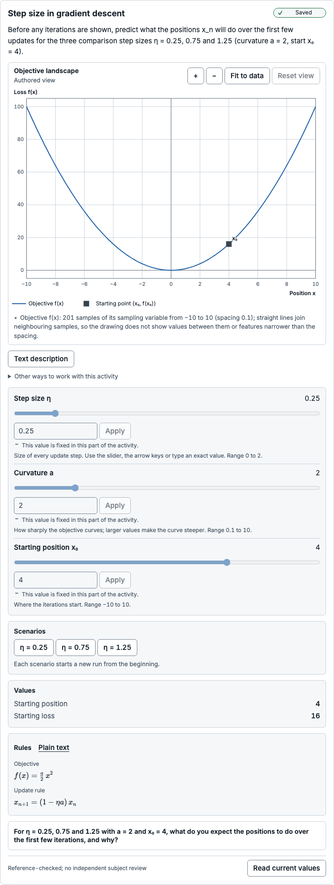
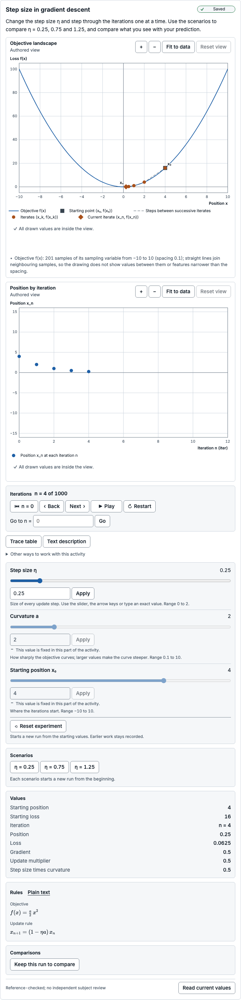
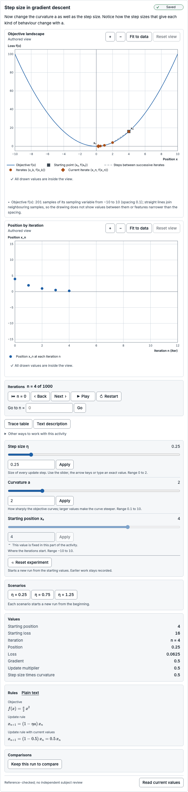
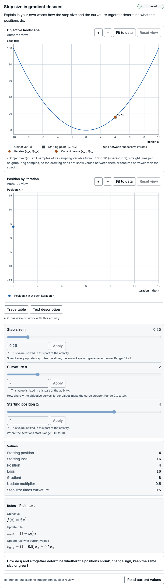
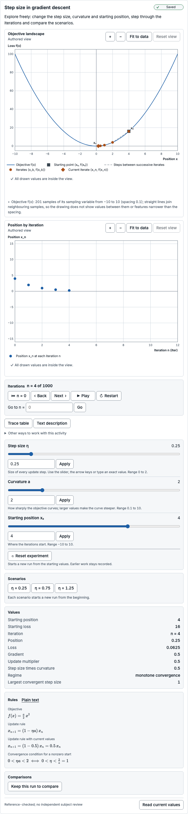

# Subject-review packet: Step size in gradient descent

> Prepared automatically by `experiment-kit activity review-packet` (toolkit 0.3.0-preview.1) for a human subject reviewer.
> It is engineering evidence, **not** a subject review, an accessibility certification or evidence of learning benefit.
> Catalogue status of this exact version: **reference-checked** — no independent human review is recorded.
> The reviewer sign-off at the end is empty; an engineering agent cannot sign it.

## Exact identity

| Item | Value |
| --- | --- |
| Template | quadratic-gradient-descent@1.0.0 |
| Template digest | `sha256:a6fdb69ad2598e7726de2d3d1d81d986677520eab7b29d48fbe9bc81b72ed8c3` |
| Model | quadratic-gradient-descent@1.0.0 |
| Model digest | `sha256:5326283f785aed9a4d5fe0ba5ca32e3f03da6e05bb5c084ee3816fea7b41171e` |
| Scientific revision | `sha256:e942314fe3ae98ce588d26cf266aab805f2f4771104159219c8ac13c33c12645` |
| Presentation revision | `sha256:5dce53f8a1319574ae2fe48436e58404dff4c46dd38a1067c1763765d1cfeeb3` |
| Reference suite bound by the model | quadratic-gradient-descent:1.0.0 `sha256:5e22c857c6557619b9634a0f8791e9567342d517e339883fc0c20b3e9b22c2f2` |
| Reference fixture file | `tests/reference/fixtures/activities/quadratic-gradient-descent.json` `sha256:5e22c857c6557619b9634a0f8791e9567342d517e339883fc0c20b3e9b22c2f2` |
| Fixture binding | matches |
| Execution | installed kernel quadratic-gradient-descent@1.0.0 (discrete) |
| Lifecycle | reference-checked |
| Generated with | toolkit 0.3.0-preview.1, Chromium 156.0.8078.4 |

## Purpose and task intent

Predict, then observe, how the step size η and the curvature a determine the positions produced by fixed-step gradient descent on f(x) = a·x²/2.

| Stage | Kind | Instruction | Host-owned response request | Visible groups (* = solution-bearing) | Controls |
| --- | --- | --- | --- | --- | --- |
| predict | predict | Before any iterations are shown, predict what the positions x_n will do over the first few updates for the three comparison step sizes η = 0.25, 0.75 and 1.25 (curvature a = 2, start x₀ = 4). | prediction: For η = 0.25, 0.75 and 1.25 with a = 2 and x₀ = 4, what do you expect the positions to do over the first few iterations, and why? (task family quadratic-step-size-prediction) | landscape (fixed), start (fixed), update-rule (fixed), step-control (fixed), curvature-control (fixed), start-control (fixed), scenarios (fixed), alternatives (fixed) | eta (fixed), a (fixed), x0 (fixed) |
| explore-step | explore | Change the step size η and step through the iterations one at a time. Use the scenarios to compare η = 0.25, 0.75 and 1.25, and compare what you see with your prediction. | — | landscape (interactive), start (fixed), update-rule (fixed), step-control (interactive), curvature-control (fixed), start-control (fixed), navigation (interactive), trace* (interactive), observations* (fixed), scenarios (interactive), alternatives (fixed) | eta (interactive), a (fixed), x0 (fixed) |
| explore-curvature | explore | Now change the curvature a as well as the step size. Notice how the step sizes that give each kind of behaviour change with a. | — | landscape (interactive), start (fixed), update-rule (fixed), step-control (interactive), curvature-control (interactive), start-control (fixed), navigation (interactive), trace* (interactive), observations* (fixed), substituted-rule* (fixed), scenarios (interactive), alternatives (fixed) | eta (interactive), a (interactive), x0 (fixed) |
| explain | explain | Explain in your own words how the step size and the curvature together determine what the positions do. | explanation: How do η and a together determine whether the positions shrink, change sign, keep the same size or grow? (task family quadratic-step-size-explanation) | landscape (fixed), start (fixed), update-rule (fixed), step-control (fixed), curvature-control (fixed), start-control (fixed), trace* (fixed), observations* (fixed), substituted-rule* (fixed), alternatives (fixed) | eta (fixed), a (fixed), x0 (fixed) |
| closed | closed | This activity is closed. | — | none | none |
| free-explore | explore | Explore freely: change the step size, curvature and starting position, step through the iterations and compare the scenarios. | — | landscape (interactive), start (fixed), update-rule (fixed), step-control (interactive), curvature-control (interactive), start-control (interactive), navigation (interactive), trace* (interactive), observations* (fixed), regime* (fixed), substituted-rule* (fixed), scenarios (interactive), alternatives (fixed) | eta (interactive), a (interactive), x0 (interactive) |

Transitions: predict → explore-step (“Show the iterations and explore the step size”); explore-step → explore-curvature (“Add the curvature control”); explore-curvature → explain (“Ask for an explanation”); explore-step → explain (“Ask for an explanation without the curvature control”); explain → closed (“Close the activity”); predict → closed (“Close the activity”); explore-step → closed (“Close the activity”); explore-curvature → closed (“Close the activity”); free-explore → closed (“Close the activity”). Initial stage: predict.

Host-owned task families (the visualizer never collects, stores or grades responses):

| Task family | Description |
| --- | --- |
| quadratic-step-size-prediction | Host-owned prediction request about how the step size changes fixed-step gradient descent on f(x) = a·x²/2. The host owns the response, its capture and any evaluation. |
| quadratic-step-size-explanation | Host-owned explanation request about how step size and curvature together determine the iterates. The host owns the response, its capture and any evaluation. |
| quadratic-new-curvature-task | Host-owned later task with a new curvature or a recurrence representation. Its prompts, held-out items and scoring stay with the host and are not part of this catalogue. |

## Derivation

- **derivation-closed-form** (derivation): Closed form written for this catalogue: f′(x) = a·x, so x_{n+1} = x_n − η·f′(x_n) = (1 − η·a)·x_n and, by induction, x_n = x0·(1 − η·a)^n. For x0 ≠ 0 the positions tend to 0 exactly when |1 − η·a| < 1, that is 0 < η·a < 2. Not independently reviewed.
- **study-harness-specification** (specification): Study Harness Original Project Specification (25 October 2026), section 10: exact quadratic gradient-descent worked example, boundary cases and staged controls, as carried into the Study Harness visualizer implementation report §12.3.
- Template derivation note **derivation-closed-form**: Closed form written for this catalogue: f′(x) = a·x, so x_{n+1} = x_n − η·f′(x_n) = (1 − η·a)·x_n and, by induction, x_n = x0·(1 − η·a)^n. For x0 ≠ 0 the positions tend to 0 exactly when |1 − η·a| < 1, that is 0 < η·a < 2. Not independently reviewed.

## Assumptions

- The objective is exactly the quadratic f(x) = a·x²/2 with a > 0: no noise and no higher-order terms.
- The step size η is the same for every update.
- Evaluation is deterministic on every conforming JavaScript engine: values come from exactly specified arithmetic rounded once (a logarithm only estimates the first index of a numerical limit, which is then verified exactly), so the same parameters and iteration always give the same values.
- Real numbers are IEEE-754 double-precision values; the product η·a is computed once in double precision and the regime is classified from it.

## Limitations

- Positions are evaluated from the closed form x_n = x0·(1 − η·a)^n with extended-precision intermediates and one final rounding; the recurrence is not stepped.
- Iterations are bounded to 0 ≤ n ≤ 1000, and η·a is at most 4.
- Values beyond the double range are numerical-limit statuses: overflow above Number.MAX_VALUE with the last finite iteration, or underflow of a nonzero value to zero. Subnormal values are reported as reduced-precision approximations.
- Displayed rounding is separate from computation: a value shown as 0 at display precision is not exact convergence, and the regime never depends on displayed digits.
- The objective curve is sampled at 201 points; the polyline between samples does not certify values between them.

## Units and conventions

- Coordinates: Position x lies on a horizontal axis, positive to the right, with the minimum of f at x = 0. The iteration index n counts updates from n = 0; it is not a time.

Parameters (canonical units; the authoring step is a UI increment unless admissibility says otherwise):

| Parameter | Label | Unit | Domain | Default | Admissible values |
| --- | --- | --- | --- | --- | --- |
| a | Curvature | dimensionless | [0.1, 10] | 2 | continuous |
| eta | Step size | dimensionless | [0, 2] | 0.25 | continuous |
| x0 | Starting position | dimensionless | [-10, 10] | 4 | continuous |

Quantities:

| Quantity | Label | Shape | Unit | Meaning | Sign convention | Frame |
| --- | --- | --- | --- | --- | --- | --- |
| start.position | Starting position | scalar | dimensionless | Position at iteration 0; equal to the parameter x0. | Positive positions lie to the right of the minimum at x = 0. | position-loss plane |
| start.loss | Starting loss | scalar | dimensionless | Objective value a·x0²/2 at the starting position; never negative. | — | position-loss plane |
| position | Position | scalar | dimensionless | Position after n fixed-step gradient-descent updates: x_n = x0·(1 − η·a)^n. | Positive positions lie to the right of the minimum at x = 0. | position-loss plane |
| loss | Loss | scalar | dimensionless | Objective value a·x_n²/2 at the current position; never negative. | — | position-loss plane |
| gradient | Gradient | scalar | dimensionless | Derivative a·x_n of the objective at the current position. | Positive when the objective increases to the right. | position-loss plane |
| multiplier | Update multiplier | scalar | dimensionless | Factor r = 1 − η·a applied to the position by every update, using the double-precision product η·a. | — | — |
| product | Step size times curvature | scalar | dimensionless | Product η·a, computed once in IEEE-754 double precision; the regime is classified from this value. | — | — |
| threshold | Largest convergent step size | scalar | dimensionless | Step size 2/a. Positive step sizes below it bring a nonzero start to 0; at it the positions alternate with constant magnitude. | — | — |
| regime | Regime | category: zero-start, stationary, monotone-convergence, one-step, alternating-convergence, oscillation, divergence | dimensionless | Classification from the declared conditions on x0 and the product p = η·a: zero-start (x0 = 0), stationary (p = 0), monotone-convergence (0 < p < 1), one-step (p = 1), alternating-convergence (1 < p < 2), oscillation (p = 2), divergence (p > 2). Never derived from iterates or displayed digits. | — | — |
| index | Iteration | scalar | iteration | Integer number of updates applied, from 0 to 1000. Not a time. | — | — |

Coupled constraints (enforced at every entry point):

| Constraint | Expression | Bounds | Message |
| --- | --- | --- | --- |
| multiplier-lower-bound | `eta * a` | value ≤ 4 | The step size times the curvature (η·a) can be at most 4, which keeps the update factor 1 − η·a at or above −3 and the iterations inside the supported numerical range. |

## Reference cases

Suite `quadratic-gradient-descent:1.0.0` for quadratic-gradient-descent@1.0.0: **55 of 55 cases agree** with frames evaluated in a browser module worker (363 evaluation points; rejection cases must be refused before evaluation).

- Author of the cases: Reference cases from the implementation report §12.3 plus cases derived by exact rational arithmetic in tests/reference/oracles/quadratic.ts, which shares no code with the catalogue kernel.
- Review statement of the fixture: No independent human subject reviewer has approved these cases. Automated agreement is engineering evidence only.
- Semantics: f(x) = a·x²/2 with a > 0; x[n+1] = (1 − p)·x[n] where p = η·a is the IEEE-754 double product of the inputs, computed once. Positions, gradients a·x[n] and losses a·x[n]²/2 are exact values for those inputs, rounded once to the nearest double. The regime depends only on (x0, p): zero-start if x0 = 0, else stationary (p = 0), monotone-convergence (0 < p < 1), one-step (p = 1), alternating-convergence (1 < p < 2), oscillation (p = 2), divergence (p > 2).
- Converted from `tests/reference/fixtures/activities/quadratic-gradient-descent.json` `sha256:5e22c857c6557619b9634a0f8791e9567342d517e339883fc0c20b3e9b22c2f2` (suite quadratic-gradient-descent:1.0.0): Converted by experiment-kit activity tooling: case IDs, labels, provenance, parameters and tolerances copied unchanged; quantity expectations restated as experiment-kit.reference-fixtures 1.0 expectations. Parameter-only quantities restated at every point of a case: start.position is the case's x0 (declared equal to it), start.loss is the case's own loss expectation at n = 0, and product is the IEEE-754 double product of the case's η and a, which the suite's declared semantics define as p (compared exactly).
- Not compared by this runner: Trace geometry (the trace ends at the current position or stops with a reason), the starting marker, the sampled objective curve and the current-iterate marker are checked by tests/reference/activities/quadratic.test.ts.

| Case | Label | Provenance | Tolerance | Result |
| --- | --- | --- | --- | --- |
| report-eta-0.25 | a = 2, η = 0.25, x0 = 4: first four positions 4, 2, 1, 0.5 | report §12.3 (tabulated sequence); loss, gradient, multiplier, threshold and regime derived by hand from f(x) = a·x²/2 and cross-checked by exact rational arithmetic (tests/reference/oracles/quadratic.ts) | exact; index: exact; start.position: exact; product: exact | pass (4 points) |
| report-eta-0.75 | a = 2, η = 0.75, x0 = 4: first four positions 4, −2, 1, −0.5 | report §12.3 (tabulated sequence); loss, gradient, multiplier, threshold and regime derived by hand from f(x) = a·x²/2 and cross-checked by exact rational arithmetic (tests/reference/oracles/quadratic.ts) | exact; index: exact; start.position: exact; product: exact | pass (4 points) |
| report-eta-1.25 | a = 2, η = 1.25, x0 = 4: first four positions 4, −6, 9, −13.5 | report §12.3 (tabulated sequence); loss, gradient, multiplier, threshold and regime derived by hand from f(x) = a·x²/2 and cross-checked by exact rational arithmetic (tests/reference/oracles/quadratic.ts) | exact; index: exact; start.position: exact; product: exact | pass (6 points) |
| zero-start-stationary | x0 = 0 with a = 2, η = 0: position stays exactly 0 through n = 1000 | report §12.3 (x0 = 0 in any allowed regime); expected values derived independently by exact rational arithmetic (tests/reference/oracles/quadratic.ts) | exact; index: exact; start.position: exact; product: exact | pass (4 points) |
| zero-start-monotone | x0 = 0 with a = 2, η = 0.25: position stays exactly 0 through n = 1000 | report §12.3 (x0 = 0 in any allowed regime); expected values derived independently by exact rational arithmetic (tests/reference/oracles/quadratic.ts) | exact; index: exact; start.position: exact; product: exact | pass (4 points) |
| zero-start-one-step | x0 = 0 with a = 2, η = 0.5: position stays exactly 0 through n = 1000 | report §12.3 (x0 = 0 in any allowed regime); expected values derived independently by exact rational arithmetic (tests/reference/oracles/quadratic.ts) | exact; index: exact; start.position: exact; product: exact | pass (4 points) |
| zero-start-alternating | x0 = 0 with a = 2, η = 0.75: position stays exactly 0 through n = 1000 | report §12.3 (x0 = 0 in any allowed regime); expected values derived independently by exact rational arithmetic (tests/reference/oracles/quadratic.ts) | exact; index: exact; start.position: exact; product: exact | pass (4 points) |
| zero-start-oscillation | x0 = 0 with a = 2, η = 1: position stays exactly 0 through n = 1000 | report §12.3 (x0 = 0 in any allowed regime); expected values derived independently by exact rational arithmetic (tests/reference/oracles/quadratic.ts) | exact; index: exact; start.position: exact; product: exact | pass (4 points) |
| zero-start-divergence | x0 = 0 with a = 2, η = 1.25: position stays exactly 0 through n = 1000 | report §12.3 (x0 = 0 in any allowed regime); expected values derived independently by exact rational arithmetic (tests/reference/oracles/quadratic.ts) | exact; index: exact; start.position: exact; product: exact | pass (4 points) |
| zero-start-divergence-multiplier-minus-3 | x0 = 0 with a = 10, η = 0.4: position stays exactly 0 through n = 1000 | report §12.3 (x0 = 0 in any allowed regime); expected values derived independently by exact rational arithmetic (tests/reference/oracles/quadratic.ts) | exact; index: exact; start.position: exact; product: exact | pass (4 points) |
| zero-start-divergence-eta-max | x0 = 0 with a = 2, η = 2: position stays exactly 0 through n = 1000 | report §12.3 (x0 = 0 in any allowed regime); expected values derived independently by exact rational arithmetic (tests/reference/oracles/quadratic.ts) | exact; index: exact; start.position: exact; product: exact | pass (4 points) |
| zero-start-monotone-curvature-min | x0 = 0 with a = 0.1, η = 2: position stays exactly 0 through n = 1000 | report §12.3 (x0 = 0 in any allowed regime); expected values derived independently by exact rational arithmetic (tests/reference/oracles/quadratic.ts) | exact; index: exact; start.position: exact; product: exact | pass (4 points) |
| eta-zero | η = 0, a = 2, x0 = 4: position stays at x0 | report §12.3 (eta = 0); expected values derived independently by exact rational arithmetic (tests/reference/oracles/quadratic.ts) | exact; index: exact; start.position: exact; product: exact | pass (5 points) |
| eta-zero-negative-start | η = 0, a = 7.3, x0 = −9.75: position stays at x0 | report §12.3 (eta = 0); expected values derived independently by exact rational arithmetic (tests/reference/oracles/quadratic.ts) | abs 0, rel 1e-12; index: exact; start.position: exact; product: exact | pass (5 points) |
| one-step-a2-eta0.5 | a = 2, η = 0.5 (η·a = 1), x0 = 4: x0 at n = 0, exactly 0 afterwards | report §12.3 (eta*a = 1); expected values derived independently by exact rational arithmetic (tests/reference/oracles/quadratic.ts) | exact; index: exact; start.position: exact; product: exact | pass (5 points) |
| one-step-a5-eta0.2 | a = 5, η = 0.2 (η·a = 1), x0 = -3: x0 at n = 0, exactly 0 afterwards | report §12.3 (eta*a = 1); expected values derived independently by exact rational arithmetic (tests/reference/oracles/quadratic.ts) | exact; index: exact; start.position: exact; product: exact | pass (5 points) |
| one-step-a10-eta0.1 | a = 10, η = 0.1 (η·a = 1), x0 = 7: x0 at n = 0, exactly 0 afterwards | report §12.3 (eta*a = 1); expected values derived independently by exact rational arithmetic (tests/reference/oracles/quadratic.ts) | exact; index: exact; start.position: exact; product: exact | pass (5 points) |
| one-step-a0.5-eta2 | a = 0.5, η = 2 (η·a = 1), x0 = 10: x0 at n = 0, exactly 0 afterwards | report §12.3 (eta*a = 1); expected values derived independently by exact rational arithmetic (tests/reference/oracles/quadratic.ts) | exact; index: exact; start.position: exact; product: exact | pass (5 points) |
| oscillation-a2-eta1 | a = 2, η = 1 (η·a = 2), x0 = 4: ±x0 alternating with constant magnitude | report §12.3 (eta*a = 2); expected values derived independently by exact rational arithmetic (tests/reference/oracles/quadratic.ts) | exact; index: exact; start.position: exact; product: exact | pass (6 points) |
| oscillation-a5-eta0.4 | a = 5, η = 0.4 (η·a = 2), x0 = -3: ±x0 alternating with constant magnitude | report §12.3 (eta*a = 2); expected values derived independently by exact rational arithmetic (tests/reference/oracles/quadratic.ts) | exact; index: exact; start.position: exact; product: exact | pass (6 points) |
| oscillation-a1-eta2 | a = 1, η = 2 (η·a = 2), x0 = 10: ±x0 alternating with constant magnitude | report §12.3 (eta*a = 2); expected values derived independently by exact rational arithmetic (tests/reference/oracles/quadratic.ts) | exact; index: exact; start.position: exact; product: exact | pass (6 points) |
| oscillation-a4-eta0.5 | a = 4, η = 0.5 (η·a = 2), x0 = 0.1: ±x0 alternating with constant magnitude | report §12.3 (eta*a = 2); expected values derived independently by exact rational arithmetic (tests/reference/oracles/quadratic.ts) | abs 0, rel 1e-12; index: exact; start.position: exact; product: exact | pass (6 points) |
| neighbour-a2-eta0.5-below | a = 2, η = 0.49999999999999994 (adjacent double below 0.5), x0 = 4 | report §12.3 (neighbouring floating-point values around each boundary); expected values derived independently by exact rational arithmetic (tests/reference/oracles/quadratic.ts) | exact; index: exact; start.position: exact; product: exact | pass (7 points) |
| neighbour-a2-eta0.5-above | a = 2, η = 0.5000000000000001 (adjacent double above 0.5), x0 = 4 | report §12.3 (neighbouring floating-point values around each boundary); expected values derived independently by exact rational arithmetic (tests/reference/oracles/quadratic.ts) | exact; index: exact; start.position: exact; product: exact | pass (7 points) |
| neighbour-a2-eta1-below | a = 2, η = 0.9999999999999999 (adjacent double below 1), x0 = 4 | report §12.3 (neighbouring floating-point values around each boundary); expected values derived independently by exact rational arithmetic (tests/reference/oracles/quadratic.ts) | abs 0, rel 1e-12; index: exact; start.position: exact; product: exact | pass (6 points) |
| neighbour-a2-eta1-above | a = 2, η = 1.0000000000000002 (adjacent double above 1), x0 = 4 | report §12.3 (neighbouring floating-point values around each boundary); expected values derived independently by exact rational arithmetic (tests/reference/oracles/quadratic.ts) | abs 0, rel 1e-12; index: exact; start.position: exact; product: exact | pass (6 points) |
| neighbour-a5-eta0.2-below | a = 5, η = 0.19999999999999998 (adjacent double below 0.2), x0 = 4 | report §12.3 (neighbouring floating-point values around each boundary); expected values derived independently by exact rational arithmetic (tests/reference/oracles/quadratic.ts) | exact; index: exact; start.position: exact; product: exact | pass (7 points) |
| neighbour-a5-eta0.2-above | a = 5, η = 0.20000000000000004 (adjacent double above 0.2), x0 = 4 | report §12.3 (neighbouring floating-point values around each boundary); expected values derived independently by exact rational arithmetic (tests/reference/oracles/quadratic.ts) | exact; index: exact; start.position: exact; product: exact | pass (7 points) |
| neighbour-a5-eta0.4-below | a = 5, η = 0.39999999999999997 (adjacent double below 0.4), x0 = 4 | report §12.3 (neighbouring floating-point values around each boundary); expected values derived independently by exact rational arithmetic (tests/reference/oracles/quadratic.ts) | abs 0, rel 1e-12; index: exact; start.position: exact; product: exact | pass (7 points) |
| neighbour-a5-eta0.4-above | a = 5, η = 0.4000000000000001 (adjacent double above 0.4), x0 = 4 | report §12.3 (neighbouring floating-point values around each boundary); expected values derived independently by exact rational arithmetic (tests/reference/oracles/quadratic.ts) | abs 0, rel 1e-12; index: exact; start.position: exact; product: exact | pass (7 points) |
| a5-eta0.05 | a = 5, η = 0.05, x0 = 4 (convergence interval 0 < η < 0.4) | report §12.3 (a = 5 and positive step sizes); expected values derived independently by exact rational arithmetic (tests/reference/oracles/quadratic.ts) | abs 0, rel 1e-12; index: exact; start.position: exact; product: exact | pass (7 points) |
| a5-eta0.1 | a = 5, η = 0.1, x0 = 4 (convergence interval 0 < η < 0.4) | report §12.3 (a = 5 and positive step sizes); expected values derived independently by exact rational arithmetic (tests/reference/oracles/quadratic.ts) | exact; index: exact; start.position: exact; product: exact | pass (7 points) |
| a5-eta0.2 | a = 5, η = 0.2, x0 = 4 (convergence interval 0 < η < 0.4) | report §12.3 (a = 5 and positive step sizes); expected values derived independently by exact rational arithmetic (tests/reference/oracles/quadratic.ts) | exact; index: exact; start.position: exact; product: exact | pass (7 points) |
| a5-eta0.3 | a = 5, η = 0.3, x0 = 4 (convergence interval 0 < η < 0.4) | report §12.3 (a = 5 and positive step sizes); expected values derived independently by exact rational arithmetic (tests/reference/oracles/quadratic.ts) | exact; index: exact; start.position: exact; product: exact | pass (7 points) |
| a5-eta0.39 | a = 5, η = 0.39, x0 = 4 (convergence interval 0 < η < 0.4) | report §12.3 (a = 5 and positive step sizes); expected values derived independently by exact rational arithmetic (tests/reference/oracles/quadratic.ts) | abs 0, rel 1e-12; index: exact; start.position: exact; product: exact | pass (7 points) |
| a5-eta0.4 | a = 5, η = 0.4, x0 = 4 (convergence interval 0 < η < 0.4) | report §12.3 (a = 5 and positive step sizes); expected values derived independently by exact rational arithmetic (tests/reference/oracles/quadratic.ts) | exact; index: exact; start.position: exact; product: exact | pass (7 points) |
| a5-eta0.41 | a = 5, η = 0.41, x0 = 4 (convergence interval 0 < η < 0.4) | report §12.3 (a = 5 and positive step sizes); expected values derived independently by exact rational arithmetic (tests/reference/oracles/quadratic.ts) | abs 0, rel 1e-12; index: exact; start.position: exact; product: exact | pass (7 points) |
| a5-eta0.6 | a = 5, η = 0.6, x0 = 4 (convergence interval 0 < η < 0.4) | report §12.3 (a = 5 and positive step sizes); expected values derived independently by exact rational arithmetic (tests/reference/oracles/quadratic.ts) | exact; index: exact; start.position: exact; product: exact | pass (9 points) |
| a5-eta0.8 | a = 5, η = 0.8, x0 = 4 (convergence interval 0 < η < 0.4) | report §12.3 (a = 5 and positive step sizes); expected values derived independently by exact rational arithmetic (tests/reference/oracles/quadratic.ts) | abs 0, rel 1e-12; index: exact; start.position: exact; product: exact | pass (13 points) |
| multiplier-minus-0.8-x0-4 | a = 2, η = 0.9 (multiplier −0.8), x0 = 4: alternating convergence | report §12.3 (multiplier -0.8); expected values derived independently by exact rational arithmetic (tests/reference/oracles/quadratic.ts) | abs 0, rel 1e-12; index: exact; start.position: exact; product: exact | pass (6 points) |
| multiplier-minus-0.8-x0--7.5 | a = 2, η = 0.9 (multiplier −0.8), x0 = -7.5: alternating convergence | report §12.3 (multiplier -0.8); expected values derived independently by exact rational arithmetic (tests/reference/oracles/quadratic.ts) | abs 0, rel 1e-12; index: exact; start.position: exact; product: exact | pass (6 points) |
| multiplier-minus-0.8-x0-10 | a = 2, η = 0.9 (multiplier −0.8), x0 = 10: alternating convergence | report §12.3 (multiplier -0.8); expected values derived independently by exact rational arithmetic (tests/reference/oracles/quadratic.ts) | abs 0, rel 1e-12; index: exact; start.position: exact; product: exact | pass (6 points) |
| multiplier-minus-0.8-x0-0.001 | a = 2, η = 0.9 (multiplier −0.8), x0 = 0.001: alternating convergence | report §12.3 (multiplier -0.8); expected values derived independently by exact rational arithmetic (tests/reference/oracles/quadratic.ts) | abs 0, rel 1e-12; index: exact; start.position: exact; product: exact | pass (6 points) |
| multiplier-minus-0.8-x0--10 | a = 2, η = 0.9 (multiplier −0.8), x0 = -10: alternating convergence | report §12.3 (multiplier -0.8); expected values derived independently by exact rational arithmetic (tests/reference/oracles/quadratic.ts) | abs 0, rel 1e-12; index: exact; start.position: exact; product: exact | pass (6 points) |
| multiplier-minus-0.8-a4 | a = 4, η = 0.45 (multiplier −0.8), x0 = 1: alternating convergence | report §12.3 (multiplier -0.8); expected values derived independently by exact rational arithmetic (tests/reference/oracles/quadratic.ts) | abs 0, rel 1e-12; index: exact; start.position: exact; product: exact | pass (6 points) |
| overflow-multiplier-minus-3 | a = 10, η = 0.4, x0 = 10: \|x_n\| = 10·3^n exceeds Number.MAX_VALUE | report §12.3 (growing sequence beyond representable bounds); expected values derived independently by exact rational arithmetic (tests/reference/oracles/quadratic.ts) | abs 0, rel 1e-12; index: exact; start.position: exact; product: exact | pass (16 points) |
| overflow-small-start | a = 10, η = 0.4, x0 = 0.001: 3^n overflows before 0.001·3^n does | report §12.3 (growing sequence beyond representable bounds); expected values derived independently by exact rational arithmetic (tests/reference/oracles/quadratic.ts) | abs 0, rel 1e-12; index: exact; start.position: exact; product: exact | pass (14 points) |
| overflow-negative-start | a = 10, η = 0.4, x0 = −10: sign alternates up to the last finite iterate | report §12.3 (growing sequence beyond representable bounds); expected values derived independently by exact rational arithmetic (tests/reference/oracles/quadratic.ts) | abs 0, rel 1e-12; index: exact; start.position: exact; product: exact | pass (11 points) |
| underflow-multiplier-0.25 | a = 2, η = 0.375 (multiplier 0.25), x0 = 4: x_n = 2^(2−2n) through the subnormal range to underflow | report §12.3 (underflow as a numerical approximation); expected values derived independently by exact rational arithmetic (tests/reference/oracles/quadratic.ts) | exact; index: exact; start.position: exact; product: exact | pass (14 points) |
| underflow-inexact-subnormal | a = 2, η = 0.375, x0 = −3: subnormal values that are not exactly representable | report §12.3 (underflow as a numerical approximation); expected values derived independently by exact rational arithmetic (tests/reference/oracles/quadratic.ts) | abs 0, rel 1e-12; index: exact; start.position: exact; product: exact | pass (9 points) |
| default-long-run | Default a = 2, η = 0.25, x0 = 4 to n = 1000: loss underflows while position stays normal | report §12.3 (underflow as a numerical approximation); expected values derived independently by exact rational arithmetic (tests/reference/oracles/quadratic.ts) | exact; index: exact; start.position: exact; product: exact | pass (10 points) |
| interior-curvature-min | a = 0.1, η = 2, x0 = −10: monotone convergence at the smallest curvature | derived independently by exact rational arithmetic (tests/reference/oracles/quadratic.ts) | abs 0, rel 1e-12; index: exact; start.position: exact; product: exact | pass (6 points) |
| interior-alternating-a10 | a = 10, η = 0.15, x0 = 3: alternating convergence | derived independently by exact rational arithmetic (tests/reference/oracles/quadratic.ts) | exact; index: exact; start.position: exact; product: exact | pass (6 points) |
| interior-alternating-a3 | a = 3, η = 0.5, x0 = 1: multiplier −0.5 | derived independently by exact rational arithmetic (tests/reference/oracles/quadratic.ts) | exact; index: exact; start.position: exact; product: exact | pass (6 points) |
| interior-divergence-a7 | a = 7, η = 0.3, x0 = 2.5: multiplier −1.1, divergence without overflow by n = 1000 | derived independently by exact rational arithmetic (tests/reference/oracles/quadratic.ts) | abs 0, rel 1e-12; index: exact; start.position: exact; product: exact | pass (6 points) |

## Mutation sensitivity

Generic faults injected into the evaluated model inside the checks worker (outputs or inputs altered after the kernel, one fault at a time); a mutant is detected when at least one reference case disagrees. **24 of 24 detected.**

| Fault | Mutants | Detected | Undetected targets |
| --- | --- | --- | --- |
| sign | 9 | 9 | — |
| factor | 9 | 9 | — |
| limit-as-zero | 3 | 3 | — |
| boundary-nudge | 3 | 3 | — |

Activity-specific mutants (for example wrong conventions, transposed inputs and incorrect boundaries) are exercised in the mutation-sensitivity tests of `tests/reference/activities/quadratic.test.ts`; hidden-output leakage across output channels is tested in `tests/activity/disclosure.test.ts`. Those results are not restated here.

## Boundary cases

Declared cases come from the package (or the installed suite's non-valid expectations); generated probes test the declared domain edges. Outcomes: valid / undefined / numerical-limit / out-of-domain (rejected before evaluation) / worker-error.

| Case | Source | Parameters | Position | Outcome | Non-valid statuses | Expectation |
| --- | --- | --- | --- | --- | --- | --- |
| report-eta-1.25@n=872: a = 2, η = 1.25, x0 = 4: first four positions 4, −6, 9, −13.5 (n = 872) | declared | a = 2, eta = 1.25, x0 = 4 | n = 872 | numerical-limit | loss: numerical-limit:OVERFLOW | met |
| neighbour-a2-eta0.5-below@n=19: a = 2, η = 0.49999999999999994 (adjacent double below 0.5), x0 = 4 (n = 19) | declared | a = 2, eta = 0.49999999999999994, x0 = 4 | n = 19 | numerical-limit | loss: numerical-limit:UNDERFLOW | met |
| neighbour-a2-eta0.5-below@n=20: a = 2, η = 0.49999999999999994 (adjacent double below 0.5), x0 = 4 (n = 20) | declared | a = 2, eta = 0.49999999999999994, x0 = 4 | n = 20 | numerical-limit | position: valid:UNDERFLOW, loss: numerical-limit:UNDERFLOW, gradient: valid:UNDERFLOW | met |
| neighbour-a2-eta0.5-below@n=21: a = 2, η = 0.49999999999999994 (adjacent double below 0.5), x0 = 4 (n = 21) | declared | a = 2, eta = 0.49999999999999994, x0 = 4 | n = 21 | numerical-limit | position: numerical-limit:UNDERFLOW, loss: numerical-limit:UNDERFLOW, gradient: numerical-limit:UNDERFLOW | met |
| neighbour-a2-eta0.5-below@n=1000: a = 2, η = 0.49999999999999994 (adjacent double below 0.5), x0 = 4 (n = 1000) | declared | a = 2, eta = 0.49999999999999994, x0 = 4 | n = 1000 | numerical-limit | position: numerical-limit:UNDERFLOW, loss: numerical-limit:UNDERFLOW, gradient: numerical-limit:UNDERFLOW | met |
| neighbour-a2-eta0.5-above@n=19: a = 2, η = 0.5000000000000001 (adjacent double above 0.5), x0 = 4 (n = 19) | declared | a = 2, eta = 0.5000000000000001, x0 = 4 | n = 19 | numerical-limit | loss: numerical-limit:UNDERFLOW | met |
| neighbour-a2-eta0.5-above@n=20: a = 2, η = 0.5000000000000001 (adjacent double above 0.5), x0 = 4 (n = 20) | declared | a = 2, eta = 0.5000000000000001, x0 = 4 | n = 20 | numerical-limit | position: valid:UNDERFLOW, loss: numerical-limit:UNDERFLOW, gradient: valid:UNDERFLOW | met |
| neighbour-a2-eta0.5-above@n=21: a = 2, η = 0.5000000000000001 (adjacent double above 0.5), x0 = 4 (n = 21) | declared | a = 2, eta = 0.5000000000000001, x0 = 4 | n = 21 | numerical-limit | position: numerical-limit:UNDERFLOW, loss: numerical-limit:UNDERFLOW, gradient: numerical-limit:UNDERFLOW | met |
| neighbour-a2-eta0.5-above@n=1000: a = 2, η = 0.5000000000000001 (adjacent double above 0.5), x0 = 4 (n = 1000) | declared | a = 2, eta = 0.5000000000000001, x0 = 4 | n = 1000 | numerical-limit | position: numerical-limit:UNDERFLOW, loss: numerical-limit:UNDERFLOW, gradient: numerical-limit:UNDERFLOW | met |
| neighbour-a5-eta0.2-below@n=10: a = 5, η = 0.19999999999999998 (adjacent double below 0.2), x0 = 4 (n = 10) | declared | a = 5, eta = 0.19999999999999998, x0 = 4 | n = 10 | valid | loss: valid:UNDERFLOW | met |
| neighbour-a5-eta0.2-below@n=100: a = 5, η = 0.19999999999999998 (adjacent double below 0.2), x0 = 4 (n = 100) | declared | a = 5, eta = 0.19999999999999998, x0 = 4 | n = 100 | numerical-limit | position: numerical-limit:UNDERFLOW, loss: numerical-limit:UNDERFLOW, gradient: numerical-limit:UNDERFLOW | met |
| neighbour-a5-eta0.2-below@n=1000: a = 5, η = 0.19999999999999998 (adjacent double below 0.2), x0 = 4 (n = 1000) | declared | a = 5, eta = 0.19999999999999998, x0 = 4 | n = 1000 | numerical-limit | position: numerical-limit:UNDERFLOW, loss: numerical-limit:UNDERFLOW, gradient: numerical-limit:UNDERFLOW | met |
| neighbour-a5-eta0.2-above@n=10: a = 5, η = 0.20000000000000004 (adjacent double above 0.2), x0 = 4 (n = 10) | declared | a = 5, eta = 0.20000000000000004, x0 = 4 | n = 10 | valid | loss: valid:UNDERFLOW | met |
| neighbour-a5-eta0.2-above@n=100: a = 5, η = 0.20000000000000004 (adjacent double above 0.2), x0 = 4 (n = 100) | declared | a = 5, eta = 0.20000000000000004, x0 = 4 | n = 100 | numerical-limit | position: numerical-limit:UNDERFLOW, loss: numerical-limit:UNDERFLOW, gradient: numerical-limit:UNDERFLOW | met |
| neighbour-a5-eta0.2-above@n=1000: a = 5, η = 0.20000000000000004 (adjacent double above 0.2), x0 = 4 (n = 1000) | declared | a = 5, eta = 0.20000000000000004, x0 = 4 | n = 1000 | numerical-limit | position: numerical-limit:UNDERFLOW, loss: numerical-limit:UNDERFLOW, gradient: numerical-limit:UNDERFLOW | met |
| a5-eta0.1@n=1000: a = 5, η = 0.1, x0 = 4 (convergence interval 0 < η < 0.4) (n = 1000) | declared | a = 5, eta = 0.1, x0 = 4 | n = 1000 | numerical-limit | loss: numerical-limit:UNDERFLOW | met |
| a5-eta0.3@n=1000: a = 5, η = 0.3, x0 = 4 (convergence interval 0 < η < 0.4) (n = 1000) | declared | a = 5, eta = 0.3, x0 = 4 | n = 1000 | numerical-limit | loss: numerical-limit:UNDERFLOW | met |
| a5-eta0.6@n=1000: a = 5, η = 0.6, x0 = 4 (convergence interval 0 < η < 0.4) (n = 1000) | declared | a = 5, eta = 0.6, x0 = 4 | n = 1000 | numerical-limit | loss: numerical-limit:OVERFLOW | met |
| a5-eta0.6@n=510: a = 5, η = 0.6, x0 = 4 (convergence interval 0 < η < 0.4) (n = 510) | declared | a = 5, eta = 0.6, x0 = 4 | n = 510 | numerical-limit | loss: numerical-limit:OVERFLOW | met |
| a5-eta0.8@n=1000: a = 5, η = 0.8, x0 = 4 (convergence interval 0 < η < 0.4) (n = 1000) | declared | a = 5, eta = 0.8, x0 = 4 | n = 1000 | numerical-limit | position: numerical-limit:OVERFLOW, loss: numerical-limit:OVERFLOW, gradient: numerical-limit:OVERFLOW | met |
| a5-eta0.8@n=645: a = 5, η = 0.8, x0 = 4 (convergence interval 0 < η < 0.4) (n = 645) | declared | a = 5, eta = 0.8, x0 = 4 | n = 645 | numerical-limit | position: numerical-limit:OVERFLOW, loss: numerical-limit:OVERFLOW, gradient: numerical-limit:OVERFLOW | met |
| a5-eta0.8@n=322: a = 5, η = 0.8, x0 = 4 (convergence interval 0 < η < 0.4) (n = 322) | declared | a = 5, eta = 0.8, x0 = 4 | n = 322 | numerical-limit | loss: numerical-limit:OVERFLOW | met |
| a5-eta0.8@n=644: a = 5, η = 0.8, x0 = 4 (convergence interval 0 < η < 0.4) (n = 644) | declared | a = 5, eta = 0.8, x0 = 4 | n = 644 | numerical-limit | loss: numerical-limit:OVERFLOW, gradient: numerical-limit:OVERFLOW | met |
| overflow-multiplier-minus-3@n=321: a = 10, η = 0.4, x0 = 10: \|x_n\| = 10·3^n exceeds Number.MAX_VALUE (n = 321) | declared | a = 10, eta = 0.4, x0 = 10 | n = 321 | numerical-limit | loss: numerical-limit:OVERFLOW | met |
| overflow-multiplier-minus-3@n=641: a = 10, η = 0.4, x0 = 10: \|x_n\| = 10·3^n exceeds Number.MAX_VALUE (n = 641) | declared | a = 10, eta = 0.4, x0 = 10 | n = 641 | numerical-limit | loss: numerical-limit:OVERFLOW | met |
| overflow-multiplier-minus-3@n=642: a = 10, η = 0.4, x0 = 10: \|x_n\| = 10·3^n exceeds Number.MAX_VALUE (n = 642) | declared | a = 10, eta = 0.4, x0 = 10 | n = 642 | numerical-limit | loss: numerical-limit:OVERFLOW, gradient: numerical-limit:OVERFLOW | met |
| overflow-multiplier-minus-3@n=643: a = 10, η = 0.4, x0 = 10: \|x_n\| = 10·3^n exceeds Number.MAX_VALUE (n = 643) | declared | a = 10, eta = 0.4, x0 = 10 | n = 643 | numerical-limit | loss: numerical-limit:OVERFLOW, gradient: numerical-limit:OVERFLOW | met |
| overflow-multiplier-minus-3@n=644: a = 10, η = 0.4, x0 = 10: \|x_n\| = 10·3^n exceeds Number.MAX_VALUE (n = 644) | declared | a = 10, eta = 0.4, x0 = 10 | n = 644 | numerical-limit | position: numerical-limit:OVERFLOW, loss: numerical-limit:OVERFLOW, gradient: numerical-limit:OVERFLOW | met |
| overflow-multiplier-minus-3@n=1000: a = 10, η = 0.4, x0 = 10: \|x_n\| = 10·3^n exceeds Number.MAX_VALUE (n = 1000) | declared | a = 10, eta = 0.4, x0 = 10 | n = 1000 | numerical-limit | position: numerical-limit:OVERFLOW, loss: numerical-limit:OVERFLOW, gradient: numerical-limit:OVERFLOW | met |
| overflow-multiplier-minus-3@n=644.11: a = 10, η = 0.4, x0 = 10: \|x_n\| = 10·3^n exceeds Number.MAX_VALUE (n = 644) | declared | a = 10, eta = 0.4, x0 = 10 | n = 644 | numerical-limit | position: numerical-limit:OVERFLOW, loss: numerical-limit:OVERFLOW, gradient: numerical-limit:OVERFLOW | met |
| overflow-multiplier-minus-3@n=321.13: a = 10, η = 0.4, x0 = 10: \|x_n\| = 10·3^n exceeds Number.MAX_VALUE (n = 321) | declared | a = 10, eta = 0.4, x0 = 10 | n = 321 | numerical-limit | loss: numerical-limit:OVERFLOW | met |
| overflow-multiplier-minus-3@n=642.15: a = 10, η = 0.4, x0 = 10: \|x_n\| = 10·3^n exceeds Number.MAX_VALUE (n = 642) | declared | a = 10, eta = 0.4, x0 = 10 | n = 642 | numerical-limit | loss: numerical-limit:OVERFLOW, gradient: numerical-limit:OVERFLOW | met |
| overflow-small-start@n=646: a = 10, η = 0.4, x0 = 0.001: 3^n overflows before 0.001·3^n does (n = 646) | declared | a = 10, eta = 0.4, x0 = 0.001 | n = 646 | numerical-limit | loss: numerical-limit:OVERFLOW | met |
| overflow-small-start@n=647: a = 10, η = 0.4, x0 = 0.001: 3^n overflows before 0.001·3^n does (n = 647) | declared | a = 10, eta = 0.4, x0 = 0.001 | n = 647 | numerical-limit | loss: numerical-limit:OVERFLOW | met |
| overflow-small-start@n=650: a = 10, η = 0.4, x0 = 0.001: 3^n overflows before 0.001·3^n does (n = 650) | declared | a = 10, eta = 0.4, x0 = 0.001 | n = 650 | numerical-limit | loss: numerical-limit:OVERFLOW | met |
| overflow-small-start@n=652: a = 10, η = 0.4, x0 = 0.001: 3^n overflows before 0.001·3^n does (n = 652) | declared | a = 10, eta = 0.4, x0 = 0.001 | n = 652 | numerical-limit | loss: numerical-limit:OVERFLOW, gradient: numerical-limit:OVERFLOW | met |
| overflow-small-start@n=653: a = 10, η = 0.4, x0 = 0.001: 3^n overflows before 0.001·3^n does (n = 653) | declared | a = 10, eta = 0.4, x0 = 0.001 | n = 653 | numerical-limit | position: numerical-limit:OVERFLOW, loss: numerical-limit:OVERFLOW, gradient: numerical-limit:OVERFLOW | met |
| overflow-small-start@n=1000: a = 10, η = 0.4, x0 = 0.001: 3^n overflows before 0.001·3^n does (n = 1000) | declared | a = 10, eta = 0.4, x0 = 0.001 | n = 1000 | numerical-limit | position: numerical-limit:OVERFLOW, loss: numerical-limit:OVERFLOW, gradient: numerical-limit:OVERFLOW | met |
| overflow-small-start@n=653.9: a = 10, η = 0.4, x0 = 0.001: 3^n overflows before 0.001·3^n does (n = 653) | declared | a = 10, eta = 0.4, x0 = 0.001 | n = 653 | numerical-limit | position: numerical-limit:OVERFLOW, loss: numerical-limit:OVERFLOW, gradient: numerical-limit:OVERFLOW | met |
| overflow-small-start@n=329: a = 10, η = 0.4, x0 = 0.001: 3^n overflows before 0.001·3^n does (n = 329) | declared | a = 10, eta = 0.4, x0 = 0.001 | n = 329 | numerical-limit | loss: numerical-limit:OVERFLOW | met |
| overflow-small-start@n=651: a = 10, η = 0.4, x0 = 0.001: 3^n overflows before 0.001·3^n does (n = 651) | declared | a = 10, eta = 0.4, x0 = 0.001 | n = 651 | numerical-limit | loss: numerical-limit:OVERFLOW, gradient: numerical-limit:OVERFLOW | met |
| overflow-negative-start@n=642: a = 10, η = 0.4, x0 = −10: sign alternates up to the last finite iterate (n = 642) | declared | a = 10, eta = 0.4, x0 = -10 | n = 642 | numerical-limit | loss: numerical-limit:OVERFLOW, gradient: numerical-limit:OVERFLOW | met |
| overflow-negative-start@n=643: a = 10, η = 0.4, x0 = −10: sign alternates up to the last finite iterate (n = 643) | declared | a = 10, eta = 0.4, x0 = -10 | n = 643 | numerical-limit | loss: numerical-limit:OVERFLOW, gradient: numerical-limit:OVERFLOW | met |
| overflow-negative-start@n=644: a = 10, η = 0.4, x0 = −10: sign alternates up to the last finite iterate (n = 644) | declared | a = 10, eta = 0.4, x0 = -10 | n = 644 | numerical-limit | position: numerical-limit:OVERFLOW, loss: numerical-limit:OVERFLOW, gradient: numerical-limit:OVERFLOW | met |
| overflow-negative-start@n=644.6: a = 10, η = 0.4, x0 = −10: sign alternates up to the last finite iterate (n = 644) | declared | a = 10, eta = 0.4, x0 = -10 | n = 644 | numerical-limit | position: numerical-limit:OVERFLOW, loss: numerical-limit:OVERFLOW, gradient: numerical-limit:OVERFLOW | met |
| overflow-negative-start@n=321: a = 10, η = 0.4, x0 = −10: sign alternates up to the last finite iterate (n = 321) | declared | a = 10, eta = 0.4, x0 = -10 | n = 321 | numerical-limit | loss: numerical-limit:OVERFLOW | met |
| overflow-negative-start@n=642.10: a = 10, η = 0.4, x0 = −10: sign alternates up to the last finite iterate (n = 642) | declared | a = 10, eta = 0.4, x0 = -10 | n = 642 | numerical-limit | loss: numerical-limit:OVERFLOW, gradient: numerical-limit:OVERFLOW | met |
| underflow-multiplier-0.25@n=257: a = 2, η = 0.375 (multiplier 0.25), x0 = 4: x_n = 2^(2−2n) through the subnormal range to underflow (n = 257) | declared | a = 2, eta = 0.375, x0 = 4 | n = 257 | valid | loss: valid:UNDERFLOW | met |
| underflow-multiplier-0.25@n=269: a = 2, η = 0.375 (multiplier 0.25), x0 = 4: x_n = 2^(2−2n) through the subnormal range to underflow (n = 269) | declared | a = 2, eta = 0.375, x0 = 4 | n = 269 | valid | loss: valid:UNDERFLOW | met |
| underflow-multiplier-0.25@n=270: a = 2, η = 0.375 (multiplier 0.25), x0 = 4: x_n = 2^(2−2n) through the subnormal range to underflow (n = 270) | declared | a = 2, eta = 0.375, x0 = 4 | n = 270 | numerical-limit | loss: numerical-limit:UNDERFLOW | met |
| underflow-multiplier-0.25@n=511: a = 2, η = 0.375 (multiplier 0.25), x0 = 4: x_n = 2^(2−2n) through the subnormal range to underflow (n = 511) | declared | a = 2, eta = 0.375, x0 = 4 | n = 511 | numerical-limit | loss: numerical-limit:UNDERFLOW | met |
| underflow-multiplier-0.25@n=512: a = 2, η = 0.375 (multiplier 0.25), x0 = 4: x_n = 2^(2−2n) through the subnormal range to underflow (n = 512) | declared | a = 2, eta = 0.375, x0 = 4 | n = 512 | numerical-limit | loss: numerical-limit:UNDERFLOW | met |
| underflow-multiplier-0.25@n=513: a = 2, η = 0.375 (multiplier 0.25), x0 = 4: x_n = 2^(2−2n) through the subnormal range to underflow (n = 513) | declared | a = 2, eta = 0.375, x0 = 4 | n = 513 | numerical-limit | position: valid:UNDERFLOW, loss: numerical-limit:UNDERFLOW, gradient: valid:UNDERFLOW | met |
| underflow-multiplier-0.25@n=537: a = 2, η = 0.375 (multiplier 0.25), x0 = 4: x_n = 2^(2−2n) through the subnormal range to underflow (n = 537) | declared | a = 2, eta = 0.375, x0 = 4 | n = 537 | numerical-limit | position: valid:UNDERFLOW, loss: numerical-limit:UNDERFLOW, gradient: valid:UNDERFLOW | met |
| underflow-multiplier-0.25@n=538: a = 2, η = 0.375 (multiplier 0.25), x0 = 4: x_n = 2^(2−2n) through the subnormal range to underflow (n = 538) | declared | a = 2, eta = 0.375, x0 = 4 | n = 538 | numerical-limit | position: valid:UNDERFLOW, loss: numerical-limit:UNDERFLOW, gradient: valid:UNDERFLOW | met |
| underflow-multiplier-0.25@n=539: a = 2, η = 0.375 (multiplier 0.25), x0 = 4: x_n = 2^(2−2n) through the subnormal range to underflow (n = 539) | declared | a = 2, eta = 0.375, x0 = 4 | n = 539 | numerical-limit | position: numerical-limit:UNDERFLOW, loss: numerical-limit:UNDERFLOW, gradient: numerical-limit:UNDERFLOW | met |
| underflow-multiplier-0.25@n=540: a = 2, η = 0.375 (multiplier 0.25), x0 = 4: x_n = 2^(2−2n) through the subnormal range to underflow (n = 540) | declared | a = 2, eta = 0.375, x0 = 4 | n = 540 | numerical-limit | position: numerical-limit:UNDERFLOW, loss: numerical-limit:UNDERFLOW, gradient: numerical-limit:UNDERFLOW | met |
| underflow-multiplier-0.25@n=1000: a = 2, η = 0.375 (multiplier 0.25), x0 = 4: x_n = 2^(2−2n) through the subnormal range to underflow (n = 1000) | declared | a = 2, eta = 0.375, x0 = 4 | n = 1000 | numerical-limit | position: numerical-limit:UNDERFLOW, loss: numerical-limit:UNDERFLOW, gradient: numerical-limit:UNDERFLOW | met |
| underflow-inexact-subnormal@n=512: a = 2, η = 0.375, x0 = −3: subnormal values that are not exactly representable (n = 512) | declared | a = 2, eta = 0.375, x0 = -3 | n = 512 | numerical-limit | position: valid:UNDERFLOW, loss: numerical-limit:UNDERFLOW | met |
| underflow-inexact-subnormal@n=513: a = 2, η = 0.375, x0 = −3: subnormal values that are not exactly representable (n = 513) | declared | a = 2, eta = 0.375, x0 = -3 | n = 513 | numerical-limit | position: valid:UNDERFLOW, loss: numerical-limit:UNDERFLOW, gradient: valid:UNDERFLOW | met |
| underflow-inexact-subnormal@n=536: a = 2, η = 0.375, x0 = −3: subnormal values that are not exactly representable (n = 536) | declared | a = 2, eta = 0.375, x0 = -3 | n = 536 | numerical-limit | position: valid:UNDERFLOW, loss: numerical-limit:UNDERFLOW, gradient: valid:UNDERFLOW | met |
| underflow-inexact-subnormal@n=537: a = 2, η = 0.375, x0 = −3: subnormal values that are not exactly representable (n = 537) | declared | a = 2, eta = 0.375, x0 = -3 | n = 537 | numerical-limit | position: valid:UNDERFLOW, loss: numerical-limit:UNDERFLOW, gradient: valid:UNDERFLOW | met |
| underflow-inexact-subnormal@n=538: a = 2, η = 0.375, x0 = −3: subnormal values that are not exactly representable (n = 538) | declared | a = 2, eta = 0.375, x0 = -3 | n = 538 | numerical-limit | position: valid:UNDERFLOW, loss: numerical-limit:UNDERFLOW, gradient: valid:UNDERFLOW | met |
| underflow-inexact-subnormal@n=539: a = 2, η = 0.375, x0 = −3: subnormal values that are not exactly representable (n = 539) | declared | a = 2, eta = 0.375, x0 = -3 | n = 539 | numerical-limit | position: numerical-limit:UNDERFLOW, loss: numerical-limit:UNDERFLOW, gradient: numerical-limit:UNDERFLOW | met |
| generated.a.min: a at its minimum 0.1 | generated | a = 0.1, eta = 0.25, x0 = 4 | n = 0 | valid | — | — |
| generated.a.max: a at its maximum 10 | generated | a = 10, eta = 0.25, x0 = 4 | n = 0 | valid | — | — |
| generated.a.below: a just below its minimum | generated | a = 0.09999010000000001, eta = 0.25, x0 = 4 | n = 0 | out-of-domain | OUT_OF_DOMAIN at $.parameters.a | met |
| generated.a.above: a just above its maximum | generated | a = 10.00001, eta = 0.25, x0 = 4 | n = 0 | out-of-domain | OUT_OF_DOMAIN at $.parameters.a | met |
| generated.eta.min: eta at its minimum 0 | generated | a = 2, eta = 0, x0 = 4 | n = 0 | valid | — | — |
| generated.eta.max: eta at its maximum 2 | generated | a = 2, eta = 2, x0 = 4 | n = 0 | valid | — | — |
| generated.eta.below: eta just below its minimum | generated | a = 2, eta = -0.000002, x0 = 4 | n = 0 | out-of-domain | OUT_OF_DOMAIN at $.parameters.eta | met |
| generated.eta.above: eta just above its maximum | generated | a = 2, eta = 2.000002, x0 = 4 | n = 0 | out-of-domain | OUT_OF_DOMAIN at $.parameters.eta | met |
| generated.x0.min: x0 at its minimum -10 | generated | a = 2, eta = 0.25, x0 = -10 | n = 0 | valid | — | — |
| generated.x0.max: x0 at its maximum 10 | generated | a = 2, eta = 0.25, x0 = 10 | n = 0 | valid | — | — |
| generated.x0.below: x0 just below its minimum | generated | a = 2, eta = 0.25, x0 = -10.00002 | n = 0 | out-of-domain | OUT_OF_DOMAIN at $.parameters.x0 | met |
| generated.x0.above: x0 just above its maximum | generated | a = 2, eta = 0.25, x0 = 10.00002 | n = 0 | out-of-domain | OUT_OF_DOMAIN at $.parameters.x0 | met |
| generated.index.first: Index 0 at the default parameters | generated | a = 2, eta = 0.25, x0 = 4 | n = 0 | valid | — | — |
| generated.index.last: Index 1000 at the default parameters | generated | a = 2, eta = 0.25, x0 = 4 | n = 1000 | numerical-limit | loss: numerical-limit:UNDERFLOW | — |
| generated.index.beyond: Index 1001 at the default parameters | generated | a = 2, eta = 0.25, x0 = 4 | n = 1001 | out-of-domain | OUT_OF_DOMAIN at $.position.index | met |

## Default evaluation and author checks

Defaults a = 2, eta = 0.25, x0 = 4 (position: n = 0): start.position valid, start.loss valid, position valid, loss valid, gradient valid, multiplier valid, product valid, threshold valid, regime valid, index valid.

Sampling of the default frame (drawings between samples do not certify values between them): curve: 201 samples over [-10, 10].

| Scenario | Outcome | Non-valid statuses |
| --- | --- | --- |
| step-0.25 | valid | — |
| step-0.75 | valid | — |
| step-1.25 | valid | — |

No author checks are part of this packet.

## Stage-by-stage captures

Each stage was prepared through the activity adapter with the browser integration fixture host under an author-preview policy whose ceiling is every group, the stage's solution-bearing groups were authorized by the host through the persist-before-reveal path, and the learner surface was mounted with the learner binding (width 720 CSS px, theme light, fonts bundled, navigated to n = 4 where the stage allows navigation). A real host policy may show less. PNG: screenshot of the mounted card; SVG: the surface's own pure-SVG capture of the primary view; text: projection-only companion.

### predict (predict)

Instruction: Before any iterations are shown, predict what the positions x_n will do over the first few updates for the three comparison step sizes η = 0.25, 0.75 and 1.25 (curvature a = 2, start x₀ = 4).

Host-owned prediction request: For η = 0.25, 0.75 and 1.25 with a = 2 and x₀ = 4, what do you expect the positions to do over the first few iterations, and why? (task family quadratic-step-size-prediction)

Revealed by the host for this stage: nothing (no solution-bearing groups). Review notice shown: “Reference-checked; no independent subject review”. Projection `sha256:3528bb5869ef250943977c5a56706271f28711c3eb7a91bdaf165f38b1cf35d0`, frame `sha256:0bd49038d3e9818df0848ec3e35e0d8d14385daf2b4197dd377ad3a669163608`.



Files: [PNG](captures/predict.png) · [SVG of landscape](captures/predict.svg) · [companion text](captures/predict.txt)

Equations: 2 of 2 rendered with KaTeX.

### explore-step (explore)

Instruction: Change the step size η and step through the iterations one at a time. Use the scenarios to compare η = 0.25, 0.75 and 1.25, and compare what you see with your prediction.

Revealed by the host for this stage: trace, observations. Review notice shown: “Reference-checked; no independent subject review”. Projection `sha256:dc6a996a3dc77207ccf90c4bb05ddb47806bd6c9a1b4a9b6c6a26cc2af21e348`, frame `sha256:fbbb93cdc83e2aa95e79c7f56345b3ed75c6a833fb05adf9f2969d4120e092a0`, n = 4.



Files: [PNG](captures/explore-step.png) · [SVG of landscape](captures/explore-step.svg) · [companion text](captures/explore-step.txt)

Equations: 2 of 2 rendered with KaTeX.

### explore-curvature (explore)

Instruction: Now change the curvature a as well as the step size. Notice how the step sizes that give each kind of behaviour change with a.

Revealed by the host for this stage: trace, observations, substituted-rule. Review notice shown: “Reference-checked; no independent subject review”. Projection `sha256:65076740fe33141bc9dda942cea74058adbdfaddacf7fbdfe20085438118733a`, frame `sha256:b2b143a97b5c13aa89b458a409ea762ba849bc22cbab0275896a7137db85725e`, n = 4.



Files: [PNG](captures/explore-curvature.png) · [SVG of landscape](captures/explore-curvature.svg) · [companion text](captures/explore-curvature.txt)

Equations: 3 of 3 rendered with KaTeX.

### explain (explain)

Instruction: Explain in your own words how the step size and the curvature together determine what the positions do.

Host-owned explanation request: How do η and a together determine whether the positions shrink, change sign, keep the same size or grow? (task family quadratic-step-size-explanation)

Revealed by the host for this stage: trace, observations, substituted-rule. Review notice shown: “Reference-checked; no independent subject review”. Projection `sha256:1f8c85024407ff889fca036cdd4d16a56ca530c3aeef05f9746d80f58e3c271c`, frame `sha256:5dd81136512c7a703a98bbaec64d37f0bbfd002b5941451c38b4ce874be83109`.



Files: [PNG](captures/explain.png) · [SVG of landscape](captures/explain.svg) · [companion text](captures/explain.txt)

Equations: 3 of 3 rendered with KaTeX.

### closed (closed)

Instruction: This activity is closed.

Revealed by the host for this stage: nothing (no solution-bearing groups). Review notice shown: “Reference-checked; no independent subject review”. Projection `sha256:b267de1b68f7f4b7a1f902e70cecee5b1092e4d339886a6a10a0c557fbd21d6f`, frame `sha256:1d1fea04ea9aca8c6233234dc4acf1ee6bf8f6667713072b4acc842753d540ee`.


Files: [PNG](captures/closed.png) · [companion text](captures/closed.txt) · no SVG (NOT_FOUND: This stage shows no view; the card screenshot and companion text record the stage.)

### free-explore (explore)

Instruction: Explore freely: change the step size, curvature and starting position, step through the iterations and compare the scenarios.

Revealed by the host for this stage: trace, observations, regime, substituted-rule. Review notice shown: “Reference-checked; no independent subject review”. Projection `sha256:a777f70d8873ad5d15b5824a8f51ec74257c417fdb10db7fcd3c574dabcd303c`, frame `sha256:ec335f94051727ae2ba69122e6e2797af3c817042938271d8520438c0583d159`, n = 4.



Files: [PNG](captures/free-explore.png) · [SVG of landscape](captures/free-explore.svg) · [companion text](captures/free-explore.txt)

Equations: 4 of 4 rendered with KaTeX.

## Content groups

Content digests bind exposure records to this exact content; any change to a group's text or definitions changes its digest.

| Group | Kind | Solution-bearing | Members | Content digest |
| --- | --- | --- | --- | --- |
| landscape | view | no | landscape | `sha256:08234a22f5d167a782ccdc7dd64990b5457ddd2d6ced104c2c4c9cfb324dce20` |
| start | quantity | no | start.position, start.loss | `sha256:f9fb2169fce1fd62b673d3f6c6708fb7504284d331615cd406f3dc9444b3c9cf` |
| update-rule | equation | no | objective, update-rule | `sha256:43b2e407198a3edf611be1d16749db5307e53032d39308e274fbfab430e2c6c8` |
| step-control | control | no | eta | `sha256:1e6a6e3a864a11b0f6b1d81dd96e8046a7571eb874d24369f89dcf89279c0582` |
| curvature-control | control | no | a | `sha256:c47efe1e93007df0a08c6d8af7a22a679a93640614e802babb0f19f80d2967b9` |
| start-control | control | no | x0 | `sha256:5e7128f44d35a2dbdbb2a41a11d98cb48caedaed7940742c3faeadf6a375362d` |
| navigation | quantity | no | index | `sha256:37a05ff5f058afd3c5ca0d71add10de460f57a65fb51db581c199c0243607dd0` |
| trace | dataset | yes | trace, iterates, steps, current | `sha256:27e300a15be4e99000d6d8ae630dee9d6f1399f6515cf2c22f31c6e19e44cb3e` |
| observations | quantity | yes | position, loss, gradient, multiplier, product | `sha256:4b27d634fd8a9d4f206cd43affbe9455919749360b70d302524079e20dac6e47` |
| regime | quantity | yes | regime, threshold | `sha256:f68675ea0311e2e540ec7180c795239b2bfa8e9ab068e0d4cfdd7bab5b3a8055` |
| substituted-rule | equation | yes | substituted-update | `sha256:d786d60f59c3264798c9ea614f2de72615a873611760bd5ac28c43ff772db1ec` |
| scenarios | annotation | no | scenario-note | `sha256:4670a9657788000e344e30c579fe1dded253c2e9463926a977f5c130e1f48e91` |
| alternatives | alternative | no | trace-table, landscape-equation-values, text-description, exact-entry, keyboard-steps | `sha256:62015f063185a534d0e75b023df198b0e8e49b19ab15666f831231e18175f989` |

## Accessible alternatives

The verification ID names the test or manual check that exercised each claimed equivalence. This packet does not re-run those checks; it records whether the named file exists in this toolkit tree.

| Alternative | Kind | Covers | Equivalence | Verification ID | Named file present |
| --- | --- | --- | --- | --- | --- |
| trace-table: Trace table | table | trace-plot, trace-points | equivalent | tests/browser/study-quadratic.spec.ts#trace-table-equivalent | yes |
| landscape-equation-values: Objective equation and values | description | landscape, objective-curve, start-marker, iterate-points, iterate-steps, current-iterate | equivalent | tests/browser/study-quadratic.spec.ts#landscape-equivalent | yes |
| text-description: Text description | description | landscape, trace-plot | partial | tests/browser/study-quadratic.spec.ts#text-description | yes |
| exact-entry: Exact entry | numeric-entry | eta, a, x0 | equivalent | tests/browser/study-quadratic.spec.ts#exact-entry | yes |
| keyboard-steps: Keyboard controls | keyboard | eta, a, x0, current-iterate | equivalent | tests/browser/study-quadratic.spec.ts#keyboard-only | yes |

## Reviewer sign-off

This section is intentionally empty. An engineering agent cannot sign it. A completed review is entered by the host as a
`study-harness.review-record` in its trusted review registry, bound to the exact scientific revision, template digest and
reference-suite digest listed under “Exact identity”; a review of any other digest does not apply to this version.

- Reviewer name and role:
- Affiliation:
- Date:
- Scope reviewed:
- Limitations:
- Outcome (approved / approved-with-limitations / rejected):

## Regenerate

```sh
experiment-kit activity review-packet --installed quadratic-gradient-descent --out docs/study-harness/review-packets/quadratic-gradient-descent --width 720 --theme light --index 4
```

