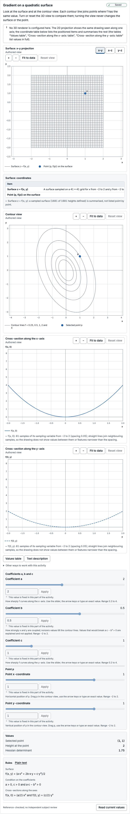
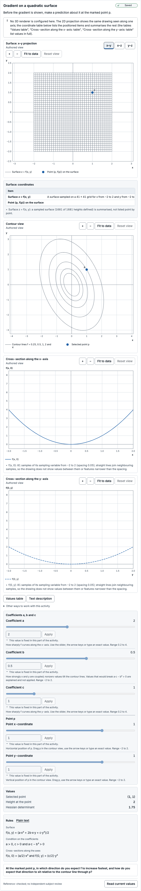
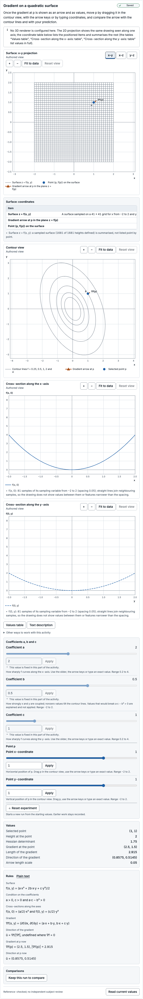
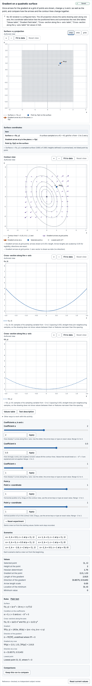
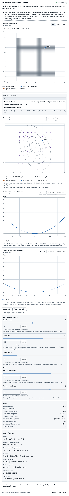
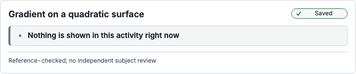
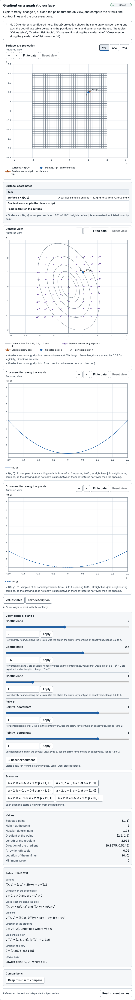

# Subject-review packet: Gradient on a quadratic surface

> Prepared automatically by `explorable-models activity review-packet` (toolkit 0.3.0-preview.1) for a human subject reviewer.
> It is engineering evidence, **not** a subject review, an accessibility certification or evidence of learning benefit.
> Catalogue status of this exact version: **reference-checked** — no independent human review is recorded.
> The reviewer sign-off at the end is empty; an engineering agent cannot sign it.

## Exact identity

| Item | Value |
| --- | --- |
| Template | quadratic-surface-gradient@1.0.0 |
| Template digest | `sha256:fbe01be3bda8b56f18869360e30f7f6dedf596786fa3eb1217d3a90039799f36` |
| Model | quadratic-surface-gradient@1.0.0 |
| Model digest | `sha256:bf6c7a28455d5b882d12e287894347d8acf4468db0a6681cb82c780b0ec34963` |
| Scientific revision | `sha256:3072ed7787d54b53890013aede217082d9b0ab9f3bf2040379cbf13662965030` |
| Presentation revision | `sha256:868aa8fd30ca9161d24c91830ce62769cedb3b61ba5aaa0e88c2d1b81ce8e72f` |
| Reference suite bound by the model | quadratic-surface-gradient:1.0.0 `sha256:4982408532970c0fca1657884b9307956e4f20ee91e0c68cdff00e8b66c2af20` |
| Reference fixture file | `tests/reference/fixtures/activities/quadratic-surface-gradient.json` `sha256:4982408532970c0fca1657884b9307956e4f20ee91e0c68cdff00e8b66c2af20` |
| Fixture binding | matches |
| Execution | installed kernel quadratic-surface-gradient@1.1.0 (static) |
| Lifecycle | reference-checked |
| Generated with | toolkit 0.3.0-preview.1, Chromium 156.0.8078.4 |

## Purpose and task intent

Predict, then observe, how the gradient of f(x, y) = (a·x² + 2b·x·y + c·y²)/2 at a chosen point p relates to the shape of the surface and to its contour lines.

| Stage | Kind | Instruction | Host-owned response request | Visible groups (* = solution-bearing) | Controls |
| --- | --- | --- | --- | --- | --- |
| orient | prepare | Look at the surface and at the contour view. Each contour line joins points where f has the same value. Turn or reset the 3D view to compare them; turning the view never changes the surface or the point. | — | scene (interactive), contour-view (interactive), section-views (fixed), surface (fixed), contours (fixed), cross-sections (fixed), point (fixed), surface-values (fixed), surface-rules (fixed), alternatives (fixed), coefficient-controls (fixed), point-controls (fixed) | a (fixed), b (fixed), c (fixed), px (fixed), py (fixed) |
| predict | predict | Before the gradient is shown, make a prediction about it at the marked point p. | prediction: At the marked point p, in which direction do you expect f to increase fastest, and how do you expect that direction to sit relative to the contour line through p? (task family surface-gradient-prediction) | scene (interactive), contour-view (interactive), section-views (fixed), surface (fixed), contours (fixed), cross-sections (fixed), point (fixed), surface-values (fixed), surface-rules (fixed), alternatives (fixed), coefficient-controls (fixed), point-controls (fixed) | a (fixed), b (fixed), c (fixed), px (fixed), py (fixed) |
| explore-point | explore | Once the gradient at p is shown as an arrow and as values, move p by dragging it in the contour view, with the arrow keys or by typing coordinates, and compare the arrow with the contour lines and with your prediction. | — | scene (interactive), contour-view (interactive), section-views (fixed), surface (fixed), contours (fixed), cross-sections (fixed), point (interactive), surface-values (fixed), surface-rules (fixed), alternatives (fixed), coefficient-controls (fixed), point-controls (interactive), gradient-rules (fixed), gradient* (fixed), gradient-drawing* (fixed), gradient-values* (fixed) | a (fixed), b (fixed), c (fixed), px (interactive), py (interactive) |
| explore-field | explore | Once arrows for the gradient at a grid of points are shown, change a, b and c as well as the point, and compare how the arrows and the contour lines change together. | — | scene (interactive), contour-view (interactive), section-views (fixed), surface (fixed), contours (fixed), cross-sections (fixed), point (interactive), surface-values (fixed), surface-rules (fixed), alternatives (fixed), coefficient-controls (interactive), point-controls (interactive), gradient-rules (fixed), gradient* (fixed), gradient-drawing* (fixed), gradient-values* (fixed), field* (fixed), minimum* (fixed), minimum-values* (fixed), scenarios (interactive) | a (interactive), b (interactive), c (interactive), px (interactive), py (interactive) |
| explain | explain | Explain in your own words how the gradient at a point is related to the contour lines and to the coefficients a, b and c. | explanation: How is the gradient at a point related to the contour line through that point, and how do a, b and c change the arrows? (task family surface-gradient-explanation) | scene (interactive), contour-view (interactive), section-views (fixed), surface (fixed), contours (fixed), cross-sections (fixed), point (fixed), surface-values (fixed), surface-rules (fixed), alternatives (fixed), coefficient-controls (fixed), point-controls (fixed), gradient-rules (fixed), gradient* (fixed), gradient-drawing* (fixed), gradient-values* (fixed), field* (fixed), minimum* (fixed), minimum-values* (fixed) | a (fixed), b (fixed), c (fixed), px (fixed), py (fixed) |
| closed | closed | This activity is closed. | — | none | none |
| free-explore | explore | Explore freely: change a, b, c and the point, turn the 3D view, and compare the arrows, the contour lines and the cross-sections. | — | scene (interactive), contour-view (interactive), section-views (interactive), surface (fixed), contours (fixed), cross-sections (fixed), point (interactive), surface-values (fixed), surface-rules (fixed), alternatives (fixed), coefficient-controls (interactive), point-controls (interactive), gradient-rules (fixed), gradient* (fixed), gradient-drawing* (fixed), gradient-values* (fixed), field* (fixed), minimum* (fixed), minimum-values* (fixed), scenarios (interactive) | a (interactive), b (interactive), c (interactive), px (interactive), py (interactive) |

Transitions: orient → predict (“Continue to the prediction”); predict → explore-point (“Show the gradient at the point and explore”); explore-point → explore-field (“Show the gradient field and the coefficient controls”); explore-field → explain (“Ask for an explanation”); explore-point → explain (“Ask for an explanation without the field stage”); explain → closed (“Close the activity”); orient → closed (“Close the activity”); predict → closed (“Close the activity”); explore-point → closed (“Close the activity”); explore-field → closed (“Close the activity”); free-explore → closed (“Close the activity”). Initial stage: orient.

Host-owned task families (the visualizer never collects, stores or grades responses):

| Task family | Description |
| --- | --- |
| surface-gradient-prediction | Host-owned prediction request about the gradient of a quadratic surface at a marked point and its relation to the contour lines. The host owns the response, its capture and any evaluation. |
| surface-gradient-explanation | Host-owned explanation request about how the gradient relates to contour lines and to the coefficients a, b and c. The host owns the response, its capture and any evaluation. |
| surface-gradient-later-task | Host-owned later task with new coefficients, a new point or another representation, such as a contour-only or table-only version. Its prompts, held-out items and scoring stay with the host and are not part of this catalogue. |

## Derivation

- **derivation-quadratic-form** (derivation): Derivation written for this catalogue: f(x, y) = ½·[x y]·H·[x y]ᵀ with H = [[a, b], [b, c]], so ∇f = H·[x y]ᵀ = (a·x + b·y, b·x + c·y). H is positive definite exactly when a > 0 and a·c − b² > 0; then f(x, y) > 0 for (x, y) ≠ (0, 0), the origin is the unique minimum with f = 0, and ∇f = 0 only there because H is invertible. On the ray (x, y) = r·(cos t, sin t), f = r²·q(t)/2 with q(t) = a·cos²t + 2b·cos t·sin t + c·sin²t > 0, so the level f = L is the closed ellipse r(t) = √(2L/q(t)). f is constant along a level curve, so ∇f is perpendicular to its tangent. The axis sections are f(x, 0) = a·x²/2 and f(0, y) = c·y²/2. Not independently reviewed.
- **study-harness-specification** (specification): Study Harness visualizer implementation report §12.5 (bounded two-variable quadratic surface from a declared symmetric positive-definite family, linked contour/projection view, selected point with a gradient vector and a bounded gradient field, disclosed sampling and vector scaling, checks of analytic gradients, axis orientation, minimum, zero gradient and approved cross-sections, camera-independent model state) and acceptance criterion A46.
- Template derivation note **derivation-quadratic-form**: Derivation written for this catalogue: f(x, y) = ½·[x y]·H·[x y]ᵀ with H = [[a, b], [b, c]], so ∇f = H·[x y]ᵀ = (a·x + b·y, b·x + c·y). H is positive definite exactly when a > 0 and a·c − b² > 0; then f(x, y) > 0 for (x, y) ≠ (0, 0), the origin is the unique minimum with f = 0, and ∇f = 0 only there because H is invertible. On the ray (x, y) = r·(cos t, sin t), f = r²·q(t)/2 with q(t) = a·cos²t + 2b·cos t·sin t + c·sin²t > 0, so the level f = L is the closed ellipse r(t) = √(2L/q(t)). f is constant along a level curve, so ∇f is perpendicular to its tangent. The axis sections are f(x, 0) = a·x²/2 and f(0, y) = c·y²/2. Not independently reviewed.

## Assumptions

- f is exactly the quadratic form (a·x² + 2b·x·y + c·y²)/2 with constant coefficients: no noise and no higher-order terms.
- The Hessian H = [[a, b], [b, c]] is symmetric positive definite: a ≥ 0.2, c ≥ 0.2 and a·c − b² > 0 (constraint positive-definite). Degenerate troughs (a·c − b² = 0) and saddles (a·c − b² < 0) are outside this model.
- The gradient is the vector of partial derivatives (∂f/∂x, ∂f/∂y) = (a·x + b·y, b·x + c·y); it points toward increasing f.
- Coefficients and coordinates are dimensionless IEEE-754 double values; evaluation is deterministic within one JavaScript engine.
- The 3D view and its camera are presentation only: the kernel has no camera input, and turning or resetting the view never changes a, b, c or the point.

## Limitations

- Point values — f(p), ∇f(p), |∇f(p)|, the direction ∇f/|∇f| and a·c − b² — are computed exactly from the double inputs (exact binary arithmetic, with integer square roots for the length and the direction) and each is rounded once to the nearest double, ties to even. Sampled surface heights, section heights and field vectors use about 106-bit intermediates and agree with the exactly rounded values to a unit in the last place.
- Results below the smallest normal double are reduced-precision approximations; a nonzero f(p) or gradient length that rounds to 0 is a numerical-limit status, never 0, a nonzero gradient or direction component shown as 0 carries an approximation note, and the gradient direction stays defined at every point other than the origin.
- The surface is sampled on a 41 × 41 grid with spacing 0.1 and the cross-sections at 81 points each; the drawing between samples does not certify values between them.
- Contours are exact ellipses sampled at 180 directions per level for L = 0.25, 0.5, 1, 2, 4 only. Because the coordinates are rounded, f at a contour point equals L to about 4·√(λmax/λmin)·2⁻⁵³ relative (better than 10⁻¹² unless λmax/λmin exceeds about 10⁶). Directions use the platform Math.cos and Math.sin, so the last bits of sample positions can differ between JavaScript engines; f = L at each point holds regardless.
- Gradient arrows (the point's arrow and the 9 × 9 field) are drawn at s·∇f with the disclosed scale s ≤ 1 chosen per frame; the arrow at p can therefore not be compared in length across frames without the scale.
- Only the axis cross-sections f(x, 0) and f(0, y) are provided; sections along other lines are not part of this model.

## Units and conventions

- Coordinates: Right-handed Cartesian frame with x to the right and y up in the contour view (viewed from +z) and z = f(x, y) up in the 3D view. Contour, field, point and arrow coordinates share the xy plane; the cross-sections are the vertical planes y = 0 (horizontal axis x) and x = 0 (horizontal axis y).
- Angles: Contour sample directions t are in radians, measured counterclockwise from +x toward +y.
- Handedness: right-handed

Parameters (canonical units; the authoring step is a UI increment unless admissibility says otherwise):

| Parameter | Label | Unit | Domain | Default | Admissible values |
| --- | --- | --- | --- | --- | --- |
| a | Coefficient a | dimensionless | [0.2, 4] | 2 | continuous |
| b | Coefficient b | dimensionless | [-2, 2] | 0.5 | continuous |
| c | Coefficient c | dimensionless | [0.2, 4] | 1 | continuous |
| px | Point x-coordinate | dimensionless | [-2, 2] | 1 | continuous |
| py | Point y-coordinate | dimensionless | [-2, 2] | 1 | continuous |

Quantities:

| Quantity | Label | Shape | Unit | Meaning | Sign convention | Frame |
| --- | --- | --- | --- | --- | --- | --- |
| point | Selected point | vector(2) | dimensionless | The selected point p = (p_x, p_y), equal to its two parameters. | Components along +x (right) and +y (up) in the xy plane. | xy plane of a right-handed frame: x to the right, y up when viewed from +z |
| value | Height at the point | scalar | dimensionless | f(p) = (a·p_x² + 2b·p_x·p_y + c·p_y²)/2, the exact value rounded once. Positive except at the minimum. | Height above the xy plane along +z; never negative on this family. | graph space of a right-handed frame: x and y horizontal, z = f(x, y) up |
| gradient | Gradient at the point | vector(2) | dimensionless | Vector of partial derivatives ∇f(p) = (∂f/∂x, ∂f/∂y) = (a·p_x + b·p_y, b·p_x + c·p_y), each component rounded once. It is the zero vector only at the minimum. | Points toward increasing f (uphill); components along +x (right) and +y (up). | xy plane of a right-handed frame: x to the right, y up when viewed from +z |
| gradient.norm | Length of the gradient | scalar | dimensionless | \|∇f(p)\| = √((∂f/∂x)² + (∂f/∂y)²): the rate of increase of f per unit distance in the direction of the gradient. | A length: never negative; 0 only at the minimum. | xy plane of a right-handed frame: x to the right, y up when viewed from +z |
| gradient.direction | Direction of the gradient | vector(2) | dimensionless | Unit vector ∇f(p)/\|∇f(p)\|, the direction of fastest increase of f. Undefined (ZERO_GRADIENT) at the minimum p = (0, 0), where the gradient is zero; no direction is ever chosen in its place. Decided from p itself, so a tiny nonzero point keeps a defined direction. | Unit vector toward increasing f; components along +x (right) and +y (up). | xy plane of a right-handed frame: x to the right, y up when viewed from +z |
| hessian.det | Hessian determinant | scalar | dimensionless | Determinant a·c − b² of the constant Hessian H = [[a, b], [b, c]], rounded once. Positive on the whole admissible domain (constraint positive-definite). | Positive for every admissible coefficient set. | — |
| minimum.location | Location of the minimum | vector(2) | dimensionless | The unique minimum of the symmetric positive-definite family: (0, 0) for every admissible a, b and c, because H is positive definite and ∇f = 0 only at the origin. | Components along +x (right) and +y (up) in the xy plane. | xy plane of a right-handed frame: x to the right, y up when viewed from +z |
| minimum.value | Minimum value | scalar | dimensionless | f(0, 0) = 0, the unique lowest value of f on this family. | Height along +z; f is never below it. | graph space of a right-handed frame: x and y horizontal, z = f(x, y) up |
| arrow.scale | Arrow length scale | scalar | dimensionless | Factor s by which drawn gradient arrows are shortened or lengthened: each arrow is drawn as s·∇f. s is chosen per frame from 1, 0.5, 0.2, 0.1, 0.05, 0.02, … as the largest value with s·M ≤ 0.45, where M is the longest gradient on the 9 × 9 field grid (90% of its spacing 0.5). Presentation scale only: no quantity is changed by it. | Positive; 1 means arrows are drawn at true length. | — |

Coupled constraints (enforced at every entry point):

| Constraint | Expression | Bounds | Message |
| --- | --- | --- | --- |
| positive-definite | `a*c - b*b` | 0 < value | The coefficients must satisfy a·c − b² > 0. Only then is the surface a bowl with a single lowest point, which is the family this activity covers; at a·c − b² = 0 the surface becomes a trough with a whole line of lowest points, and below 0 a saddle. |

## Reference cases

Suite `quadratic-surface-gradient:1.0.0` for quadratic-surface-gradient@1.0.0: **27 of 27 cases agree** with frames evaluated in a browser module worker (20 evaluation points; rejection cases must be refused before evaluation).

- Author of the cases: Cases derived by hand from f(x, y) = (a·x² + 2b·x·y + c·y²)/2 where the results are exact rationals, with irrational values (|∇f|, direction) and non-dyadic inputs computed by exact rational arithmetic in tests/reference/oracles/quadratic-surface-gradient.ts, which shares no code with the catalogue kernel. The three exact-tie cases (2026-10-26) take their expectations from that oracle; they were added, and every point tolerance set to 0, when the kernel (1.1.0) began computing point values exactly. Prepared by an engineering agent.
- Review statement of the fixture: No independent human subject reviewer has approved these cases. Automated agreement is engineering evidence only.
- Semantics: f(x, y) = (a·x² + 2b·x·y + c·y²)/2 and ∇f = (a·x + b·y, b·x + c·y) for the exact rational values of the double inputs, each reported value rounded once to the nearest double (ties to even). Coefficients are admissible when fl(fl(a·c) − fl(b·b)) > 0 (minimum exclusive), which implies exact a·c − b² > 0. The direction ∇f/|∇f| is undefined (ZERO_GRADIENT) exactly when p = (0, 0). A positive value that rounds to 0 is a numerical limit (UNDERFLOW); a value or vector component below 2⁻¹⁰²² is valid with an UNDERFLOW approximation. The arrow scale s is the first of the listed scales with s·M ≤ 0.45, M the longest gradient on the 9 × 9 field grid. Surface samples (i − 20)/10, field samples (i − 4)/2 and section samples (i − 40)/20 are exact grid coordinates rounded once; contour points are any doubles at the stated directions with f = L within the case tolerance.
- Converted from `tests/reference/fixtures/activities/quadratic-surface-gradient.json` `sha256:4982408532970c0fca1657884b9307956e4f20ee91e0c68cdff00e8b66c2af20` (suite quadratic-surface-gradient:1.0.0): Converted by explorable-models activity tooling: case IDs, labels, provenance, parameters and tolerances copied unchanged; quantity expectations restated as explorable-models.reference-fixtures 1.0 expectations.
- Not compared by this runner: Surface, section and field grids, contour levels and the perpendicularity of contours to the gradient direction are checked by tests/reference/activities/quadratic-surface-gradient.test.ts.
- Quantities without any expectation in this suite: `point`, `minimum.location`, `minimum.value`.

| Case | Label | Provenance | Tolerance | Result |
| --- | --- | --- | --- | --- |
| default-point-on-level-2 | a = 2, b = 0.5, c = 1 at p = (1, 1): f = 2, ∇f = (2.5, 1.5); p lies on the contour f = 2 | Hand derivation from f = (a·x² + 2b·x·y + c·y²)/2 and ∇f = (a·x + b·y, b·x + c·y): f(1, 1) = (2 + 1 + 1)/2 = 2, ∇f = (2 + 0.5, 0.5 + 1), a·c − b² = 1.75; field maximum \|∇f(2, 2)\| = \|(5, 3)\| = √34, so s = 0.05 (0.1·√34 > 0.45). \|∇f\| = √8.5 and the direction (2.5, 1.5)/√8.5 are irrational: correctly rounded values from exact rational arithmetic in tests/reference/oracles/quadratic-surface-gradient.ts (no shared code with the catalogue kernel). | exact; gradient.norm: exact; gradient.direction: exact; arrow.scale: exact | pass (1 point) |
| axes-plus-x | Axis orientation: b = 0, p = (1, 0): the gradient (2, 0) points along +x (to the right) | Hand derivation from f = (a·x² + 2b·x·y + c·y²)/2 and ∇f = (a·x + b·y, b·x + c·y): with b = 0, ∇f(1, 0) = (a, 0) = (2, 0), \|∇f\| = 2, direction (1, 0); f(1, 0) = a/2 = 1, so p lies on the contour f = 1 at direction t = 0 (sample k = 0); a·c − b² = 2; field maximum \|(4, 2)\| = √20, s = 0.1 (0.1·√20 ≈ 0.447 ≤ 0.45). Cross-checked by exact rational arithmetic in tests/reference/oracles/quadratic-surface-gradient.ts (no shared code with the catalogue kernel). | exact; gradient.norm: exact; gradient.direction: exact; arrow.scale: exact | pass (1 point) |
| axes-plus-y | Axis orientation: b = 0, p = (0, 1): the gradient (0, 1) points along +y (up) | Hand derivation from f = (a·x² + 2b·x·y + c·y²)/2 and ∇f = (a·x + b·y, b·x + c·y): ∇f(0, 1) = (b, c) = (0, 1), \|∇f\| = 1, direction (0, 1); f(0, 1) = c/2 = 0.5, so p lies on the contour f = 0.5 at t = π/2 (sample k = 45). Cross-checked by exact rational arithmetic in tests/reference/oracles/quadratic-surface-gradient.ts (no shared code with the catalogue kernel). | exact; gradient.norm: exact; gradient.direction: exact; arrow.scale: exact | pass (1 point) |
| axes-minus-x | Axis orientation: b = 0, p = (−1, 0): the gradient (−2, 0) points along −x (to the left) | Hand derivation from f = (a·x² + 2b·x·y + c·y²)/2 and ∇f = (a·x + b·y, b·x + c·y): ∇f(−1, 0) = (−a, −b) = (−2, 0), \|∇f\| = 2, direction (−1, 0); f(−1, 0) = 1, on the contour f = 1 at t = π (sample k = 90). Cross-checked by exact rational arithmetic in tests/reference/oracles/quadratic-surface-gradient.ts (no shared code with the catalogue kernel). | exact; gradient.norm: exact; gradient.direction: exact; arrow.scale: exact | pass (1 point) |
| minimum-at-origin | Minimum: p = (0, 0) gives f = 0 and ∇f = (0, 0); the direction is undefined (ZERO_GRADIENT) | Hand derivation from f = (a·x² + 2b·x·y + c·y²)/2 and ∇f = (a·x + b·y, b·x + c·y): f(0, 0) = 0 and ∇f(0, 0) = (0, 0) for every admissible a, b, c; \|∇f\| = 0 and the direction is undefined, never an arbitrary direction. Cross-checked by exact rational arithmetic in tests/reference/oracles/quadratic-surface-gradient.ts (no shared code with the catalogue kernel). | exact; gradient.norm: exact; gradient.direction: exact; arrow.scale: exact | pass (1 point) |
| minimum-at-origin-negative-zero | Minimum with a negative-zero input p = (−0, 0) and b = −1.5: still the origin; outputs are +0 and the direction is undefined | Hand derivation from f = (a·x² + 2b·x·y + c·y²)/2 and ∇f = (a·x + b·y, b·x + c·y): −0 is the number 0, so p is the origin; a·c − b² = 3 − 2.25 = 0.75 > 0. Outputs must be +0 (Object.is), never −0. Cross-checked by exact rational arithmetic in tests/reference/oracles/quadratic-surface-gradient.ts (no shared code with the catalogue kernel). | exact; gradient.norm: exact; gradient.direction: exact; arrow.scale: exact | pass (1 point) |
| tilted-point-on-x-axis | Rotated ellipses: b = 1, p = (1, 0): ∇f = (2, 1) is not along +x, and is perpendicular to the tilted contour f = 1 | Hand derivation from f = (a·x² + 2b·x·y + c·y²)/2 and ∇f = (a·x + b·y, b·x + c·y): ∇f(1, 0) = (a, b) = (2, 1); f(1, 0) = a/2 = 1 on the contour f = 1 at t = 0 (sample k = 0); a·c − b² = 1. \|∇f\| = √5 and the direction (2, 1)/√5 from exact rational arithmetic in tests/reference/oracles/quadratic-surface-gradient.ts (no shared code with the catalogue kernel). | exact; gradient.norm: exact; gradient.direction: exact; arrow.scale: exact | pass (1 point) |
| tilted-negative-b-point-on-y-axis | Rotated ellipses: b = −0.5, p = (0, 2): ∇f = (−1, 1) | Hand derivation from f = (a·x² + 2b·x·y + c·y²)/2 and ∇f = (a·x + b·y, b·x + c·y): ∇f(0, 2) = (2b, 2c) = (−1, 1); f(0, 2) = 4c/2 = 1 on the contour f = 1 at t = π/2 (sample k = 45); a·c − b² = 0.25; field maximum \|∇f(2, −2)\| = \|(3, −2)\| = √13, s = 0.1. \|∇f\| = √2 and the direction (−1, 1)/√2 from exact rational arithmetic in tests/reference/oracles/quadratic-surface-gradient.ts (no shared code with the catalogue kernel). | exact; gradient.norm: exact; gradient.direction: exact; arrow.scale: exact | pass (1 point) |
| decimal-inputs | Non-dyadic decimal inputs a = 1.3, b = −0.7, c = 2.1 at p = (0.3, −1.7) | Every value from exact rational arithmetic in tests/reference/oracles/quadratic-surface-gradient.ts (no shared code with the catalogue kernel) for the exact rational values of the double inputs, rounded once; the kernel may differ by one unit in the last place. Hand estimate for orientation: ∇f ≈ (1.3·0.3 + 0.7·1.7, −0.7·0.3 − 2.1·1.7) = (1.58, −3.78). | exact; gradient.norm: exact; gradient.direction: exact; arrow.scale: exact | pass (1 point) |
| steep-corner | Largest heights: a = c = 4, b = 2 at the corner p = (2, 2): f = 24, ∇f = (12, 12) | Hand derivation from f = (a·x² + 2b·x·y + c·y²)/2 and ∇f = (a·x + b·y, b·x + c·y): f(2, 2) = (16 + 16 + 16)/2 = 24 (the largest height on the domain), ∇f = (8 + 4, 4 + 8), a·c − b² = 12; field maximum 12√2, s = 0.02 (0.05·12√2 > 0.45). \|∇f\| = 12√2 and the direction (√½, √½) from exact rational arithmetic in tests/reference/oracles/quadratic-surface-gradient.ts (no shared code with the catalogue kernel). | exact; gradient.norm: exact; gradient.direction: exact; arrow.scale: exact | pass (1 point) |
| steep-corner-negative-b | a = c = 4, b = −2 at p = (−2, 2): f = 24, ∇f = (−12, 12) | Hand derivation from f = (a·x² + 2b·x·y + c·y²)/2 and ∇f = (a·x + b·y, b·x + c·y): f(−2, 2) = (16 + 16 + 16)/2 = 24, ∇f = (−8 − 4, 4 + 8) = (−12, 12), a·c − b² = 12, s = 0.02. Direction (−√½, √½) from exact rational arithmetic in tests/reference/oracles/quadratic-surface-gradient.ts (no shared code with the catalogue kernel). | exact; gradient.norm: exact; gradient.direction: exact; arrow.scale: exact | pass (1 point) |
| gentle-bowl | Gentle round bowl a = c = 0.2, b = 0 at p = (−2, −2): ∇f = (−0.4, −0.4), arrow scale 0.5 | Hand derivation from f = (a·x² + 2b·x·y + c·y²)/2 and ∇f = (a·x + b·y, b·x + c·y): f(−2, −2) = (0.2·4 + 0.2·4)/2 = 0.8 and ∇f = (−0.4, −0.4), exact multiples of the double 0.2 by powers of two; field maximum 0.4√2 ≈ 0.566, so s = 0.5 (1·0.566 > 0.45). Rounded values and the direction from exact rational arithmetic in tests/reference/oracles/quadratic-surface-gradient.ts (no shared code with the catalogue kernel). | exact; gradient.norm: exact; gradient.direction: exact; arrow.scale: exact | pass (1 point) |
| near-singular-accepted-b-below-1 | Constraint boundary from above: a = c = 1, b = 1 − 2⁻⁵³ is accepted (a·c − b² ≈ 2⁻⁵²); along (1, −1) f = ∇f components = 2⁻⁵³ | Hand derivation from f = (a·x² + 2b·x·y + c·y²)/2 and ∇f = (a·x + b·y, b·x + c·y): fl(b·b) = 1 − 2⁻⁵², so fl(a·c) − fl(b·b) = 2⁻⁵² > 0 is accepted; exact a·c − b² = 2⁻⁵² − 2⁻¹⁰⁶ rounds (tie to even) to 2⁻⁵². At p = (1, −1): ∇f = (1 − b, b − 1) = (2⁻⁵³, −2⁻⁵³), f = 1 − b = 2⁻⁵³. Cross-checked by exact rational arithmetic in tests/reference/oracles/quadratic-surface-gradient.ts (no shared code with the catalogue kernel). Contour tolerance: the declared bound 4·√(λmax/λmin)·2⁻⁵³ ≈ 6e−8 with λmax/λmin ≈ 1.8e16, rounded up to 1e−7. | exact; gradient.norm: exact; gradient.direction: exact; arrow.scale: exact | pass (1 point) |
| near-singular-accepted-c-above-1 | Constraint boundary from above: a = 4, b = 2, c = 1 + 2⁻⁵² is accepted (a·c − b² = 2⁻⁵⁰); at p = (0.5, −1) ∇f = (0, −2⁻⁵²) | Hand derivation from f = (a·x² + 2b·x·y + c·y²)/2 and ∇f = (a·x + b·y, b·x + c·y): a·c = 4 + 2⁻⁵⁰ exactly, so a·c − b² = 2⁻⁵⁰ > 0. At p = (0.5, −1) (the null direction of the singular neighbour c = 1): ∇f = (2 − 2, 1 − c) = (0, −2⁻⁵²), f = (−1)·(−2⁻⁵²)/2 = 2⁻⁵³, direction (0, −1). Cross-checked by exact rational arithmetic in tests/reference/oracles/quadratic-surface-gradient.ts (no shared code with the catalogue kernel). Contour tolerance: declared bound ≈ 7.4e−8 (λmax/λmin ≈ 2.8e16), rounded up to 1e−7. | exact; gradient.norm: exact; gradient.direction: exact; arrow.scale: exact | pass (1 point) |
| tiny-point-subnormal-gradient | Smallest nonzero point p = (2⁻¹⁰⁷⁴, 0): f underflows, ∇f = (2⁻¹⁰⁷³, 2⁻¹⁰⁷⁵ → 0) is approximate, the direction stays defined | Hand derivation from f = (a·x² + 2b·x·y + c·y²)/2 and ∇f = (a·x + b·y, b·x + c·y): ∇f = 2⁻¹⁰⁷⁴·(a, b) = (2⁻¹⁰⁷³, 2⁻¹⁰⁷⁵); 2⁻¹⁰⁷⁵ is exactly half the smallest subnormal and rounds (tie to even) to 0, so the vector carries an UNDERFLOW approximation; f = 2⁻²¹⁴⁸ is positive but rounds to 0 (numerical limit); \|∇f\| = 2⁻¹⁰⁷⁴·√4.25 rounds to 2⁻¹⁰⁷³ (subnormal, approximate); the direction (a, b)/√(a² + b²) is defined because p ≠ 0. Correctly rounded values from exact rational arithmetic in tests/reference/oracles/quadratic-surface-gradient.ts (no shared code with the catalogue kernel). | exact; gradient.norm: exact; gradient.direction: exact; arrow.scale: exact | pass (1 point) |
| tiny-point-diagonal | p = (2⁻¹⁰⁷⁴, 2⁻¹⁰⁷⁴) with a = c = 0.25: both gradient components round to 0 but the direction is still (√½, √½), never ZERO_GRADIENT | Hand derivation from f = (a·x² + 2b·x·y + c·y²)/2 and ∇f = (a·x + b·y, b·x + c·y): ∇f = 2⁻¹⁰⁷⁶·(1, 1); each component is below half the smallest subnormal and rounds to 0 (approximation), \|∇f\| = 2⁻¹⁰⁷⁶·√2 = 2⁻¹⁰⁷⁵·⁵ is below half the smallest subnormal and rounds to 0 (numerical limit), f rounds to 0 (numerical limit). The zero-gradient case is decided from p, so the direction (√½, √½) is reported. Correctly rounded values from exact rational arithmetic in tests/reference/oracles/quadratic-surface-gradient.ts (no shared code with the catalogue kernel). | exact; gradient.norm: exact; gradient.direction: exact; arrow.scale: exact | pass (1 point) |
| small-point-subnormal-height | p = (10⁻¹⁶⁰, −3·10⁻¹⁶⁰): the gradient is normal but f ≈ 4·10⁻³²⁰ is subnormal (approximate) | Every value from exact rational arithmetic in tests/reference/oracles/quadratic-surface-gradient.ts (no shared code with the catalogue kernel) for the exact rational values of the double inputs. Hand estimate: f ≈ (2·1 − 3 + 9)·10⁻³²⁰/2 = 4·10⁻³²⁰, below 2⁻¹⁰²² ≈ 2.2·10⁻³⁰⁸, so f is a reduced-precision approximation while ∇f ≈ (−0.5, −2.5)·10⁻¹⁶⁰ is normal. | exact; gradient.norm: exact; gradient.direction: exact; arrow.scale: exact | pass (1 point) |
| exact-tie-tiny-x-term | b·py is an exact rounding tie and a·px ≈ 1.2·10⁻¹¹⁴ lies far below one unit of it: ∂f/∂x must round toward the tiny term, not to even | Expectations from exact rational arithmetic in tests/reference/oracles/quadratic-surface-gradient.ts (no shared code with the catalogue kernel). b·py has 105 significant bits whose low 52 are 1 followed by 51 zeros, an exact tie; a·px > 0 breaks it upward, so ∂f/∂x is 0.18664041048643928 (ties-to-even alone would give 0.18664041048643926). Found by the 2026-10 adversarial review (R37). | exact; gradient.norm: exact; gradient.direction: exact; arrow.scale: exact | pass (1 point) |
| exact-tie-hand-built-x | a = 2, b = 1 + 2⁻⁵², c = 2, p = (−10⁻¹⁰⁰, 1.5): b·py = 1.5 + 2⁻⁵² + 2⁻⁵³ is a tie that a·px = −2·10⁻¹⁰⁰ breaks downward | Hand derivation: b·py = 1.5·(1 + 2⁻⁵²) = 1.5 + 2⁻⁵² + 2⁻⁵³ lies halfway between the doubles 1.5 + 2⁻⁵² and 1.5 + 2⁻⁵¹; the exact ∂f/∂x = b·py − 2·10⁻¹⁰⁰ is just below that midpoint, so it rounds to 1.5 + 2⁻⁵² = 1.5000000000000002 (ties-to-even would give 1.5000000000000004). ∂f/∂y = 3 − (1 + 2⁻⁵²)·10⁻¹⁰⁰ rounds to 3. f(p), \|∇f\|, the direction and a·c − b² = 4 − (1 + 2⁻⁵²)² from exact rational arithmetic in tests/reference/oracles/quadratic-surface-gradient.ts. | exact; gradient.norm: exact; gradient.direction: exact; arrow.scale: exact | pass (1 point) |
| exact-tie-hand-built-y | a = 2, b = 0.5, c = 1 + 2⁻⁵², p = (−10⁻¹⁰⁰, 1.5): c·py is the tie, so ∂f/∂y must round toward b·px = −5·10⁻¹⁰¹ | Hand derivation: c·py = 1.5 + 2⁻⁵² + 2⁻⁵³ is the midpoint of 1.5 + 2⁻⁵² and 1.5 + 2⁻⁵¹; ∂f/∂y = c·py − 5·10⁻¹⁰¹ is just below it and rounds to 1.5000000000000002. ∂f/∂x = 0.75 − 2·10⁻¹⁰⁰ rounds to 0.75. f(p), \|∇f\|, the direction and a·c − b² from exact rational arithmetic in tests/reference/oracles/quadratic-surface-gradient.ts. | exact; gradient.norm: exact; gradient.direction: exact; arrow.scale: exact | pass (1 point) |
| singular-unit | a = b = c = 1: a·c − b² = 0 exactly, rejected (minimum exclusive) | Hand derivation: 1·1 − 1² = 0; the trough has a line of minima and is outside the model. | exact | pass (rejected as expected) |
| singular-wide | a = 4, b = 2, c = 1: a·c − b² = 0 exactly, rejected | Hand derivation: 4·1 − 2² = 0. | exact | pass (rejected as expected) |
| singular-negative-b | a = 0.5, b = −1, c = 2: a·c − b² = 0 exactly, rejected | Hand derivation: 0.5·2 − (−1)² = 0. | exact | pass (rejected as expected) |
| singular-largest-b | a = c = 2, b = −2: a·c − b² = 0 exactly, rejected | Hand derivation: 2·2 − 4 = 0. | exact | pass (rejected as expected) |
| saddle | a = 1, b = 1.5, c = 2: a·c − b² = −0.25 < 0 (a saddle), rejected | Hand derivation: 2 − 2.25 = −0.25. | exact | pass (rejected as expected) |
| a-below-range | a = 0.1 is below the parameter range [0.2, 4] | Declared parameter bounds. | exact | pass (rejected as expected) |
| point-outside-range | p_x = 2.5 is outside the point range [−2, 2] | Declared parameter bounds. | exact | pass (rejected as expected) |

## Mutation sensitivity

Generic faults injected into the evaluated model inside the checks worker (outputs or inputs altered after the kernel, one fault at a time); a mutant is detected when at least one reference case disagrees. **24 of 24 detected.**

| Fault | Mutants | Detected | Undetected targets |
| --- | --- | --- | --- |
| sign | 6 | 6 | — |
| factor | 6 | 6 | — |
| undefined-as-zero | 1 | 1 | — |
| limit-as-zero | 2 | 2 | — |
| swap-inputs | 4 | 4 | — |
| boundary-nudge | 5 | 5 | — |

Activity-specific mutants (for example wrong conventions, transposed inputs and incorrect boundaries) are exercised in the mutation-sensitivity tests of `tests/reference/activities/quadratic-surface-gradient.test.ts`; hidden-output leakage across output channels is tested in `tests/activity/disclosure.test.ts`. Those results are not restated here.

## Boundary cases

Declared cases come from the package (or the installed suite's non-valid expectations); generated probes test the declared domain edges. Outcomes: valid / undefined / numerical-limit / out-of-domain (rejected before evaluation) / worker-error.

| Case | Source | Parameters | Position | Outcome | Non-valid statuses | Expectation |
| --- | --- | --- | --- | --- | --- | --- |
| minimum-at-origin: Minimum: p = (0, 0) gives f = 0 and ∇f = (0, 0); the direction is undefined (ZERO_GRADIENT) | declared | a = 2, b = 0.5, c = 1, px = 0, py = 0 | static | undefined | gradient.direction: undefined:ZERO_GRADIENT | met |
| minimum-at-origin-negative-zero: Minimum with a negative-zero input p = (−0, 0) and b = −1.5: still the origin; outputs are +0 and the direction is undefined | declared | a = 3, b = -1.5, c = 1, px = -0, py = 0 | static | undefined | gradient.direction: undefined:ZERO_GRADIENT | met |
| tiny-point-subnormal-gradient: Smallest nonzero point p = (2⁻¹⁰⁷⁴, 0): f underflows, ∇f = (2⁻¹⁰⁷³, 2⁻¹⁰⁷⁵ → 0) is approximate, the direction stays defined | declared | a = 2, b = 0.5, c = 1, px = 5e-324, py = 0 | static | numerical-limit | value: numerical-limit:UNDERFLOW, gradient: valid:UNDERFLOW, gradient.norm: valid:UNDERFLOW | met |
| tiny-point-diagonal: p = (2⁻¹⁰⁷⁴, 2⁻¹⁰⁷⁴) with a = c = 0.25: both gradient components round to 0 but the direction is still (√½, √½), never ZERO_GRADIENT | declared | a = 0.25, b = 0, c = 0.25, px = 5e-324, py = 5e-324 | static | numerical-limit | value: numerical-limit:UNDERFLOW, gradient: valid:UNDERFLOW, gradient.norm: numerical-limit:UNDERFLOW | met |
| small-point-subnormal-height: p = (10⁻¹⁶⁰, −3·10⁻¹⁶⁰): the gradient is normal but f ≈ 4·10⁻³²⁰ is subnormal (approximate) | declared | a = 2, b = 0.5, c = 1, px = 1e-160, py = -3e-160 | static | valid | value: valid:UNDERFLOW | met |
| singular-unit: a = b = c = 1: a·c − b² = 0 exactly, rejected (minimum exclusive) | declared | a = 1, b = 1, c = 1, px = 1, py = 1 | static | out-of-domain | CONSTRAINT_VIOLATION at $.constraints.positive-definite | met |
| singular-wide: a = 4, b = 2, c = 1: a·c − b² = 0 exactly, rejected | declared | a = 4, b = 2, c = 1, px = 0.5, py = -1 | static | out-of-domain | CONSTRAINT_VIOLATION at $.constraints.positive-definite | met |
| singular-negative-b: a = 0.5, b = −1, c = 2: a·c − b² = 0 exactly, rejected | declared | a = 0.5, b = -1, c = 2, px = 0, py = 0 | static | out-of-domain | CONSTRAINT_VIOLATION at $.constraints.positive-definite | met |
| singular-largest-b: a = c = 2, b = −2: a·c − b² = 0 exactly, rejected | declared | a = 2, b = -2, c = 2, px = 1, py = 1 | static | out-of-domain | CONSTRAINT_VIOLATION at $.constraints.positive-definite | met |
| saddle: a = 1, b = 1.5, c = 2: a·c − b² = −0.25 < 0 (a saddle), rejected | declared | a = 1, b = 1.5, c = 2, px = 1, py = 1 | static | out-of-domain | CONSTRAINT_VIOLATION at $.constraints.positive-definite | met |
| a-below-range: a = 0.1 is below the parameter range [0.2, 4] | declared | a = 0.1, b = 0, c = 1, px = 1, py = 1 | static | out-of-domain | OUT_OF_DOMAIN at $.parameters.a | met |
| point-outside-range: p_x = 2.5 is outside the point range [−2, 2] | declared | a = 2, b = 0.5, c = 1, px = 2.5, py = 0 | static | out-of-domain | OUT_OF_DOMAIN at $.parameters.px | met |
| generated.a.min: a at its minimum 0.2 | generated | a = 0.2, b = 0.5, c = 1, px = 1, py = 1 | static | out-of-domain | CONSTRAINT_VIOLATION at $.constraints.positive-definite | — |
| generated.a.max: a at its maximum 4 | generated | a = 4, b = 0.5, c = 1, px = 1, py = 1 | static | valid | — | — |
| generated.a.below: a just below its minimum | generated | a = 0.1999962, b = 0.5, c = 1, px = 1, py = 1 | static | out-of-domain | OUT_OF_DOMAIN at $.parameters.a | met |
| generated.a.above: a just above its maximum | generated | a = 4.000004, b = 0.5, c = 1, px = 1, py = 1 | static | out-of-domain | OUT_OF_DOMAIN at $.parameters.a | met |
| generated.b.min: b at its minimum -2 | generated | a = 2, b = -2, c = 1, px = 1, py = 1 | static | out-of-domain | CONSTRAINT_VIOLATION at $.constraints.positive-definite | — |
| generated.b.max: b at its maximum 2 | generated | a = 2, b = 2, c = 1, px = 1, py = 1 | static | out-of-domain | CONSTRAINT_VIOLATION at $.constraints.positive-definite | — |
| generated.b.below: b just below its minimum | generated | a = 2, b = -2.000004, c = 1, px = 1, py = 1 | static | out-of-domain | OUT_OF_DOMAIN at $.parameters.b | met |
| generated.b.above: b just above its maximum | generated | a = 2, b = 2.000004, c = 1, px = 1, py = 1 | static | out-of-domain | OUT_OF_DOMAIN at $.parameters.b | met |
| generated.c.min: c at its minimum 0.2 | generated | a = 2, b = 0.5, c = 0.2, px = 1, py = 1 | static | valid | — | — |
| generated.c.max: c at its maximum 4 | generated | a = 2, b = 0.5, c = 4, px = 1, py = 1 | static | valid | — | — |
| generated.c.below: c just below its minimum | generated | a = 2, b = 0.5, c = 0.1999962, px = 1, py = 1 | static | out-of-domain | OUT_OF_DOMAIN at $.parameters.c | met |
| generated.c.above: c just above its maximum | generated | a = 2, b = 0.5, c = 4.000004, px = 1, py = 1 | static | out-of-domain | OUT_OF_DOMAIN at $.parameters.c | met |
| generated.px.min: px at its minimum -2 | generated | a = 2, b = 0.5, c = 1, px = -2, py = 1 | static | valid | — | — |
| generated.px.max: px at its maximum 2 | generated | a = 2, b = 0.5, c = 1, px = 2, py = 1 | static | valid | — | — |
| generated.px.below: px just below its minimum | generated | a = 2, b = 0.5, c = 1, px = -2.000004, py = 1 | static | out-of-domain | OUT_OF_DOMAIN at $.parameters.px | met |
| generated.px.above: px just above its maximum | generated | a = 2, b = 0.5, c = 1, px = 2.000004, py = 1 | static | out-of-domain | OUT_OF_DOMAIN at $.parameters.px | met |
| generated.py.min: py at its minimum -2 | generated | a = 2, b = 0.5, c = 1, px = 1, py = -2 | static | valid | — | — |
| generated.py.max: py at its maximum 2 | generated | a = 2, b = 0.5, c = 1, px = 1, py = 2 | static | valid | — | — |
| generated.py.below: py just below its minimum | generated | a = 2, b = 0.5, c = 1, px = 1, py = -2.000004 | static | out-of-domain | OUT_OF_DOMAIN at $.parameters.py | met |
| generated.py.above: py just above its maximum | generated | a = 2, b = 0.5, c = 1, px = 1, py = 2.000004 | static | out-of-domain | OUT_OF_DOMAIN at $.parameters.py | met |

## Default evaluation and author checks

Defaults a = 2, b = 0.5, c = 1, px = 1, py = 1 (position: static): point valid, value valid, gradient valid, gradient.norm valid, gradient.direction valid, hessian.det valid, minimum.location valid, minimum.value valid, arrow.scale valid.

Sampling of the default frame (drawings between samples do not certify values between them): surface: 41 × 41 grid over [-2, 2, -2, 2]; cross-section-x: 81 samples over [-2, 2]; cross-section-y: 81 samples over [-2, 2].

| Scenario | Outcome | Non-valid statuses |
| --- | --- | --- |
| default-bowl | valid | — |
| round-bowl | valid | — |
| stretched-bowl | valid | — |
| tilted-bowl | valid | — |
| narrow-tilted-bowl | valid | — |
| point-at-origin | undefined | gradient.direction: undefined:ZERO_GRADIENT |

No author checks are part of this packet.

## Stage-by-stage captures

Each stage was prepared through the activity adapter with the browser integration fixture host under an author-preview policy whose ceiling is every group, the stage's solution-bearing groups were authorized by the host through the persist-before-reveal path, and the learner surface was mounted with the learner binding (width 720 CSS px, theme light, fonts bundled, navigated to n = 4 where the stage allows navigation). A real host policy may show less. PNG: screenshot of the mounted card; SVG: the surface's own pure-SVG capture of the primary view; text: projection-only companion.

> 3D views are shown through the surface's 2D projection fallback and coordinate table: the capture page does not load a spatial renderer (the 3D renderer is developed separately). The 2D projection, the coordinate table and the authored 2D views carry the same values; once the capture page can load the 3D renderer, the same command regenerates this packet with 3D views.

### orient (prepare)

Instruction: Look at the surface and at the contour view. Each contour line joins points where f has the same value. Turn or reset the 3D view to compare them; turning the view never changes the surface or the point.

Revealed by the host for this stage: nothing (no solution-bearing groups). Review notice shown: “Reference-checked; no independent subject review”. Projection `sha256:55ad53104dba34bd2348241f956d754cd974f9b15af4ef39dbece11423e60506`, frame `sha256:6eaaa15be1d64cbf6462288b8bb30eca16b8f7fb99c77f6c6d5bcc5a794448bb`.



Files: [PNG](captures/orient.png) · [SVG of surface-view](captures/orient.svg) · [companion text](captures/orient.txt)

Equations: 0 of 3 rendered with KaTeX, 3 shown as plain text.

### predict (predict)

Instruction: Before the gradient is shown, make a prediction about it at the marked point p.

Host-owned prediction request: At the marked point p, in which direction do you expect f to increase fastest, and how do you expect that direction to sit relative to the contour line through p? (task family surface-gradient-prediction)

Revealed by the host for this stage: nothing (no solution-bearing groups). Review notice shown: “Reference-checked; no independent subject review”. Projection `sha256:43c5e08b5f8af98c9768ac74faac564e7d45ceb36b95fac38638f273e4f786a4`, frame `sha256:8f9de7ec58537088f06f541a4d7c5e8eecfcff78b4c1e2357f8dd1458b07f0ff`.



Files: [PNG](captures/predict.png) · [SVG of surface-view](captures/predict.svg) · [companion text](captures/predict.txt)

Equations: 0 of 3 rendered with KaTeX, 3 shown as plain text.

### explore-point (explore)

Instruction: Once the gradient at p is shown as an arrow and as values, move p by dragging it in the contour view, with the arrow keys or by typing coordinates, and compare the arrow with the contour lines and with your prediction.

Revealed by the host for this stage: gradient, gradient-drawing, gradient-values. Review notice shown: “Reference-checked; no independent subject review”. Projection `sha256:e56c50abf041ae6a37a911b42e209bb95104482b31d3039232cacd71efb989e4`, frame `sha256:a36031edb84bdf1af0ac9eba7a2e661adfc14f6cd06b084908a0372996ebc997`.



Files: [PNG](captures/explore-point.png) · [SVG of surface-view](captures/explore-point.svg) · [companion text](captures/explore-point.txt)

Equations: 0 of 7 rendered with KaTeX, 7 shown as plain text.

### explore-field (explore)

Instruction: Once arrows for the gradient at a grid of points are shown, change a, b and c as well as the point, and compare how the arrows and the contour lines change together.

Revealed by the host for this stage: gradient, gradient-drawing, gradient-values, field, minimum, minimum-values. Review notice shown: “Reference-checked; no independent subject review”. Projection `sha256:1514530b5fae85d4ff53569454cdbc57a44f764d6df087265a5858533a786cbc`, frame `sha256:5c6f1463dd67806278c6430f9ecd3502d00da113a3c69e2a5817539738005b86`.



Files: [PNG](captures/explore-field.png) · [SVG of surface-view](captures/explore-field.svg) · [companion text](captures/explore-field.txt)

Equations: 0 of 8 rendered with KaTeX, 8 shown as plain text.

### explain (explain)

Instruction: Explain in your own words how the gradient at a point is related to the contour lines and to the coefficients a, b and c.

Host-owned explanation request: How is the gradient at a point related to the contour line through that point, and how do a, b and c change the arrows? (task family surface-gradient-explanation)

Revealed by the host for this stage: gradient, gradient-drawing, gradient-values, field, minimum, minimum-values. Review notice shown: “Reference-checked; no independent subject review”. Projection `sha256:64ee403dcebeac88049f75ddd4fbe0d6b8a654d5f89a48eaec2c176fd0be0d3c`, frame `sha256:f169784ca1f8711a79c9acc8812097c96bab8e70b8aadc8a75898fe64e90ef56`.



Files: [PNG](captures/explain.png) · [SVG of surface-view](captures/explain.svg) · [companion text](captures/explain.txt)

Equations: 0 of 8 rendered with KaTeX, 8 shown as plain text.

### closed (closed)

Instruction: This activity is closed.

Revealed by the host for this stage: nothing (no solution-bearing groups). Review notice shown: “Reference-checked; no independent subject review”. Projection `sha256:b4b599c5f5dfd7c2956d260a1620c9f1a1f1adc2202608ed4e207b5c1a832256`, frame `sha256:96a5001616f62cbe7b48c1558f294878921e5ac1007f65ed54f8d104e9fd17dd`.



Files: [PNG](captures/closed.png) · [companion text](captures/closed.txt) · no SVG (NOT_FOUND: This stage shows no view; the card screenshot and companion text record the stage.)

### free-explore (explore)

Instruction: Explore freely: change a, b, c and the point, turn the 3D view, and compare the arrows, the contour lines and the cross-sections.

Revealed by the host for this stage: gradient, gradient-drawing, gradient-values, field, minimum, minimum-values. Review notice shown: “Reference-checked; no independent subject review”. Projection `sha256:cbfeba3a47f22dbe20dc1a8d7058fb5206840434681f6272c2a92d007fde39ef`, frame `sha256:adbfa5d7136d94541c2fb8953ead28f94a85be451285de5489cc5c3da01bfb7a`.



Files: [PNG](captures/free-explore.png) · [SVG of surface-view](captures/free-explore.svg) · [companion text](captures/free-explore.txt)

Equations: 0 of 8 rendered with KaTeX, 8 shown as plain text.

## Content groups

Content digests bind exposure records to this exact content; any change to a group's text or definitions changes its digest.

| Group | Kind | Solution-bearing | Members | Content digest |
| --- | --- | --- | --- | --- |
| scene | view | no | surface-view | `sha256:17d40ea224bf95b4766830bc1b46aa686837cb93dfa6cdda5ff1316b77202d99` |
| contour-view | view | no | contour-plot | `sha256:0bbc8367b2145d3abbcf543170a63c97d614cb970a97c40afb1c5a4087006bd4` |
| section-views | view | no | section-x, section-y | `sha256:c511a0041919ac07271e1a4c2b31e57e785c0bb7bbfe516e61d97570efbc830c` |
| surface | dataset | no | surface | `sha256:831b7fdcbd1ac9e0d0065bfebd66363b4ade993ba67d7a7b780d6136880a0f5a` |
| contours | dataset | no | contours | `sha256:d0fb0f757d535bd889bb6923dc07338dd49afed2984c0decb31c8e910bbf70e9` |
| cross-sections | dataset | no | cross-section-x, cross-section-y | `sha256:2a3b7d20bbce7daceaae8e4b8f0fc86c79506a2b3538dc6f2d297b00d6de39d7` |
| point | dataset | no | point-2d, point-3d | `sha256:bd17ce952fa136272d30982004d22ffc75be83447706b61d4f41ea954e25e6b2` |
| surface-values | quantity | no | point, value, hessian.det | `sha256:c4abd5cb67f00f183da7a7f522254383bc6b8248645d36e3c3c570ffdbf70ab2` |
| surface-rules | equation | no | surface-definition, positive-definite-condition, section-rules | `sha256:877bc9621a7921e36a50a1c776a327c0393cc06b9c4d376f74d700feed3b86f5` |
| gradient-rules | equation | no | gradient-definition, direction-definition | `sha256:6f0d95791f410df4b7cc7c2e44b65a3b7be27699cda60b883518ecda4f2e2f29` |
| gradient | quantity | yes | gradient, gradient.norm, gradient.direction, arrow.scale | `sha256:18e3a1a66319bba6677934f4ffc8a5a256f03078ceade78af8a55572b240abea` |
| gradient-drawing | dataset | yes | gradient-2d, gradient-3d | `sha256:9173b71d2254bd586edc8fd8a65c6a9b114ad0438e0bc4e128900f9d3ce2db81` |
| gradient-values | equation | yes | gradient-value, direction-value | `sha256:64b906dd2c8224655d3b714bb673dc8fd4996a93994252441f12061cf78857f2` |
| field | dataset | yes | field | `sha256:82d8a0e9c722d5d1aa5b32c036c0d7cf77c4254d84ce13e6d101fdbb523d1829` |
| minimum | quantity | yes | minimum.location, minimum.value | `sha256:e0ee79d3f14d8f6153abbc305cdb6ac448ff9cb1072d2da8429774dc9ffec19d` |
| minimum-values | equation | yes | minimum-value | `sha256:a512c908fac5fa6feb3f983fd3142383acf7b6d8a0df97d8e350d1dc6d266a8e` |
| coefficient-controls | control | no | a, b, c | `sha256:bfa2b8e18caea5ae87c69849296706b1ecbb8218757744984d5aa9278a538537` |
| point-controls | control | no | px, py | `sha256:75a808bc2d92b0283b12c34ee4477d013de78f1f2223b47a9d16eb84a2fcf9fb` |
| scenarios | annotation | no | scenario-note | `sha256:89d5d8efa6c0ec9c3eca868604fe53ca02087bc831e6942de272fb987c699c4e` |
| alternatives | alternative | no | without-webgl, contour-projection-gradient, contour-projection-shape, equation-values, value-table, field-table, section-tables, text-description, exact-entry, keyboard-controls | `sha256:427ad3fb1e3f88b22b1d23e0814fbf491793e591cac2eca3f885b163f73af17a` |

## Accessible alternatives

The verification ID names the test or manual check that exercised each claimed equivalence. This packet does not re-run those checks; it records whether the named file exists in this toolkit tree.

| Alternative | Kind | Covers | Equivalence | Verification ID | Named file present |
| --- | --- | --- | --- | --- | --- |
| without-webgl: Without the 3D view | alternative-activity | surface-view, surface-mesh, point-on-surface, gradient-arrow-3d | alternative-activity | tests/browser/study-spatial.spec.ts#no-webgl-completion | yes |
| contour-projection-gradient: Contour view for the gradient | projection-2d | point-on-surface, gradient-arrow-3d | equivalent | tests/browser/study-spatial.spec.ts#contour-projection-gradient | yes |
| contour-projection-shape: Contour view for the shape | projection-2d | surface-view, surface-mesh | partial | tests/browser/study-spatial.spec.ts#contour-projection-shape | yes |
| equation-values: Equation, coefficients and values | description | contour-plot, contour-lines, field-arrows, gradient-arrow, point-marker, minimum-marker, section-x, section-x-curve, section-y, section-y-curve | equivalent | tests/browser/study-spatial.spec.ts#equation-values-equivalent | yes |
| value-table: Values table | table | point-marker, gradient-arrow, minimum-marker, point-on-surface, gradient-arrow-3d | equivalent | tests/browser/study-spatial.spec.ts#value-table-equivalent | yes |
| field-table: Gradient field table | table | field-arrows | equivalent | tests/browser/study-spatial.spec.ts#field-table-equivalent | yes |
| section-tables: Cross-section tables | table | section-x, section-x-curve, section-y, section-y-curve | equivalent | tests/browser/study-spatial.spec.ts#section-tables-equivalent | yes |
| text-description: Text description | description | surface-view, contour-plot, section-x, section-y | partial | tests/browser/study-spatial.spec.ts#text-description | yes |
| exact-entry: Exact entry | numeric-entry | a, b, c, px, py | equivalent | tests/browser/study-spatial.spec.ts#exact-entry | yes |
| keyboard-controls: Keyboard controls | keyboard | a, b, c, px, py, point-marker | equivalent | tests/browser/study-spatial.spec.ts#keyboard-only | yes |

## Reviewer sign-off

This section is intentionally empty. An engineering agent cannot sign it. A completed review is entered by the host as a
`study-harness.review-record` in its trusted review registry, bound to the exact scientific revision, template digest and
reference-suite digest listed under “Exact identity”; a review of any other digest does not apply to this version.

- Reviewer name and role:
- Affiliation:
- Date:
- Scope reviewed:
- Limitations:
- Outcome (approved / approved-with-limitations / rejected):

## Regenerate

```sh
explorable-models activity review-packet --installed quadratic-surface-gradient --out docs/study-harness/review-packets/quadratic-surface-gradient --width 720 --theme light --index 4
```

