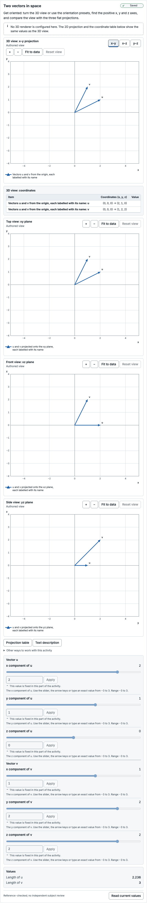
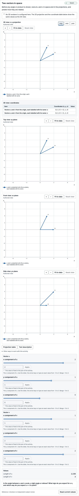
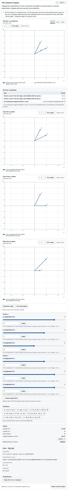
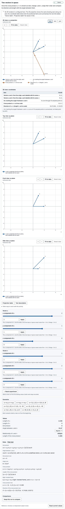
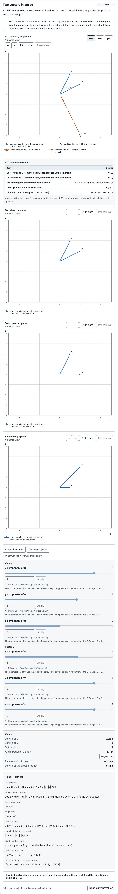
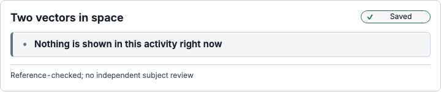

# Subject-review packet: Two vectors in space

> Prepared automatically by `explorable-models activity review-packet` (toolkit 0.3.0-preview.1) for a human subject reviewer.
> It is engineering evidence, **not** a subject review, an accessibility certification or evidence of learning benefit.
> Catalogue status of this exact version: **reference-checked** — no independent human review is recorded.
> The reviewer sign-off at the end is empty; an engineering agent cannot sign it.

## Exact identity

| Item | Value |
| --- | --- |
| Template | vector-orientation-3d@1.0.0 |
| Template digest | `sha256:df6de7b7ab572ad15f3fd4cec50302b88d5bda4da1f8a1b3206b5435a5892615` |
| Model | vector-orientation-3d@1.0.0 |
| Model digest | `sha256:5406433b6fd86fa353ccb113cc0d6c69af346b74ba0e1021d63d39429a9f32bc` |
| Scientific revision | `sha256:61285ee348b6ad94028b90282cc6f2faf7a9c32aeae193e7276e37acb7dc9746` |
| Presentation revision | `sha256:3a03ab54774c576ca7cb0c8ad65873b2586c0de81014e47440aa00aa15b1ce8b` |
| Reference suite bound by the model | vector-orientation-3d:1.0.0 `sha256:ae6ee27be8c85f6c6d209a3a3361f443ea01d8d0d651ccb051b6aa64fa560f02` |
| Reference fixture file | `tests/reference/fixtures/activities/vector-orientation-3d.json` `sha256:ae6ee27be8c85f6c6d209a3a3361f443ea01d8d0d651ccb051b6aa64fa560f02` |
| Fixture binding | matches |
| Execution | installed kernel vector-orientation-3d@1.0.0 (static) |
| Lifecycle | reference-checked |
| Generated with | toolkit 0.3.0-preview.1, Chromium 156.0.8078.4 |

## Purpose and task intent

Predict, then observe, how the directions of two vectors u and v in a right-handed 3D frame determine the angle between them, their dot product and their cross product.

| Stage | Kind | Instruction | Host-owned response request | Visible groups (* = solution-bearing) | Controls |
| --- | --- | --- | --- | --- | --- |
| orient | prepare | Get oriented: turn the 3D view or use the orientation presets, find the positive x, y and z axes, and compare the view with the three flat projections. | — | space (interactive), projections (fixed), vectors (fixed), components (fixed), lengths (fixed), alternatives (fixed), controls-u (fixed), controls-v (fixed) | ux (fixed), uy (fixed), uz (fixed), vx (fixed), vy (fixed), vz (fixed) |
| predict | predict | Before any angle or product is shown, look at u and v in space and in the projections, and predict how they are related. | prediction: Is the angle between u and v acute, a right angle or obtuse? What sign do you expect for u·v, and which way do you expect u × v to point? (task family vector-orientation-prediction) | space (interactive), projections (fixed), vectors (fixed), components (fixed), lengths (fixed), alternatives (fixed), controls-u (fixed), controls-v (fixed) | ux (fixed), uy (fixed), uz (fixed), vx (fixed), vy (fixed), vz (fixed) |
| explore-angle | explore | Change the components of u and v and watch the angle θ, the dot product u·v and the relationship. Compare what you see with your prediction. | — | space (interactive), projections (fixed), vectors (fixed), components (fixed), lengths (fixed), alternatives (fixed), controls-u (interactive), controls-v (interactive), angle-dot* (fixed), angle-arc* (fixed), dot-rules (fixed), dot-values* (fixed), scenarios (interactive) | ux (interactive), uy (interactive), uz (interactive), vx (interactive), vy (interactive), vz (interactive) |
| explore-cross | explore | Once the cross product u × v is shown as well, change u and v, swap their order and compare its direction and length with the angle between them. | — | space (interactive), projections (fixed), vectors (fixed), components (fixed), lengths (fixed), alternatives (fixed), controls-u (interactive), controls-v (interactive), angle-dot* (fixed), angle-arc* (fixed), dot-rules (fixed), dot-values* (fixed), cross* (fixed), cross-drawing* (fixed), cross-rules (fixed), cross-values* (fixed), scenarios (interactive) | ux (interactive), uy (interactive), uz (interactive), vx (interactive), vy (interactive), vz (interactive) |
| explain | explain | Explain in your own words how the directions of u and v determine the angle, the dot product and the cross product. | explanation: How do the directions of u and v determine the sign of u·v, the size of θ and the direction and length of u × v? (task family vector-orientation-explanation) | space (interactive), projections (fixed), vectors (fixed), components (fixed), lengths (fixed), alternatives (fixed), controls-u (fixed), controls-v (fixed), angle-dot* (fixed), angle-arc* (fixed), dot-rules (fixed), dot-values* (fixed), cross* (fixed), cross-drawing* (fixed), cross-rules (fixed), cross-values* (fixed) | ux (fixed), uy (fixed), uz (fixed), vx (fixed), vy (fixed), vz (fixed) |
| closed | closed | This activity is closed. | — | none | none |
| free-explore | explore | Explore freely: change both vectors, use the scenarios, turn the 3D view and compare the projections and values. | — | space (interactive), projections (interactive), vectors (fixed), components (fixed), lengths (fixed), alternatives (fixed), controls-u (interactive), controls-v (interactive), angle-dot* (fixed), angle-arc* (fixed), dot-rules (fixed), dot-values* (fixed), cross* (fixed), cross-drawing* (fixed), cross-rules (fixed), cross-values* (fixed), scenarios (interactive) | ux (interactive), uy (interactive), uz (interactive), vx (interactive), vy (interactive), vz (interactive) |

Transitions: orient → predict (“Continue to the prediction”); predict → explore-angle (“Show the angle and dot product and explore”); explore-angle → explore-cross (“Show the cross product”); explore-cross → explain (“Ask for an explanation”); explore-angle → explain (“Ask for an explanation without the cross product”); explain → closed (“Close the activity”); orient → closed (“Close the activity”); predict → closed (“Close the activity”); explore-angle → closed (“Close the activity”); explore-cross → closed (“Close the activity”); free-explore → closed (“Close the activity”). Initial stage: orient.

Host-owned task families (the visualizer never collects, stores or grades responses):

| Task family | Description |
| --- | --- |
| vector-orientation-prediction | Host-owned prediction request about the angle between two vectors in space, the sign of their dot product and the direction of their cross product. The host owns the response, its capture and any evaluation. |
| vector-orientation-explanation | Host-owned explanation request about how the directions of two vectors determine their angle, dot product and cross product. The host owns the response, its capture and any evaluation. |
| vector-orientation-later-task | Host-owned later task with new vectors or another representation, such as a projection-only or table-only version. Its prompts, held-out items and scoring stay with the host and are not part of this catalogue. |

## Derivation

- **derivation-vector-products** (derivation): Derivation written for this catalogue: u·v = Σ u_i v_i = |u||v| cos θ; u×v = (u_y v_z − u_z v_y, u_z v_x − u_x v_z, u_x v_y − u_y v_x) with e_x × e_y = e_z in a right-handed frame, so |u×v| = |u||v| sin θ and |u×v|² + (u·v)² = |u|²|v|² (Lagrange's identity). Hence θ = atan2(|u×v|, u·v) ∈ [0, π], defined when u ≠ 0 and v ≠ 0; u×v = 0 exactly when a vector is zero or u and v are parallel or antiparallel, and then it has no direction. Not independently reviewed.
- **study-harness-specification** (specification): Study Harness visualizer implementation report §12.4 (spatial vector orientation: two vectors, their angle, dot and cross products with declared handedness, coordinate projections, orientation presets, exact numeric alternatives, parallel, antiparallel, orthogonal and zero-vector checks) and §11 (3D equivalents).
- Template derivation note **derivation-vector-products**: Derivation written for this catalogue: u·v = Σ u_i v_i = |u||v| cos θ; u×v = (u_y v_z − u_z v_y, u_z v_x − u_x v_z, u_x v_y − u_y v_x) with e_x × e_y = e_z in a right-handed frame, so |u×v| = |u||v| sin θ and |u×v|² + (u·v)² = |u|²|v|² (Lagrange's identity). Hence θ = atan2(|u×v|, u·v) ∈ [0, π], defined when u ≠ 0 and v ≠ 0; u×v = 0 exactly when a vector is zero or u and v are parallel or antiparallel, and then it has no direction. Not independently reviewed.

## Assumptions

- u and v are dimensionless vectors in a right-handed Cartesian frame; their components are exact IEEE-754 double values.
- The cross product follows the right-hand rule: e_x × e_y = e_z, e_y × e_z = e_x, e_z × e_x = e_y.
- Two nonzero vectors are classified with the tolerance τ = 1/10¹²: parallel or antiparallel when sin θ ≤ τ, orthogonal when |cos θ| ≤ τ, decided exactly from the inputs.
- Evaluation is deterministic within one JavaScript engine: θ, the unit directions and the angle arc use Math.atan2, Math.cos, Math.sin and exponentiation, which ECMAScript lets each engine approximate, so their last bits can differ between engines; the dot and cross products, the lengths and the relationship are computed exactly and are the same on every engine.

## Limitations

- Dot products, cross-product components and lengths are rounded once from exact values; θ and the unit direction are computed from those rounded, rescaled values and agree with exact references to a few units in the last place.
- The classification is a tolerance decision on exact values, not a property of displayed digits: decimal inputs that are not exactly proportional in binary can be parallel within the tolerance while u×v is a tiny nonzero vector with a defined, input-sensitive direction.
- A nonzero result smaller than the smallest representable number is a numerical-limit status, never 0; an inexact result below the smallest normal double is reported as a reduced-precision approximation.
- The cross product is drawn at true scale and can leave the default view; the unit direction is drawn with length 1. The angle arc is sampled at 33 points; the polyline between samples is a drawing aid.
- Projections onto coordinate planes drop one component each, so a single projection cannot show whether two vectors are parallel or orthogonal in space.

## Units and conventions

- Coordinates: Right-handed Cartesian frame with axes x, y, z and e_x × e_y = e_z; u and v are free vectors drawn from the common origin. The xy projection is viewed from +z, the xz projection from −y and the yz projection from +x, each with its first named axis to the right and the second up.
- Angles: θ is the unsigned angle between u and v in radians, 0 ≤ θ ≤ π, computed as atan2(|u×v|, u·v). Degree display converts at the presentation boundary (1° = π/180 rad); the canonical value stays in radians.
- Handedness: right-handed

Parameters (canonical units; the authoring step is a UI increment unless admissibility says otherwise):

| Parameter | Label | Unit | Domain | Default | Admissible values |
| --- | --- | --- | --- | --- | --- |
| ux | u x component | dimensionless | [-3, 3] | 2 | continuous |
| uy | u y component | dimensionless | [-3, 3] | 1 | continuous |
| uz | u z component | dimensionless | [-3, 3] | 0 | continuous |
| vx | v x component | dimensionless | [-3, 3] | 1 | continuous |
| vy | v y component | dimensionless | [-3, 3] | 2 | continuous |
| vz | v z component | dimensionless | [-3, 3] | 2 | continuous |

Quantities:

| Quantity | Label | Shape | Unit | Meaning | Sign convention | Frame |
| --- | --- | --- | --- | --- | --- | --- |
| u | Vector u | vector(3) | dimensionless | The vector u = (u_x, u_y, u_z), equal to its three parameters. | Components (x, y, z) along the positive axes of the right-handed frame, where e_x × e_y = e_z. | right-handed Cartesian frame (x, y, z), origin shared by u and v |
| v | Vector v | vector(3) | dimensionless | The vector v = (v_x, v_y, v_z), equal to its three parameters. | Components (x, y, z) along the positive axes of the right-handed frame, where e_x × e_y = e_z. | right-handed Cartesian frame (x, y, z), origin shared by u and v |
| u.norm | Length of u | scalar | dimensionless | \|u\| = √(u_x² + u_y² + u_z²), rounded once from its exact value. | A length: never negative; 0 only for the zero vector. | right-handed Cartesian frame (x, y, z), origin shared by u and v |
| v.norm | Length of v | scalar | dimensionless | \|v\| = √(v_x² + v_y² + v_z²), rounded once from its exact value. | A length: never negative; 0 only for the zero vector. | right-handed Cartesian frame (x, y, z), origin shared by u and v |
| dot | Dot product | scalar | dimensionless | u·v = u_x v_x + u_y v_y + u_z v_z = \|u\|·\|v\|·cos θ, rounded once from its exact value. It does not depend on the order of u and v. | Positive for an acute angle, 0 for a right angle or a zero vector, negative for an obtuse angle. | right-handed Cartesian frame (x, y, z), origin shared by u and v |
| angle | Angle between u and v | scalar | rad | θ = atan2(\|u×v\|, u·v), the unsigned angle between u and v in radians, 0 ≤ θ ≤ π. Undefined (ZERO_VECTOR) when u or v is the zero vector, because a zero vector has no direction. | Unsigned: the same for (u, v) and (v, u); 0 when u and v point the same way, π when they point in opposite directions. | right-handed Cartesian frame (x, y, z), origin shared by u and v |
| relationship | Relationship of u and v | category: parallel, antiparallel, orthogonal, oblique, undefined-zero-vector | dimensionless | Classification with the declared tolerance τ = 1e-12 (the rational 1/10¹², applied exactly to the inputs): parallel when sin θ ≤ τ and u·v > 0, antiparallel when sin θ ≤ τ and u·v < 0, orthogonal when \|cos θ\| ≤ τ, oblique otherwise, undefined-zero-vector when u or v is the zero vector. Never derived from displayed digits. | — | — |
| cross | Cross product | vector(3) | dimensionless | u×v = (u_y v_z − u_z v_y, u_z v_x − u_x v_z, u_x v_y − u_y v_x), each component rounded once from its exact value. Its length is \|u\|·\|v\|·sin θ and it is perpendicular to both u and v; it is the zero vector exactly when u or v is zero or u and v are parallel or antiparallel. | Right-hand rule: with the fingers of the right hand turning from u toward v through θ, the thumb points along u×v; e_x × e_y = e_z, and v×u = −(u×v). | right-handed Cartesian frame (x, y, z), origin shared by u and v |
| cross.norm | Length of the cross product | scalar | dimensionless | \|u×v\| = \|u\|·\|v\|·sin θ, the area of the parallelogram spanned by u and v, rounded once from its exact value. | A length: never negative; 0 only for the zero vector. | right-handed Cartesian frame (x, y, z), origin shared by u and v |
| cross.direction | Direction of the cross product | vector(3) | dimensionless | Unit vector u×v / \|u×v\|, normal to the plane of u and v. Undefined (NO_CROSS_DIRECTION) whenever u×v = 0 exactly (a zero vector, or parallel or antiparallel vectors); no direction is ever chosen arbitrarily. Defined for every nonzero u×v, including nearly parallel vectors classified as parallel within the tolerance, where it is sensitive to tiny input changes. | Right-hand rule, as for u×v. | right-handed Cartesian frame (x, y, z), origin shared by u and v |
| u.xy | u projected onto the xy plane | vector(2) | dimensionless | Orthogonal projection of u onto the xy plane: its components (x, y), with the third component dropped. | Components (x, y) along the positive axes of that plane. | xy plane of the right-handed frame, viewed from +z (z toward the viewer) |
| v.xy | v projected onto the xy plane | vector(2) | dimensionless | Orthogonal projection of v onto the xy plane: its components (x, y), with the third component dropped. | Components (x, y) along the positive axes of that plane. | xy plane of the right-handed frame, viewed from +z (z toward the viewer) |
| u.xz | u projected onto the xz plane | vector(2) | dimensionless | Orthogonal projection of u onto the xz plane: its components (x, z), with the third component dropped. | Components (x, z) along the positive axes of that plane. | xz plane of the right-handed frame, viewed from −y (y away from the viewer) |
| v.xz | v projected onto the xz plane | vector(2) | dimensionless | Orthogonal projection of v onto the xz plane: its components (x, z), with the third component dropped. | Components (x, z) along the positive axes of that plane. | xz plane of the right-handed frame, viewed from −y (y away from the viewer) |
| u.yz | u projected onto the yz plane | vector(2) | dimensionless | Orthogonal projection of u onto the yz plane: its components (y, z), with the third component dropped. | Components (y, z) along the positive axes of that plane. | yz plane of the right-handed frame, viewed from +x (x toward the viewer) |
| v.yz | v projected onto the yz plane | vector(2) | dimensionless | Orthogonal projection of v onto the yz plane: its components (y, z), with the third component dropped. | Components (y, z) along the positive axes of that plane. | yz plane of the right-handed frame, viewed from +x (x toward the viewer) |

## Reference cases

Suite `vector-orientation-3d:1.0.0` for vector-orientation-3d@1.0.0: **33 of 33 cases agree** with frames evaluated in a browser module worker (33 evaluation points; rejection cases must be refused before evaluation).

- Author of the cases: Reference cases for report §12.4 (handedness, parallel, antiparallel, orthogonal, oblique and zero vectors) plus tolerance-boundary and numerical-limit cases. Integer cases are derived by hand; every stored value is the output of the exact oracle tests/reference/oracles/vector-orientation-3d.ts, which shares no code with the catalogue kernel.
- Review statement of the fixture: No independent human subject reviewer has approved these cases. Automated agreement is engineering evidence only.
- Semantics: Right-handed frame (e_x × e_y = e_z). Inputs are the exact values of IEEE-754 doubles. u·v, the components of u×v = (u_y v_z − u_z v_y, u_z v_x − u_x v_z, u_x v_y − u_y v_x) and the lengths |u|, |v|, |u×v| are exact values rounded once to the nearest double (ties to even). θ = atan2(|u×v|, u·v) ∈ [0, π] in radians; undefined (ZERO_VECTOR) when u or v is the zero vector. The unit direction of u×v is undefined (NO_CROSS_DIRECTION) exactly when u×v = 0. Relationship with τ = 1/10¹² exactly: parallel or antiparallel when |u×v|² ≤ τ²·|u|²·|v|² (by the sign of u·v), orthogonal when (u·v)² ≤ τ²·|u|²·|v|², oblique otherwise, undefined-zero-vector when a vector is zero. The angle arc is drawn exactly when u×v ≠ 0 and θ is representable; otherwise it is empty with a reason.
- Converted from `tests/reference/fixtures/activities/vector-orientation-3d.json` `sha256:ae6ee27be8c85f6c6d209a3a3361f443ea01d8d0d651ccb051b6aa64fa560f02` (suite vector-orientation-3d:1.0.0): Converted by explorable-models activity tooling: case IDs, labels, provenance, parameters and tolerances copied unchanged; quantity expectations restated as explorable-models.reference-fixtures 1.0 expectations.
- Not compared by this runner: The angle-arc flag and the exact geometry of u, v and their projections are checked by tests/reference/activities/vector-orientation-3d.test.ts.

| Case | Label | Provenance | Tolerance | Result |
| --- | --- | --- | --- | --- |
| handedness-ex-ey | e_x × e_y = e_z (right-handed frame); orthogonal axis vectors, θ = π/2 | report §12.4 handedness check; hand-derived from the component formulas u·v = Σ u_i v_i and u×v = (u_y v_z − u_z v_y, u_z v_x − u_x v_z, u_x v_y − u_y v_x) with small integers; lengths and θ follow from \|w\| = √(w·w) and θ = atan2(\|u×v\|, u·v); every stored double cross-checked by exact rational arithmetic in tests/reference/oracles/vector-orientation-3d.ts | exact; angle: abs 0, rel 1e-15; cross.direction: abs 1e-15, rel 0 | pass (1 point) |
| handedness-ey-ex | e_y × e_x = −e_z: reversing the order reverses the cross product | report §12.4 handedness check; hand-derived from the component formulas u·v = Σ u_i v_i and u×v = (u_y v_z − u_z v_y, u_z v_x − u_x v_z, u_x v_y − u_y v_x) with small integers; lengths and θ follow from \|w\| = √(w·w) and θ = atan2(\|u×v\|, u·v); every stored double cross-checked by exact rational arithmetic in tests/reference/oracles/vector-orientation-3d.ts | exact; angle: abs 0, rel 1e-15; cross.direction: abs 1e-15, rel 0 | pass (1 point) |
| handedness-ey-ez | e_y × e_z = e_x (cyclic order) | handedness check (cyclic permutation); hand-derived from the component formulas u·v = Σ u_i v_i and u×v = (u_y v_z − u_z v_y, u_z v_x − u_x v_z, u_x v_y − u_y v_x) with small integers; lengths and θ follow from \|w\| = √(w·w) and θ = atan2(\|u×v\|, u·v); every stored double cross-checked by exact rational arithmetic in tests/reference/oracles/vector-orientation-3d.ts | exact; angle: abs 0, rel 1e-15; cross.direction: abs 1e-15, rel 0 | pass (1 point) |
| handedness-ez-ex | e_z × e_x = e_y (cyclic order) | handedness check (cyclic permutation); hand-derived from the component formulas u·v = Σ u_i v_i and u×v = (u_y v_z − u_z v_y, u_z v_x − u_x v_z, u_x v_y − u_y v_x) with small integers; lengths and θ follow from \|w\| = √(w·w) and θ = atan2(\|u×v\|, u·v); every stored double cross-checked by exact rational arithmetic in tests/reference/oracles/vector-orientation-3d.ts | exact; angle: abs 0, rel 1e-15; cross.direction: abs 1e-15, rel 0 | pass (1 point) |
| parallel-nonaxis | v = 1.5·u with u = (1, 2, 2): parallel, θ = 0, u×v = 0 with no direction | report §12.4 parallel case; hand-derived from the component formulas u·v = Σ u_i v_i and u×v = (u_y v_z − u_z v_y, u_z v_x − u_x v_z, u_x v_y − u_y v_x) with small integers; lengths and θ follow from \|w\| = √(w·w) and θ = atan2(\|u×v\|, u·v); every stored double cross-checked by exact rational arithmetic in tests/reference/oracles/vector-orientation-3d.ts | exact; angle: abs 0, rel 1e-15; cross.direction: abs 1e-15, rel 0 | pass (1 point) |
| parallel-axis | u = (0, 0, 2), v = (0, 0, 0.5): parallel along the z axis | report §12.4 parallel case; hand-derived from the component formulas u·v = Σ u_i v_i and u×v = (u_y v_z − u_z v_y, u_z v_x − u_x v_z, u_x v_y − u_y v_x) with small integers; lengths and θ follow from \|w\| = √(w·w) and θ = atan2(\|u×v\|, u·v); every stored double cross-checked by exact rational arithmetic in tests/reference/oracles/vector-orientation-3d.ts | exact; angle: abs 0, rel 1e-15; cross.direction: abs 1e-15, rel 0 | pass (1 point) |
| antiparallel-nonaxis | v = −1.5·u with u = (1, 2, 2): antiparallel, θ = π, no arc because the plane of the turn is not unique | report §12.4 antiparallel case; hand-derived from the component formulas u·v = Σ u_i v_i and u×v = (u_y v_z − u_z v_y, u_z v_x − u_x v_z, u_x v_y − u_y v_x) with small integers; lengths and θ follow from \|w\| = √(w·w) and θ = atan2(\|u×v\|, u·v); every stored double cross-checked by exact rational arithmetic in tests/reference/oracles/vector-orientation-3d.ts | exact; angle: abs 0, rel 1e-15; cross.direction: abs 1e-15, rel 0 | pass (1 point) |
| antiparallel-axis | u = (3, 0, 0), v = (−1, 0, 0): antiparallel along the x axis | report §12.4 antiparallel case; hand-derived from the component formulas u·v = Σ u_i v_i and u×v = (u_y v_z − u_z v_y, u_z v_x − u_x v_z, u_x v_y − u_y v_x) with small integers; lengths and θ follow from \|w\| = √(w·w) and θ = atan2(\|u×v\|, u·v); every stored double cross-checked by exact rational arithmetic in tests/reference/oracles/vector-orientation-3d.ts | exact; angle: abs 0, rel 1e-15; cross.direction: abs 1e-15, rel 0 | pass (1 point) |
| orthogonal-axis | u = (2, 0, 0), v = (0, 0, −3): orthogonal axis vectors, u×v = (0, 6, 0) | report §12.4 orthogonal case (axis); hand-derived from the component formulas u·v = Σ u_i v_i and u×v = (u_y v_z − u_z v_y, u_z v_x − u_x v_z, u_x v_y − u_y v_x) with small integers; lengths and θ follow from \|w\| = √(w·w) and θ = atan2(\|u×v\|, u·v); every stored double cross-checked by exact rational arithmetic in tests/reference/oracles/vector-orientation-3d.ts | exact; angle: abs 0, rel 1e-15; cross.direction: abs 1e-15, rel 0 | pass (1 point) |
| orthogonal-nonaxis | u = (1, 2, 2), v = (2, 1, −2): orthogonal, u×v = (−6, 6, −3), \|u×v\| = 9 | report §12.4 orthogonal case (nonaxis); hand-derived from the component formulas u·v = Σ u_i v_i and u×v = (u_y v_z − u_z v_y, u_z v_x − u_x v_z, u_x v_y − u_y v_x) with small integers; lengths and θ follow from \|w\| = √(w·w) and θ = atan2(\|u×v\|, u·v); every stored double cross-checked by exact rational arithmetic in tests/reference/oracles/vector-orientation-3d.ts | exact; angle: abs 0, rel 1e-15; cross.direction: abs 1e-15, rel 0 | pass (1 point) |
| oblique-acute | Default pair u = (2, 1, 0), v = (1, 2, 2): u·v = 4, u×v = (2, −4, 3), acute angle | oblique case (template default); hand-derived from the component formulas u·v = Σ u_i v_i and u×v = (u_y v_z − u_z v_y, u_z v_x − u_x v_z, u_x v_y − u_y v_x) with small integers; lengths and θ follow from \|w\| = √(w·w) and θ = atan2(\|u×v\|, u·v); every stored double cross-checked by exact rational arithmetic in tests/reference/oracles/vector-orientation-3d.ts | exact; angle: abs 0, rel 1e-15; cross.direction: abs 1e-15, rel 0 | pass (1 point) |
| oblique-obtuse | u = (1, 1, 0), v = (−2, 1, 1): u·v = −1, u×v = (1, −1, 3), obtuse angle | oblique case (obtuse); hand-derived from the component formulas u·v = Σ u_i v_i and u×v = (u_y v_z − u_z v_y, u_z v_x − u_x v_z, u_x v_y − u_y v_x) with small integers; lengths and θ follow from \|w\| = √(w·w) and θ = atan2(\|u×v\|, u·v); every stored double cross-checked by exact rational arithmetic in tests/reference/oracles/vector-orientation-3d.ts | exact; angle: abs 0, rel 1e-15; cross.direction: abs 1e-15, rel 0 | pass (1 point) |
| oblique-domain-corners | u = (3, 3, 3), v = (−3, 3, −3): largest components, u×v = (−18, 0, 18) beyond the default view | oblique case at the domain corners; hand-derived from the component formulas u·v = Σ u_i v_i and u×v = (u_y v_z − u_z v_y, u_z v_x − u_x v_z, u_x v_y − u_y v_x) with small integers; lengths and θ follow from \|w\| = √(w·w) and θ = atan2(\|u×v\|, u·v); every stored double cross-checked by exact rational arithmetic in tests/reference/oracles/vector-orientation-3d.ts | exact; angle: abs 0, rel 1e-15; cross.direction: abs 1e-15, rel 0 | pass (1 point) |
| zero-u | u = 0: angle undefined (ZERO_VECTOR), u×v = 0 with no direction, relationship undefined-zero-vector | report §12.4 zero-vector case; hand-derived from the component formulas u·v = Σ u_i v_i and u×v = (u_y v_z − u_z v_y, u_z v_x − u_x v_z, u_x v_y − u_y v_x) with small integers; lengths and θ follow from \|w\| = √(w·w) and θ = atan2(\|u×v\|, u·v); every stored double cross-checked by exact rational arithmetic in tests/reference/oracles/vector-orientation-3d.ts | exact; angle: abs 0, rel 1e-15; cross.direction: abs 1e-15, rel 0 | pass (1 point) |
| zero-v | v = 0: angle undefined (ZERO_VECTOR), u×v = 0 with no direction | report §12.4 zero-vector case; hand-derived from the component formulas u·v = Σ u_i v_i and u×v = (u_y v_z − u_z v_y, u_z v_x − u_x v_z, u_x v_y − u_y v_x) with small integers; lengths and θ follow from \|w\| = √(w·w) and θ = atan2(\|u×v\|, u·v); every stored double cross-checked by exact rational arithmetic in tests/reference/oracles/vector-orientation-3d.ts | exact; angle: abs 0, rel 1e-15; cross.direction: abs 1e-15, rel 0 | pass (1 point) |
| zero-both | u = v = 0: every orientation quantity undefined, lengths and products exactly 0 | report §12.4 zero-vector case; hand-derived from the component formulas u·v = Σ u_i v_i and u×v = (u_y v_z − u_z v_y, u_z v_x − u_x v_z, u_x v_y − u_y v_x) with small integers; lengths and θ follow from \|w\| = √(w·w) and θ = atan2(\|u×v\|, u·v); every stored double cross-checked by exact rational arithmetic in tests/reference/oracles/vector-orientation-3d.ts | exact; angle: abs 0, rel 1e-15; cross.direction: abs 1e-15, rel 0 | pass (1 point) |
| negative-zero-components | u = (−0, 1, −0), v = (0, −0, 2): −0 inputs are ordinary zeros; outputs carry +0 | signed-zero handling; hand-derived from the component formulas u·v = Σ u_i v_i and u×v = (u_y v_z − u_z v_y, u_z v_x − u_x v_z, u_x v_y − u_y v_x) with small integers; lengths and θ follow from \|w\| = √(w·w) and θ = atan2(\|u×v\|, u·v); every stored double cross-checked by exact rational arithmetic in tests/reference/oracles/vector-orientation-3d.ts | exact; angle: abs 0, rel 1e-15; cross.direction: abs 1e-15, rel 0 | pass (1 point) |
| near-parallel-inside | u = (1, 0, 0), v = (1, b, 0) with b the double nearest 1e-12 (below it): sin θ ≤ 10⁻¹², parallel | tolerance boundary, inside (adjacent doubles straddle sin θ = 10⁻¹²); derived by exact rational arithmetic (high-precision fixed point for θ and the unit direction) in tests/reference/oracles/vector-orientation-3d.ts, which shares no code with the catalogue kernel | exact; angle: abs 0, rel 1e-15; cross.direction: abs 1e-15, rel 0 | pass (1 point) |
| near-parallel-outside | u = (1, 0, 0), v = (1, b⁺, 0) with b⁺ the next double above b: sin θ > 10⁻¹², oblique | tolerance boundary, outside (adjacent doubles straddle sin θ = 10⁻¹²); derived by exact rational arithmetic (high-precision fixed point for θ and the unit direction) in tests/reference/oracles/vector-orientation-3d.ts, which shares no code with the catalogue kernel | exact; angle: abs 0, rel 1e-15; cross.direction: abs 1e-15, rel 0 | pass (1 point) |
| near-orthogonal-inside | u = (1, 0, 0), v = (b, 1, 0): \|cos θ\| ≤ 10⁻¹², orthogonal | tolerance boundary, inside (adjacent doubles straddle \|cos θ\| = 10⁻¹²); derived by exact rational arithmetic (high-precision fixed point for θ and the unit direction) in tests/reference/oracles/vector-orientation-3d.ts, which shares no code with the catalogue kernel | exact; angle: abs 0, rel 1e-15; cross.direction: abs 1e-15, rel 0 | pass (1 point) |
| near-orthogonal-outside | u = (1, 0, 0), v = (b⁺, 1, 0): \|cos θ\| > 10⁻¹², oblique | tolerance boundary, outside (adjacent doubles straddle \|cos θ\| = 10⁻¹²); derived by exact rational arithmetic (high-precision fixed point for θ and the unit direction) in tests/reference/oracles/vector-orientation-3d.ts, which shares no code with the catalogue kernel | exact; angle: abs 0, rel 1e-15; cross.direction: abs 1e-15, rel 0 | pass (1 point) |
| near-orthogonal-negative-inside | u = (1, 0, 0), v = (−b, 1, 0): cos θ slightly negative, still orthogonal | tolerance boundary, inside on the obtuse side; derived by exact rational arithmetic (high-precision fixed point for θ and the unit direction) in tests/reference/oracles/vector-orientation-3d.ts, which shares no code with the catalogue kernel | exact; angle: abs 0, rel 1e-15; cross.direction: abs 1e-15, rel 0 | pass (1 point) |
| near-antiparallel-inside | u = (1, 0, 0), v = (−1, b, 0): large angle π − 10⁻¹², sin θ ≤ 10⁻¹², antiparallel | large-angle tolerance boundary, inside; derived by exact rational arithmetic (high-precision fixed point for θ and the unit direction) in tests/reference/oracles/vector-orientation-3d.ts, which shares no code with the catalogue kernel | exact; angle: abs 0, rel 1e-15; cross.direction: abs 1e-15, rel 0 | pass (1 point) |
| near-antiparallel-outside | u = (1, 0, 0), v = (−1, b⁺, 0): sin θ > 10⁻¹², oblique although θ rounds near π | large-angle tolerance boundary, outside; derived by exact rational arithmetic (high-precision fixed point for θ and the unit direction) in tests/reference/oracles/vector-orientation-3d.ts, which shares no code with the catalogue kernel | exact; angle: abs 0, rel 1e-15; cross.direction: abs 1e-15, rel 0 | pass (1 point) |
| near-antiparallel-nonaxis-inside | u = (1, 2, 2), v = (−1, −2, −2 + 4·10⁻¹²): sin θ ≈ 0.994·10⁻¹², antiparallel | large-angle tolerance boundary, nonaxis, inside (sin θ = √5·ε/(3·\|v\|)); derived by exact rational arithmetic (high-precision fixed point for θ and the unit direction) in tests/reference/oracles/vector-orientation-3d.ts, which shares no code with the catalogue kernel | exact; angle: abs 0, rel 1e-15; cross.direction: abs 1e-15, rel 0 | pass (1 point) |
| near-antiparallel-nonaxis-outside | u = (1, 2, 2), v = (−1, −2, −2 + 4.05·10⁻¹²): sin θ ≈ 1.006·10⁻¹², oblique | large-angle tolerance boundary, nonaxis, outside; derived by exact rational arithmetic (high-precision fixed point for θ and the unit direction) in tests/reference/oracles/vector-orientation-3d.ts, which shares no code with the catalogue kernel | exact; angle: abs 0, rel 1e-15; cross.direction: abs 1e-15, rel 0 | pass (1 point) |
| decimal-near-parallel | u = (0.1, 0.2, 0.3), v = (0.3, 0.6, 0.9): parallel within τ, but the binary inputs give u×v ≠ 0, so θ and the direction are defined | decimal inputs that are not exactly proportional in binary; derived by exact rational arithmetic (high-precision fixed point for θ and the unit direction) in tests/reference/oracles/vector-orientation-3d.ts, which shares no code with the catalogue kernel | exact; angle: abs 0, rel 1e-15; cross.direction: abs 1e-15, rel 0 | pass (1 point) |
| decimal-parallel-exact | u = (0.1, 0.2, 0.3), v = (0.2, 0.4, 0.6): v = 2u exactly in binary, so u×v = 0 exactly and has no direction | decimal inputs that are exactly proportional in binary (doubling is exact); derived by exact rational arithmetic (high-precision fixed point for θ and the unit direction) in tests/reference/oracles/vector-orientation-3d.ts, which shares no code with the catalogue kernel | exact; angle: abs 0, rel 1e-15; cross.direction: abs 1e-15, rel 0 | pass (1 point) |
| scaled-orthogonal-nonaxis | The orthogonal nonaxis pair scaled by 2⁻⁵⁰⁰: same θ and direction, products near 10⁻³⁰⁰ | scale invariance of θ and direction; derived by exact rational arithmetic (high-precision fixed point for θ and the unit direction) in tests/reference/oracles/vector-orientation-3d.ts, which shares no code with the catalogue kernel | exact; angle: abs 0, rel 1e-15; cross.direction: abs 1e-15, rel 0 | pass (1 point) |
| tiny-orthogonal-cross-underflow | u = (10⁻²⁰⁰, 0, 0), v = (0, 10⁻²⁰⁰, 0): u×v ≈ (0, 0, 10⁻⁴⁰⁰) is a numerical limit, not 0; its direction (0, 0, 1) is defined | underflow of a nonzero cross product; derived by exact rational arithmetic (high-precision fixed point for θ and the unit direction) in tests/reference/oracles/vector-orientation-3d.ts, which shares no code with the catalogue kernel | exact; angle: abs 0, rel 1e-15; cross.direction: abs 1e-15, rel 0 | pass (1 point) |
| tiny-parallel-dot-underflow | u = (10⁻²⁰⁰, 0, 0), v = (2·10⁻²⁰⁰, 0, 0): u·v ≈ 2·10⁻⁴⁰⁰ is a numerical limit, not 0; θ = 0 exactly | underflow of a nonzero dot product; derived by exact rational arithmetic (high-precision fixed point for θ and the unit direction) in tests/reference/oracles/vector-orientation-3d.ts, which shares no code with the catalogue kernel | exact; angle: abs 0, rel 1e-15; cross.direction: abs 1e-15, rel 0 | pass (1 point) |
| tiny-dot-subnormal | u = (10⁻¹⁶⁰, 0, 0), v = (1.5·10⁻¹⁶⁰, 0, 0): u·v is subnormal and reported as a reduced-precision approximation | subnormal rounding of a nonzero dot product; derived by exact rational arithmetic (high-precision fixed point for θ and the unit direction) in tests/reference/oracles/vector-orientation-3d.ts, which shares no code with the catalogue kernel | exact; angle: abs 0, rel 1e-15; cross.direction: abs 1e-15, rel 0 | pass (1 point) |
| subnormal-angle-underflow | u = (3, 0, 0), v = (3, 5·10⁻³²⁴, 0): θ ≈ 1.6·10⁻³²⁴ is a numerical limit (not 0), parallel within τ, direction (0, 0, 1) defined, no arc | underflow of a nonzero angle; derived by exact rational arithmetic (high-precision fixed point for θ and the unit direction) in tests/reference/oracles/vector-orientation-3d.ts, which shares no code with the catalogue kernel | exact; angle: abs 0, rel 1e-15; cross.direction: abs 1e-15, rel 0 | pass (1 point) |

## Mutation sensitivity

Generic faults injected into the evaluated model inside the checks worker (outputs or inputs altered after the kernel, one fault at a time); a mutant is detected when at least one reference case disagrees. **58 of 58 detected.**

| Fault | Mutants | Detected | Undetected targets |
| --- | --- | --- | --- |
| sign | 15 | 15 | — |
| factor | 15 | 15 | — |
| unit | 1 | 1 | — |
| undefined-as-zero | 2 | 2 | — |
| limit-as-zero | 4 | 4 | — |
| swap-inputs | 15 | 15 | — |
| boundary-nudge | 6 | 6 | — |

Activity-specific mutants (for example wrong conventions, transposed inputs and incorrect boundaries) are exercised in the mutation-sensitivity tests of `tests/reference/activities/vector-orientation-3d.test.ts`; hidden-output leakage across output channels is tested in `tests/activity/disclosure.test.ts`. Those results are not restated here.

## Boundary cases

Declared cases come from the package (or the installed suite's non-valid expectations); generated probes test the declared domain edges. Outcomes: valid / undefined / numerical-limit / out-of-domain (rejected before evaluation) / worker-error.

| Case | Source | Parameters | Position | Outcome | Non-valid statuses | Expectation |
| --- | --- | --- | --- | --- | --- | --- |
| parallel-nonaxis: v = 1.5·u with u = (1, 2, 2): parallel, θ = 0, u×v = 0 with no direction | declared | ux = 1, uy = 2, uz = 2, vx = 1.5, vy = 3, vz = 3 | static | undefined | cross.direction: undefined:NO_CROSS_DIRECTION | met |
| parallel-axis: u = (0, 0, 2), v = (0, 0, 0.5): parallel along the z axis | declared | ux = 0, uy = 0, uz = 2, vx = 0, vy = 0, vz = 0.5 | static | undefined | cross.direction: undefined:NO_CROSS_DIRECTION | met |
| antiparallel-nonaxis: v = −1.5·u with u = (1, 2, 2): antiparallel, θ = π, no arc because the plane of the turn is not unique | declared | ux = 1, uy = 2, uz = 2, vx = -1.5, vy = -3, vz = -3 | static | undefined | cross.direction: undefined:NO_CROSS_DIRECTION | met |
| antiparallel-axis: u = (3, 0, 0), v = (−1, 0, 0): antiparallel along the x axis | declared | ux = 3, uy = 0, uz = 0, vx = -1, vy = 0, vz = 0 | static | undefined | cross.direction: undefined:NO_CROSS_DIRECTION | met |
| zero-u: u = 0: angle undefined (ZERO_VECTOR), u×v = 0 with no direction, relationship undefined-zero-vector | declared | ux = 0, uy = 0, uz = 0, vx = 1, vy = 2, vz = 2 | static | undefined | angle: undefined:ZERO_VECTOR, cross.direction: undefined:NO_CROSS_DIRECTION | met |
| zero-v: v = 0: angle undefined (ZERO_VECTOR), u×v = 0 with no direction | declared | ux = -2, uy = 1, uz = 0.5, vx = 0, vy = 0, vz = 0 | static | undefined | angle: undefined:ZERO_VECTOR, cross.direction: undefined:NO_CROSS_DIRECTION | met |
| zero-both: u = v = 0: every orientation quantity undefined, lengths and products exactly 0 | declared | ux = 0, uy = 0, uz = 0, vx = 0, vy = 0, vz = 0 | static | undefined | angle: undefined:ZERO_VECTOR, cross.direction: undefined:NO_CROSS_DIRECTION | met |
| decimal-parallel-exact: u = (0.1, 0.2, 0.3), v = (0.2, 0.4, 0.6): v = 2u exactly in binary, so u×v = 0 exactly and has no direction | declared | ux = 0.1, uy = 0.2, uz = 0.3, vx = 0.2, vy = 0.4, vz = 0.6 | static | undefined | cross.direction: undefined:NO_CROSS_DIRECTION | met |
| tiny-orthogonal-cross-underflow: u = (10⁻²⁰⁰, 0, 0), v = (0, 10⁻²⁰⁰, 0): u×v ≈ (0, 0, 10⁻⁴⁰⁰) is a numerical limit, not 0; its direction (0, 0, 1) is defined | declared | ux = 1e-200, uy = 0, uz = 0, vx = 0, vy = 1e-200, vz = 0 | static | numerical-limit | cross: numerical-limit:UNDERFLOW, cross.norm: numerical-limit:UNDERFLOW | met |
| tiny-parallel-dot-underflow: u = (10⁻²⁰⁰, 0, 0), v = (2·10⁻²⁰⁰, 0, 0): u·v ≈ 2·10⁻⁴⁰⁰ is a numerical limit, not 0; θ = 0 exactly | declared | ux = 1e-200, uy = 0, uz = 0, vx = 2e-200, vy = 0, vz = 0 | static | numerical-limit | dot: numerical-limit:UNDERFLOW, cross.direction: undefined:NO_CROSS_DIRECTION | met |
| tiny-dot-subnormal: u = (10⁻¹⁶⁰, 0, 0), v = (1.5·10⁻¹⁶⁰, 0, 0): u·v is subnormal and reported as a reduced-precision approximation | declared | ux = 1e-160, uy = 0, uz = 0, vx = 1.5e-160, vy = 0, vz = 0 | static | undefined | dot: valid:UNDERFLOW, cross.direction: undefined:NO_CROSS_DIRECTION | met |
| subnormal-angle-underflow: u = (3, 0, 0), v = (3, 5·10⁻³²⁴, 0): θ ≈ 1.6·10⁻³²⁴ is a numerical limit (not 0), parallel within τ, direction (0, 0, 1) defined, no arc | declared | ux = 3, uy = 0, uz = 0, vx = 3, vy = 5e-324, vz = 0 | static | numerical-limit | angle: numerical-limit:UNDERFLOW | met |
| generated.ux.min: ux at its minimum -3 | generated | ux = -3, uy = 1, uz = 0, vx = 1, vy = 2, vz = 2 | static | valid | — | — |
| generated.ux.max: ux at its maximum 3 | generated | ux = 3, uy = 1, uz = 0, vx = 1, vy = 2, vz = 2 | static | valid | — | — |
| generated.ux.below: ux just below its minimum | generated | ux = -3.000006, uy = 1, uz = 0, vx = 1, vy = 2, vz = 2 | static | out-of-domain | OUT_OF_DOMAIN at $.parameters.ux | met |
| generated.ux.above: ux just above its maximum | generated | ux = 3.000006, uy = 1, uz = 0, vx = 1, vy = 2, vz = 2 | static | out-of-domain | OUT_OF_DOMAIN at $.parameters.ux | met |
| generated.uy.min: uy at its minimum -3 | generated | ux = 2, uy = -3, uz = 0, vx = 1, vy = 2, vz = 2 | static | valid | — | — |
| generated.uy.max: uy at its maximum 3 | generated | ux = 2, uy = 3, uz = 0, vx = 1, vy = 2, vz = 2 | static | valid | — | — |
| generated.uy.below: uy just below its minimum | generated | ux = 2, uy = -3.000006, uz = 0, vx = 1, vy = 2, vz = 2 | static | out-of-domain | OUT_OF_DOMAIN at $.parameters.uy | met |
| generated.uy.above: uy just above its maximum | generated | ux = 2, uy = 3.000006, uz = 0, vx = 1, vy = 2, vz = 2 | static | out-of-domain | OUT_OF_DOMAIN at $.parameters.uy | met |
| generated.uz.min: uz at its minimum -3 | generated | ux = 2, uy = 1, uz = -3, vx = 1, vy = 2, vz = 2 | static | valid | — | — |
| generated.uz.max: uz at its maximum 3 | generated | ux = 2, uy = 1, uz = 3, vx = 1, vy = 2, vz = 2 | static | valid | — | — |
| generated.uz.below: uz just below its minimum | generated | ux = 2, uy = 1, uz = -3.000006, vx = 1, vy = 2, vz = 2 | static | out-of-domain | OUT_OF_DOMAIN at $.parameters.uz | met |
| generated.uz.above: uz just above its maximum | generated | ux = 2, uy = 1, uz = 3.000006, vx = 1, vy = 2, vz = 2 | static | out-of-domain | OUT_OF_DOMAIN at $.parameters.uz | met |
| generated.vx.min: vx at its minimum -3 | generated | ux = 2, uy = 1, uz = 0, vx = -3, vy = 2, vz = 2 | static | valid | — | — |
| generated.vx.max: vx at its maximum 3 | generated | ux = 2, uy = 1, uz = 0, vx = 3, vy = 2, vz = 2 | static | valid | — | — |
| generated.vx.below: vx just below its minimum | generated | ux = 2, uy = 1, uz = 0, vx = -3.000006, vy = 2, vz = 2 | static | out-of-domain | OUT_OF_DOMAIN at $.parameters.vx | met |
| generated.vx.above: vx just above its maximum | generated | ux = 2, uy = 1, uz = 0, vx = 3.000006, vy = 2, vz = 2 | static | out-of-domain | OUT_OF_DOMAIN at $.parameters.vx | met |
| generated.vy.min: vy at its minimum -3 | generated | ux = 2, uy = 1, uz = 0, vx = 1, vy = -3, vz = 2 | static | valid | — | — |
| generated.vy.max: vy at its maximum 3 | generated | ux = 2, uy = 1, uz = 0, vx = 1, vy = 3, vz = 2 | static | valid | — | — |
| generated.vy.below: vy just below its minimum | generated | ux = 2, uy = 1, uz = 0, vx = 1, vy = -3.000006, vz = 2 | static | out-of-domain | OUT_OF_DOMAIN at $.parameters.vy | met |
| generated.vy.above: vy just above its maximum | generated | ux = 2, uy = 1, uz = 0, vx = 1, vy = 3.000006, vz = 2 | static | out-of-domain | OUT_OF_DOMAIN at $.parameters.vy | met |
| generated.vz.min: vz at its minimum -3 | generated | ux = 2, uy = 1, uz = 0, vx = 1, vy = 2, vz = -3 | static | valid | — | — |
| generated.vz.max: vz at its maximum 3 | generated | ux = 2, uy = 1, uz = 0, vx = 1, vy = 2, vz = 3 | static | valid | — | — |
| generated.vz.below: vz just below its minimum | generated | ux = 2, uy = 1, uz = 0, vx = 1, vy = 2, vz = -3.000006 | static | out-of-domain | OUT_OF_DOMAIN at $.parameters.vz | met |
| generated.vz.above: vz just above its maximum | generated | ux = 2, uy = 1, uz = 0, vx = 1, vy = 2, vz = 3.000006 | static | out-of-domain | OUT_OF_DOMAIN at $.parameters.vz | met |

## Default evaluation and author checks

Defaults ux = 2, uy = 1, uz = 0, vx = 1, vy = 2, vz = 2 (position: static): u valid, v valid, u.norm valid, v.norm valid, dot valid, angle valid, relationship valid, cross valid, cross.norm valid, cross.direction valid, u.xy valid, v.xy valid, u.xz valid, v.xz valid, u.yz valid, v.yz valid.

| Scenario | Outcome | Non-valid statuses |
| --- | --- | --- |
| basis-x-y | valid | — |
| basis-y-x | valid | — |
| pair-a | undefined | cross.direction: undefined:NO_CROSS_DIRECTION |
| pair-b | undefined | cross.direction: undefined:NO_CROSS_DIRECTION |
| pair-c | valid | — |
| pair-d | valid | — |
| pair-e | undefined | angle: undefined:ZERO_VECTOR, cross.direction: undefined:NO_CROSS_DIRECTION |

No author checks are part of this packet.

## Stage-by-stage captures

Each stage was prepared through the activity adapter with the browser integration fixture host under an author-preview policy whose ceiling is every group, the stage's solution-bearing groups were authorized by the host through the persist-before-reveal path, and the learner surface was mounted with the learner binding (width 720 CSS px, theme light, fonts bundled, navigated to n = 4 where the stage allows navigation). A real host policy may show less. PNG: screenshot of the mounted card; SVG: the surface's own pure-SVG capture of the primary view; text: projection-only companion.

> 3D views are shown through the surface's 2D projection fallback and coordinate table: the capture page does not load a spatial renderer (the 3D renderer is developed separately). The 2D projection, the coordinate table and the authored 2D views carry the same values; once the capture page can load the 3D renderer, the same command regenerates this packet with 3D views.

### orient (prepare)

Instruction: Get oriented: turn the 3D view or use the orientation presets, find the positive x, y and z axes, and compare the view with the three flat projections.

Revealed by the host for this stage: nothing (no solution-bearing groups). Review notice shown: “Reference-checked; no independent subject review”. Projection `sha256:b2520248b7efad67da5454f4a27c4edaa1664d591c1ebeaffd25dff4d80dc323`, frame `sha256:48f6b7a9bfee86c604f3a75b385d658a1de94b21504d91c431856353de31fe1d`.



Files: [PNG](captures/orient.png) · [SVG of space](captures/orient.svg) · [companion text](captures/orient.txt)

### predict (predict)

Instruction: Before any angle or product is shown, look at u and v in space and in the projections, and predict how they are related.

Host-owned prediction request: Is the angle between u and v acute, a right angle or obtuse? What sign do you expect for u·v, and which way do you expect u × v to point? (task family vector-orientation-prediction)

Revealed by the host for this stage: nothing (no solution-bearing groups). Review notice shown: “Reference-checked; no independent subject review”. Projection `sha256:794c17f43f0b09d655c59a66748b9e633d69f1355a1cdc3e44b07adcf361140c`, frame `sha256:5a5832b12c1eee26ce93524f3d8526a708509236c35068f0eecfa5cb4e8ffc09`.



Files: [PNG](captures/predict.png) · [SVG of space](captures/predict.svg) · [companion text](captures/predict.txt)

### explore-angle (explore)

Instruction: Change the components of u and v and watch the angle θ, the dot product u·v and the relationship. Compare what you see with your prediction.

Revealed by the host for this stage: angle-dot, angle-arc, dot-values. Review notice shown: “Reference-checked; no independent subject review”. Projection `sha256:6ade1ccfb33474beb62d34c5a2d096d0653537799245c2fea52f7df66598a5c0`, frame `sha256:e96a4b4b00a84a4d3f451b22d73db50ef6de9d79a3fe0b2359d7124691348eb8`.



Files: [PNG](captures/explore-angle.png) · [SVG of space](captures/explore-angle.svg) · [companion text](captures/explore-angle.txt)

Equations: 0 of 4 rendered with KaTeX, 4 shown as plain text.

### explore-cross (explore)

Instruction: Once the cross product u × v is shown as well, change u and v, swap their order and compare its direction and length with the angle between them.

Revealed by the host for this stage: angle-dot, angle-arc, dot-values, cross, cross-drawing, cross-values. Review notice shown: “Reference-checked; no independent subject review”. Projection `sha256:c3854806f2d9b85feb0256832ee278305b5000b8b16532b7cc8e81d2ae92ad53`, frame `sha256:336e5c38ac7f2e8b4d530d142fe1458c4ae430c2a721dd692ddb4480f81bd343`.



Files: [PNG](captures/explore-cross.png) · [SVG of space](captures/explore-cross.svg) · [companion text](captures/explore-cross.txt)

Equations: 0 of 9 rendered with KaTeX, 9 shown as plain text.

### explain (explain)

Instruction: Explain in your own words how the directions of u and v determine the angle, the dot product and the cross product.

Host-owned explanation request: How do the directions of u and v determine the sign of u·v, the size of θ and the direction and length of u × v? (task family vector-orientation-explanation)

Revealed by the host for this stage: angle-dot, angle-arc, dot-values, cross, cross-drawing, cross-values. Review notice shown: “Reference-checked; no independent subject review”. Projection `sha256:598bdd3824b1c42df76d1e6f77ba23839a2917a8bdc3eb4369c428da8a8beab7`, frame `sha256:72c7de1621ac9167a6920e597f110ea298227ace6be2a2fb9ecc4380746ab9da`.



Files: [PNG](captures/explain.png) · [SVG of space](captures/explain.svg) · [companion text](captures/explain.txt)

Equations: 0 of 9 rendered with KaTeX, 9 shown as plain text.

### closed (closed)

Instruction: This activity is closed.

Revealed by the host for this stage: nothing (no solution-bearing groups). Review notice shown: “Reference-checked; no independent subject review”. Projection `sha256:5ad6405f30a61bf1573a7863be697008520e6e735c4bc6960a78c99d5134e5c6`, frame `sha256:6a0a65a933520c2958286d309b0bcba2a10351cdaec29bb4b83d0e2aa9cee669`.



Files: [PNG](captures/closed.png) · [companion text](captures/closed.txt) · no SVG (NOT_FOUND: This stage shows no view; the card screenshot and companion text record the stage.)

### free-explore (explore)

Instruction: Explore freely: change both vectors, use the scenarios, turn the 3D view and compare the projections and values.

Revealed by the host for this stage: angle-dot, angle-arc, dot-values, cross, cross-drawing, cross-values. Review notice shown: “Reference-checked; no independent subject review”. Projection `sha256:9d21547507e979dc0fa6f1185335a4e2478efde134e7931e780359674a7df787`, frame `sha256:72a4d6b00cd39aa76db6e109791a191837aab8f94dec1924734205cab576aae2`.


Files: [PNG](captures/free-explore.png) · [SVG of space](captures/free-explore.svg) · [companion text](captures/free-explore.txt)

Equations: 0 of 9 rendered with KaTeX, 9 shown as plain text.

## Content groups

Content digests bind exposure records to this exact content; any change to a group's text or definitions changes its digest.

| Group | Kind | Solution-bearing | Members | Content digest |
| --- | --- | --- | --- | --- |
| space | view | no | space | `sha256:7ebb836d2e872e3ed3dcdd69b354b1ff9025c8a9d1ed0e7f09d929155d18fb71` |
| projections | view | no | plane-xy, plane-xz, plane-yz | `sha256:e7272872056f680c71cbed931a65af209bac98d2650b88c2d3463ea0826bf3bf` |
| vectors | dataset | no | vectors, projection-xy, projection-xz, projection-yz | `sha256:67446c9c86b2a2529af20e97b3a2fe3e1f5a06ec45d644de231e656316eab02d` |
| components | quantity | no | u, v, u.xy, v.xy, u.xz, v.xz, u.yz, v.yz | `sha256:7301a8c297095744920298edfd85898fd2fa973834a68e146accabd04d1470dd` |
| lengths | quantity | no | u.norm, v.norm | `sha256:eef280331ce2f39ce5502bf4acd83da43f5d5a961c986114f6e158a1b1a11a3a` |
| controls-u | control | no | ux, uy, uz | `sha256:3d3023688da7c7d8d2602722713e37f59a837b6c8a900a966ec4f464d4b017e5` |
| controls-v | control | no | vx, vy, vz | `sha256:c5a80a91427a7b341d5ff8682a4688d7b5975d0a142a76a119bd1ee3240e5e2d` |
| angle-dot | quantity | yes | dot, angle, relationship | `sha256:1419588e79afb31fe1bf034149bd5b0a97867d6f050147d2b6985de9d3af8d9c` |
| angle-arc | dataset | yes | angle-arc | `sha256:aa01780e1a925a2427b034b6db032bf1fb7e0ed6c8bf133e313485f5f3b63a1e` |
| dot-rules | equation | no | dot-definition, angle-definition | `sha256:f84f23cb5375656e9c3b5d222d5457d022832ff902a2a905b66f6b44f8bfa553` |
| dot-values | equation | yes | dot-value, angle-value | `sha256:4ccdbe734d0363c16741f57f02b26ae21f10b9f75fc7c29f7131418f344bb9e3` |
| cross | quantity | yes | cross, cross.norm, cross.direction | `sha256:1387413e01884cf462bda5a1fc987e6618441a58e693ae3fd5b6e076cebbda02` |
| cross-drawing | dataset | yes | cross | `sha256:c9fa789da9927bfbb6d16e161311518d5c7627226f3e3b005b723dd81053c58e` |
| cross-rules | equation | no | cross-definition, cross-length, handedness | `sha256:bde1ec8261af91902b655306ec04caec71b28e048f12399c74437812ab44d8f5` |
| cross-values | equation | yes | cross-value, direction-value | `sha256:4f83b255cb70375756dfe773b4bf9a2c6e8e9b9e46f6d0c00336696158c1121e` |
| scenarios | annotation | no | scenario-note | `sha256:02d0880a3ae56e7e2d10fb375cc46cc4b45bec9b3111ba3acb988ff505439408` |
| alternatives | alternative | no | without-webgl, projection-views, projection-table, text-description, exact-entry, keyboard-controls | `sha256:98f17cefb36c04abb4ce15b5411fe53aaf46f18ca3e874db373f30d8a57d354c` |

## Accessible alternatives

The verification ID names the test or manual check that exercised each claimed equivalence. This packet does not re-run those checks; it records whether the named file exists in this toolkit tree.

| Alternative | Kind | Covers | Equivalence | Verification ID | Named file present |
| --- | --- | --- | --- | --- | --- |
| without-webgl: Activity without the 3D view | alternative-activity | space, vector-segments, angle-arc-curve, cross-segment, cross-direction-arrow | alternative-activity | tests/browser/study-spatial.spec.ts#no-webgl-completion | yes |
| projection-views: Flat projections | projection-2d | space, vector-segments | partial | tests/browser/study-spatial.spec.ts#projection-views | yes |
| projection-table: Projection table | table | plane-xy, projection-xy-segments, plane-xz, projection-xz-segments, plane-yz, projection-yz-segments | equivalent | tests/browser/study-spatial.spec.ts#projection-table-equivalent | yes |
| text-description: Text description | description | space, plane-xy, plane-xz, plane-yz | partial | tests/browser/study-spatial.spec.ts#text-description | yes |
| exact-entry: Exact entry | numeric-entry | ux, uy, uz, vx, vy, vz | equivalent | tests/browser/study-spatial.spec.ts#exact-entry | yes |
| keyboard-controls: Keyboard controls | keyboard | ux, uy, uz, vx, vy, vz | equivalent | tests/browser/study-spatial.spec.ts#keyboard-only | yes |

## Reviewer sign-off

This section is intentionally empty. An engineering agent cannot sign it. A completed review is entered by the host as a
`study-harness.review-record` in its trusted review registry, bound to the exact scientific revision, template digest and
reference-suite digest listed under “Exact identity”; a review of any other digest does not apply to this version.

- Reviewer name and role:
- Affiliation:
- Date:
- Scope reviewed:
- Limitations:
- Outcome (approved / approved-with-limitations / rejected):

## Regenerate

```sh
explorable-models activity review-packet --installed vector-orientation-3d --out docs/study-harness/review-packets/vector-orientation-3d --width 720 --theme light --index 4
```

